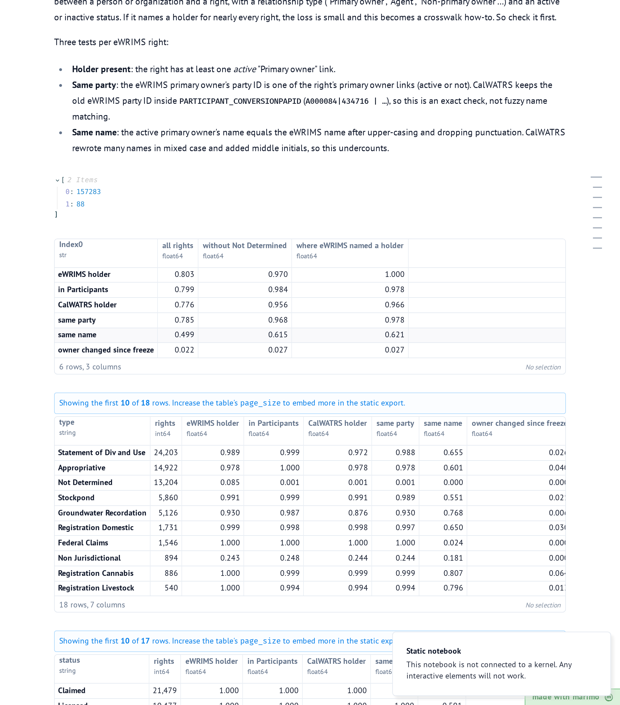

# Does California's new water rights data still say who holds each right?

California's State Water Resources Control Board is replacing its old water rights system, eWRIMS, with a new one, CalWATRS. The old one-row-per-right file, the **eWRIMS Water Rights LIST**, is marked DISCONTINUED and "will be removed in the near future". So far the board has published two CalWATRS tables in its place: **Participants** (who is linked to each right) and **Geospatial** (each right's points of diversion, use and storage). This spike archives the old file before it disappears, joins the two new tables on the right ID, and measures what carries over. It looks hardest at the holder.

**Short answer.** The holder survives. It moved to the Participants table, and you have to join it on the right ID. Most fields people use carry over too: points, county, watershed, source, priority date, face value, flow rate. 99 of the old file's 160 columns have no CalWATRS equivalent yet. Status and type now use different words, and the lookup learned in the WaDE spike only partly translates them. The old file's "last updated" date on the portal is 524 days newer than its data.



## Results

From a clean run on 2026-11-23. `outputs/summary.json` has every number. The eWRIMS file has 69,910 rights.

**Holder.** The card's strongest evidence against was that Participants might already restore the holder. It mostly does:

| | all rights | without "Not Determined" | where eWRIMS named a holder |
|---|---|---|---|
| eWRIMS names a primary owner | 80.3% | 97.0% | 100% |
| Right is in CalWATRS Participants | 79.9% | 98.4% | 97.8% |
| CalWATRS has an active primary owner | 77.6% | 95.6% | **96.6%** |
| Same eWRIMS party is a CalWATRS primary owner | 78.5% | 96.8% | **97.8%** |
| Owner name matches letter for letter | 49.9% | 61.5% | 62.1% |
| Active owner added after eWRIMS froze | 2.2% | 2.7% | 2.7% |

- 19% of the old file (13,204 rows) is type "Not Determined". Only 8.5% of those rows name an owner, 1.7% have a location and almost none have a use, so they look like placeholder records. They are nearly all missing from CalWATRS.
- The "same party" check is exact: CalWATRS keeps each old eWRIMS party ID inside `PARTICIPANT_CONVERSIONPAPID`. Name matching undercounts because CalWATRS rewrote names in mixed case and added middle initials.
- Holder coverage is 97–100% for every major right type: statements, appropriative rights, stockponds, registrations and federal claims. It is lower for groundwater recordations (88%) and "Non Jurisdictional" records (24%). `outputs/holder_by_type.csv` and `holder_by_status.csv` have the full breakdowns.

**Fields.** 80.0% of eWRIMS rights are in at least one CalWATRS table. The point of diversion eWRIMS listed is in Geospatial for 99.5% of rights, under the same eWRIMS ID, and 99.9% of those points are within 10 m of the old location.

- **61 of 160 eWRIMS columns have a CalWATRS equivalent.** 36 of those carry over: CalWATRS has a value for at least 90% of rights where eWRIMS did, and at least 90% of the values agree. 23 carry over only partly, and 1 can't be tested. `outputs/field_crosswalk.csv` lists each pair with its coverage and agreement.
- Among the ones that carry over: priority date, face value, license date, county, HUC-8/12, source name, PLSS section, township and range, diversion rate and unit, initial statement amount, and the eWRIMS party ID.
- Among the partly ones: application date (33% coverage), permit issue date (11% coverage, 34% agreement where present), petitions (10%), agent and owner entity type (78–79% agreement).
- **99 columns have no equivalent** (`outputs/fields_without_calwatrs_equivalent.csv`). They are mostly per-use detail (24: population, stock, use acreage, seasons), application amounts and fees (24), GIS bookkeeping for the point (14), licensing steps (10) and all 5 enforcement fields. Permit, license and certificate numbers, the parcel number, the project summary and the status-history date are also gone (`outputs/fields_by_dictionary_group.csv`).

**Status and type.** The same word appears in both systems for only 47% of statuses and 30% of types.

| Lookup | status | type |
|---|---|---|
| WaDE spike's lookup, rights it learned from (in-sample) | 93% | 96% |
| WaDE spike's lookup, eWRIMS rights WaDE never carried (out-of-sample) | **10%** | 96% |
| Same method learned on all of eWRIMS (in-sample ceiling, published) | 93% | 97% |

WaDE's type lookup transfers to new rights; its status lookup doesn't. The rights WaDE never carried are mostly inactive or revoked. A few rights WaDE knew changed status after it froze (Claimed → Inactive, Licensed → Revoked), so the lookup learned those changes as if they were renamings. `outputs/status_type_lookup.csv` is the lookup learned on all of eWRIMS. Its score is in-sample, so treat it as a ceiling.

**"Last updated."** The portal shows 2026-11-12 for the eWRIMS list. That date is the last edit to the dataset's description. The CSV was uploaded 2026-10-01, its file name says 2025-08-05, and the newest record change inside it is **2025-06-06**: 524 days earlier than the portal date. The CalWATRS tables are current: both were uploaded 2026-11-23, with records dated 2026-11-19 and 2026-11-20.

**Run time and cost.** About 20 s for the archive and 65 s for the notebook. $0: public data, no model, no paid service.

## How to run

Needs [uv](https://docs.astral.sh/uv/) and network access. The notebook also downloads WaDE's last California table from WSWC's shared Google Drive, using the WaDE spike's helpers.

```bash
./run.sh
```

- `archive.py` downloads the three datasets and their data dictionaries into `data/` (about 106 MB). It writes `outputs/archive_manifest.json`, which records source URLs, portal dates, the fetch time and SHA-256 checksums. It also writes `outputs/ewrims_water_rights_list.parquet` (GeoParquet, every column kept as published text, a point per right where it has coordinates).
- `crosswalk.py` is the marimo notebook. It reads the archive and writes the CSVs and `summary.json`.
- To read the notebook with its outputs: `uv run marimo edit crosswalk.py`.
- Set `CROSSWALK_DATA_DIR` or `CROSSWALK_OUT_DIR` to move the downloads or the outputs.

## Where the data comes from

- [DISCONTINUED – California Water Rights LIST](https://data.ca.gov/dataset/water-rights), with its data dictionary and type/status appendix. State Water Resources Control Board, **public domain**.
- [CalWATRS Water Rights Participants](https://data.ca.gov/dataset/calwatrs-participants) and [CalWATRS Water Rights Geospatial Data](https://data.ca.gov/dataset/calwatrs-geospatial). Same board, **CC BY**, updated weekly.
- WaDE's last California table (`waterallocations.csv`) from WSWC's Drive, loaded with `../wade-water-rights-rebuild/wade.py`. That module is imported, not edited.

**License change.** The old file is public domain. CalWATRS is CC BY, so anything republished from it needs attribution to the State Water Resources Control Board. Every CSV in `outputs/` carries this note in a `license` column.

**What we looked at first.** data.ca.gov lists only these two CalWATRS datasets (searched 2026-11-23). The crosswalk pairs come from reading the three data dictionaries; no published eWRIMS-to-CalWATRS mapping exists. The status and type lookup reuses the WaDE spike's method. Raw files, holder names and the per-right GeoParquet are regenerated on each run and not committed, because the Participants table names individuals.

## What this doesn't show

- It compares CalWATRS against eWRIMS as of June 2025, not against the truth. Some disagreements are real changes since then; we flag new owners, but not other updates.
- The board is publishing CalWATRS tables "one at a time". Fields missing today may arrive in a later table, so the 99-column count is a snapshot as of 2026-11-23.
- eWRIMS listed one point of diversion per right, so this checks that point only, not all of a right's points or its places of use.
- The field pairs are our judgment from the dictionaries. A field we called "no equivalent" could be hiding under another name.
- We didn't check the other DISCONTINUED eWRIMS files (associated parties, uses and seasons, enforcement…), which hold more of the lost detail.
- Name matching is exact after normalizing; we tried no fuzzy matching. The party-ID check makes it unnecessary for identity.
