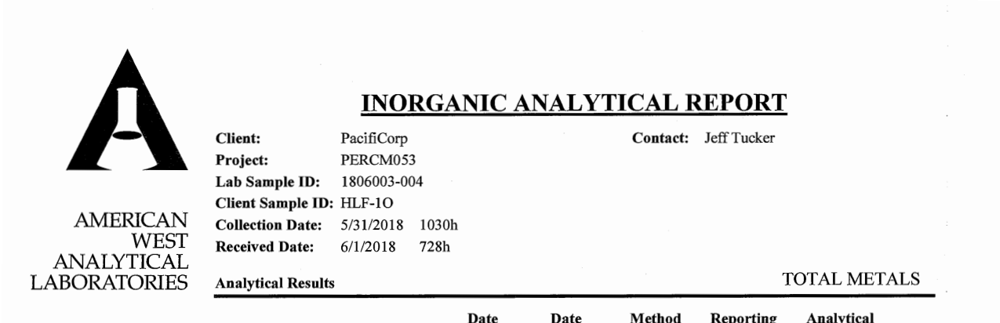

# Coal ash groundwater reports: extraction error, review rate and cost per page

Every US coal plant with an ash pond or landfill must post an annual groundwater monitoring report, a PDF that often runs to hundreds of pages. EIP typed the first year of them (443 reports from 265 plants, last updated 2019-04-30) into a database by hand. Nobody has typed the reports posted since. This spike runs the method from [`scanned-990ez-extraction/`](../scanned-990ez-extraction/) on those reports:

1. Draft the schema from sample pages, then freeze it.
2. Two independent vision models read every page.
3. A field goes to review when the models disagree or the field fails a check, including a check of each page's well and date against the report's own results table.
4. Every value keeps its page and box, and the error rate is measured.

Issue #188 asked whether this can extract every year of a set like EIP's for cents a page, at an error rate a nonprofit could show a funder. Issue #223 added a page-level well check and ran the same notebooks on a second utility (AEP).



*The one kind of error that got through in #188: the lab printed the well `HLF-1O` (letter O), and both models read `HLF-10`. The well check now sends these pages to review.*

## Read it

Three marimo notebooks, each meant to be read top to bottom. Open one with `uv run marimo edit 1_documents.py`, or read it as plain Python. `CCR_UTILITY=aep` runs a notebook on AEP's reports; the default is PacifiCorp.

1. [`1_documents.py`](1_documents.py): the question, the reports, finding lab result pages, and parsing the answer key (one parser per utility's table layout).
2. [`2_extraction.py`](2_extraction.py): drafting and freezing the schema, and the two models reading every page.
3. [`3_results.py`](3_results.py): the review rule, the well check before and after, the scores, cost, the dataset and the size of the whole job.

## Run it

```
./run.sh
```

You need [uv](https://docs.astral.sh/uv/). The model answers are committed under `answers/`, so a re-run rescores without calling a model and needs no key. Reading a page that isn't saved needs `OPENROUTER_API_KEY`, and spending stops when all saved answers together pass $5.10.

`run.sh` runs the three notebooks on PacifiCorp, then on AEP. They download eleven reports (about 175 MB) to `output/`, which is not committed (set `CCR_OUTPUT_DIR` to put it elsewhere), and write the datasets to `results/` and `results/aep/`. Model spending: **$2.10** for PacifiCorp in #188 and **$1.28** for AEP in #223 (12 minutes of reading), $3.38 in all.

## The data

All of it is public, and none of it is committed.

- **PacifiCorp (#188).** One page per coal plant lists every annual groundwater report: 136 reports. The sample is seven, chosen to cover scanned lab pages (Hunter and Huntington, 2018 and 2019) and born-digital ones (Dave Johnston 2022, Jim Bridger 2021, Naughton 2022). The answer key is the consultant's (WET) results table, which `pdfplumber` parses exactly: 26,127 values in 1,556 samples.
- **AEP (#223).** One page per plant at `aep.com/environment/ccr/` lists 168 reports at 18 plants. Most leave the lab reports out. The sample is the four 2020–2021 reports from Northeastern (Oklahoma) and Welsh (Texas) that include them: Northeastern landfill 2020 and bottom ash pond 2020 and 2021, and Welsh bottom ash pond 2020. Two labs: AEP's Shreveport lab (samples from 2016 to 2019) and AEP's Dolan lab (2020 samples, metals in µg/L). The answer key is the consultant's (Geosyntec) results table: 7,226 values in 442 samples.
- **Pages.** A page counts as *scanned* if one picture covers most of it. Both models read every scanned candidate page and a seeded sample of born-digital candidates (15 a report at PacifiCorp, 25 at AEP).
- **Models.** Gemini 3.8 Flash (Google) and Mistral Small 2603 (Mistral, open weights) through OpenRouter, typed with Pydantic AI, with the schema frozen in #188.
- **`adjudications.json`, `adjudications_aep.json`** (committed): every field where the answer key was in doubt, with the value seen on the page and a note.

## Results: PacifiCorp (#188, rescored with the well check)

From the run of `./run.sh` on 2026-11-13. On the 188 lab pages that matched a sample in the results table, **1,541 constituent values** were scored.

| | Gemini alone | Mistral alone | The pair, with review |
|---|---|---|---|
| Wrong or missing values | 1 (0.06%) | 2 (0.13%) | **0 of 1,538 accepted** (95% interval 0% to 0.25%) |
| Scanned pages (1,025 values) | 1 missing | 1 wrong | 0 accepted wrong (0% to 0.37%) |
| Born-digital pages (516 values) | 0 | 1 wrong | 0 accepted wrong (0% to 0.74%) |
| Well names wrong (188 pages) | 4 | 5 | **0 accepted wrong** (3 before the well check) |

**The well check (#223).** A page goes to review when either model's well isn't in the report's well list, which is every well name in its results table. Using the committed answers only, with no new model calls:

| | Before | After |
|---|---|---|
| Pages where both models read the same wrong well | 3 accepted | 3 sent to review, 0 accepted |
| Lab pages with something in review (of 234) | 11 | 53 |
| Fields sent to review (of 2,644) | 11 | 56 |

The check flags 49 pages and adds 42 to review. 36 of those are field duplicates and blanks (`DUP`, `FB`, `GROUPB-BLANK1`), which aren't monitoring wells and shouldn't be filed under one anyway. Three more are `HLF-10` pages where the lab itself printed a zero; the table says `HLF-1O`. It doubles the assumed review cost: **$0.138 per lab page** for review, **$0.147 all-in** (it was $0.078).

**The date check changed too.** In #188, a date had to be in or just before the report's year. AEP's reports carry lab reports from as far back as 2016, so the check is now "within the period the report's results table covers, give or take three days". At PacifiCorp this adds 3 pages to review, all from a September 2022 event the table doesn't cover yet. That's why "before" is 11 pages, not #188's 8.

**Other findings from #188 still hold.** Disagreement caught both single-model value errors; Gemini's confidence caught neither (it put 0.95 or more on every value). Of the 17 fields checked on the page, the table differed from the page in 14 (9 of them rounding), and both models were wrong in 3. Model calls cost **$0.0045 per page read**, or $0.0088 per lab page. 18 values have a box taller than it is wide, flagged in `bbox_suspect`.

**The whole job (an estimate).** At 312 pages and 64 lab result pages a report, report years 2018 to 2025 come to 3,500 to 6,100 reports nationally, or 230,000 to 395,000 lab result pages. At $0.147 a lab page that's **$33,000 to $58,000**, mostly assumed review time.

## Results: AEP, a second utility (#223)

Same notebooks, same frozen schema, same models.

| | Gemini alone | Mistral alone | The pair, with review |
|---|---|---|---|
| Wrong or missing values (627 scored on 41 pages) | 0 | 0 | **0 of 627 accepted** (95% interval 0% to 0.61%) |
| Well names wrong (41 pages) | 0 | 6 | 0 accepted wrong |

- **The answer key differed 77 times, the models never.** On Welsh's 2016 lab pages, both models read non-detects at the lab's reporting limit (`< 0.005`), while the table gives estimates or non-detects below it (`0.00156793`, `< 0.00007`). The lab pages are born-digital, so each of the 77 was checked against the page's own text layer, and the models matched every one.
- **Review rate: high, for a reason the schema causes.** 29 of 1,108 fields (2.6%) went to review (15 before the well check), but 49 of 84 pages have something in review. 19 of the 86 born-digital pages hold two to four samples (55 samples in all), and the frozen schema has one well per page. Gemini turns those pages away; Mistral reads the first sample. 16 went to review on that disagreement. On 3 both models agreed, so their extra samples were lost without review. That's the one failure this utility found.
- **The well check** flags 29 pages and adds 14 to review, all field duplicates, equipment blanks and wells the report's table doesn't list. It also flags Mistral's 6 wrong wells (it read lab numbers such as `192190-005` as the well), which disagreement already caught.
- **Cost.** $0.0035 per page read, but only 64 of the 365 pages read were single-sample lab pages, so **$0.020 per lab page** for the models. Most scanned candidates were custody forms. Assumed review comes to $2.23 per lab page, because each page sent to review whole counts as 20 fields.

**How much had to change.** The answer-key parser is new (about 70 lines): Geosyntec prints one table per well with the well in the title, the units in their own row, and the qualifier in the value's cell, and metals in µg/L have to be converted to mg/L. Everything else was a setting or a small rule change. The report list is fetched from a different site, born-digital pages are 25 a report instead of 15, the page finder also accepts "Sample Number" (Dolan's label), and results printed in µg/L are converted. The date check is the one described above.

## What didn't work, and what it doesn't show

- **No second utility with scanned lab pages.** AEP, Alabama Power and Georgia Power post reports a script can fetch. In the 38 of their 2018–2023 reports we looked at, the scanned pages are custody forms, field sheets and QC summaries, and the lab pages are born-digital. Duke Energy's and TVA's sites refuse scripted requests, and we didn't try to get around that. So AEP tests a new utility, consultant, lab and table, but not new scans.
- **Born-digital lab pages don't need a model.** Their text layer gives every value exactly; we used it to check the answer key. A text-layer parser per lab layout would read AEP's pages for free.
- **The schema assumes one sample per page.** It doesn't hold for AEP's labs, and AEP's reports from 2022 on (Dolan's newer layout) print several samples a page. They weren't sampled.
- **The well check needs a results table.** Here the table is in the same PDF. A utility without one would need the monitoring network section instead, which we didn't parse.
- **Mostly one lab per utility.** PacifiCorp's lab pages come from two labs and one consultant, AEP's from two AEP labs and one consultant. Handwritten pages and other consultants will do worse.
- **The checking was done by the agent that built this, not a person.** Every decision is in the adjudication files.
- **Small samples.** Zero accepted errors in 627 AEP values still allows up to 0.61%. The national estimate scales seven PacifiCorp reports.
- **Reviewers are assumed perfect and their time is assumed.**

## Files

- `1_documents.py`, `2_extraction.py`, `3_results.py`: the demo, as three marimo notebooks
- `answers/`: every model answer, with its cost and time, so the scores can be rerun for free
- `adjudications.json`, `adjudications_aep.json`: every field checked on the page
- `results/` (PacifiCorp) and `results/aep/`: `groundwater_results.csv` and `.parquet`, `review_queue.csv`, `accuracy.csv`, `results.json`, and [`DATA_DICTIONARY.md`](results/DATA_DICTIONARY.md)
- `screenshots/`: every page where both models read the same wrong well
- `run.sh`, `pyproject.toml`, `uv.lock`: the one command and its pinned environment

What we looked at first: vendor tools ship the same steps (Reducto, Extend, Azure Document Intelligence, Textract with A2I; see the reading research in #58), but none publishes its error rate on public records. The pipeline is the 990-EZ spike's, with `pdfplumber` added for the answer-key tables.
