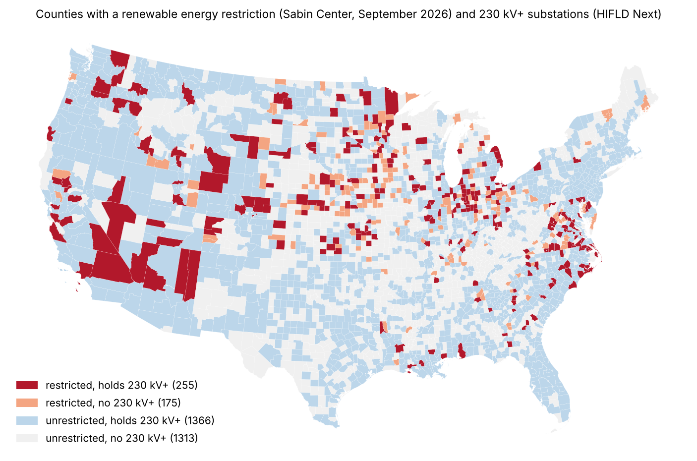

# Do counties that restrict renewables sit next to high-voltage substations?

Spike for [issue #51](https://github.com/fulton-ring/agent-content-demos/issues/51). We join the Sabin
Center's restriction data to substations derived from HIFLD Next and ask whether US counties with a wind or
solar restriction are more likely than other counties to hold or border a high-voltage substation.

**Short answer: yes, modestly.** 59% of restricted counties hold a 230 kV+ substation, against 50% of
unrestricted counties. The gap holds within states, and after adjusting for county land area. "Holds or
borders" is close to universal (94–96% in both groups at 230 kV), so it doesn't separate the two groups.

This measures exposure only. It says nothing about spare grid capacity, or about why counties restrict.

## Run it

```bash
./run.sh
```

You need [uv](https://docs.astral.sh/uv/). The first run downloads about 60 MB into `data/` (not committed)
and takes about a minute. Tables, the map and the full log go to `outputs/`. To read the notebook with its
output next to each step: `uv run marimo edit analysis.py`.

## Data (all public, downloaded at run time)

| Input | Source | Version used |
|---|---|---|
| Restrictions | Sabin Center for Climate Change Law, *Opposition to Renewable Energy Facilities in the United States*, restriction-data CSV linked from [oppositionreport.org/reports/current](https://oppositionreport.org/reports/current/) | September 2026 edition (restrictions as of 31 Dec 2025), 889 entries |
| Substations | [HIFLD Next](https://hifld.publicenvirodata.org/) Transmission Lines, GeoParquet | v1.0.0, 94,619 lines |
| Counties | Census [2024 cartographic boundaries, 1:500k](https://www2.census.gov/geo/tiger/GENZ2024/shp/) | 3,144 counties, 50 states and DC |

**HIFLD Next has no Electric Substations layer**, although the issue assumed it did: the catalog's 330
datasets don't include one. Instead we derive substations from the Transmission Lines layer, the same way
HIFLD's original substations layer was built. Each line ends at a named substation or tap (`SUB_1`,
`SUB_2`). We merge line ends within 100 m into nodes, name each node from the lines that meet there, drop
the 17,728 taps, and give each substation the highest voltage of the lines that end at it. That leaves
**45,779 substations** in the 50 states and DC.

**The restriction data comes coded to county FIPS**, so no name matching or model was needed. "Restricted"
(the main definition) means a county-level ordinance on wind or solar that's in effect: 460 entries
covering **432 counties**. We drop the 23 state laws because they apply statewide, and storage-only or
transmission-only entries. The 332 town, township and city ordinances are set aside in the main
definition because they cover only part of a county. A *broad* definition adds them (573 counties). A
*ban* definition keeps only bans and moratoriums (204 counties).

**Cross-check against USA Today was not done.** Its county pages at data.usatoday.com sit behind a
browser check, with no downloadable table.

## Results (from one clean `./run.sh`)

Substation voltages: 26,608 at 115 kV and up, 6,469 at 230 kV and up, 2,269 at 345 kV and up.
**6,427 substations (14.0%) have no voltage value**, so every "holds X kV+" share below is a floor.

**National comparison**, main definition (432 restricted vs 2,712 unrestricted counties):

| Measure | Restricted | Unrestricted | Odds ratio | Fisher p |
|---|---|---|---|---|
| holds 115 kV+ | 405 (93.8%) | 2,452 (90.4%) | 1.59 | 0.024 |
| holds 230 kV+ | 256 (59.3%) | 1,368 (50.4%) | 1.43 | 0.0007 |
| holds 345 kV+ | 159 (36.8%) | 814 (30.0%) | 1.36 | 0.005 |
| holds or borders 115 kV+ | 432 (100%) | 2,699 (99.5%) | — | 0.24 |
| holds or borders 230 kV+ | 414 (95.8%) | 2,543 (93.8%) | 1.53 | 0.10 |
| holds or borders 345 kV+ | 370 (85.6%) | 2,177 (80.3%) | 1.47 | 0.008 |

**Within states** (Cochran–Mantel–Haenszel test across the 40 states that have both restricted and
unrestricted counties), and **adjusted for state and land area** (logistic regression with state fixed
effects). Restricted counties are slightly *smaller*: median 1,471 km² against 1,628 km².

| Measure | Within-state odds ratio (95% CI), p | State + area adjusted odds ratio (95% CI), p |
|---|---|---|
| holds 115 kV+ | 2.22 (1.45–3.41), 0.0002 | 2.15 (1.38–3.37), 0.0008 |
| holds 230 kV+ | 1.55 (1.23–1.95), 0.0002 | 1.49 (1.18–1.90), 0.0009 |
| holds 345 kV+ | 1.45 (1.14–1.85), 0.002 | 1.37 (1.08–1.76), 0.011 |
| holds or borders 230 kV+ | 1.40 (0.80–2.46), 0.24 | — |
| holds or borders 345 kV+ | 1.43 (1.03–1.98), 0.036 | — |

**Other definitions**, holds 230 kV+: *ban* 59.3% vs 51.1% (within-state OR 1.35, p = 0.057); *broad*
62.1% vs 49.3% (within-state OR 1.80, p < 0.0001). The gap is there under every definition. It's weakest
for bans alone, the smallest group.

**Spot check passes:** Bannock County, Idaho (FIPS 16005) is restricted, and Populus is a 345 kV
substation inside it where 8 lines end.



Full tables: `outputs/national_comparison.csv`, `within_state_comparison.csv`, `area_adjusted.csv`,
`definition_sensitivity.csv`, `by_state_230kv.csv` (state by state; the gap isn't uniform, and Iowa and
Ohio run the other way).

## What an article can claim

"We matched 6,469 HIFLD Next substations of 230 kV and up to the 432 US counties with a county-level wind or
solar restriction in the Sabin Center's September 2026 data. 59% of restricted counties hold one, against
50% of unrestricted counties. Within the same state, a restricted county has about 1.5 times the odds of
holding one."

## What didn't work or was changed

- No HIFLD Next substations layer: substations are derived from line endpoints (above). A substation
  with no HIFLD line ending at it is missed. Nodes whose name couldn't be resolved (2,148) are kept as
  substations, so a few taps may be counted among them. About half of the 45,779 carry HIFLD placeholder
  names (23,668 "UNKNOWN…", 6,569 "NOT AVAILABLE"). Counting only named substations, the 230 kV+ gap
  holds (49.3% vs 40.4%, OR 1.44). That check was run in the Research manager's review, not in the notebook.
- "Holds or borders" barely varies: almost every county borders a 115 kV+ substation, and 94% border a
  230 kV+ one. "Holds" is the measure that separates the groups.
- Connecticut: Sabin codes its towns to the pre-2022 counties, which Census replaced with planning
  regions. Its 14 entries, all town-level, can't be joined, which affects only the broad definition.
- USA Today cross-check: not downloadable (above).

## What this doesn't show

- **Spare capacity.** A nearby substation isn't room on the grid. Interconnection queues decide that, and
  they aren't in this join.
- **Cause.** Nothing here says substations, or tax revenue, drive restrictions or their reversal.
- **County energy tax revenue.** Not joined. We found no national county-level table, and the issue
  allowed it only as a partial add-on.
- **Township-level detail.** The main definition is county-level only. The broad definition shows that
  adding townships widens the gap.

## What we looked at first

HIFLD Next's catalog API and feature server (no substations layer), the Sabin Center's report PDF (not
needed once we found the CSV export), and USA Today's data pages (behind a browser check). The analysis
uses geopandas, shapely, scipy (Fisher test, KD-tree endpoint clustering) and statsmodels (CMH test and
logit). It's one marimo notebook, `analysis.py`.
