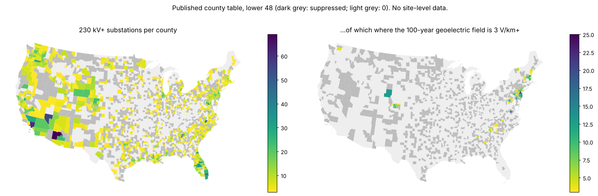

# A county grid-exposure index: high-voltage substations by county and hazard

Spike for [issue #199](https://github.com/fulton-ring/agent-content-demos/issues/199)
([proposal card](https://app.notion.com/p/403cc69045cb818388aec6ee20f28b66)). We build a free county-level table
on top of the substations rebuilt from public data, but we don't publish the substations themselves. For every US
county it gives the number of substations of 230 kV and up (and 345 kV and up), and how many of them sit where the
once-per-century geomagnetic field is high or in a county FEMA rates high for flood, wildfire, heat or hurricane.
It has counts and shares only, and a tested suppression rule makes sure no row can pin down a single site.

**Short answer: it works, but suppression costs a lot.** 6,469 substations of 230 kV+ in 1,624 counties. 14% of the
rated ones sit where the 100-year geoelectric field is 3 V/km or more. 37% are in a county rated high for flood and
16% in one rated high for wildfire. To keep every county row safe we had to change 1,087 of those 1,624 rows, and
842 counties hold only one or two such substations, so all they show is "1 or 2".

## Run it

```bash
./run.sh     # needs uv; the first run downloads about 70 MB into data/
```

It runs the notebook [`grid_exposure.py`](grid_exposure.py) as a script and writes `outputs/`. To read the
notebook with each step's output next to it, run `uv run marimo edit grid_exposure.py`. **Run time:** 74 to 102 s from a
clean checkout with an empty `data/` (two runs, 2026-11-06 and 2026-11-07), including downloads and uv setup. It
costs nothing.

## Data (all public, downloaded at run time, nothing downloaded is committed)

| Input | Source |
|---|---|
| Substations | Derived from [HIFLD Next](https://hifld.publicenvirodata.org/) Transmission Lines v1.0.0 line ends. The cells are copied from `us-substations-verified/verify.py`, and an assert checks we get its 45,779 |
| OSM substations (gap only) | Overture Maps `base/infrastructure`, release 2026-09-23.0. Used only to measure what the derived set misses |
| Geomagnetic | USGS, Lucas et al. 2020: the 100-year geoelectric field at 1,079 survey sites (the paper's CSV) |
| Future Risk Index | FEMA's FRI master datasheet (12/05/2024), saved in `fulton-ring/nri-future-risk` |
| Inland flood | FEMA NRI v1.20 (December 2025) counties, from FEMA's ArcGIS service |
| Counties | Census 2024 cartographic boundaries, 1:500k |

**Definitions.** *Geomagnetic high* means the substation's nearest survey site within 100 km has a field of
3 V/km or more (the same method as `hifld-grid-gaps/`). If no site is that close, the substation is unrated. *Hazard
high* means the county's FRI projected risk rating (mid-century, higher warming) is Relatively High or Very High,
for coastal flood, wildfire, extreme heat or hurricane. The FRI has no inland flood, so *flood* means the FRI
coastal flood rating or today's NRI inland flood rating is high. Every column is in
[`DATA_DICTIONARY.md`](DATA_DICTIONARY.md).

## Results (from one clean `./run.sh`)

**Coverage gaps, measured on this run** (`outputs/coverage_gaps.csv`):

- 97.2% of the derived 230 kV+ substations (6,289 of 6,469) have an OSM substation within 1 km.
- The derived set misses **16.2%** of OSM's 230 kV+ substations (1,096 of 6,780): none of ours is within 1 km.
- **25.1%** of 230 kV+ substations (30.4% of 345 kV+) have no geomagnetic survey site within 100 km.
- Connecticut's nine planning regions have no FRI row (28 substations). FEMA's file still uses the old counties.

**National** (`outputs/national_summary.csv`):

| | 230 kV+ | 345 kV+ |
|---|---:|---:|
| Substations | 6,469 | 2,269 |
| Counties holding one | 1,624 | 973 |
| Geomagnetic high (share of rated) | 675 (13.9%) | 155 (9.8%) |
| In a county rated high: flood (FRI coastal or NRI inland) | 2,395 (37.0%) | 608 (26.8%) |
| ... FRI coastal flood | 848 (13.1%) | 124 (5.5%) |
| ... NRI inland flood | 2,098 (32.4%) | 564 (24.9%) |
| ... FRI wildfire | 1,020 (15.8%) | 166 (7.3%) |
| ... FRI extreme heat | 1,627 (25.2%) | 579 (25.5%) |
| ... FRI hurricane | 1,279 (19.8%) | 182 (8.0%) |

**Which US counties have the most high-voltage substations in flood or wildfire zones?** These are 230 kV+ counts
from the published table (`outputs/top_counties_*.csv`):

- **Flood:** Maricopa AZ 69, Los Angeles CA 60, Clark NV 55, Fulton GA 49, Wake NC 42, Broward FL 41, Fairfax VA
  36, Polk FL 34, Orange FL 34, Miami-Dade FL 30.
- **Wildfire:** Maricopa AZ 69, Los Angeles CA 60, Clark NV 55, Broward FL 41, Orange FL 34, Polk FL 34,
  Miami-Dade FL 30, Kern CA 29, Klickitat WA 29, Palm Beach FL 25.

The ratings cover whole counties, so each of these counties' share is 100%. The lists mostly show which big
counties hold many substations and carry a high FEMA rating. They don't show which substations are in a
floodplain (see below).

**How exposed is the US grid to geomagnetic storms by county?** About one rated substation in seven sits where
the 100-year field is 3 V/km or more, and they cluster in the Northeast corridor and Virginia. By count:
Middlesex NJ 25, Chesterfield VA 20, New Castle DE 14, and Essex, Union and Ocean NJ, Henrico VA and Carbon WY 13
each. Of the 129 counties with 10 or more substations and a published split, 25 have any in the high class, and
15 have all of them in it. One survey site's cell often covers a whole county.

**Suppression** (`outputs/suppression_report.csv`):

| What the rule changed | Counties |
|---|---:|
| 1 or 2 substations of 230 kV+: only "1 or 2" published | 842 |
| 345 kV+ count blanked | 210 |
| 230 kV+ geomagnetic split blanked | 45 |
| 345 kV+ geomagnetic split blanked | 223 |
| **Any change** (of 1,624 counties holding a 230 kV+ substation) | **1,087** |

The rule: every group of substations a reader can count from a row, directly or by subtracting one published
number from another, has 0 or at least 3 members. Blanks always cover a whole split. The test cell checks every
grouping a reader could derive from each row (63 per row, 3,144 rows) against the true counts and finds **0**
groups of 1 or 2. In every count column, either no county is blank or two or more are, so the national totals
can't recover a blanked one. The full rule is in `DATA_DICTIONARY.md` and the notebook.



## What this doesn't show

- **"In a high-flood county" isn't "in a floodplain".** The FRI and NRI rate whole counties. NRI risk ratings
  combine expected losses to all the people, buildings and farmland in a county with social vulnerability, so
  large, populous counties rate high (Maricopa is high for inland flood and for wildfire). The flood and wildfire
  answers are county-level hazard context, not substation exposure. A site-level answer means checking FEMA flood
  zones or wildfire hazard potential at each point, which this folder deliberately doesn't do. That would be a
  separate, private analysis.
- **Suppression protects against counting, not against other sources.** It stops this table from locating a
  site. It can't stop someone from joining the table to a public point layer, and one is already public in this
  repo: `us-substations-verified/dataset/` and its map carry every derived substation's coordinates. A founder
  should decide whether that conflicts with the security reasoning behind this card.
- **The substations are derived, not an asset list.** Some derived points are taps or plant switchyards (see
  `us-substations-verified/hand_check.csv`), and voltages are floors.
- **Unrated isn't low.** Geomagnetic ratings stop where the USGS survey stops.

## What didn't work or was changed

- **Few counties are left to read.** Banding counts of 1 or 2, as the card suggested, leaves half the counties
  that hold a 230 kV+ substation saying only "1 or 2". A coarser unit (state, or groups of counties) would keep
  more detail without locating a site.
- **The first top-by-share geomagnetic list was all ties at 100%.** We kept it, sorted by count, and report how
  many counties are at 100%.

## What we looked at first

The derivation, the Overture query and the geomagnetic method are copied from `us-substations-verified/` and
`hifld-grid-gaps/`. We didn't import them, because those are marimo notebooks, not modules, and AGENTS.md says
not to touch their folders. We read the FRI ratings from FEMA's master datasheet, not from `fri-datasets-map/`,
because that folder publishes multipliers, not ratings. For suppression we checked every derivable grouping with
NumPy's matrix rank instead of using a statistical disclosure-control package (sdcMicro, tau-ARGUS). Those
packages target microdata and large tabulations, and this table has one six-cell table per county.
