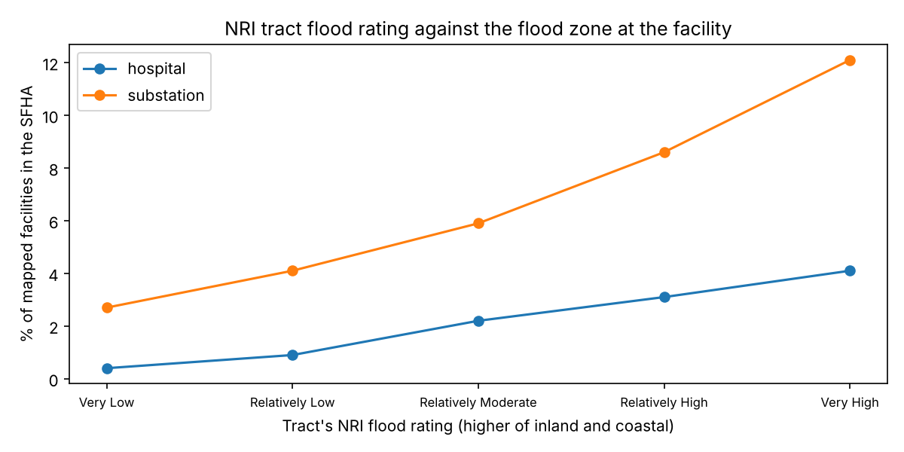

# Which hospitals and substations sit in FEMA flood zones?

HIFLD Open is gone. How does an analyst now find which hospitals, substations and other critical
facilities sit in FEMA flood zones, or rank them by the National Risk Index (NRI)? This spike does
it nationally from public data in one marimo notebook. It joins every open HIFLD Next hospital and
every substation in our `us-substations-verified/` dataset to FEMA's National Flood Hazard Layer
(NFHL) and to NRI census tracts, and reports the counts. Issue
[#193](https://github.com/fulton-ring/agent-content-demos/issues/193),
[proposal card](https://app.notion.com/p/3fccc69045cb811eb27dcfe567e2e87e).

**Short answer: it works nationally, in about 30 minutes, for free.** The answer has three parts:
a flood zone where FEMA has mapped one, an "unknown" for about one facility in ten, and a tract
risk score that says little about the building.

- **79,591 facilities checked**: 7,966 open hospitals and 71,625 substations. FEMA's service
  answered every point; no query failed.
- **In the 1% floodplain (SFHA): 156 hospitals (2.0%) and 4,113 substations (5.7%).** Almost all
  are in the A zones. Only 27 substations and no hospitals are in the coastal V zones.
- **In the 0.2% (500-year) zone: 319 hospitals (4.0%) and 2,615 substations (3.7%).**
- **No digital NFHL at the point: 625 hospitals (7.8%) and 8,387 substations (11.7%)**, spread over
  33 states and Palau. Texas has the most (2,259 facilities, 31% of its total) and Idaho the largest share
  (61%). Add zone D and mapped areas with no zone, and the flood zone is unknown for 9.1% of
  hospitals and 14.3% of substations.
- **NRI tract ratings rank tracts, not buildings.** Of hospitals in a "Very High" flood-risk tract,
  4.1% are in the SFHA. Of the ten hospitals with the highest riverine flood score, none is in the
  SFHA.
- **Spot check: 23 of 25 hospital points sit on the hospital. For substations it's 15 of 25.** Three
  more substation points land on a dam powerhouse, one is near the switchyard, five have no
  substation in view and one is unclear.

## Run it

```bash
./run.sh            # the notebook as a script; writes results/
./run.sh --chips    # also draws the 50 spot-check images (not committed: the imagery is Esri's)
```

Needs [uv](https://docs.astral.sh/uv/). From an empty cache it takes **31 minutes** (2026-11-09),
nearly all of it 79,591 calls to FEMA's NFHL service at about 40 a second. Answers are cached in
`~/.cache/critical-facilities-flood-zones` (or set `CFF_CACHE`), so a rerun takes under a minute.
A rerun after a dropped connection only asks for what's missing. To read the notebook with its
outputs: `uv run marimo edit notebook.py`. Cost: $0.

## Data (all public, downloaded at run time)

| Input | Version and vintage |
|---|---|
| Hospitals: HIFLD Next `hospitals-3` | v1.1.1 (same records as v1.1.0). 93% of source dates are from 2024; locations last checked a median of 2014, mostly on imagery |
| Substations: `us-substations-verified/dataset/us_substations.parquet`, read from this repo at commit `b48028f` | HIFLD Next Transmission Lines v1.0.0 line ends, plus OpenStreetMap substations via Overture Maps release 2026-09-23.0 |
| Flood zones: FEMA NFHL MapServer, `identify` on layers 0 (Availability), 3 (FIRM Panels) and 28 (Flood Hazard Zones) | Live service, queried 2026-11-09. FIRM panel effective dates have a median of 2012: 0.3% are before 2000 and 20% are from 2020 or later |
| Risk: FEMA NRI census tracts (ArcGIS Online) | v1.20, December 2025 |
| Tract shapes: Census cartographic boundaries | 2020, 1:500k |

**Why not HIFLD substations.** DHS withdrew HIFLD's Electric Substations layer from public access
in 2022, so HIFLD Next doesn't have one. Our `hifld-grid-gaps/` spike found this, and the 331
dataset folders in HIFLD Next's bucket still have none. We use `us-substations-verified/`: 45,779
substations derived from HIFLD Next transmission-line ends, of which 97% of those at 230 kV and up
have an OSM substation within 1 km, plus 25,846 OSM substations the derivation missed. Because it
contains OSM data, `results/facilities.csv.gz` is under the ODbL: © OpenStreetMap contributors,
via Overture Maps.

## Method

1. **Facilities**: open hospitals, and substations grouped by highest known voltage.
2. **Flood zone**: one NFHL `identify` call per point returns three things: whether the point is
   inside an effective digital study (layer 0), the FIRM panel's effective date (layer 3), and the
   flood zone (layer 28). Where zones meet, the highest hazard wins. SFHA covers the V family, then
   the A family (A, AE, AH, AO, AR, A99), then the 0.2% zone, other shaded X, minimal X, D and open
   water. Last come "study area, no zone" and "no NFHL", meaning the point is outside every
   digital study.
3. **NRI**: a point-in-polygon join to the 2020 tract, then NRI's overall, inland (riverine) flood
   and coastal flood risk scores and ratings.
4. **Spot check**: a random 25 hospitals and 25 substations of 100 kV and up, drawn from those in
   the SFHA (seed 193). We looked at each on Esri World Imagery with the NFHL zones over it
   (`chips.py`) and labeled it in `hand_check.csv`, one line per point.

**Reused and new.** We took the cached downloads, the NRI tract paging and the tract join from
`facility-climate-ranking/`. The idea of a flood class with "highest hazard wins" comes from
`data-center-metro-hazard/`. New here are the substations, the A, V and 0.2% split, coverage gaps
from the NFHL Availability layer, panel effective dates as the flood zone's vintage, one
`identify` call instead of a `query` per layer, and the location spot check. Our hospital SFHA
count (156) matches `facility-climate-ranking/`'s, which used a different call.

## Results (from one `./run.sh`, 2026-11-09)

| Group | Facilities | SFHA | SFHA % | 0.2% zone | Zone D | No NFHL | No NFHL % |
|---|---:|---:|---:|---:|---:|---:|---:|
| Hospitals | 7,966 | 156 | 2.0 | 319 | 66 | 625 | 7.8 |
| Substations 230 kV+ | 8,291 | 444 | 5.4 | 411 | 245 | 968 | 11.7 |
| Substations 100–229 kV | 27,645 | 1,626 | 5.9 | 873 | 428 | 3,127 | 11.3 |
| Substations under 100 kV | 25,935 | 1,495 | 5.8 | 1,052 | 480 | 2,955 | 11.4 |
| Substations, voltage unknown | 9,754 | 548 | 5.6 | 279 | 288 | 1,337 | 13.7 |
| **Substations, all** | 71,625 | 4,113 | 5.7 | 2,615 | 1,441 | 8,387 | 11.7 |

The most SFHA hospitals are in Florida (38), Louisiana (25) and Texas (19). The most SFHA
substations are in California (369), Texas (356) and Florida (337). Among critical access hospitals,
11 of 1,257 are in the SFHA. Tables by state and hospital type are in `results/` and the notebook.

**Top facilities by NRI flood risk score** (top ten per list in `results/top_facilities.csv`;
substations 100 kV and up):

- Riverine, hospitals: McDowell ARH (McDowell, KY; score 100.0), Kindred Rancho Cucamonga (CA),
  then Eisenhower Medical Center and the Betty Ford Center, which share a tract in Rancho Mirage, CA.
- Riverine, substations: four in one Miami-Dade tract (Avocado, Florida City, Maco, Mango; 99.996),
  then six in one Kent, WA tract.
- Coastal, hospitals: Coast Guard Sector Columbia River (Warrenton, OR; 99.91; listed as a
  hospital), a behavioral
  health center in Cambridge, MD, Nantucket Cottage Hospital, then MUSC, the Charleston VA and Roper,
  which share a tract in Charleston, SC.
- Coastal, substations: Grays Harbor, WA, then Clatsop, Lewis and Clark and Warrenton in one
  Warrenton, OR tract.



**Spot check** (`hand_check.csv`, `results/spot_check_summary.csv`). Hospitals: 23 points on the
building, 1 on a neighbouring building, 1 unclear. For 6 of the 25, only part of the campus is in
the SFHA. Substations: 15 on the substation, 1 on a dam powerhouse about 100 m from the switchyard,
3 on a dam powerhouse farther away (Brownlee, Laurel, Goat Rock), 5 with no substation in view and
1 unclear. Of those 5, 2 are unconfirmed derived points. The other 3 have an OSM substation within
1 km but not at the point.

## What didn't work, and what this doesn't show

- **Downloading the NFHL.** The state geodatabases run to several GB each, so we query the live
  service instead. Our first try used one request per point without connection reuse and ran at 2
  points a second. Reusing connections, one session per thread, took it to about 40 a second.
- **"No NFHL" is unknown, not safe.** These are communities with paper maps or none. Zone D is
  also unknown.
- **The vintage is the panel's effective date**, not the date of the flood study, which can be
  older. 2,115 of the 9,012 points outside every digital study still fall on an indexed panel.
- **A point is not a footprint.** Six of 25 sampled SFHA hospitals are only partly in the SFHA.
- **Substation points** can be taps, plants or misplaced. The spot check found 5 to 9 of 25 not on a
  substation, depending on how you count dam powerhouses. Counts for substations are an upper
  bound on the exact facility, but the share in the SFHA barely moves across voltage classes or
  sources.
- **Other critical facilities** (fire stations, wastewater plants, schools) need only a different
  input layer. We didn't run them.
- **The NFHL leaves out rainfall (pluvial) flooding**, and FEMA says the NRI doesn't replace local
  assessment.

## Files

`notebook.py` (the analysis), `chips.py` (spot-check images), `hand_check.csv` (our labels), and
`results/`: `facilities.csv.gz` (every facility with its flood class, zone, panel, tract and NRI
scores), `counts.csv`, `nfhl_gaps_by_state.csv`, `top_facilities.csv`, `sfha_by_tract_rating.csv`,
`vintage.csv`, `spot_check*.csv` and `headline.json`.
