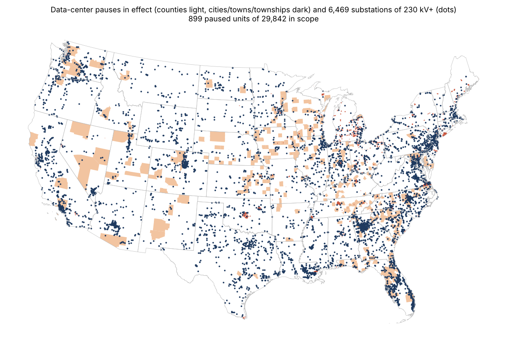

# Do the places that have paused data centers hold a high-voltage substation?

Spike for [issue #317](https://github.com/fulton-ring/agent-content-demos/issues/317), a spin-off from
[`county-bans-substations/`](../county-bans-substations/). We join the Moratorium Data 2026 inventory of local
data-center pauses to Census boundaries and to the [verified 230 kV+ substations](../us-substations-verified/),
and ask whether paused places hold a high-voltage substation more often than comparable places.

**Short answer: yes for cities, towns and townships, no for counties.** 19.6% of the 583 paused cities, towns
and townships hold a 230 kV+ substation, against 9.7% of unpaused places of the same population band in the
same states (within-state, same-size odds ratio 2.48, p < 0.0001). Paused counties hold one 57.6% of the time,
against 59.0% for comparable counties: no difference (odds ratio 0.89, p = 0.56). 997 of the 6,469 substations
(15.4%) sit inside a paused jurisdiction.

This measures exposure only. Pauses follow developer activity, and a substation isn't spare capacity.

## Run it

```bash
./run.sh
```

You need [uv](https://docs.astral.sh/uv/) and a checkout of the whole repo (the substations are read from
`../us-substations-verified/dataset/`). The first run downloads about 80 MB into `data/` (not committed) and
takes about 2 minutes. Tables, the map and the log go to `outputs/`. To read the notebook with its output next
to each step: `uv run marimo edit pause_substations.py`. `AS_OF` (default `2026-11-21`) sets the date pauses
are judged against; `BOMMARITO_RELEASE` (default `v2026.11.11.post13`) pins the inventory.

## Data

| Input | Source | Version |
|---|---|---|
| Pauses | [Moratorium Data 2026](https://mjbommar.github.io/moratorium-data-2026/) local inventory, Michael J. Bommarito, CC BY 4.0 | release v2026.11.11.post13 (latest enactment 2026-11-04) |
| Check only | [Calyx Intelligence register](https://register.calyxos.ai/pauses/), pauses in effect (no open license: read at run time, counts only, no rows written) | live page, 403 places on 2026-11-21 |
| Substations | `../us-substations-verified/dataset/us_substations_hifld_only.csv` (derived from HIFLD Next lines; public domain) | as on `main` |
| Boundaries | Census [2024 cartographic boundaries, 1:500k](https://www2.census.gov/geo/tiger/GENZ2024/shp/): counties, places, county subdivisions | 2024 |
| Population | Census [Vintage 2024 subcounty estimates](https://www2.census.gov/programs-surveys/popest/datasets/2020-2024/cities/totals/) | July 2024 |

**Pauses in effect.** 946 records are active or extended with a data-center sector. 41 have a recorded end
date before 2026-11-21, so we drop them: **905 pauses in effect** in November 2026. Only 268 carry an end date.

**Join to Census units.** Cities and villages join to an incorporated place, townships and New England/NY/WI
towns to a county subdivision, counties to a county. Bommarito's point is a reference point, so a join is
*clean* when the point falls inside a unit of the same name, and *nearby* when a same-name unit in the same
state is within 25 km:

| | Records | Clean | Nearby | Unjoined |
|---|---:|---:|---:|---:|
| Counties | 310 | 310 | 0 | 0 |
| Cities, towns, villages, townships, boroughs | 592 | 585 | 5 | 2 |
| Tribal nations, utility authority | 3 | 0 | 0 | 3 |
| **All** | **905** | **895 (98.9%)** | **5** | **5** |

The five unjoined are in `outputs/unjoined_records.csv`: two tribal nations and a utility authority (no Census
unit), Louisville Metro (a consolidated government with no matching place name), and Shawnee Township (Allen
County, OH), whose point is about 200 km away in another county. The 900 joined records cover **899 units**.

**Calyx cross-check.** Of Calyx's 399 distinct place names (403 places in 39 states), **329 (82%)** match a
Bommarito pause in effect by state and name, so Calyx confirms 329 of Bommarito's 882 distinct places. A
one-off check outside the notebook sorted the 59 Calyx rows with no match: 7 are in Bommarito under another
status, 2 under another sector, 2 under another name form (Indianapolis, Lexington-Fayette), and the other
48 aren't in this release under their name; the ones we spot-checked (Oakland, San Diego, Boise, Salt Lake
City) aren't in it at all. So Bommarito misses some places Calyx has read.

## Results (from one clean `./run.sh`)

The comparison group is every unpaused unit of the same level in a state with a paused unit of that level.
*Comparable* is the share paused units would show at the rate of unpaused units in their own state and
population quartile. The within-state test is Cochran–Mantel–Haenszel across state × population-quartile
strata (`outputs/comparison.csv`).

**Holds a 230 kV+ substation:**

| Level | Paused | Comparable | All unpaused | Fisher OR, p | Within-state, same-size OR (95% CI), p |
|---|---|---:|---:|---|---|
| County | 182 of 316 (57.6%) | 59.0% | 51.1% of 2,337 | 1.30, 0.036 | 0.89 (0.64–1.24), 0.56 |
| Place (city, village, town) | 87 of 380 (22.9%) | 10.2% | 4.0% of 17,937 | 7.11, < 0.0001 | 3.03 (2.27–4.03), < 0.0001 |
| Town or township | 27 of 203 (13.3%) | 8.8% | 6.9% of 8,669 | 2.06, 0.001 | 1.61 (1.03–2.50), 0.043 |
| **Local (place + town/township)** | **114 of 583 (19.6%)** | **9.7%** | 5.0% of 26,606 | 4.66, < 0.0001 | **2.48 (1.96–3.15), < 0.0001** |

**Within 5 miles of one:** local 60.5% vs 49.6% comparable (OR 1.71, 1.42–2.07); counties 73.4% vs 73.7%
(OR 0.93, p = 0.75). On OSM-confirmed substations only, shares move by 0.1 point or less and odds ratios by
0.02 or less.

Paused counties look exposed in the raw comparison (57.6% vs 51.1%) only because they are bigger: against
counties of the same population in the same state, the gap disappears. The local gap shrinks from 4.0× raw
odds to 2.5× after matching on size, but holds.

**Pauses ending soon:** 170 of the 905 pauses have a known end date by 2027-05-21 (six months from
the run date).

**Substations inside paused units:** 997 of 6,469 (15.4%): 776 in a paused county, 246 in a paused city, town
or township. For 374 of them every covering pause has a known end date, and **221 sit only under pauses that end
by 2027-05-21**. The other 623 sit under at least one pause with no recorded end date, so that count is a
floor. **Calyx**, which has end dates for 366 of its places, has 181 ending by 2027-05-21.



**Free table:** `outputs/paused_places_substations.csv`, one row per joined pause (900): Bommarito's id,
jurisdiction, dates and status, the Census unit and population, and the 230 kV+ substations inside it and
within 5 miles. Bommarito- and HIFLD-derived only; publish under CC BY 4.0, crediting Moratorium Data 2026.

## What an article can claim

"We matched 905 local data-center pauses in effect in November 2026 to 6,469 substations of 230 kV and up.
19.6% of paused cities, towns and townships hold one, against 9.7% of places of similar size in the same
states. Paused counties are no more likely than comparable counties to hold one. 997 substations sit inside a
paused jurisdiction, and at least 221 of them under pauses that end by May 2027."

## What didn't work, and limits

- **The county half of the argument fails.** Paused counties are no more likely than same-size counties to
  hold a 230 kV+ substation. The issue's "it's wrong" condition holds for counties and is reported as such.
- **Reference points, not boundaries**, and Bommarito's records aren't confirmed to be in force. Calyx confirms
  329 of 882 places; it is a deliberate subset, so the rest aren't shown wrong.
- **End dates are sparse:** 268 of 905 pauses have one, so "ends within six months" is a floor.
- **Substations are floors:** about half the derived substations carry placeholder names and 14% have no
  voltage, so some 230 kV+ substations are missed.
- **Exposure, not capacity or cause.** Restrictions follow developer activity (Ko, Dolšak & Prakash 2023;
  Lerner 2021), and proximity is not available capacity; interconnection queues decide that.
- **Comparison universe:** incorporated places and functioning towns/townships from the Census estimates. Census-
  designated places are left out (they can't pass an ordinance). Places and townships overlap in some states,
  so the levels are tested separately and pooled only with level in the strata.

## What we looked at first

Bommarito's codebook and data page (the CSV is in the GitHub repo, pinned by release tag), the Calyx page (HTML
tables per state; no download), and the Census API (it needed a key here, so we use the estimates CSV). The
analysis uses geopandas, scipy (Fisher) and statsmodels (CMH). It's one marimo notebook, `pause_substations.py`.
