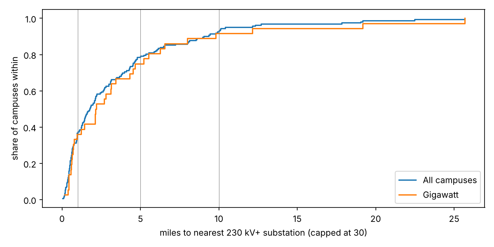

# How far is each planned US data-center campus from a high-voltage substation?

Issue [#214](https://github.com/fulton-ring/agent-content-demos/issues/214). We take two public lists of US
data-center campuses, keep the ones located to a site, and measure how far each is from the nearest 230 kV+ and
345 kV+ substation in our [us-substations-verified](../us-substations-verified/) dataset. We also measure how far
each is from the nearest 230 kV+ line in HIFLD's 2023 layer and in current OpenStreetMap. Then we hand-check the
far ones on imagery and in utility filings.

## Result

**About one campus in five has no 230 kV+ substation within 5 miles, and so does one gigawatt campus in four.
Almost every campus has some transmission substation (100 kV+) within 5 miles.** Most of the buildout follows the
high-voltage grid. A real minority needs new high-voltage substations, and filings show utilities building them.

| | Campuses | No 230 kV+ substation within 1 / 5 / 10 mi | No 345 kV+ within 1 / 5 / 10 mi | No 100 kV+ within 5 mi |
|---|---:|---:|---:|---:|
| Malachi.Energy, site- or address-located | 48 | 32 / 11 / 4 | 35 / 18 / 13 | 2 |
| Data Center Atlas, site-located | 130 | 80 / 28 / 10 | 99 / 57 / 35 | 2 |
| All campuses (deduplicated) | 163 | 103 / **34** / 12 | 125 / 69 / 44 | 3 |
| Gigawatt campuses (≥1,000 MW in either list) | 36 | 23 / **9** / 3 | 25 / 12 / 9 | 1 |

- **Planned MW more than 5 miles from a 230 kV+ substation:** 32,420 MW of the 88,961 MW with a known figure
  (36%). Fermi America's 17,000 MW Project Matador is more than half of that. Malachi's far campuses alone plan
  30,620 of its 79,350 site-located MW.
- **Hand check of the 34 far campuses** (`hand_check.csv`):
  - 5 have a filing that names a new 230 kV+ substation or switching station for the campus. These are Meta
    Hyperion (Entergy's Smalling 500/230 kV), Meta Lebanon (WVPA 345/138 kV), Stargate Lighthouse (ATC's Decker
    345 kV), Google Project Cannoli (ITC 345 kV switching station) and Microsoft Silver Springs (NV Energy's
    Nighthawk 345/120 kV).
  - 2 more have a new 230 kV+ substation planned nearby for a customer the filing doesn't name.
  - 4 have only "a substation" in a site plan.
  - 2 run on their own gas generation (Vantage Frontier, Nexus Hubbard).
  - 2 get new grid work below 230 kV (Fermi gets a 115 kV tie, Meta Beaver Dam a 138 kV substation).
  - 12 are existing buildings already fed from a 100–229 kV substation.
  - For 7 we found nothing.
  - Of the 9 far gigawatt campuses, 3 have a named new 230 kV+ substation and 2 bypass the grid.
- **Line layers:** 19 of 163 campuses (12%) land in a different distance band (≤1, 1–5, 5–10, >10 mi) when we
  measure to HIFLD 2023 lines instead of OpenStreetMap lines. Most of them are closer to a line in
  OpenStreetMap. Examples: Core Scientific Pecos is 40 mi from a line in HIFLD and 10 mi in OSM; Nexus Hubbard is
  14 mi and 8 mi. Our HIFLD distances reproduce the figures Malachi.Energy publishes for 46 of its 48 projects
  (median difference 0.02 mi).
- **Distance to a line misleads.** Meta Hyperion is 2.1 mi from a 500 kV line but 25.7 mi from a 230 kV+
  substation, and Entergy is building one for it. Stargate Michigan is 0.6 mi from a line and 12.1 mi from a
  substation.
- **The two lists:**
  - 33 of Malachi's 48 site-located projects appear in the Atlas. Only 15 are site-located there too; the Atlas
    places the rest at a locality or county.
  - Where both lists place a campus at a site, the coordinates differ by more than 1 km for 6 of 15 and by more
    than 5 km for none. Using the Atlas coordinate moves 1 campus to a different substation band.
  - Planned MW differs by more than 25% for 8 of the 20 pairs where both lists give a figure. Examples: Colossus
    is 1,500 vs 340 MW, Project Tembo/Jade 1,800 vs 10,000 MW, Galaxy Helios 800 vs 1,600 MW.
- **Run time:** 38 s for the notebook from a clean clone (42 s with `uv` setup), most of it downloads. Repeat runs
  use `data/` and take about 5 s.



## Run it

```bash
./run.sh            # downloads inputs to data/, runs distance.py, writes outputs/
./run.sh --chips    # also draws the imagery chips behind hand_check.csv into data/chips/ (not committed)
uv run marimo edit distance.py   # read it as a notebook
```

Needs [uv](https://docs.astral.sh/uv/) and a checkout of `main` that includes `us-substations-verified/`. No keys
and no paid services.

## Data

All downloaded at run time; nothing from the outside lists is committed.

- **Malachi.Energy US Data Center Directory, frozen release
  [2026-10-03](https://malachi.energy/data-centers/releases/2026-10-03)**: `mega-projects.csv`, checked against
  the release's SHA-256s. Free for editorial use with attribution. We also read each project page for its
  published HIFLD distance.
- **[Data Center Atlas](https://kiankyars.github.io/datacenter-atlas/data/), archive 2026-10-25
  (`research-sixtyfourth`, 664 sites)**: `sites.csv` and `projects.csv` from the GitHub release, checked against
  `SHA256SUMS`. CC BY 4.0.
- **us-substations-verified** (`../us-substations-verified/dataset/us_substations.csv`): 71,625 substations from
  HIFLD Next and OpenStreetMap. ODbL.
- **HIFLD Next Transmission Lines v1.0.0** (Oak Ridge National Laboratory / HIFLD, public domain).
- **GMWID `power_line` and `power_substation`** ([GeoMermaids](https://gmwid.geomermaids.com/), OpenStreetMap,
  ODbL). DuckDB reads them over HTTP and keeps only US 230 kV+ active lines.
- Imagery for the hand check: Esri World Imagery tiles. The images aren't committed.

## Outputs

- `outputs/summary.json`: every headline number above, and the ETag of the GMWID build used.
- `outputs/counts.csv`: the table above, plus a not-yet-operational group.
- `outputs/campus_distances.csv`: per campus, its name, list, MW and distances in miles. No coordinates.
- `outputs/run_log.txt`: the printed log of the run.
- `hand_check.csv`: imagery label, finding, and filing link for each far campus.

By design, no committed file joins campus coordinates to substation coordinates. Founders decide whether to
publish that table. `data/far_campuses_private.csv` and the chips stay local.

## What it doesn't show

- **Capacity.** A nearby substation may have no headroom, and straight-line distance ignores routing.
- **A national 230 kV threshold.** Much of the Midwest and South transmits at 115–161 kV. Using any 100 kV+
  substation, only 3 of 163 campuses have none within 5 miles. The 12 "existing lower voltage" campuses are mostly
  urban colocation buildings from the Atlas, not gigawatt projects.
- **A fixed OSM build.** GMWID serves only its latest build, so the 2026-10-11 build the issue names is gone and
  the OSM numbers can drift. The ETag of the build used is recorded.
- **Complete capacity figures.** Only 23 of 130 Atlas sites carry a planned MW figure; Atlas-only campuses without
  one count as 0 MW.
- **Exhaustive filings.** The filing search covered 18 of the 34 far campuses, mostly the largest. "nothing_found"
  for the rest may mean "not searched".
- **Dated imagery.** The imagery is undated and often predates construction, so "undeveloped" is weak evidence.
- **A precise list match.** Malachi-to-Atlas matching uses shared name words within 50 km. Every pair is printed
  in the notebook.

Looked at first: Malachi's own HIFLD-line distances (we reproduce and extend them to substations), OpenStreetMap
construction tags (35 US substations tagged under construction or proposed, none within 5 mi of a far campus), and
the Atlas's coordinates (used to test sensitivity to location).
