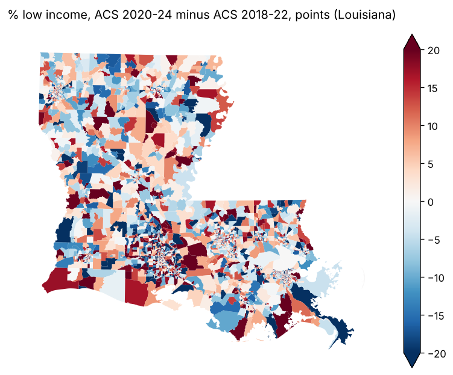

# EJ screening datasets for HIFLD Next

Can the environmental-justice screening data that came down in 2025 be rebuilt as files [HIFLD Next](https://hifld.publicenvirodata.org) can host, with versions, metadata and a pipeline anyone can rerun? Yes. One notebook downloads the public copies, writes one GeoParquet file and one STAC record per dataset, checks the files against the sources, and compares PEDP's rebuild with EPA's last release. Issue [#88](https://github.com/fulton-ring/agent-content-demos/issues/88).

| Dataset | What it is | Rows | Columns | GeoParquet | PMTiles |
|---|---|---|---|---|---|
| `epa-ejscreen-2024-block-groups` | EPA EJScreen 2.3 (2024), ACS 2018–2022, EPA's last official release | 243,022 | 233 | 196.8 MB | 114.9 MB |
| `pedp-ejam-acs2024-block-groups` | PEDP's EJAM `v3.2024.0`, EJScreen-style indicators from ACS 2020–2024 | 242,983 | 227 | 270.8 MB | 124.3 MB |
| `cejst-v2-census-tracts` | CEJST v2.0 (December 2024), 2010 tracts | 74,134 | 138 | 411.0 MB | 138.6 MB |

Column counts include `geoid`, `geometry` and `census_aland` (the Census land area of the joined shape).

## How to run

```bash
./run.sh                 # GeoParquet, STAC records, validation and the diff
EJ_PMTILES=1 ./run.sh    # also vector tiles, about 18 minutes more
```

It needs [uv](https://docs.astral.sh/uv/) and about 4 GB of disk. The first run downloads 70 files (1.39 GB) into `data/` and spends about 11 minutes parsing EJAM's two R data files, which are then cached. `EJ_DATA_DIR` and `EJ_OUT_DIR` move the download and output folders. To read the notebook with its outputs, run `uv run marimo edit ej_datasets.py`.

## Where the data comes from

Everything is fetched at run time; nothing from a source is committed. Each file's SHA-256 goes into the STAC record's `derived_from` links.

| Source | Copy used, and why | Licence |
|---|---|---|
| EPA EJScreen 2024 block-group CSV and column list | [Harvard Dataverse doi:10.7910/DVN/RLR5AX](https://doi.org/10.7910/DVN/RLR5AX): the only archive with the CSV as a single file and published MD5s. EPA's `gaftp.epa.gov` returns 404; [Zenodo](https://doi.org/10.5281/zenodo.14767363) has only 5 GB zips per year. | CC0 1.0 on the archive; a US government work |
| EJAM `blockgroupstats` and `map_headernames` | The `.rda` files in [EJAM](https://github.com/Public-Environmental-Data-Partners/EJAM) at tags `v3.2024.0` and `v3.2022.3` | MIT (EJAM authors) |
| EJAM EJ indexes `bgej.arrow` | Release assets of [ejamdata](https://github.com/Public-Environmental-Data-Partners/ejamdata) at the same tags | MIT (US EPA, 2024) |
| CEJST v2.0 communities CSV and codebook | [EDGI on Zenodo doi:10.5281/zenodo.14675929](https://doi.org/10.5281/zenodo.14675929): publishes MD5s, and its shapefile zip holds the codebook, read over HTTP range requests so only 42 kB comes down. The [Harvard Dataverse copy](https://doi.org/10.7910/DVN/XRNMXK) has no checksums. | None stated on the archive; CEQ's data is a US government work |
| Geometry | Census cartographic boundary block groups 2022 (EPA) and 2024 (EJAM); 2022 places for AS, GU and MP and TIGER/Line 2022 estates for VI, the units EPA used there; TIGER/Line 2010 tracts for CEJST | Public domain |

`v3.2024.0` is the newest EJAM data vintage. PEDP released it in June 2026; its NEWS file says ACS 2020–2024 will be released again as `4.2024.0`.

## Results

All numbers come from `outputs/summary.json`, `outputs/validation.csv` and `outputs/diff_vs_epa_2024.csv`, written by the run.

**Validation against the sources.** Every file has exactly the source's rows and unique IDs. Every column's null count matches the source's (0 mismatches across 231, 225 and 136 columns), and every value in 2,000 random rows per dataset matches (0 mismatches). For the block groups, the joined Census shape's land area equals the land area the source reports in every row where both exist (241,892 EPA rows, 241,854 EJAM rows), so no shape landed on the wrong row. Shapes are missing for 445 EPA rows and 444 EJAM rows: block groups that are all water or have no population, which cartographic files leave out, plus one place in Guam. All 74,134 CEJST tracts got a shape. Nulls by column are in `outputs/*.nulls.csv`; 224 of EPA's 231 columns have some (Alaska, Hawaii, Puerto Rico and the territories lack several environmental indicators), and no column is empty.

**PEDP's rebuild against EPA's last release.** EJAM's own `map_headernames` table pairs 76 of its columns with EPA's.

- At the same vintage (`v3.2022.3`, ACS 2018–2022), 76 of 76 columns match EPA's in at least 99.9% of block groups, and the lowest (people with disabilities) matches in 99.99%. PEDP reproduces EPA's numbers.
- In `v3.2024.0` (ACS 2020–2024), 50 of 75 columns changed in more than half of block groups: population counts, the demographic shares and indexes, and the EJ indexes built from them. (The demographic indexes are averages of z-scores shifted to be non-negative, so part of their change is a new national shift, not local change.) 18 are identical to EPA's: 12 of the 13 environmental indicators (PM2.5, ozone, NO2, diesel PM, toxic releases to air, traffic, Superfund, RMP and hazardous-waste proximity, underground tanks, wastewater, drinking water; the 13th, lead paint, comes from the ACS and was updated), low life expectancy, two facility counts, the EPA region, and the counts of EJ indexes at or above the 80th percentile, which stay the same although most EJ index values moved. That last one looks carried over rather than recomputed.
- `v3.2024.0` has 39 fewer block groups than EPA's file, all in Suffolk County, New York (77,885 people in EPA's 2024 file). EJAM's pipeline documentation says they are missing from Census's ACS tables for that vintage.

**What's missing from the public copies.**

- EJAM `v3.2024.0` has no per-block-group percentiles: EPA's 50 national-percentile (`P_`), 50 map-bin (`B_`) and 50 map-text (`T_`) columns have no counterpart. EJAM computes them when it runs a report, from lookup tables.
- No public copy has environmental indicators newer than EPA's 2024 release.
- The 231 EPA-named columns inside EJAM's `v3.2024.0` table are empty in every row and are dropped.
- CEJST v2.0 is still on 2010 tracts and ACS 2015–2019; no newer CEJST exists.

**Run time.** On 4 CPUs, the first run from a clean checkout with vector tiles took 29.4 minutes: 18 s of downloads, about 11 minutes parsing EJAM's two R files, under a minute writing the GeoParquet files and STAC records, and about 18 minutes building the three PMTiles files (5–6 minutes each). A rerun with the downloads and parsed files cached took 20 minutes, almost all of it vector tiles. Without vector tiles (the default `./run.sh`), a clean-checkout run took about 8 minutes in the 2026-10-22 review.



The change in percent low income per block group in Louisiana between EPA's file and PEDP's, one of the inputs to the indexes. Block-group ACS estimates have wide margins of error, so much of the speckle is sampling noise.

## What's in the folder

- `ej_datasets.py`: the marimo notebook. It reads top to bottom: sources, download, read, normalise, geometry, write, validate, diff, gaps.
- `run.sh`: runs the notebook as a script.
- `outputs/`: the STAC records (`*.collection.json`), validation and diff tables, nulls by column, `summary.json`, the map, and `samples/`, Washington, DC cut from each GeoParquet file. The full GeoParquet and PMTiles files are too big to commit and are rebuilt by the run.

## What we looked at first

- **EJAM's own R pipeline** (`run_ejscreen_pipeline()`) rebuilds the tables from Census data and is the right tool for producing a new vintage. Here the vintages are already published, so the spike packages PEDP's output instead of rerunning the pipeline, and it needs no R.
- **`rdata`** reads `.rda` files in pure Python. `pyreadr` returned one empty column for this data.table.
- **geopandas** writes GeoParquet 1.1 with a bounding-box column; **GDAL's PMTiles driver** (bundled with `pyogrio`) builds tiles without installing tippecanoe; **pystac** builds and validates the STAC records against the file, version and table extensions.
- The records copy the shape of HIFLD Next's published collections (for example `icis-wastewater-treatment-plants/v1.0.0/collection.json`): STAC 1.1, `table:columns`, assets with `file:size` and `file:checksum`, and the `hifld:` fields that can be filled from the data.

## What it doesn't show

- It doesn't upload anything to HIFLD Next or run its ingest; the records have only been validated against STAC's schemas.
- It doesn't check whether EJAM's formulas are right where its numbers differ from EPA's, only how much they differ and in which columns.
- It doesn't compute the missing percentiles for `v3.2024.0`, fill the water-only shapes from TIGER/Line, or update any indicator beyond what PEDP published.
