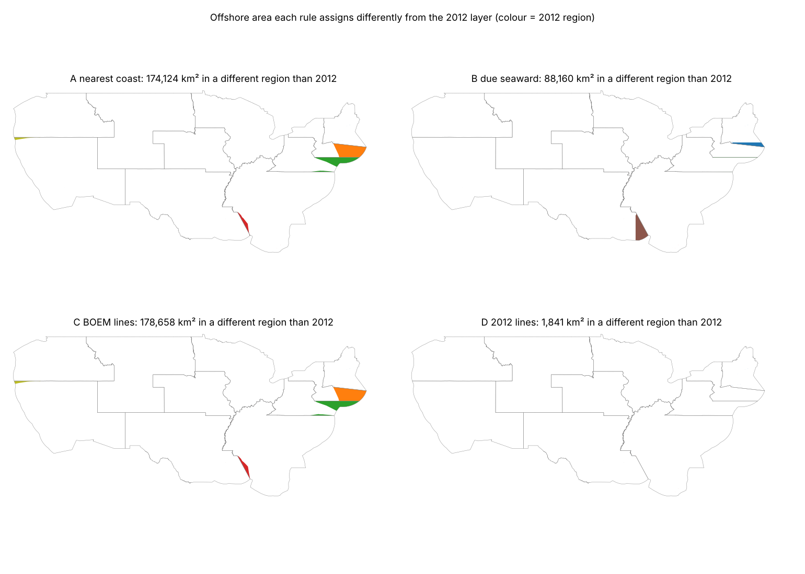

# Rebuilding EPA's regions-with-offshore-waters layer

HIFLD Next ships "EPA Region Boundaries with Exclusive Economic Zone", read from an EPA map service built in
2012 (`OEI/EPA_Locations/MapServer/4`) that EPA no longer updates. EPA maintains the onshore regions
("U.S. EPA Regions (DOC & EPA 2023)") but publishes no current version that reaches offshore.

**Question:** can we rebuild the offshore layer from the 2023 onshore regions and NOAA's maritime limits,
splitting the sea between regions by a simple rule, and how close does it get to the 2012 layer?

**Answer:** yes, but only by keeping EPA's own 2012 split lines. With the current coast and the current NOAA
EEZ, those five straight segments reproduce the 2012 layer at offshore IoU ≥ 0.999 in every coastal region.
No rule built from first principles gets close: the best of them ("due seaward") has a worst-region IoU of
0.78. HIFLD Next can swap to the derived layer, provided it's published as our derived product with its
method written down, not as an EPA layer.

## Run it

```bash
./run.sh
```

Needs [uv](https://docs.astral.sh/uv/). It downloads the inputs into `data/` (git-ignored), runs the
marimo notebook `rebuild.py` as a script and writes `outputs/`. Takes about 4 minutes. To read the
notebook with its maps: `uv run marimo edit rebuild.py`.

## Data (all public, downloaded at run time)

| Input | Source | Current as of | Licence |
|---|---|---|---|
| 2012 EPA regions with EEZ (reference) | [geodata.epa.gov MapServer/4](https://geodata.epa.gov/arcgis/rest/services/OEI/EPA_Locations/MapServer/4) | built from 2011 TIGER/Line and NOAA boundaries | US Government work |
| U.S. EPA Regions (DOC & EPA 2023), onshore | [EPA_GEO feature service](https://services.arcgis.com/cJ9YHowT8TU7DUyn/arcgis/rest/services/US_EPA_Regions__DOC___EPA_2023_/FeatureServer/13) | data last edited 2026-07-02 | EPA Data Licensing Agreement, public use |
| NOAA Office of Coast Survey US Maritime Limits and Boundaries | [nauticalcharts.noaa.gov](https://nauticalcharts.noaa.gov/data/us-maritime-limits-and-boundaries.html) (shapefile) | newest line published 2013-09-13; file dated 2020-03-31 | US Government work, public domain |
| BOEM OCS administrative boundaries (rule C only) | [boem.gov](https://www.boem.gov/oil-gas-energy/mapping-and-data/map-gallery/administrative-boundaries) | files dated 2024-09-25 | US Government work |

NOAA's limits are current and public, but published as **lines only** and rarely updated (newest line
2013). There's no official EEZ polygon, so the notebook builds one.

## What the notebook does

1. **Builds a current EEZ polygon** from NOAA's lines plus the 2023 coastline. It needed three fixes:
   shifting longitudes to 0–360° (NOAA cuts lines at the antimeridian), snapping to a 1e-5° grid (line
   ends miss each other by ~1e-8°) and dropping high-seas pockets the lines also enclose (the Bering Sea
   "Donut Hole" and an Arctic sliver: 181,622 km²). The result matches the 2012 outer extent at
   **IoU 0.9999** (690 km² of 2012 missing, 2,248 km² new).
2. **Measures how 2012 split the sea.** Every split is one straight two-vertex segment from coast to EEZ
   edge. Three run along parallels: 2/3 at 38.84°N, 3/4 at 36.55°N (VA/NC) and 9/10 at 42°N (CA/OR). Two
   are oblique: 1/2 east-south-east from Block Island Sound and 4/6 south-south-east from the LA/MS line.
   No published rule explains them, and BOEM's lateral lines don't match either.
3. **Scores four rules** for the two offshore pieces several regions share (Atlantic–Gulf, Pacific lower 48).
   Offshore pieces that touch one region's land go to that region.

## Results

Offshore IoU against 2012, per coastal region (region minus 2023 land; `outputs/iou_by_region.csv` also has
whole-region IoU and km² that differs):

| Region | A nearest coast | B due seaward | C BOEM lines | D 2012 lines |
|---|---|---|---|---|
| 1 | 0.479 | 0.782 | 0.478 | 0.999 |
| 2 | 0.680 | 0.929 | 0.678 | 1.000 |
| 3 | 0.509 | 0.964 | 0.496 | 1.000 |
| 4 | 0.975 | 0.929 | 0.971 | 1.000 |
| 6 | 0.959 | 0.830 | 0.953 | 1.000 |
| 9 | 0.999 | 1.000 | 0.999 | 1.000 |
| 10 | 0.998 | 0.999 | 0.998 | 0.999 |
| **km² placed differently** | 174,124 | 88,160 | 178,658 | 1,841 |

Regions 5, 7 and 8 have no coast. For rule D, most of the 1,841 km² comes from coastline changes between 2011
and 2023 TIGER (Region 10, Alaska, accounts for 2,625 km² of summed differences).



**Territories:** all covered, same as 2012. Puerto Rico and the US Virgin Islands are in Region 2. Hawaii,
Guam, the Northern Mariana Islands, American Samoa and the Pacific Remote Islands (Wake, Johnston, Palmyra,
Kingman, Howland, Baker, Jarvis) are in Region 9, and Alaska is in Region 10. The 2023 regions have no land
for the Pacific Remote Islands, so their waters go to the nearest region (9).

**Run time** 214 s (253 s on a clean checkout, including downloads) in a 4-core cloud container. **Cost** $0.

## Output

`outputs/epa_regions_offshore_derived.parquet`: GeoParquet, EPSG:4326, one row per region, built with rule D.
Each row carries `product = "Fulton Ring derived layer, not an EPA product"` and its sources.

## What it doesn't show

- **Why** EPA drew the two oblique lines. We reuse them as measured, so the layer inherits a 2012 choice
  nobody documented. If EPA or a founder prefers a principled rule, B (due seaward) is the simplest, but it
  moves about 88,000 km², mostly off New England and in the Gulf.
- That NOAA's lines are the latest legal limits. They're NOAA's published data, but its newest line dates
  from 2013. Ambulatory baselines may have moved since.
- Whether HIFLD Next's `epa_eez.py` needs changes beyond the source URL. That code lives in another repo.
- Rule C uses BOEM lines stretched 0.3° to reach the EEZ edge. BOEM computed them by equidistance, which is
  why C lands almost exactly on A.

## What we looked at first

There's no published current EEZ polygon from NOAA (the REST service and downloads are lines). BOEM's
administrative boundaries cover only state pairs and stop short of the EEZ edge. Marine Regions' EEZ
polygons are not a US agency source. So the EEZ polygon is built here with shapely's `polygonize`, and the
splits use shapely and geopandas, not custom geometry code.
