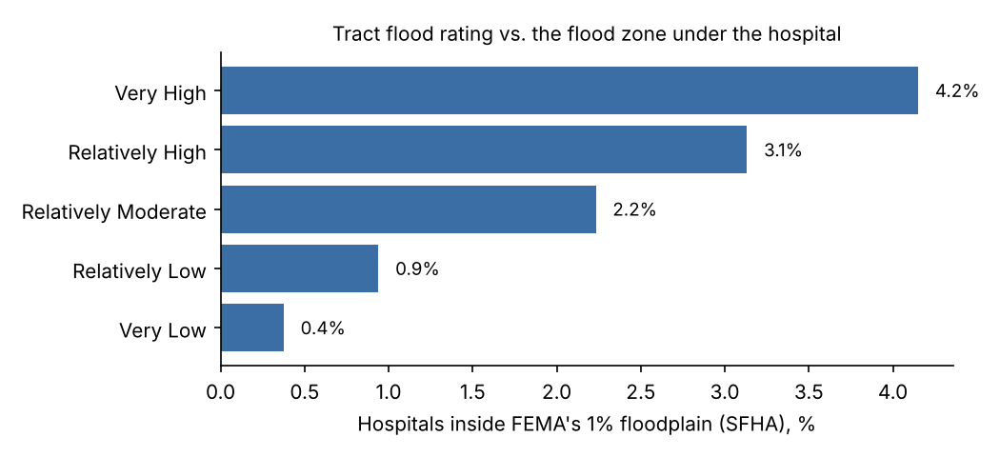

# Ranking facilities by climate risk: HIFLD Next × the National Risk Index × the Future Risk Index

Can anyone rank hospitals, power plants or other facilities by climate risk with free public data
and one short notebook? This spike joins three [HIFLD Next](https://hifld.publicenvirodata.org)
layers to FEMA's National Risk Index (NRI) census tracts and the Future Risk Index (FRI) county
multipliers, ranks them by hazard, checks the top of each ranking against places recorded as hit,
and measures where a tract score misstates a building's risk. Issue
[#185](https://github.com/fulton-ring/agent-content-demos/issues/185),
[proposal card](https://app.notion.com/p/3fccc69045cb813890bde24b03c2c761).

**Short answer: the join works and anyone can rerun it. The ranking is good for hurricanes, weak
for floods, and a tract's flood rating says little about the building.**

- **The join is reliable.** 34,518 of 34,822 active facilities (99.1%) land in an NRI tract. The
  rest are bad coordinates or tracts NRI doesn't score. Every joined county has an FRI value.
  The county we derive matches the layer's own county FIPS for 100% of hospitals, 99.9% of
  power plants and 97.1% of wastewater plants.
- **Hurricanes: 17 of 20 hospitals** named as evacuated or damaged in a hurricane rank in the
  hurricane or flood top decile.
- **Floods: 4 of 13 flood-hit hospitals** rank in the flood top decile. None of the NYC Sandy
  hospitals (NYU Langone, Bellevue, Coney Island) do. Facilities in the 100 counties with the most
  NFIP repetitive-loss properties make the flood top decile 14–16% of the time, against 11% for
  all facilities. That's barely better than chance. In tracts with 25 or more such properties it's
  29–40%.
- **Wildfire: 3 of 7** fire-evacuated hospitals rank in the top decile. The two Santa Rosa
  hospitals evacuated in the 2017 Tubbs Fire rank 1,225th and 5,006th of 6,574 for wildfire.
- **Tract rating against flood zone:** 96% of hospitals in a "Very High" flood-risk tract are
  outside FEMA's 1% floodplain (SFHA). 0.4% of "Very Low" tract hospitals are inside it. Only
  29% of the 156 hospitals inside the SFHA make the flood top decile.
- **The futures barely reorder the top.** 54–96 of today's top 100 stay in the top 100 under
  late-century, higher-warming multipliers. Coastal flood changes the most.

## Run it

```bash
./run.sh
```

Needs [uv](https://docs.astral.sh/uv/). It runs `notebook.py` as a script and writes everything
to `results/`. The slow part is about 7,900 point queries to FEMA's NFHL service, which resets
connections under load. Finished queries are cached, so rerun if it stops. A point that fails
8 times is kept as "query failed" and counted. **Run time:** 81–95 minutes from a clean checkout
with an empty cache (2026-11-04 and 2026-11-05), almost all NFHL queries; under a minute cached. Downloads go
to `~/.cache/facility-climate-ranking`, or set `FCR_CACHE`. To read the notebook with its outputs,
run `uv run marimo edit notebook.py`. Cost: $0.

## Data (all public, downloaded at run time, nothing downloaded is committed)

| What | Source |
|---|---|
| Facilities | HIFLD Next GeoParquet: `hospitals-3` v1.1.0 (open), `power-plants-1` v1.0.0 (status OP), `icis-wastewater-treatment-plants` v1.0.0 (POTW, effective or admin-continued permit) |
| Tracts | Census 2020 cartographic tract boundaries (`cb_2020_us_tract_500k`) |
| NRI | FEMA NRI v1.20 (December 2025) tract table, FEMA's ArcGIS Online service, attributes only |
| FRI | `fri-datasets-map/data/` at commit `ba506b1`: FEMA's FRI multipliers and our rebuild's |
| Flood zones | FEMA NFHL live service, layer 28, point queries (hospitals only) |
| Known places | OpenFEMA `NfipMultipleLossProperties` (240,932 properties), and `known_hospitals.csv` |

**No substations.** HIFLD Next has no substations layer: DHS withdrew it from public access in
2022 (see `hifld-grid-gaps/`). Power plants stand in for the grid, so the county-only rule for
substations didn't come into play. **`known_hospitals.csv`** lists 50 hospitals named in a
public source as flooded, damaged or evacuated in a named hurricane or wildfire, one source each.
The sources are the Urban Institute's Katrina report, Toner et al. 2017 on Sandy, ASPR TRACIE, the
Interior Department, and news and trade press. They were matched to HIFLD IDs by hand, with a note
per row. Pre-storm, precautionary-only evacuations (Irene, the Keys in Irma, Milton's
AdventHealth North Pinellas and others) were left out. Ten have closed, moved building or have
no HIFLD record, so 40 are scored.

## Method

1. Each point is joined to the 2020 tract polygon it falls in, then to NRI's row for that tract
   and to the FRI multipliers for NRI's county.
2. **What we rank on:** for inland flood, coastal flood, hurricane and wildfire, the tract's
   annualized loss rate for **buildings** (`*_ALRB`). That's the share of a building's value the
   hazard is expected to destroy each year. For heat wave, the **population** loss rate
   (`HWAV_ALRP`), because heat barely touches buildings in the NRI. We use rates, not dollar
   losses, because a tract's dollar loss mostly counts how many buildings it has.
3. **Futures:** today's rate × the county's FRI multiplier, for four scenarios. We use FEMA's
   multipliers and, separately, our rebuild's. The FRI has no inland flood multiplier, so inland
   flood is ranked today only. A missing multiplier counts as 1.
4. **Known places:** a facility is "flood top decile" if it's in its layer's top 10% for inland
   or coastal flood. For hurricane-hit hospitals we accept hurricane or flood.

## Results (run of 2026-11-04)

| Layer | HIFLD records | Active | Joined to an NRI tract | Outside every tract | Tract not in NRI |
|---|---|---|---|---|---|
| Hospitals | 8,340 | 7,966 | 7,918 | 1 | 47 |
| Power plants | 16,317 | 11,864 | 11,706 | 5 | 153 |
| Wastewater | 18,885 | 14,992 | 14,894 | 21 | 77 |

**Top 100 that stay in the top 100, late century, higher warming** (FEMA / our rebuild; all
four scenarios in `results/top100_overlap.csv`):

| Hazard | Hospitals | Power plants | Wastewater |
|---|---|---|---|
| Coastal flood | 68 / 83 | 54 / 71 | 65 / 73 |
| Hurricane | 78 / 93 | 88 / 96 | 78 / 89 |
| Wildfire | 88 / 89 | 90 / 90 | 84 / 87 |
| Heat wave | 90 / 90 | 86 / 86 | 88 / 88 |

**Known places in the flood top decile:**

| Layer | All ranked | In a top-100 repetitive-loss county | In a tract with 25+ repetitive-loss properties |
|---|---|---|---|
| Hospitals | 11.1% | 15.7% (1,038) | 29.1% (158) |
| Power plants | 11.2% | 14.1% (918) | 33.8% (157) |
| Wastewater | 10.8% | 16.4% (1,076) | 39.8% (349) |

**Top of the hospital lists** (full lists per layer in `results/top_facilities.csv`):

- Hurricane: Carteret General (Morehead City, NC), then three Guam hospitals.
- Coastal flood: South Cameron Memorial (Cameron, LA), then three Charleston hospitals in one tract.
- Inland flood: McDowell ARH (KY), Hoboken University Medical Center (NJ).
- Wildfire: Northeastern Nevada Regional (Elko, NV).

**Hospitals, tract flood rating against NFHL class** (7,918 hospitals). 156 are in the SFHA,
471 in shaded X, about 6,573 in minimal hazard, 651 on no digital map and 66 in zone D. NFHL
failed to answer 0–2 points per run. Full table: `results/hospitals_tract_vs_sfha.csv`.



## Where it misleads

- **A tract is not a building.** A "Very High" flood tract hospital is 10 times as likely to be
  in the SFHA as a "Very Low" one (4.2% against 0.4%), but 96% of them are not. NYU Langone sits
  in zone AE, yet ranks 151st of 956 for coastal flood.
- **Ratings and rates disagree.** NRI's `*_RISKR` rating includes social vulnerability and
  community resilience. The loss rate doesn't. Ben Taub sits in a "Very High" inland flood tract
  but ranks 1,619th on inland flood rate.
- **Ties.** Many facilities share a tract, so the top of a list is a handful of tracts. Three
  Charleston hospitals tie for coastal flood.
- **Missing multipliers.** Guam's hospitals rank 2–4 for hurricane today. They drop to about 180
  in the futures because the FRI has no Guam multiplier and we keep today's rate there.
- **FEMA's coastal multipliers are huge** (135× for Miami-Dade, late century, higher warming), so
  coastal flood reorders the most. FRI multipliers were built on NRI v1.19; we apply them to v1.20.
- **Closed hospitals drop out of the check.** Charity, Lindy Boggs, Long Beach Medical Center and
  Feather River closed after the event, so the hospitals hit hardest aren't scored.

## What it doesn't show

- A ranking of buildings. Every score is a tract (NRI) or county (FRI) average.
- Heat risk to hospitals beyond NRI's population loss rate, or any hospital list for heat.
- Substations (no public HIFLD layer).
- Inland flood futures (the FRI has none).
## Files

`notebook.py` (the whole analysis, a [marimo](https://marimo.io) notebook), `known_hospitals.csv`,
and `results/`: one CSV and one GeoParquet per layer (the free artifact, described in
`results/DATA_DICTIONARY.md`) plus the summary tables and `headline.json`.
