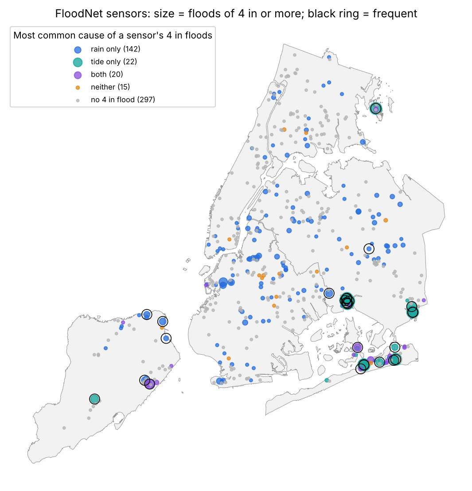

# What New York's street-level flood sensors can tell us

New York publishes every flood event recorded by FloodNet, a network of low-cost ultrasonic
sensors that measure water depth on city streets every minute. This spike reads that feed the
way a city would want it read. It joins the events to NOAA tide gauges, airport rain gauges,
FEMA's flood zones, the city's Stormwater Flood Maps and HIFLD Next critical facilities. All of
it is in one marimo notebook. Issue
[#213](https://github.com/fulton-ring/agent-content-demos/issues/213),
[proposal card](https://app.notion.com/p/3efcc69045cb81fa9c8deb675f046938).

**Short answer: the feed has grown about fivefold since the 2024 paper. Most of what it records
is tidal flooding at a few coastal sites. The two official flood maps each cover one kind of
flooding, and you need both** (true of the moderate stormwater map; the Extreme 2080 map covers
all but 1.0% of flooding sensors, so it barely tells them apart). Numbers from the run on 2026-11-15, with data through
2026-11-09:

- **The network: 496 sensors ever deployed, 452 active, 3,611 events at 322 sensors.** 1,602
  of those events reached 4 inches at the sensor. Queens has 2,109 of the events. Events per
  sensor that has recorded any: Bronx 18.7, Queens 17.9, Staten Island 10.8, Brooklyn 4.5,
  Manhattan 3.0. The 2024 paper counted 87 sensors (as of February 2024) and 360 floods
  (October 2020 to May 2023). Today's feed lists 97 sensors installed before March 2024, and
  278 events at 19 sensors for the paper's window, not 360.
- **Rain or tide, per event: 46% tide only, 30% rain only, 14% both, 10% neither.** For floods
  of 4 inches or more: 56% tide only, 24% rain only, 18% both, 2% neither. The tide only counts
  at sensors FloodNet flags as tidal (see Method). Across the threshold variations in the
  sensitivity table (other than letting the gauges decide the tide everywhere), tide-only
  events stay at 39 to 50% and rain-only at 25 to 35%.
- **Mapped risk: 61% of the 199 sensors with a 4-inch flood sit outside FEMA's 1% floodplain,
  and 36% are more than 20 m from the city's moderate stormwater flood areas.** Each map misses
  the other kind of flood. 67% of rain-only floods happened outside FEMA's floodplain, but only
  30% were outside the moderate stormwater map. For tide-only floods it's the reverse: 0.2%
  outside FEMA's floodplain and 93% outside the moderate stormwater map. With FEMA's 0.2% zone
  and the extreme 2080 stormwater scenario combined, no flooding sensor is unmapped.
- **28 sensors flood often** (4 or more 4-inch floods a year, after at least 180 days
  deployed). 21 are in Queens, 6 on Staten Island and 1 in the Bronx, and 23 are flagged tidal.
  Within 250 m of them are 7 public schools, 3 fire or EMS stations, 25 subway entrances at 8
  stations, and no hospitals or nursing homes.
- **Hurricane Ida "50 minutes early": partly verified.** The FloodNet team's paper says its
  alerts reached NYC Emergency Management 50 minutes before *other notifications* of the
  Gowanus flooding. That is lead time over other reports, not a forecast. We found no city
  document confirming it. The feed shows the three Gowanus sensors flooding from 8:11 pm ET on
  September 1, 2021, with up to 35.6 inches at Carroll St/4th Av.
- **Run time: 9 min 44 s from a clean checkout with an empty cache.** Most of that is six years
  of 6-minute tide data, with retries when NOAA and the Iowa Mesonet throttle requests. A rerun
  with the cache took 4 min 38 s (the committed `summary.json` is from a warm rerun). Cost: $0.

## Run it

```bash
./run.sh
```

You need [uv](https://docs.astral.sh/uv/). `run.sh` runs `notebook.py` as a script and writes
`results/`. Downloads are cached in `~/.cache/floodnet-street-flooding` (or set
`FLOODNET_CACHE`). Recent months of tide and rain data are fetched again on every run, and so
are the FloodNet tables. FEMA's NFHL service is sometimes slow or answers with an error; the
notebook retries each lookup five times, and if a run still fails there, rerun: finished lookups are
cached. To read the notebook with its outputs, run
`uv run marimo edit notebook.py`.

## Data (all public, downloaded at run time)

| Input | Source |
|---|---|
| Flood events, sensor metadata | NYC Open Data `aq7i-eu5q`, `kb2e-tjy3` (FloodNet, NYU and CUNY; refreshed every two weeks) |
| Tide | NOAA CO-OPS 6-minute water level vs Mean High Water: the Battery, Kings Point, Sandy Hook |
| Rain | Iowa Environmental Mesonet ASOS archive, hourly reports: Central Park, LaGuardia, JFK, Newark |
| FEMA flood zones | FEMA NFHL MapServer `identify`, layer 28, live |
| Stormwater flood maps | NYC Open Data `9i7c-xyvv` (Moderate 2.13 in/hr current sea level; Extreme 3.66 in/hr with 2080 sea level rise) |
| Facilities | HIFLD Next `public-schools` v1.0.0, `hospitals-3` v1.1.1, `fire-and-emergency-medical-service-ems-stations` v1.0.0, `nursing-homes` v1.0.0; MTA Subway Entrances and Exits 2024 (data.ny.gov `i9wp-a4ja`) |
| Boroughs | NYC Open Data `gthc-hcne` |

## Method in brief

- **Flood**: an event whose peak reached 4 inches at the sensor. This is the bottom of the
  stormwater maps' "nuisance" tier, a rule taken from Mark Bauer's
  [FloodNet tutorials](https://github.com/mebauer/floodnet-nyc-tutorial). The 180-day minimum
  for rates is also his. We read his notebooks first. They split tidal from rain flooding with
  FloodNet's per-sensor flag and flood timing only, with no tide or rain data. The per-event
  method below is ours.
- **Rain**: at least 0.10 inch at the nearest airport gauge, from 3 hours before the event
  starts to its peak.
- **Tide**: water at the nearest NOAA gauge at or above Mean High Water within 90 minutes of the
  event's peak, counted only at sensors FloodNet flags as tidal. Why the restriction: the water
  is that high about 37% of the time anyway. Applied at every sensor, the gauges alone call 53%
  of the events at non-tidal sensors tide-related. The sensitivity table shows the unrestricted
  version too.
- **Inside a stormwater area**: within 20 m of a mapped polygon, because sensors hang over the
  sidewalk and the model's ponding is mostly in the roadway. The point-in-polygon counts are in
  `results/outside_mapped_zones.csv` and differ by under 6 points.

## Outputs

`results/summary.json` holds the headline numbers. The CSVs hold each table, `sensor_map.png`
is the map, and `events_classified.csv.gz` has every event with its peak time, rain, tide and
cause.



## What it doesn't show, and what didn't work

- **Flooding where there is no sensor.** FloodNet puts sensors where flooding is known or
  expected, so none of this estimates citywide flooding or what the maps miss citywide.
- **The rain and tide labels are approximate.** Airport gauges miss storm cells over one
  neighbourhood. The three NOAA gauges miss the lag and amplification of the tide inside
  Jamaica Bay, where many tidal sensors are. Those misses land in "neither" (10% of events).
- **The sensor flag can't see some tides.** A high tide can back up an outfall and flood an
  inland street. The flag-based rule calls that rain.
- **The paper's 360 doesn't reproduce from the feed.** The feed has 278 events for October 2020
  to May 2023 and doesn't say why.
- **One stormwater scenario wouldn't open.** The *Limited Flood* geodatabase in the city's
  download uses a compression GDAL's open driver can't read.
- **FEMA's effective map for NYC dates from 2007.** The 2015 preliminary maps aren't in the
  NFHL service.
- **Deployment time assumes sensors were always online.** The feed has no uptime record, so
  the per-year flood rates are lower bounds.

Cite the data as FloodNet (New York University and The City University of New York), and
Mydlarz et al. (2024), *Water Resources Research* 60, e2023WR036806.
