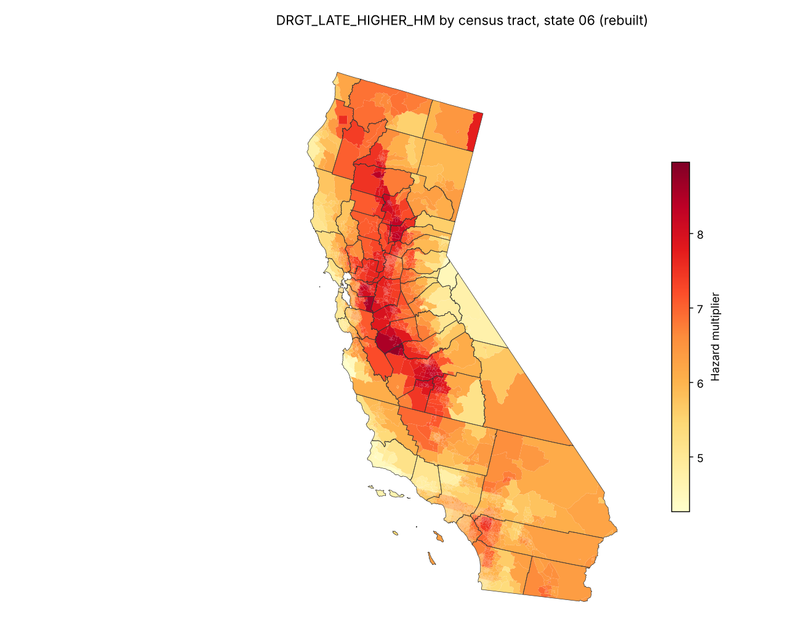

# Rebuilding FEMA's Future Risk Index with a swarm of agents

Can agents working from FEMA's published methodology and public data rebuild the Future Risk
Index (FRI) county hazard multipliers, and take them below the county? This is the spike for
[issue #15](https://github.com/fulton-ring/agent-content-demos/issues/15)
([proposal card](https://app.notion.com/p/3facc69045cb8004a763e1047da67297)).

## What it shows

An agent loop (Pydantic AI, Claude Sonnet through OpenRouter) edited one pipeline file per
hazard, scored against FEMA's published county values on training states, and was checked on
12 held-out states. Held-out results, mean over the four scenarios:

| Hazard | Rebuilt? | Same rating bin | Pearson | Mean abs log error |
|---|---|---|---|---|
| Extreme heat, LOCA2 | Yes, essentially exactly | 99.7% | 1.000 | 0.009 |
| Drought | Yes, essentially exactly | 99.6% | 0.998 | 0.021 |
| Wildfire | Close | 96.9% | 0.960 | 0.072 |
| Extreme heat, NEX | Partly: 95th percentile good, 99th about 25% low | 90.0% | 0.824 | 0.240 |
| Coastal flooding | No: levels roughly right, ranking not | 75.0% | 0.279 | 0.662 |
| Hurricane | Not attempted: FEMA's input is not public | | | |

- **The agents** ran 126 experiments for $7.61 of model calls. They found what mattered for
  drought (the Thornthwaite heat index per year) and wildfire (the shape of the regression),
  and could not crack coastal flooding or the NEX heat index. A person stepped in 13 times;
  two of those leaked a little held-out information. The rebuild notebook lists every one.
- **LOCA2 heat is matched by the human baseline alone**, which follows FEMA's text literally.
  NEX heat follows the same method with the same climate model plus a heat-index filter, so
  that filter is where the NEX rebuild goes wrong.
- **Coastal flooding failed because FEMA did something other than what it documented.** With
  the answer key open, FEMA's factors come from NOAA's flood thresholds read off the 2022 Sea
  Level Rise report's curves (18 of 42 testable counties reproduced to within 0.1%), and the
  county weights suggest the floodplain share of losses was dropped rather than kept at 1.
- **Below the county:** a census-tract drought layer for California (9,109 tracts) adds back
  up to county losses exactly; its resolution is bounded by the 25 km climate grid. A
  building-level pilot for Charleston County, SC puts mid-century tract multipliers within
  about ±30-50% of the county's, and barely reorders tracts by projected loss.



## Read it

Four [marimo](https://marimo.io) notebooks, each readable on its own, top to bottom: the
question, the data, each step, the result and what didn't work.

| Notebook | What it covers | Writes |
|---|---|---|
| [`notebooks/rebuild.py`](notebooks/rebuild.py) | The rebuild: data, scoring, the agent loop, scores per hazard, largest misses, every kept pipeline on held-out states, the Claude Code comparison, every human intervention | `results/rebuild/` |
| [`notebooks/tracts.py`](notebooks/tracts.py) | One hazard by census tract, and the roll-up check | `results/tracts/` |
| [`notebooks/coastal.py`](notebooks/coastal.py) | Reverse engineering FEMA's coastal multipliers (answer key open), the recovered recipe, what-if floodplain scenarios, baseline drift | `results/coastal/` |
| [`notebooks/charleston.py`](notebooks/charleston.py) | Coastal multipliers by tract, built from buildings | `results/charleston/` |

To open one interactively: `uv run marimo edit notebooks/rebuild.py`.

The rest of the code is what the notebooks share:

- `hazards/<hazard>/pipeline.py`: the final pipeline the agents kept for each hazard, and
  `program.md`, the human-written brief they worked from (with dated interventions).
- `src/fri_rebuild/inputs.py`: the read-only data API the pipelines (and so the agents) use.
- `src/fri_rebuild/data.py`: downloads and caches every input.
- `src/fri_rebuild/scoring.py`: rating bins, the train/held-out split and the metrics.
- `src/fri_rebuild/recipe.py`: the recovered coastal recipe (coastal and Charleston notebooks).
- `src/fri_rebuild/swarm.py`: the agent loop.
- `experiments.jsonl`: every agent proposal from every harness, with its code.

## Run it

```bash
./run.sh
```

It needs [uv](https://docs.astral.sh/uv/) and about 25 GB of free disk (the cache ends at 17 GB). It downloads every
input into `~/.cache/fri-agent-rebuild` (set `FRI_CACHE` to move it; nothing downloaded goes
into the repo), then runs each notebook as a script, so every number in `results/` comes from
the code in the notebooks.

The first run takes most of a day, almost all of it climate downloads:

- **NEX-GDDP-CMIP6**: 924 global yearly files of about 250 MB, each cut to the CONUS box.
  About two hours at 30 MB/s.
- **LOCA2**: range reads from UCSD's server, at about 1.5-2.5 hours per 30-year period on 4
  workers (five periods). It runs last and prints nothing until a period is done. Each worker
  uses about 1 GB; set `FRI_LOCA2_WORKERS` for more or fewer. If it is interrupted, rerun
  `./run.sh`: finished three-year pieces are kept.

With the inputs cached, `run.sh` took 17 minutes from a fresh clone, and reproduced every file
in `results/` exactly.

The agent loop is not part of `run.sh`, because it costs money and gives different results each
run. To run it for one hazard (needs `OPENROUTER_API_KEY`):

```bash
uv run fri-swarm drought --rounds 8 --agents 3 --budget 3
```

## Where the data comes from

All public, downloaded at run time:

- **Answer key**: FEMA's `NRI_Future_Risk_Master_Datasheet_12052024.xlsx`, saved before the
  tool was taken down in February 2025, from
  [fulton-ring/nri-future-risk](https://github.com/fulton-ring/nri-future-risk) at `c5cc0d6`.
- **Methodology**: *National Risk Index: Future Risk Technical Documentation* (FEMA, December
  2024), [archived at Harvard EELP](https://eelp.law.harvard.edu/wp-content/uploads/2025/03/NRI_Future_Risk_Technical_Document.pdf).
- **Climate**: [NASA NEX-GDDP-CMIP6](https://registry.opendata.aws/nex-gddp-cmip6/) and
  [LOCA2](https://cirrus.ucsd.edu/~pierce/LOCA2/), model MPI-ESM1-2-HR r1i1p1f1; NASA's
  [NEX-GDDP-CMIP6 Fire Weather Index](https://data.nas.nasa.gov/gddpimpact/FWI/).
- **Fuels**: LANDFIRE LF2022 FBFM40, from the LANDFIRE ImageServer at 500 m.
- **Coastal**: NOAA CO-OPS high-tide-flooding projections, counts, flood thresholds and datums;
  the 2022 Sea Level Rise Technical Report data files.
- **NRI**: v1.19.0 tracts ([Harvard Dataverse](https://doi.org/10.7910/DVN/JSQ8KZ)), v1.18.1
  counties (a third-party copy), v1.20 counties (FEMA's ArcGIS service).
- **Buildings**: USACE National Structure Inventory (Charleston pilot; only tract totals are
  written).
- **Boundaries**: Census 2020 cartographic boundaries.

## What it doesn't show

- Hurricane was not attempted, and coastal flooding was not rebuilt blind.
- NEX heat is only a partial match; FEMA's heat-index step is not documented.
- Alaska, Hawaii and the territories were not rebuilt.
- One climate model, one run: how closely FEMA's numbers can be reproduced, not how uncertain
  they are.
- The Claude Code subagent comparison was not walled off from the answer key.
- Tools tried first: Prime Agent (blocked by the session sandbox) and Modal (its gRPC client
  can't get through this environment's proxy). The loop uses Pydantic AI instead.
