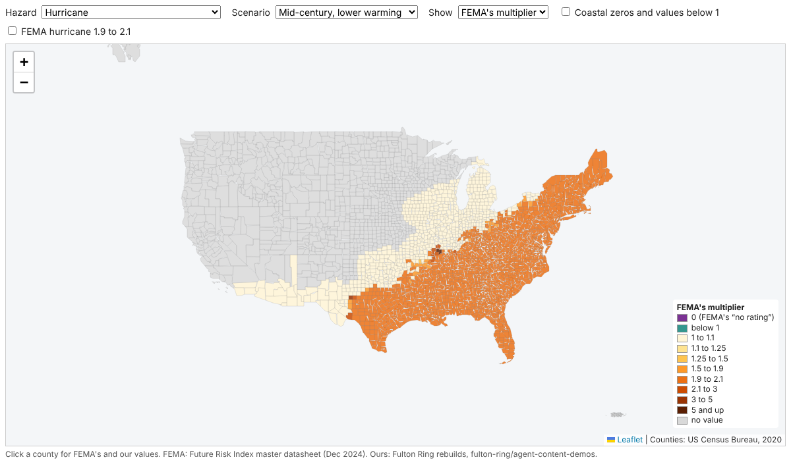
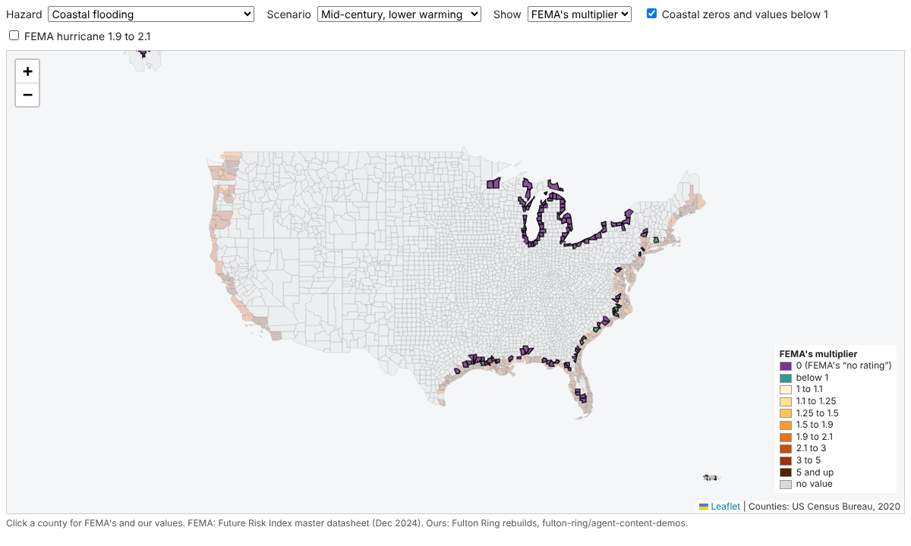

# FEMA's frozen climate risk multipliers: open county datasets and an embeddable map

FEMA's Future Risk Index (FRI) multiplied each county's expected annual loss by a hazard
multiplier for four futures. FEMA took it down in February 2025 and plans no update. Two spikes
here rebuilt the multipliers from public data:
[`fri-agent-rebuild/`](../fri-agent-rebuild/) and
[`hurloss-public-rebuild/`](../hurloss-public-rebuild/). This folder publishes FEMA's values
and ours side by side as county files, and as a map the whitepaper can embed. It is the work
for [issue #77](https://github.com/fulton-ring/agent-content-demos/issues/77)
([proposal card](https://app.notion.com/p/3ffcc69045cb8113a3e4fd030566e952)).

**Read [`datasets.py`](datasets.py)** (a [marimo](https://marimo.io) notebook) for how each
file is made, and [`data/DATA_DICTIONARY.md`](data/DATA_DICTIONARY.md) for every column and
the licence.



## What's in it

| File | What |
|---|---|
| [`data/multipliers_by_county.csv`](data/multipliers_by_county.csv) | FEMA's and our multipliers for drought, wildfire, extreme heat (LOCA2 and NEX, 95th and 99th) and coastal flooding: 3,231 counties × 7 × 4 scenarios, with the held-out flag |
| [`data/coastal_flags.csv`](data/coastal_flags.csv) | The 120 coastal zeros and 17 values below 1, with NRI v1.18.1 losses |
| [`data/hurricane_by_county.csv`](data/hurricane_by_county.csv) | FEMA's hurricane multipliers next to our open layer (central and range), 2,219 counties |
| [`data/baseline_scores.csv`](data/baseline_scores.csv) | The constant baseline per hazard, against the rebuild and the Draft job's figures |
| [`data/counties.parquet`](data/counties.parquet) | All of it, one row per county, with Census 2020 shapes (GeoParquet) |
| [`map/`](map/) | The map: [`map/src/fri-map.ts`](map/src/fri-map.ts), built to `map/dist/fri-map.js`, reading `map/data/counties.geojson` |

## Results

**The constant baseline**, a held-out county given the training-state median, reproduces the
Draft job's hand-worked figures exactly for all five hazards (held-out states, mean over
scenarios):

| Hazard | Baseline same bin | Baseline log error | Rebuild same bin | Rebuild log error |
|---|---|---|---|---|
| Drought | 81.9% | 0.443 | 99.6% | 0.021 |
| Wildfire | 93.1% | 0.194 | 96.9% | 0.072 |
| Extreme heat, LOCA2 | 79.4% | 0.545 | 99.7% | 0.009 |
| Extreme heat, NEX | 84.1% | 0.393 | 90.0% | 0.240 |
| Coastal flooding | 78.6% | 0.605 | 75.0% | 0.662 |

The baseline is computed in this folder's notebook with `fri_rebuild.scoring`, imported from the
rebuild rather than copied. The issue asked for it in `fri-agent-rebuild/notebooks/rebuild.py`,
but AGENTS.md says never to touch another project's folder.

**Coastal flags.** 120 counties have coastal flood loss and a multiplier of 0 in every scenario.
Of these, **71 had no coastal loss in v1.18.1 and 49 did**, by FIPS against FEMA's own v1.18.1
county service. That is one county off the 70 / 50 reported on #42, whose code isn't
committed; the third-party copy the coastal notebook uses also gives 49. Of the 17 below 1,
8 had v1.18.1 loss.

**Hurricane.** Between 615 and 643 of the 2,219 counties sit at FEMA's floor of 1, depending on the scenario. Of
the rest, 95-97% are between 1.9 and 2.1 in three scenarios and 32% in late century, higher
warming. Our central multipliers have medians of 1.02-1.06.

**The map** has a hazard and scenario picker, shows FEMA's value, ours or the ratio, and has a
popup with both values (and our range for hurricane). Two toggles outline the coastal flags and
FEMA's 1.9-2.1 hurricane band and fade every other county. Served from jsDelivr, it was ready
2.7 s after page load in headless Chromium. The data file is 5.0 MB, about 1 MB compressed.



## Embed it

Paste this into the Astro page, with the commit the article should freeze on:

```html
<div data-fri-map data-hazard="HRCN" style="--fri-map-height: 480px"></div>
<script type="module" src="https://cdn.jsdelivr.net/gh/fulton-ring/agent-content-demos@<commit>/fri-datasets-map/map/dist/fri-map.js"></script>
```

- `data-hazard` (`DRGT`, `WFIR`, `EXHT_L95`, `EXHT_L99`, `EXHT_N95`, `EXHT_N99`, `CFLD`, `HRCN`),
  `data-scenario` and `data-view` (`fema`, `ours`, `ratio`) set the opening view.
- The script loads Leaflet 1.9.4 from jsDelivr if the page hasn't, and reads
  `../data/counties.geojson` next to itself. `data-src` points it elsewhere, for example a copy
  on the Astro site.
- [`map/embed-example.html`](map/embed-example.html) is a full page (replace `@COMMIT` in its script URL with a commit hash first), and
  [`screenshots/embed_jsdelivr.png`](screenshots/embed_jsdelivr.png) shows it working.
- jsDelivr serves `.js` and `.geojson` from GitHub, but serves `.html` as plain text, so it
  can't host `map/index.html` for an iframe. To get an iframe URL, enable GitHub Pages on this
  repo (a founder's call), or copy `map/` into the Astro site's `public/`.

**Why a new page, not the existing map.** [fulton-ring/nri-future-risk](https://github.com/fulton-ring/nri-future-risk)
is a React, Tailwind and shadcn replica of FEMA's tool, built as one Vite app for its own Pages
site. Extending it would mean a second app in that repo and a cross-repo PR. Its global
Tailwind styles would also leak into an Astro article. So this map reuses its approach
(Leaflet over Census counties, the same datasheet) in one strict TypeScript file of about 300
lines with scoped CSS. That breaks the AGENTS.md "Tailwind and shadcn" rule, on purpose, so
the embed doesn't restyle the host page.

## Run it

```bash
./run.sh
```

It needs [uv](https://docs.astral.sh/uv/) and Node 22. It runs `datasets.py` as a script,
writing `data/` and `map/data/` (about 15 s once the downloads are cached), then checks the map
with `biome` and `tsc` and builds `map/dist/fri-map.js`. To view the map, serve this folder
(`python3 -m http.server`) and open `map/index.html`. To read the notebook with its outputs:
`uv run marimo edit datasets.py`.

## Where the data comes from

- **FEMA's multipliers**: the FRI master datasheet (12/05/2024) from
  [fulton-ring/nri-future-risk](https://github.com/fulton-ring/nri-future-risk) at `c5cc0d6`,
  downloaded at run time with `fri_rebuild.data` into `$FRI_CACHE`, shared with the rebuild.
- **Ours**: the committed `results/` of the two rebuilds. Nothing is rerun, so this takes
  seconds, not the rebuild's 15-hour LOCA2 step.
- **NRI v1.18.1 coastal losses**: FEMA's `NRI_Counties_Prod_v1181_view` ArcGIS service.
- **Shapes**: Census 2020 cartographic boundaries, 1:20m.

## What it doesn't show

- Our values are reconstructions. Coastal flooding loses to the constant baseline, NEX heat's
  99th percentile runs low, and the hurricane layer is FEMA's method on open inputs, not
  FEMA's numbers.
- No rebuilt values for Alaska, Hawaii or the territories. The map and GeoParquet leave out
  American Samoa, Guam, the Northern Marianas and the Virgin Islands (no 1:20m shapes).
- No live URL yet that works without a commit hash: jsDelivr links are pinned to a commit.
- The CC BY 4.0 licence for our values is a proposal; a founder may prefer CC0 to match
  nri-future-risk's public-domain dedication.
