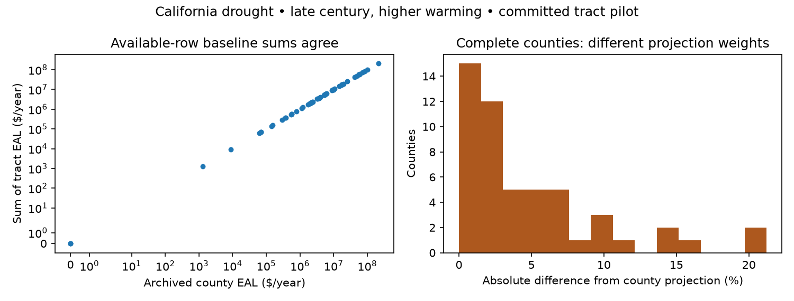

# Validate FRI publication readiness before changing its baseline

**The archived downstream fields reproduce. National tract publication is still unfinished.**
This spike independently checks drought, wildfire and four extreme-heat variants against FEMA's
preserved December 2024 master datasheet, then checks the tract pilot and both NRI releases.
Issue [#118](https://github.com/fulton-ring/agent-content-demos/issues/118).

## Run and read

```bash
./run.sh
```

Requires Python 3.12+ and [uv](https://docs.astral.sh/uv/). Run from this folder.
`run.sh` executes the readable [marimo notebook](notebook.py), downloads about 8 MB of archived
files plus four public NRI attribute tables, verifies input fingerprints, and writes `results/`.
Dependencies are pinned in `uv.lock`. No paid services or model calls. A cached run takes about
6 seconds; a fresh download takes longer. Open interactively with `uv run marimo edit notebook.py`.

The default input cache is `../../fri-validation-cache` (outside the repository).
Set `FRI_VALIDATION_CACHE` and `FRI_VALIDATION_RESULTS` to move inputs or outputs. HTTP requests
have timeouts and bounded retries/pages. A changed live layer fails the version/hash checks;
review and version a new snapshot rather than silently mixing it into this calculation.

## What the independent run found

**1. Every observable downstream field matches the archive.** Six variants × four scenarios ×
3,231 counties × four fields = **310,176 comparisons, zero mismatches**, including nulls and
special statuses. Of the 77,544 projected-score slots, 75,432 are numeric and 2,112 are missing.
This tests the archived HMs first, isolating downstream correctness from reconstruction error.

| Output | Reproduced calculation/classification |
|---|---|
| PAL rating (`PALR`) | EAL × HM, classified with the full baseline's per-band maximum EAL |
| Risk rating (`PRISKR`) | Baseline **hazard** RISKV × HM, classified with fixed baseline risk maxima |
| Risk score (`PRISKS`) | Scenario-specific national average percentile rank of projected risk, including zero ties; four significant digits |
| HM rating (`DELTAR`) | Quintile cutpoints from HMs pooled across all four scenarios, separately per variant |

Upper boundaries remain in the lower band; tied heat cutpoints can leave a band empty.
“No Expected Annual Losses” becomes “No Rating”; “Insufficient Data” becomes “Not Applicable”.
Zero-risk counties still participate in score ranking even when their risk rating is “No Rating”.
The greatest raw score difference is 0.004998 points; four-significant-digit display removes it.
The score precision and pooled HM reference are empirical archive findings, tested on every row.
A future score can fall as loss rises because it compares against that scenario's other counties.

**2. A hazard's effective county CRF is not the county composite CRF in v1.19.**
Replacing baseline hazard RISKV × HM with county PAL × composite CRF introduces median relative
risk-value differences of **5.70% drought, 3.26% wildfire and 1.09% heat**, before climate changes.
Target-hazard county risk is the sum of tract hazard risk to floating-point precision in v1.19.
In v1.20, county hazard EAL × county CRF matches; tract sums miss by medians of **10.79%, 9.49%
and 9.84%**, respectively. Do not transplant the v1.20 county equation into archive reproduction.

**3. The original subset-derived rating thresholds change the accuracy measurement.**
Using the complete frozen baseline instead changes 179 county/variant/scenario classifications
across training and held-out subsets. Independently rescored held-out PAL-rating agreement:

| Hazard / heat variant | Correct full-reference agreement |
|---|---:|
| Drought | 99.53% |
| Wildfire | 96.96% |
| Heat LOCA2, 95th / 99th | 99.67% / 99.47% |
| Heat NEX, 95th / 99th | 94.85% / 85.67% |

These rescore **committed multipliers**, not rerun climate pipelines. `rebuilt_scores.csv` gives
all scenarios, denominators, log errors, missing HMs and values below one. None are missing or
below one in the target columns; the wildfire function itself does not enforce the floor.

**4. Baseline conservation is different from projected conservation.** The California drought
pilot contains 9,109 tracts, 58 counties, one scenario. Available tract EAL sums agree with archived
county EAL within 4.66e-10 relative error. But **three tract rows have missing EAL; one also lacks
HM**, affecting three counties. Their meaning must be resolved before a strict publication roll-up.
Across the 52 complete counties with positive loss, summed tract PAL differs from the independently
computed county projection by **2.81% median, 21.23% maximum**. Area weighting and EAL weighting
give different county projections. Original available-row sums give 3.01% median and 21.63% max.



**5. The key sensitivity findings reproduce from fresh FEMA attributes.** Swapping vulnerability
inside v1.20 changes 21,345 / 84,092 tract ratings (**25.38%**) and 340 / 3,135 county ratings
(**10.85%**). Published full-release county changes are **812 / 3,135 (25.9%)**. Tract vulnerability
rank correlation is 0.526. Connecticut tract renumbering is matched; its changed counties are not.
These are composite NRI results, not measured future-hazard sensitivities or full CRF reproduction.

A qualification to the older sensitivity headline: v1.19 **composite** tract sums have 153 county
exceptions despite a near-zero median. The target-hazard risk sums do agree. Every composite
exception is saved; explanation is scoped to follow-up [#119](https://github.com/fulton-ring/agent-content-demos/issues/119).

## Publication requirements established by this spike

- First freeze the archive-compatible version: baseline values, geography, effective hazard CRFs,
  thresholds, scenario ranking populations, pooled HM-rating reference and special statuses.
- Version newer baseline inputs and aggregation as a separate methodology, with a change report.
  Wildfire fits an elasticity using baseline county EAL, so its coefficient and HMs need versioning too.
- Choose whether counties preserve the archived area-weighted method or aggregate tract projections.
  If both exist, identify and quantify them. Never average percentile scores or rating labels.
- Generate and validate tract outputs for each supported scenario/hazard and declared geography.
  The rebuild is CONUS-only; Alaska, Hawaii and territories need new work for national coverage.
  The committed drought pilot is not national coverage. LOCA2's function currently accepts county weights only;
  its 1/16° source centers receive 0.25° weighting boxes. Review spatial support before a 6 km claim.
- Fix the NEX 99th-percentile mismatch or label it as a different, incompletely reproduced method.

## Evidence and limits

`sources.json` pins the archived XLSX to `nri-future-risk@c5cc0d6`, the methodology PDF by SHA-256,
existing spike inputs to `agent-content-demos@390f7c0`, and four FEMA ArcGIS snapshots by release,
row count, field list and normalized attribute hash. The archive EXHT baseline matches NRI HWAV
within `rtol=1e-8, atol=$0.000001`; drought and wildfire pass the same check.
Primary equations: [FRI Technical Document](https://eelp.law.harvard.edu/wp-content/uploads/2025/03/NRI_Future_Risk_Technical_Document.pdf),
§3.1–3.2, §5.3, §6.3, §8.3. We checked this before implementing; pandas supplies ranks/quantiles,
NumPy supplies fixed-bin lookup, SciPy the triangular inverse CDF, and scikit-learn k-means.
No ready-made end-to-end FRI validator exists in the reviewed spikes, so the notebook compares fields.

`results/summary.json` is the overview. `downstream_checks.csv`, `classification_thresholds.csv`,
`special_statuses.csv` and `rebuilt_scores.csv` expose the classification evidence. `tract_rollup.csv`
and `tract_missing_inputs.csv` distinguish complete from available-row totals; EAL/PAL columns are
available-row sums and strict totals are null for incomplete counties. `baseline_aggregation.csv`,
`archive_baseline_checks.csv`, exception tables, `sensitivity_checks.csv`, `tract_capabilities.csv`
and `provenance.json` retain baseline, capability and input evidence. Empty exception CSVs have headers.

PAL/projected-risk dollar values are not published in this datasheet; exact field agreement validates
their observable ratings/scores, not unpublished dollar answer keys. We did not rerun climate models,
produce national tract data, recreate CRFs exactly from all source inputs, model future demographics,
repeat Shapley attribution, or validate a production app deployment. No other spike folder is changed.

Checks: `uv run --locked pytest -q`, `uv run --locked ruff check .`,
`uv run --locked ruff format --check .`, `uv run --locked ty check .`.
