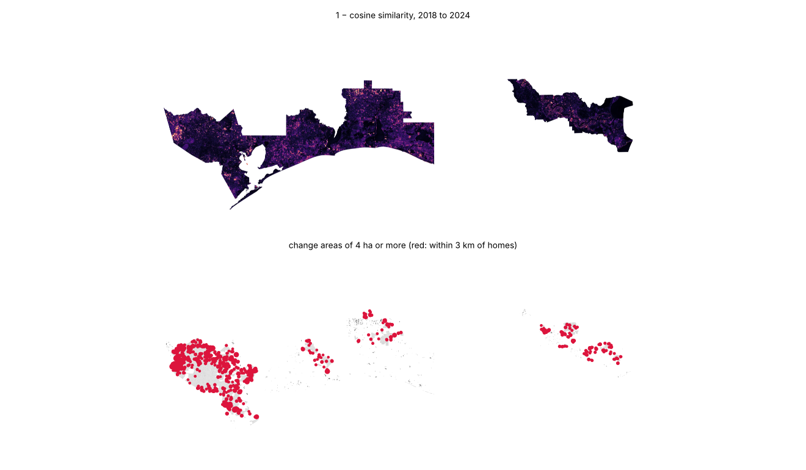
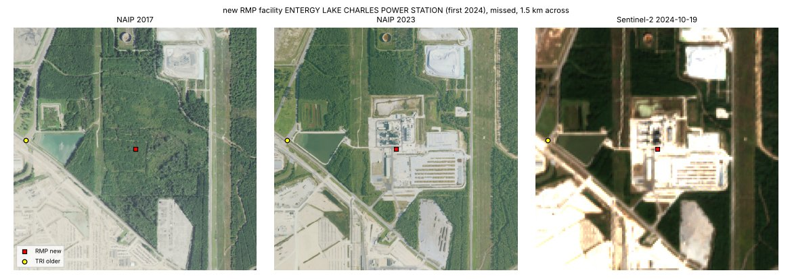

# Yearly geoembedding change near homes

Can the change in Google DeepMind's AlphaEarth satellite embeddings between 2018 and 2024 flag new industrial land (plants, tank farms, terminals, large warehouses) going in next to homes, earlier and more completely than EPA's facility registries record it? We tested it in eleven Gulf Coast counties: Harris, Chambers, Galveston and Jefferson in Texas, and Calcasieu, Cameron, Ascension, Iberville, St. James, St. John the Baptist and St. Charles in Louisiana. Issue [#156](https://github.com/fulton-ring/agent-content-demos/issues/156), a follow-up to [#149](https://github.com/fulton-ring/agent-content-demos/issues/149).

**Short answer: it finds new construction reliably, but near homes that is mostly new suburbs, and the industry it finds is warehouses, not plants.** Of 750 large-change areas within 3 km of residential block groups, a random sample of 60 checked on aerial photos was 30% new housing and 23% industry. All 16 industrial areas we found were warehouses, yards or industrial-park buildings, and 15 had no TRI or RMP facility within 300 m. The facilities that first appear in TRI or RMP in 2019–2024 are mostly old plants that only began reporting: 3 of 30 sampled showed new construction, and the change map missed all 3. Ranking change areas by how much they look like existing heavy industry put new subdivisions at the top.

## How to run

```bash
./run.sh
```

It needs [uv](https://docs.astral.sh/uv/), about 8 GB of disk and about 6.5 GB of downloads. On the first run it builds the EJScreen block groups by running `../ej-datasets-hifld-next/run.sh` unchanged, with its folders pointed into `data/ej/`, then runs the notebook `change_near_homes.py` as a script. To read the notebook with its outputs, run `uv run marimo edit change_near_homes.py`. The 117 photo chips the hand check used are drawn into `outputs/chips/` by the run (they are not committed; five examples are in `outputs/examples/`).

## Where the data comes from

Everything is downloaded at run time.

| Data | Copy used | Licence |
|---|---|---|
| AlphaEarth Foundations annual Satellite Embedding, 2018 and 2024 | [Source Cooperative `tge-labs/aef`](https://source.coop/tge-labs/aef), 40 m overviews read over HTTP, no account | CC-BY 4.0. "The AlphaEarth Foundations Satellite Embedding dataset is produced by Google and Google DeepMind." |
| EJScreen 2024 block groups (ACS 2018–2022 population) | Built by [`ej-datasets-hifld-next/`](../ej-datasets-hifld-next/) | US government work |
| Toxics Release Inventory, every facility that reported, 2010–2024, TX and LA | [EPA TRI basic data files](https://www.epa.gov/toxics-release-inventory-tri-program/tri-basic-data-files-calendar-years-1987-present) | US government work |
| RMP facilities with registration dates; refineries, petroleum terminals and hazardous-waste TSDFs | [HIFLD Next](https://hifld.publicenvirodata.org) GeoParquet `v1.0.0` | As published by HIFLD Next |
| NAIP aerial photos (2018 and 2022 in Texas, 2017 and 2023 in Louisiana) and Sentinel-2 L2A, Sept–Dec 2024 | [Microsoft Planetary Computer](https://planetarycomputer.microsoft.com), anonymous tokens | Public domain; Copernicus open licence |

## Method in one paragraph

For each 40 m pixel, the change score is the cosine similarity between its 2018 and 2024 embedding (Google's documented way to compare years; we skip 2017, which was regenerated in version 1.1). Pixels below 0.6, the lowest 1.4%, are changed. Touching changed pixels form a change area; we keep areas of 4 ha or more and call them near homes if they come within 3 km of a block group with at least 200 people per km². A seeded random sample of 60 such areas, plus the 30 ranked most like existing heavy industry, got before-and-after NAIP photos and a late-2024 Sentinel-2 image, labelled by the worker agent in `hand_check.csv`. New registered facilities are TRI facilities that first report in 2019–2024 (none in 2010–2018) and RMP facilities whose record was created in 2019–2024; one is caught if a change area lies within 300 m. A random 30 of the new ones near homes got the same photo check.

## Results

All numbers come from `outputs/summary.json`, written by the run.

**Change areas.** 1,461 areas of 4 ha or more; 750 near homes, median 8 ha, 12,554 ha in all. Harris County has 478 of them, Cameron Parish none (no block group there reaches 200 people per km²).



**What the change is (hand check of photos).**

| Label | Random 60 near homes | Top 30 by industry score |
|---|---|---|
| New housing | 18 | 25 |
| Industry (warehouses, yards, industrial parks) | 14 | 2 |
| Farm rotation (mostly sugar cane) | 8 | 0 |
| Commercial, schools, roads | 7 | 3 |
| Cleared or graded, nothing built yet | 6 | 0 |
| Forestry | 4 | 0 |
| Ponds | 2 | 0 |
| Other | 1 | 0 |

- Industry is 14 of 60 (23%, 95% CI 13%–36%), or about 175 of the 750 areas. Every one of the 16 industry areas found in either sample is a warehouse, industrial yard or industrial-park building. None is a plant, tank farm or terminal.
- 15 of those 16 have no TRI or RMP facility within 300 m, which is what we'd expect for warehouses, which rarely handle reportable chemicals.
- The industry score (cosine similarity to the mean 2024 vector under existing refineries, terminals, TSDFs and RMP facilities) scores an AUC of 0.61 on the random sample, and its top 30 are 25 new subdivisions. Across both samples, industry areas score lower than other change (median 0.83 against 0.90).

**Against the registries.**

| | New 2019–2024, caught | New and near homes, caught | Older, still active, caught (control) |
|---|---|---|---|
| TRI | 11 of 112 (10%) | 9 of 97 (9%) | 24 of 577 (4%) |
| RMP | 4 of 40 (10%) | 1 of 34 (3%) | 12 of 433 (3%) |

- Recall is low, but so is the share of "new" registrations that are new buildings. Of 30 sampled near homes, 20 sit in plants or buildings already there in 2018, 6 sit on a road, levee or house lot with no plant, 1 is unclear and 3 are new construction.
- The change map missed all 3 real new builds. The Entergy Lake Charles Power Station (forest in 2017 photos, a gas plant by 2023, first RMP record 2024) has a lowest cosine of 0.72 within 300 m, most likely because its site was cleared during 2018 (Louisiana has no 2018 NAIP to confirm it). ONEOK's Mont Belvieu fractionator was a construction site in 2018 (0.82). Gulf Coast Ammonia in Texas City went up on an already graded lot and has only 2 changed pixels.
- The Entergy plant does show a registry lagging: it stands finished in the 2023 photos, and its RMP record dates from May 2024.



**Cost and time.** Zero dollars; no account or key. A clean checkout on 4 CPUs took 23 minutes: about 11 for the sibling EJ build (1.4 GB), then 12 for the notebook, of which 4 went to the 28 embedding tile reads (4.7 GB) and 4 to the 117 photo chips. Every result matched the development run exactly. A rerun reuses the downloads and takes about 3 minutes plus the chips. Failures seen: the first full run ran out of memory holding three tiles' float vectors at once (fixed by working in strips), and Planetary Computer tokens expired after an hour mid-run (fixed by a fresh token per chip).

## What it doesn't show

- The hand-check labels are the worker agent's judgment from photos, not a field visit. The chips are regenerated by the run so anyone can check them.
- One threshold (0.6), one minimum size (4 ha), one resolution (40 m) and one pair of years. A 2017 or 2016 baseline might catch plants whose sites were cleared in 2018; finer pixels might catch plants built inside complexes.
- "Near homes" uses block-group density, so rural fenceline homes in a sparse block group count only if a denser block group is within 3 km. Cameron Parish's LNG terminals fall outside it.
- Registries are TRI and RMP only. EIA power-plant years, state air permits and FERC LNG dockets weren't used.
- Only one simple classifier was tried. A classifier trained on labelled change (or the 10 m facility classifier from [#155](https://github.com/fulton-ring/agent-content-demos/issues/155)) is untested.

## What we looked at first

- **AlphaEarth on Earth Engine** needs an account. The Source Cooperative copy is open, its overviews already hold AlphaEarth's own pooled vectors, and the 2018 and 2024 tiles share one grid, so no reprojection is needed. Its files are stored bottom-up.
- **FRS create dates in HIFLD Next's TRI layer** include a 2013 bulk load and other batch years, so TRI first-report years come from EPA's yearly files instead.
- **NAIP** doesn't reach 2024 yet, so each chip adds a late-2024 Sentinel-2 image. Planetary Computer's tokens last an hour; the notebook asks for a fresh one per chip.
