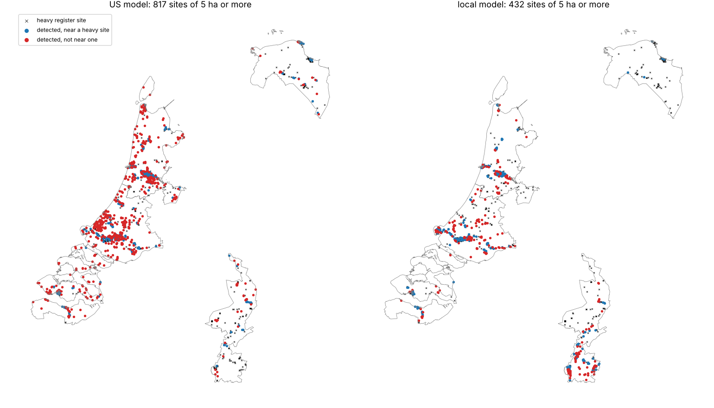

# Geoembeddings: screening for industry outside the US

Can a heavy-industry classifier trained on 10 m AlphaEarth embeddings in one country find industrial sites near homes in a country with no EJ index, well enough to serve as a first-pass screen? We took the classifier from [`geoembeddings-facility-finder/`](../geoembeddings-facility-finder/), trained on registered refineries, terminals, hazardous-waste sites and chemical plants in 17 Gulf Coast counties, and ran it unchanged over five Dutch provinces. We then retrained it on the Dutch register, scored both models against that register, hand-checked a random sample of each model's detections on aerial photos, and counted the people living nearby. Issue [#157](https://github.com/fulton-ring/agent-content-demos/issues/157).

**Short answer: the US model doesn't carry over as a screen, but a locally retrained one does.** The US model still ranks Dutch industrial pixels well (AUC 0.92), but at its US threshold it flags greenhouses, brick housing, town centres and building sites. Only 11 of 30 random detections were industry of any kind (37%, 95% interval 22–55%). Retrained on about 500 Dutch register sites, the same pipeline found industry in 27 of 30 (90%, 74–97%), and both models found the register's refineries and most of its chemical plants. Neither model tells heavy industry (tank farms, plants) apart from warehouses and shipyards: heavy sites were 3 of 30 and 5 of 30.

## How to run

```bash
./run.sh
```

It needs [uv](https://docs.astral.sh/uv/), about 9 GB of free memory and about 6 GB of disk (the 4.1 GB cache in `data/` plus the Python environment). It downloads about 51 GB, most of it AlphaEarth blocks that are read and thrown away. `run.sh` runs the notebook `ej_outside_us.py` as a script, and every number below is in `outputs/summary.json`. To read the notebook with its tables, run `uv run marimo edit ej_outside_us.py`.

## Where the data comes from

Everything is downloaded at run time. The only committed data are the 60 photo chips in `outputs/chips/`, used for the hand check. Delete `outputs/chips/` to re-fetch them from PDOK.

| Data | Copy used | Licence |
|---|---|---|
| AlphaEarth Foundations annual Satellite Embedding, 2022, 10 m | [Source Cooperative `tge-labs/aef`](https://source.coop/tge-labs/aef) | CC-BY 4.0. "The AlphaEarth Foundations Satellite Embedding dataset is produced by Google and Google DeepMind." |
| US training facilities (EIA refineries and terminals, EPA RMP, RCRA TSDF, TRI, Superfund; power, gas processing, LNG) | [HIFLD Next](https://hifld.publicenvirodata.org) GeoParquet v1.0.0 | As published by HIFLD Next |
| US county outlines | Census Bureau 2022 cartographic boundaries | Public domain |
| Dutch register: sites reporting under the Industrial Emissions Directive and E-PRTR | [EEA Industrial Reporting site map, v16, Feb 2026](https://sdi.eea.europa.eu/catalogue/srv/api/records/3bbf28cb-70e8-4073-8fe9-8c1d9c513f52) (the data behind the EU Industrial Emissions Portal) | CC-BY 4.0, © EEA |
| Dutch province outlines, 2022 | CBS gebiedsindelingen via [PDOK](https://api.pdok.nl/cbs/gebiedsindelingen/ogc/v1) | CC-BY 4.0 |
| Population, 2020, 100 m | [GHS-POP R2023A](https://human-settlement.emergency.copernicus.eu/ghs_pop2023.php), JRC | CC-BY 4.0, © European Union |
| Aerial photos, 2022, 25 cm | PDOK Luchtfoto (Beeldmateriaal Nederland) WMS | CC-BY 4.0 |

**Why the Netherlands.** It has an open, georeferenced register to score against, open 25 cm photos to check against, and no EJScreen-style index that combines pollution with who lives nearby. RIVM's Atlas Leefomgeving maps environmental health, but it has no demographic or EJ index. The five provinces were picked up front for their different industry: Zuid-Holland (Rotterdam port), Noord-Holland (IJmuiden, Amsterdam port), Zeeland (Vlissingen, Terneuzen), Limburg (Chemelot) and Groningen (Delfzijl, Eemshaven). Together they hold 8.6 million people and 12,300 km² of land, which is 230 AlphaEarth blocks.

## Method in one paragraph

The **US model** is the facility finder's, rebuilt here: a multinomial logistic regression on the 64 embedding values of pixels within 30 m of 857 registered facilities (21,189 pixels) and 127,798 background pixels more than 1 km from any registered facility, all 17 counties at once. The **register** is Dutch sites that reported in 2021–2023. We count a site as **heavy** if one of its E-PRTR sectors is energy, chemicals, metals, minerals, or waste and wastewater (523 sites in the five provinces). Livestock farms are dropped, and food, paper and "other" sites only keep background pixels away. The **local model** is the same pipeline with two classes (heavy site or background), trained five times, each time holding out one province. Both models scan every province on a 20 m grid of 10 m pixels (30.7 million pixels). The local model scores each province only with the model that never saw it. As in the facility finder, pixels with P(industrial) ≥ 0.9 are joined into sites, and the operating point is sites of 5 ha or more, fixed before the scan. A site is **registered** if a heavy register site is within 500 m, and a heavy site is **found** if a detected site comes within 500 m of it.

## Results

All numbers come from `outputs/summary.json`, `outputs/sites.csv` and `hand_check.csv`, written or read by the run.

**Pixels** (heavy register pixels against background; the local model's AUC is on held-out provinces):

| | US model | Local model |
|---|---|---|
| AUC, all five provinces | 0.92 | 0.95 |
| AUC by province | 0.87 (Zeeland) to 0.94 (Groningen) | 0.93 to 0.96 |
| Background pixels over 0.9 | 3.0% | 0.9% |

**Sites against the register** (sites of 5 ha or more, threshold 0.9):

| | Sites | Precision | Recall | No register site within 1 km |
|---|---|---|---|---|
| US model | 817 | 0.25 | 0.55 | 456 |
| Local model | 432 | 0.48 | 0.49 | 128 |

- By province, the US model's precision runs from 0.21 (Zuid-Holland, Zeeland) to 0.57 (Groningen). In Limburg, whose chemical park looks least like the Gulf Coast, its recall drops to 0.30, against 0.50 for the local model.
- Recall by sector: the US model finds all six refineries and the local model five, and both find 68% of chemical sites. Waste, wastewater and mineral sites are mostly found less than half the time (landfills: 0.55 for the US model, 0.46 for the local one).
- Precision is a floor on finding industry, since the register only lists sites big enough to report. The hand check measures the rest.
- Lowering the US threshold to 0.5 raises recall to 0.86 but cuts precision to 0.14. At 0.99 precision is 0.45 and recall 0.16.

**Hand check** of 30 random sites of 5 ha or more per model (seed 0), on 2022 aerial photos (`hand_check.csv`, `outputs/chips/`):

| Label | US model | Local model |
|---|---|---|
| Heavy (tank farm, power station, process plant, bulk terminal) | 3 | 5 |
| Other industry (industrial estates, warehouses, port quays, shipyards) | 8 | 22 |
| Not industrial (greenhouses, housing, town centres, building sites, dunes) | 19 | 3 |
| Any industry, 95% interval | 37% (22–55%) | 90% (74–97%) |

- The US model's 19 false alarms are 4 greenhouse blocks and a glasshouse research compound, 10 housing areas, town centres and campuses, 2 building sites, a holiday park and a stretch of dunes. The Gulf Coast training counties have almost none of these.
- Two heavy sites in the sample have no heavy register site within 500 m: a Rotterdam tank farm 510 m from the nearest register point (US model), and a tank farm in Limburg about 300 m from homes with no register site within 1.2 km (local model). Tank storage on its own is not an E-PRTR or IED activity, so the register misses it.

**People** (GHS-POP 2020; each 100 m cell counted once):

| Sites of 5 ha or more | Within 1 km | Within 3 km |
|---|---|---|
| US model, all 817 | 4.60 million | 7.04 million |
| Local model, all 432 | 1.95 million | 5.08 million |
| Local model, the 12 hand-checked industrial sites with no heavy register site nearby | 90,507 | 619,303 |

In a country this dense, a screen with false alarms puts most people "near industry": the US model's 1 km count is 54% of everyone in the five provinces. The count is only meaningful after the hand check.



**Cost and time.** Zero dollars, and no account or key is needed. A clean checkout on 4 CPUs took 10 minutes 19 seconds and downloaded 50.7 GB (counted from the machine's network interfaces, so other traffic during the run is included). That is 32.9 GB for the 431 US blocks, which are read only for training pixels and so take 4 minutes and almost no disk, and 17.6 GB for the 230 Dutch blocks, 2 minutes. The rest is the register (90 MB), two GHS-POP tiles (80 MB) and the photo chips. The scan of both models took about 1 minute. The Dutch blocks' 20 m grids are cached in `data/` (4.1 GB), so a rerun takes about 4 minutes. Peak memory was about 9 GB.

## What didn't work

- **The US model as is.** Its threshold doesn't transfer: greenhouses, brick terraces and construction score above 0.9.
- **Heavy versus light.** Neither model separates tank farms and plants from warehouses and port quays. The register's sector can't be predicted from the embedding.
- **The local model at 0.99.** It leaves 9 sites, because its probabilities are less extreme.

## What it doesn't show

- Five provinces, one year (2022) and one linear model. Training on the US and Dutch registers together, or using a nonlinear model, might do better; we didn't try either.
- The Dutch register points are site addresses, so a 500 m match forgives some offset. Seveso tank-storage sites are in a separate register (RIVM's Risicokaart) that we didn't check against.
- Each hand-check sample is 30 sites, judged by the worker agent from photos. "Heavy" is a land-use label, not measured pollution.
- GHS-POP is a modelled grid; the counts are for scale, not exposure.

## What we looked at first

- The facility finder's code for range reads, dequantising and flipping the files, and its model setup. It's copied into this notebook, since that folder can't be edited.
- The EEA register comes as a 584 MB GeoPackage or a 90 MB FileGDB. We read the FileGDB with pyogrio, straight out of its zip.
- For population, WorldPop and GHS-POP are both global and open. We used GHS-POP for its single CC-BY 4.0 grid.
