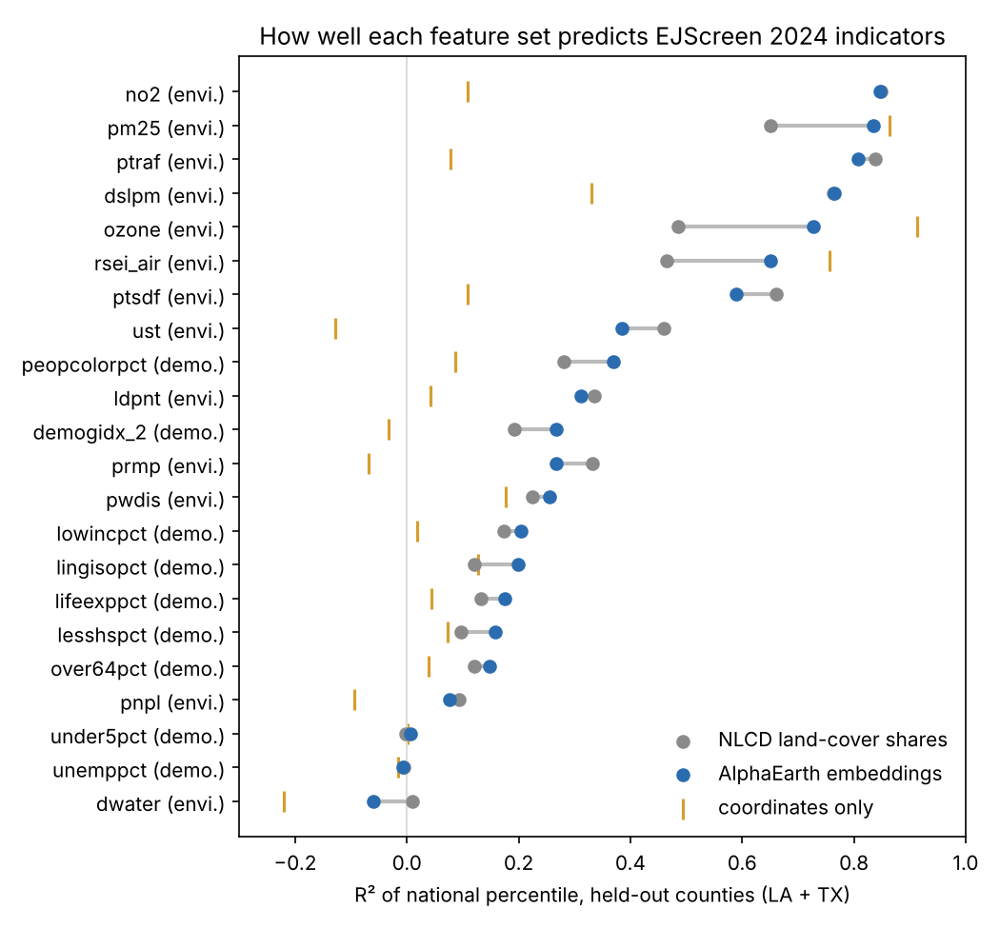
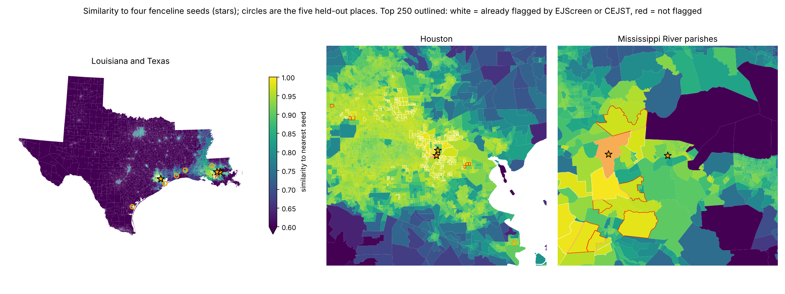

# Geoembeddings for EJ screening

Can public satellite embeddings find communities with high environmental and health burdens, including ones the EJ screening indexes miss? We tested Google DeepMind's AlphaEarth Foundations embeddings against EPA's EJScreen 2024 block-group indicators in Louisiana and Texas. Issue [#149](https://github.com/fulton-ring/agent-content-demos/issues/149).

**Short answer: not as a finder of missed places.** Mean-pooled embeddings predict EJScreen's land-use indicators about as well as plain NLCD land-cover shares, not better. Where they do beat NLCD (ozone, PM2.5, toxic air releases), the block group's coordinates alone do better still: the embeddings are telling the model where a place is. A "find places like this" search from four well-known fenceline communities mostly returns block groups EJScreen or CEJST already flag. Hand-checked on aerial photos, the unflagged ones are mostly cane fields, swamp and suburbs, not hidden fencelines. For asthma, embeddings add to the EJ indicators about what coordinates add.

## How to run

```bash
./run.sh
```

It needs [uv](https://docs.astral.sh/uv/), about 3 GB of disk and about 4.5 GB of downloads. On the first run it builds the EJScreen and CEJST GeoParquet files by running `../ej-datasets-hifld-next/run.sh` unchanged, with its download and output folders pointed into `data/ej/` (1.4 GB, about 12 minutes). It then runs the notebook `geoembeddings_ej.py` as a script. To read the notebook with its outputs, run `uv run marimo edit geoembeddings_ej.py`.

## Where the data comes from

Everything is downloaded at run time; nothing from a source is committed except the 12 small NAIP chips in `outputs/naip/` used for the hand check.

| Data | Copy used | Licence |
|---|---|---|
| AlphaEarth Foundations annual Satellite Embedding, 2022 | [Source Cooperative `tge-labs/aef`](https://source.coop/tge-labs/aef): COGs with mean-pooled overviews, read over HTTP range requests, no account. The Google Cloud original is requester-pays; Earth Engine needs an account. | CC-BY 4.0. "The AlphaEarth Foundations Satellite Embedding dataset is produced by Google and Google DeepMind." |
| EJScreen 2024 block groups and CEJST v2.0 tracts | Built by [`ej-datasets-hifld-next/`](../ej-datasets-hifld-next/) from the Harvard Dataverse and Zenodo archives | CC0 / US government work |
| NLCD 2022 land cover (Annual NLCD Collection 1) | [Source Cooperative mirror](https://source.coop/kylebarron/usgs-landcover) of USGS's requester-pays bucket | Public domain |
| HIFLD Next facility layers: refineries, RMP, TRI, RCRA TSDFs, Superfund, petroleum terminals, power plants | [hifld.publicenvirodata.org](https://hifld.publicenvirodata.org) GeoParquet, `v1.0.0` | As published by HIFLD Next |
| CDC PLACES 2025, tract asthma prevalence | [data.cdc.gov `yjkw-uj5s`](https://data.cdc.gov/d/yjkw-uj5s) | Public domain |
| NAIP aerial photos, 2022–2023 | [Microsoft Planetary Computer](https://planetarycomputer.microsoft.com/dataset/naip), anonymous token | Public domain |

## Method in one paragraph

For each of the 181 embedding tiles over the two states we read the 160 m overview, whose pixels are AlphaEarth's own normalised mean of the 10 m embeddings, and average the pixels inside each of 22,911 block groups (median 53 pixels each). NLCD shares are exact 30 m counts. Both feature sets also get a 5 km neighbourhood average, since EJScreen's proximity indicators look beyond the block group. One gradient-boosting model per indicator predicts EPA's national percentile, scored on five folds of held-out counties and on a train-Texas, test-Louisiana split. A fourth feature set, the block group's coordinates alone, checks what the embeddings carry beyond location.

## Results

All numbers come from `outputs/summary.json` and `outputs/prediction_scores.csv`, written by the run.

**Prediction (R² on held-out counties, national percentile).**

| Indicator | Coordinates | NLCD | Embeddings | Both |
|---|---|---|---|---|
| NO2 | 0.11 | 0.85 | 0.85 | 0.87 |
| Traffic proximity | 0.08 | 0.84 | 0.81 | 0.86 |
| Diesel PM | 0.33 | 0.76 | 0.76 | 0.81 |
| Hazardous-waste (TSDF) proximity | 0.11 | 0.66 | 0.59 | 0.65 |
| RMP facility proximity | -0.07 | 0.33 | 0.27 | 0.31 |
| Superfund proximity | -0.10 | 0.09 | 0.08 | 0.13 |
| PM2.5 | 0.86 | 0.65 | 0.83 | 0.84 |
| Ozone | 0.91 | 0.49 | 0.73 | 0.72 |
| Toxic releases to air (RSEI) | 0.76 | 0.46 | 0.65 | 0.66 |
| People of colour | 0.09 | 0.28 | 0.37 | 0.39 |
| Low income | 0.02 | 0.17 | 0.20 | 0.24 |
| Median, 13 environmental | 0.11 | 0.46 | 0.59 | 0.65 |
| Median, 9 demographic | 0.04 | 0.12 | 0.18 | 0.20 |



- The land-use indicators we expected embeddings to do well on are predicted well, but NLCD does as well or better. Adding embeddings to NLCD changes them by −0.02 to +0.05.
- Embeddings beat NLCD by 0.18 to 0.24 on PM2.5, ozone and RSEI air, and coordinates alone beat embeddings on all three. Trained on Texas and scored on Louisiana, the embeddings' R² falls to 0.27 (ozone), −0.15 (RSEI air) and −2.33 (PM2.5).
- Embeddings do a little better than NLCD on demographics (median 0.18 against 0.12). That's still too weak to screen with.
- Top-decile AUC per indicator is in `outputs/prediction_scores.csv`. For embeddings it runs from 0.97 (PM2.5) and 0.95 (traffic) down to 0.52 (children under 5).

**Look-alike search.** Seeds: the block groups containing Reserve (by the Denka plant) and Convent in Louisiana, and Manchester and Galena Park on the Houston Ship Channel. The top 250 by cosine similarity are the look-alikes.

| | Flagged by EJScreen | by CEJST | by either |
|---|---|---|---|
| All 22,911 block groups | 66.0% | 47.6% | 72.1% |
| Random 250 | 64.8% | 49.6% | 69.6% |
| 250 look-alikes | 94.4% | 84.8% | 95.2% |
| 122 look-alikes more than 10 km from a seed | 89.3% | 72.1% | 90.2% |

- 128 of the 250 look-alikes are within 10 km of a seed. Only 12 are unflagged.
- A refinery, RMP facility, TSDF or terminal is within 3 km of 78% of look-alikes, against 41% of all block groups. For the 12 unflagged ones the share is 42%, no higher than for a block group picked at random.
- False positives: being flagged doesn't make a match right, since 72% of all block groups are flagged, often for demographics alone. 55 of the 250 look-alikes (22%) have no refinery, RMP facility, TSDF or terminal within 3 km, and 48 of those 55 are flagged anyway. Near the seeds the rate is 8 of 128 (6%); more than 10 km away it is 47 of 122 (39%). 38 are in Harris County and 16 in rural Louisiana parishes. This counts only facilities HIFLD Next lists.
- Hand check: all 12 unflagged look-alikes, on NAIP photos from 2022–2023 with HIFLD facilities overlaid. 0 were clearly real, 1 partly (homes against a manufacturing park with about 15 TRI reporters in northwest Houston), and 11 were not: cane fields and swamp in Lafourche, Ascension and inland St. James parishes, and ordinary Houston suburbs. Labels and notes are in `hand_check.csv`; the chips are in `outputs/naip/`.
- Five known fenceline places held out from the seeds rank badly out of 22,907: Texas City 2,490th, North Baton Rouge 3,766th, Mossville/Westlake 7,685th, West Port Arthur 7,755th and Hillcrest in Corpus Christi 9,113th. Using only the block group's own pixels or only its 5 km context doesn't fix it (`summary.json`, `variants`).



**Asthma (CDC PLACES 2025, R² on held-out counties, 8,211 tracts).** EJ indicators alone 0.56; embeddings alone 0.33; EJ indicators plus embeddings 0.64; EJ indicators plus coordinates 0.64. Whatever embeddings add to the EJ indicators, coordinates add as much.

**Cost and time.** Zero dollars; no account or key is needed. On 4 CPUs a clean checkout took about 12 minutes for the sibling EJ build, then 12 minutes for the notebook in the run these outputs come from: 3 for the 181 embedding tiles (2.8 GB), half a minute for NLCD (149 MB), 5 for the model fits, and the rest for the NAIP mosaics. An earlier clean run on a busier machine took 21 minutes and measured 3.2 GB for the tiles, with identical results. A rerun reuses the downloads. Failures seen: Source Cooperative now and then returns a bad body for a range request, which the notebook retries with a fresh URL; one block group smaller than a 160 m pixel takes the pixel under its interior point.

## Why it didn't work

Mean-pooling a block group's pixels describes what most of the block group looks like, and in a fenceline community most of it is houses or fields; the plant next door is a minority of the pixels even in the 5 km context. So the search finds "suburban Houston" and "river-parish cane and swamp", and EJ flags are already common in both. Where embeddings look strong, on regional air quality, they are acting as a map of where things are.

## What it doesn't show

- It doesn't test other ways to use embeddings. Three follow-ups are filed as sub-issues: a classifier on 10 m pixels of known facilities to find unregistered hazards near homes (#155), year-to-year change to spot new industry next to housing (#156), and screening in a country with no EJ index (#157).
- Only two states, one year (2022) and one model (AlphaEarth). Clay and Major TOM embeddings were not tried.
- The hand check is 12 block groups judged by the worker agent from photos, not a field visit, and "real" means visible heavy industry next to homes, not measured exposure.
- EJScreen 2024 has no impervious-surface or tree-cover indicator, so those weren't tested.
- PLACES asthma is itself modelled partly from ACS demographics, so it favours the demographic indicators.

## What we looked at first

- **AlphaEarth on Earth Engine** needs an account; the Google Cloud bucket is requester-pays. The Source Cooperative copy is open, and its overviews already hold AlphaEarth's own mean-pooled embeddings, so no 10 m data has to be downloaded. Its files are stored bottom-up, and the published `.vrt` wrappers didn't open over HTTP with GDAL, so the notebook reads the TIFFs and flips the rows.
- **Annual NLCD** from USGS is requester-pays; the Source Cooperative mirror isn't.
- **`rasterio.merge` with `WarpedVRT`** builds the NAIP mosaics across UTM zones, and Planetary Computer's STAC search finds the photos. The per-tile embedding sums and NLCD counts are cached in `data/` so a rerun doesn't download again.
