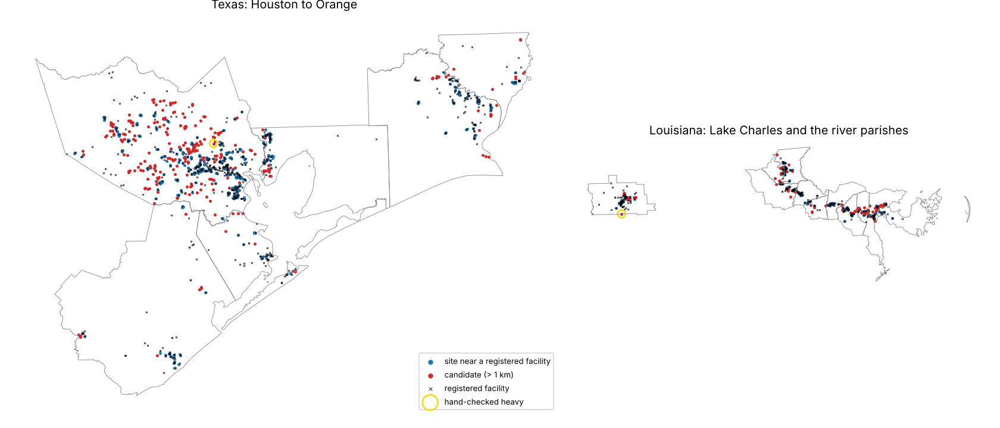

# Geoembeddings facility finder

Can the 10 m AlphaEarth satellite embeddings of known heavy-industry sites find similar sites that aren't in HIFLD Next or EPA's registries, and how many sit next to homes? We trained a classifier on pixels at registered refineries, petroleum terminals, hazardous-waste TSDFs and RMP chemical facilities in 17 Gulf Coast counties and parishes, scanned counties it never saw, and hand-checked what it found away from the registries. Issue [#155](https://github.com/fulton-ring/agent-content-demos/issues/155), a follow-up to [`geoembeddings-ej-screening/`](../geoembeddings-ej-screening/).

**Short answer: it finds industry, but not the hidden heavy industry we hoped for.** At the pixel level the classifier is nearly perfect (held-out AUC 0.97 to 1.00). As a scanner it finds two thirds of registered facilities, but only 38% of the sites it flags are near one. Of 324 candidate sites more than 1 km from any registered facility, a random 30 on aerial photos were **1 tank farm, 23 other industrial sites** (rail yards, salvage yards, shipyards, factories, warehouses, a wastewater plant) **and 6 non-industrial** (a mall, offices, a hospital, self-storage). Every real one has an EPA Facility Registry Service (FRS) record within 500 m. These are gaps in HIFLD Next's four heavy-industry layers, not sites EPA has never heard of.

## How to run

```bash
./run.sh
```

It needs [uv](https://docs.astral.sh/uv/), about 12 GB of disk and about 19 GB of downloads. The first run builds the EJScreen and CEJST GeoParquet files by running `../ej-datasets-hifld-next/run.sh` unchanged, with its folders pointed into `data/ej/` (1.4 GB, about 12 minutes). It then runs the notebook `facility_finder.py` as a script. To read the notebook with its outputs, run `uv run marimo edit facility_finder.py`.

## Where the data comes from

Everything is downloaded at run time. Only the 31 NAIP chips in `outputs/naip/` used for the hand check are committed.

| Data | Copy used | Licence |
|---|---|---|
| AlphaEarth Foundations annual Satellite Embedding, 2022, 10 m | [Source Cooperative `tge-labs/aef`](https://source.coop/tge-labs/aef), HTTP range reads, no account | CC-BY 4.0. "The AlphaEarth Foundations Satellite Embedding dataset is produced by Google and Google DeepMind." |
| Refineries, product terminals (EIA); RMP facilities, RCRA TSDFs, TRI, Superfund (EPA); power plants; gas processing plants; LNG terminals; EPA FRS program interests (6.3 million rows) | [HIFLD Next](https://hifld.publicenvirodata.org) GeoParquet, `v1.0.0` | As published by HIFLD Next |
| EJScreen 2024 block groups, CEJST v2.0 tracts | Built by [`ej-datasets-hifld-next/`](../ej-datasets-hifld-next/) | CC0 / US government work |
| NAIP aerial photos, 2022–2023 | [Microsoft Planetary Computer](https://planetarycomputer.microsoft.com/dataset/naip), anonymous token | Public domain |

## Method in one paragraph

The study area is 17 counties and parishes (28,000 km²): Houston and Galveston Bay, Beaumont–Port Arthur–Orange, Lake Charles, and the Mississippi river parishes from Baton Rouge to New Orleans. We read all 431 of the 10 km embedding blocks that touch it at full 10 m resolution. Training positives are the 10 m pixels within 30 m of each of the 857 registered facilities of the four types (21,189 pixels). Background is 300 random pixels per block more than 1 km from anything in nine HIFLD Next layers (127,798 pixels). A multinomial logistic regression is trained in five folds of held-out counties. Each county is scanned on a 20 m grid of its 10 m pixels (70.6 million pixels) by the model that never saw it. Pixels with P(any facility) ≥ 0.9 are joined into sites. A site counts as **registered** if a facility of the four types is within 500 m, and as a **candidate** if none is within 1 km. A facility is **found** if a site comes within 500 m of it.

## Results

All numbers come from `outputs/summary.json` and `outputs/candidates.csv`, written by the run.

**Held-out scores against the registries** (sites of 5 ha or more):

| Type | Facilities | Recall | Sites typed as this | Precision: same type | Precision: any of the four |
|---|---|---|---|---|---|
| Refinery | 30 | 0.93 | 23 | 0.00 | 0.09 |
| Petroleum terminal | 100 | 0.70 | 2 | 0.00 | 0.00 |
| TSDF | 105 | 0.82 | 22 | 0.05 | 0.36 |
| RMP facility | 622 | 0.64 | 673 | 0.34 | 0.39 |
| **All four** | **857** | **0.68** | **720** | | **0.38** |

**By site size:** sites of 1 ha or more: 2,744 sites, precision 0.21, recall 0.76, 1,681 candidates. At 5 ha or more: 720, 0.38, 0.68, 324. At 20 ha or more: 206, 0.65, 0.58, 56. We used 5 ha (a small tank farm) as the operating point. It was chosen from this table before any photo was looked at.

- Pixels are easy and sites are hard. Background vastly outnumbers facilities, so a 0.97 AUC still leaves most flagged sites away from the registries.
- The model can't tell the types apart. Sites it types as refineries are almost never near one. It learns "industrial-looking land".
- Precision here is a floor on finding real industry. The hand check below measures the rest.

**Candidates.** 324 sites of 5 ha or more (4,535 ha) are more than 1 km from any registered facility of the four types, 241 of them in Harris County. Of these, 246 have another HIFLD Next facility (TRI, power plant, Superfund, gas processing, LNG) within 1 km and 316 have an FRS site within 500 m. Only one has nothing in FRS within 1 km.

**Hand check** of 30 candidates drawn at random (seed 0), on NAIP photos with registered and FRS sites marked (`hand_check.csv`, `outputs/naip/`):

| Label | Count | Share (95% interval) |
|---|---|---|
| Heavy industry (tank farm, refinery, chemical plant, waste site, bulk terminal) | 1 | 3% (1–17%) |
| Other industry (rail and truck yards, salvage, shipyards, factories, warehouses, a wastewater plant) | 23 | |
| Heavy or other industry | 24 | 80% (63–91%) |
| Not industrial (mall, offices, hospital, self-storage) | 6 | |

- The heavy one is a six-tank storage farm near Sheldon with homes about 300 m away. HIFLD Next has it in no terminal or RMP layer. FRS lists it under Explorer Pipeline as a hazardous-waste and water-permit site, 450 m from the tanks. 1,779 people live within 1 km and about 29,000 within 3 km, all in EJScreen-flagged block groups.
- The one candidate with nothing in FRS within 1 km (checked as well, outside the random sample) is equipment laydown inside the Cameron LNG export terminal, whose HIFLD Next point is 2.3 km away on the same site. It's a large-site location problem, not a missing facility.
- Many of the 23 "other industry" sites sit against homes (rail yards in Beaumont, Baytown and southeast Houston, shipyards in Orange and Port Arthur, metal works in northeast Houston). Within 1 km of them live 73,779 people, 89% in block groups flagged by EJScreen or CEJST; within 3 km, 673,549 (86%). Those counts overlap where sites are close together.



**Cost and time.** Zero dollars, and no account or key is needed. Reading the 431 blocks downloads about 17 GB of 10 m embeddings. With the HIFLD Next layers (including 440 MB of FRS) and NAIP chips, the total is about 19 GB, plus 1.4 GB for the EJ build. On 4 CPUs the first run took about X minutes. The block reads take about 9 minutes with 32 parallel readers; the scan, about 1.5 minutes. A rerun reuses the cached blocks (7 GB in `data/aef/`) and takes about 4 minutes.

## What didn't work

- **Telling the four facility types apart.** Type precision is 0 to 34%, and the model calls refineries RMP sites.
- **Small sites.** Below 5 ha, four in five flagged sites are away from any registry, and those are mostly roofs, parking and yards.
- **Windowed reads.** The files store each of the 64 bands in separate 10 km blocks, so a read around one facility costs a whole block (about 40 MB). One block took 4 to 26 seconds on its own, so throughput comes from reading 32 blocks at once.
- **The newest NAIP year** sometimes only grazed a chip and left it black. The notebook now takes the newest year that covers the whole chip.

## What it doesn't show

- Only 17 counties, one year (2022), one model (AlphaEarth) and a linear classifier. A nonlinear model, or features from a pixel's neighbourhood, might separate the types better. We didn't try them, because a gradient-boosted model was too slow to score 70 million pixels on 4 CPUs.
- Facility points are often at an office or gate, not on the tanks. A 30 m training radius picks up some roads and parking, and a 500 m match radius forgives some of that.
- The hand check is 30 sites judged by the worker agent from photos, not a field visit. "Heavy" is what the classifier was trained to find, not measured exposure. The site names come from FRS records near each site.
- Population counts spread each block group's people evenly over its area.

## What we looked at first

- **The previous spike's code** for range reads, dequantising and flipping the bottom-up files, and the NAIP mosaics. It's copied into this notebook, since that folder can't be edited.
- **The AlphaEarth overviews.** They are cheaper to read (the 20 m overview is a quarter of the size), but they average away small sites, and the issue asked for 10 m pixels.
- **EPA FRS through HIFLD Next** for the registry check. It is 6.3 million program records, and in a city almost every 5 ha site has one within 500 m, so "in FRS" alone doesn't make a site a known hazard.
