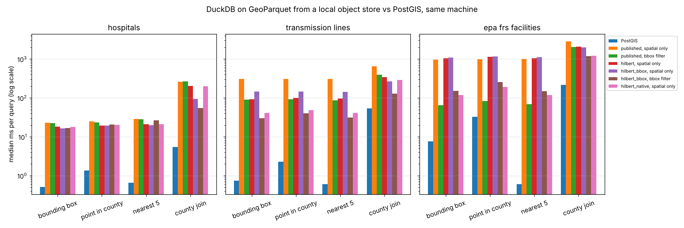

# How fast is HIFLD Next's GeoParquet straight from object storage, and when do you still need PostGIS?

DuckDB 2.0 reads HIFLD Next GeoParquet over S3 range requests. We time four spatial queries against it and against
the same data in PostGIS on the same machine. Each file is written four ways, to see whether **how the file is
written** decides the speed. Issue: [#216](https://github.com/fulton-ring/agent-content-demos/issues/216).

The notebook [`benchmark.py`](benchmark.py) reads top to bottom: the question, the data, the four layouts, the pruning
check, PostGIS, the queries, results, cost, and what didn't work.

## Run it

```bash
./run.sh
```

This needs Docker and [uv](https://docs.astral.sh/uv/). `run.sh` starts SeaweedFS (an S3-compatible object store)
and PostGIS 17-3.5 in Docker, runs the notebook as a script (`uv run benchmark.py`), writes `results/` and removes
the containers. It takes about 30 minutes, most of it the slow full-scan queries, and needs about 5 GB of disk. Set
`N_LOCATIONS` (default 20) or `N_REMOTE_LOCATIONS` (default 5) for a shorter run. To read it as a notebook:
`uv run marimo edit benchmark.py` with the two containers from `run.sh` running.

## Data

Downloaded from [HIFLD Next](https://hifld.publicenvirodata.org)'s public bucket at run time:

| Layer | Features | Published file |
|---|---|---|
| Hospitals | 8,340 points | 1.1 MB, 1 row group |
| Transmission lines | 94,619 lines | 44.5 MB, 1 row group |
| EPA FRS facilities (stands in for substations, which HIFLD Next doesn't have) | 6,335,511 points | 439 MB, 64 row groups |
| US county boundaries | 3,235 polygons | 43.9 MB, 1 row group |

## The four layouts

| Layout | How | FRS file | Write time (FRS) |
|---|---|---|---|
| `published` | As served today: GeoParquet 1.1 with a `bbox` covering column, not spatially sorted | 439 MB | – |
| `hilbert` | DuckDB `ORDER BY ST_Hilbert`, 10,000-row row groups, GeoParquet 1.0, no `bbox` | 360 MB | 15.6 s |
| `hilbert_bbox` | `gpio sort hilbert --add-bbox` (geoparquet-io 0.4.0), GeoParquet 1.1 with `bbox` | 475 MB | 139 s |
| `hilbert_native` | DuckDB sort with `GEOPARQUET_VERSION 'V2'`: native Parquet `GEOMETRY` with per-row-group bounding boxes | 360 MB | 12.6 s |

All sizes and times for every layer are in [`results/layouts.csv`](results/layouts.csv). Loading the same four
tables into PostGIS and building GiST indexes took 57 s and 2.0 GB
([`results/postgis_load.csv`](results/postgis_load.csv)).

## Results

The answers matched: **all 1,485 DuckDB answers returned the same ids as PostGIS.** Each query ran at 20 random
hospital locations (5 for the county join). Times are medians from a local object store, on a 4-CPU Linux cloud
container. Full medians, p95s, bytes and row groups for every variant are in
[`results/summary.csv`](results/summary.csv), and every query is in [`results/timings.csv`](results/timings.csv).

**Does DuckDB 2.0.0 prune row groups on a `bbox` column written by another tool? No, not by itself.** It doesn't read
GeoParquet 1.1 covering metadata. `ST_Intersects` alone read all 64 of the published FRS file's row groups (48 MB,
959 ms) for a box over lower Manhattan. Adding an explicit filter on `bbox.xmin`/`xmax`/`ymin`/`ymax` cut that to
7 of 64 (12 MB, 65 ms). It does prune automatically on **native Parquet geometry**: 19 of 619 row groups, 154 ms,
with no hint in the query ([`results/pruning.csv`](results/pruning.csv)).

Median ms per query, PostGIS against DuckDB reading the published file the plain way and DuckDB's best layout:

| Layer | Query | PostGIS | DuckDB, published, `ST_Intersects` only | DuckDB, best layout | Best layout | MB fetched (best) |
|---|---|---|---|---|---|---|
| Hospitals | bounding box | 0.5 | 23 | 17 | hilbert_bbox | 1.1 |
| Hospitals | point in county | 1.4 | 25 | 19 | hilbert_bbox | 1.1 |
| Hospitals | nearest 5 | 0.7 | 29 | 20 | hilbert_bbox | 1.1 |
| Hospitals | county join | 5.5 | 262 | 55 | hilbert_bbox + bbox filter | 8.2 |
| Transmission lines | bounding box | 0.8 | 308 | 30 | hilbert_bbox + bbox filter | 8.2 |
| Transmission lines | point in county | 2.3 | 306 | 40 | hilbert_bbox + bbox filter | 9.6 |
| Transmission lines | nearest 5 | 0.6 | 310 | 32 | hilbert_bbox + bbox filter | 9.5 |
| Transmission lines | county join | 54 | 645 | 128 | hilbert_bbox + bbox filter | 18.1 |
| EPA FRS | bounding box | 7.6 | 971 | 64 | published + bbox filter | 10.7 |
| EPA FRS | point in county | 33 | 996 | 83 | published + bbox filter | 12.6 |
| EPA FRS | nearest 5 | 0.6 | 1,004 | 69 | published + bbox filter | 12.2 |
| EPA FRS | county join | 217 | 2,858 | 1,190 | hilbert_bbox + bbox filter | 33.4 |



What the numbers say:

- **How the file is written decides DuckDB's speed.** On the two larger layers, the right layout and query form make
  point, box and nearest queries 8 to 15 times faster than the published file read the plain way (joins 2 to 5
  times). They fetch 2 to 3% of the FRS file (10 to 13 MB
  of 439) instead of all of its geometry. Sorting alone does nothing if nothing reads the statistics. The `hilbert`
  layout without `bbox` or native geometry read all 619 row groups, in 646 requests.
- **On the best layout, point, box and nearest queries come back in 17 to 83 ms**, and a county join for a whole
  state in 0.05 to 1.2 s.
- **PostGIS is still 2 to 113 times faster** on every query. Everything but the joins and the FRS county polygon
  (33 ms) runs under 10 ms. DuckDB has a
  floor of about 17 ms per query, for reading the footer and making several requests. It has no spatial index, so
  nearest-5 is a widening window: 0.6 ms in PostGIS, about 70 ms in DuckDB.
- **Over the internet it gets slower.** Read straight from HIFLD Next's public Google Cloud bucket through this
  container's proxy, the published FRS file takes 2.5 s per query the plain way and 1.0 to 1.2 s with the bbox
  filter. Transmission lines take 7 s and 2.5 to 3.2 s, and hospitals 0.7 s. That's still faster than the 1.3 to
  29.9 s the NTNU thesis benchmark
  ([kartAI/doppa](https://github.com/kartAI/doppa)) found, and slower than every local number above.

## Cost per thousand queries

Prices: Google Cloud Storage Class B reads at $0.0004 per 1,000 and internet egress at $0.12/GB
([Google's pricing examples](https://cloud.google.com/storage/pricing-examples)). PostGIS on a GCP e2-medium at
$0.0553/hour, $40/month ([Spare Cores](https://sparecores.com/server/gcp/e2-medium)).

| Setup | FRS point query, per 1,000 queries |
|---|---|
| DuckDB, published, `ST_Intersects` only, reader on the internet | $7.05 (58 MB each) |
| DuckDB, published + bbox filter or `hilbert_native`, reader on the internet | $1.14 to $1.52 |
| Same, reader in the bucket's region (no egress) | $0.005 to $0.008 |
| PostGIS e2-medium at 10,000 / 100,000 / 1,000,000 queries a month | $4.04 / $0.40 / $0.04 |

Egress is the cost. A badly written file costs the publisher about six times as much per query as a well-written one.
Per query, files are cheaper than a database below about 30,000 internet queries a month (well-written) or 6,000
(published as-is). Above that, an always-on PostGIS server costs less. Every row is in
[`results/costs.csv`](results/costs.csv).

## When you still need PostGIS

- **The answer needs to come back in milliseconds**, as in an app or an agent making many lookups per task. PostGIS
  answers in about 1 ms, files take 20 ms or more locally and around a second over the internet.
- **Nearest-neighbour and spatial joins.** These are where the index matters most: a statewide county join took
  1.2 s in DuckDB against 0.2 s in PostGIS.
- **High query volume.** Above tens of thousands of internet queries a month, egress costs more than a small
  server.

For occasional analysis, a researcher can query well-written files directly, and the publisher should write them
for that. Our recommendation for HIFLD Next is to sort and write native geometry (`GEOPARQUET_VERSION 'V2'`) or keep
the `bbox` column and document the explicit filter.

## What didn't work

- MinIO, which the issue suggested, no longer publishes pullable images: Docker Hub refuses the pull and quay.io
  asks for a login. We use SeaweedFS instead; it serves the same S3 range reads.
- geoparquet-io 1.2.0 crashes on DuckDB 2.0, because it calls a removed connection method. We pin 0.4.0.
- DuckDB won't write row groups smaller than its 2,048-row vector, so the DuckDB-written county files have 2 row
  groups where geoparquet-io's has 33. That's why `hilbert_bbox` wins the hospital county join (8 MB against 42 MB).
- In the FRS file, the Hilbert layouts with 10,000-row row groups were slower than the published file's 64 groups
  of about 100,000 rows (64 ms against 119 to 153 ms), with similar bytes and requests. The likely cause is the
  footer, which grows from 0.3 MB to 2.9 MB and gets fetched and parsed on every query. Smaller row groups aren't
  free.
- A first run used `&&` (bounding-box overlap) for PostGIS's box query, and that disagreed with DuckDB on
  transmission lines. The notebook now uses `ST_Intersects` in both engines.

## What this doesn't show

- It ran on one 4-CPU cloud container, not on a laptop and a separate cloud VM, and ran one query at a time. A cloud
  VM in the bucket's region was out of scope for a no-cost run.
- The internet run went through this container's egress proxy, so its times are an upper bound.
- PostGIS ran on the same machine with warm caches. A remote database adds a network round trip to every query.
- It covers three layers and four query shapes. Polygon-heavy layers like flood zones may behave differently.
- Tools used instead of our own code: DuckDB's Parquet writer, geoparquet-io, and DuckDB's HTTP log for bytes fetched.
