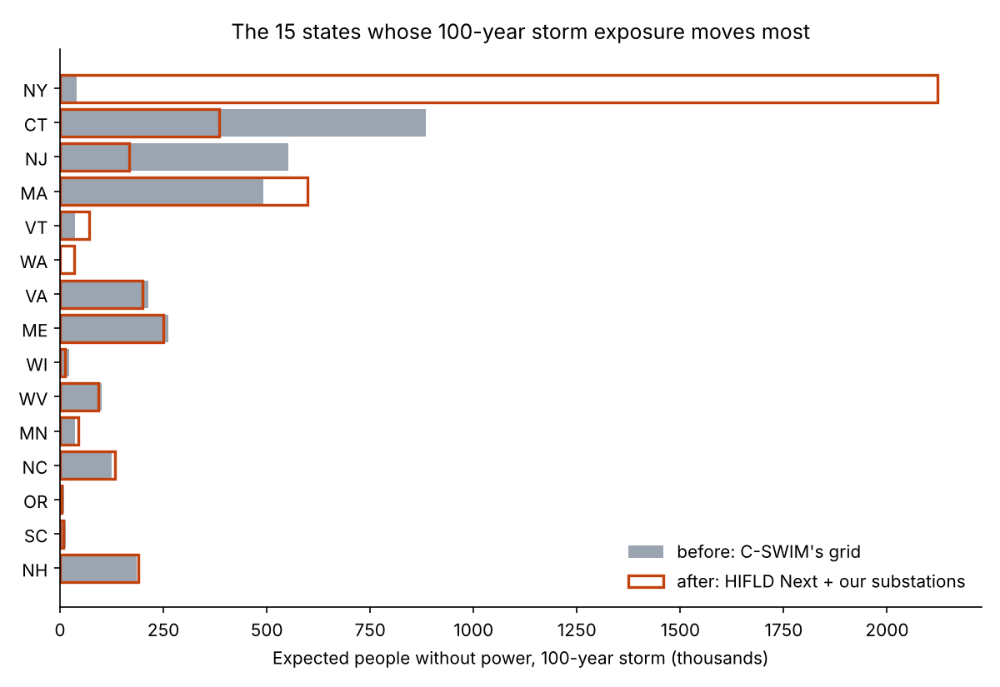

# Does a fuller substation map change where a geomagnetic storm hits the US grid hardest?

Spike for [issue #215](https://github.com/fulton-ring/agent-content-demos/issues/215)
([proposal card](https://app.notion.com/p/406cc69045cb81a2a8e3f4f82af7a142)). We rerun the open C-SWIM storm-loss
model from AGU Advances (Oughton, Bor et al. 2026) on its own grid, then on HIFLD Next transmission lines with our
verified substations (`us-substations-verified/dataset/`), and compare.

**Short answer: yes, a lot, and almost all of it is New York.** Our rerun of the paper's own grid lands within 2%
of its headline (3.51 million people for a 100-year storm against 3.45 million). On HIFLD Next lines with our
substations the grid gains 1,385 substations (+13.5%) and 2,297 line segments (+14.1%), and the people put out of
power rise 38% for a 100-year storm (to 4.84 million, about 1.71 billion USD a day) and 40% for a 250-year storm (to
7.24 million, 2.57 billion a day). New York goes from 20 substations to 204 and from about 41,000 expected people
affected to 2.1 million, led by Long Island and Westchester; Connecticut and New Jersey fall, because Long Island and
New York City were being served by their substations. Washington, the paper's other sparse state, gains 286
substations but stays near zero, because its storm fields are weak. The fuller map moves the hotspot rather than
confirming the published one.

## Run it

```bash
./run.sh     # needs uv and about 15 GB of free disk on the first run
```

It runs the notebook [`gic_rerun.py`](gic_rerun.py) as a script and writes `outputs/`. To read it with each step's
output beside it: `uv run marimo edit gic_rerun.py`. The first run downloads C-SWIM's 11 GB data release once,
keeps about 1.5 GB of it in `data/` and deletes the rest. **Run time:** RUNTIME_TBD. It costs nothing.

## Data (all public, downloaded at run time, nothing downloaded is committed)

| Input | Source |
|---|---|
| Storm catalog (92 storms, 1985 to 2024), observatory magnetic fields, the published grid (10,464 substations), per-line storm voltages, return-period fits, C-SWIM's own Monte Carlo output | C-SWIM data release v5, [Zenodo 20089397](https://zenodo.org/records/20089397) |
| Magnetotelluric transfer functions (EarthScope USArray / USMTArray), 1,611 of C-SWIM's 1,616 sites | C-SWIM data release, [Zenodo 16994602](https://zenodo.org/records/16994602) |
| Transmission lines (after) | [HIFLD Next](https://hifld.publicenvirodata.org/) Transmission Lines v1.0.0 |
| Substations (after) | `us-substations-verified/dataset/us_substations.parquet` (HIFLD-derived plus OpenStreetMap via Overture, ODbL) |
| Population | Census 2020 block-group population centroids |
| Counties | Census 2024 cartographic boundaries, 1:500k |

## How

C-SWIM's code ([github.com/denniesbor/C-SWIM](https://github.com/denniesbor/C-SWIM), MIT) is written for a GPU
workstation with its own data folders, so the notebook rewrites each stage in a few lines, names the C-SWIM function
it follows, and checks it against C-SWIM's published output:

1. **Grid** (`08_p_power_grid.py`, `build_admittance_matrix.py`): substations within 150 m of a 160 kV+ line, lines
   split between neighbouring substations, a high- and low-voltage bus per substation.
2. **Storm voltages** (`calc_storm_maxes.py`): SECS fit to observatory fields ([pysecs](https://github.com/greglucas/pysecs)),
   magnetotelluric impedances ([bezpy](https://github.com/greglucas/bezpy)), integrated along each line, for all 92 storms.
3. **100- and 250-year values** (`stat_analysis.py`): median of 100 bootstrap truncated-lognormal fits per line.
4. **Currents and failures** (`est_gic.py`, `p_gic_files.py`): 1,000 Monte Carlo transformer setups, a sparse network
   solve, effective current per phase, C-SWIM's fragility curve.
5. **People and dollars**: people served = Census block groups nearest each substation; dollars = the paper's own
   rate per affected person (its loss model is linear in affected people).

## Results

Numbers from `outputs/headline.txt` and `outputs/national_totals.csv` (1,000 Monte Carlo draws per grid; the
range is the 5th to 95th percentile across draws).

**Does the rerun reproduce the paper?**

| Run | 100-year people | 250-year people | Gap to paper (100 / 250) |
|---|---|---|---|
| Paper (AGU Advances 2026) | 3.45 M | 5.10 M | |
| (a) C-SWIM's own Monte Carlo in its data release v5 | 4.12 M | 5.78 M | +19% / +13% |
| (b) our solver, C-SWIM's published line voltages | 3.55 M | 5.16 M | +3.0% / +1.1% |
| (c) our full rerun of the published grid (the *before*) | 3.51 M (3.07 to 3.96) | 5.18 M (4.64 to 5.73) | +1.8% / +1.7% |

Step checks against C-SWIM's published files, on the 16,093 line segments both grids share (of its 16,256): our
storm maxima equal C-SWIM's (median ratio 1.000, 10th to 90th percentile 1.00 to 1.00); our 100-year line voltages
match within bootstrap noise (median 1.000, 10th to 90th percentile 0.95 to 1.05). The paper's exact figures are
not in its data release: its own archived Monte Carlo (a) is higher, so the paper used a later run.

**Before and after**

| | Before (C-SWIM's grid) | After (HIFLD Next + our substations) | Change |
|---|---|---|---|
| Substations | 10,284 | 11,669 | +1,385 (+13.5%) |
| Line segments (paper: 16,256) | 16,254 | 18,551 | +2,297 (+14.1%) |
| 100-year people affected | 3.51 M | 4.84 M (4.04 to 5.69) | +38% |
| 100-year daily loss | 1.24 B USD | 1.71 B USD | +0.47 B |
| 250-year people affected | 5.18 M | 7.24 M (6.26 to 8.20) | +40% |
| 250-year daily loss | 1.84 B USD | 2.57 B USD | +0.73 B |

**Where it moves** (100-year storm): New York +2.08 M; all other states together −0.75 M. Counties: Nassau NY
+1.02 M, Westchester NY +0.57 M, Western Connecticut −0.54 M, Passaic NJ −0.31 M, Dutchess NY +0.16 M, Kings NY
+0.14 M. Washington 0 → 35,000. See `outputs/state_changes.csv` and the chart below.



## What it doesn't show

- **Most of the gain is current OpenStreetMap, not HIFLD.** Of the after-grid's 11,669 substations, 9,608 are
  HIFLD-derived with OpenStreetMap within 1 km, 1,717 are OpenStreetMap only and 344 HIFLD-derived only. C-SWIM's own
  code switched to current OpenStreetMap in August 2026, after the paper, so the authors' next run may close much of
  this gap themselves.
- **The totals move because service areas are coarse.** C-SWIM gives each 161 kV+ substation everyone nearer to it
  than to any other. Where few such substations serve a dense place (Long Island, New York City), one substation
  stands for about a million people, so a handful of substations moves the national total. That is the method's
  sensitivity, measured here, not a better estimate of real outages.
- **Not an exact reproduction.** Five of 1,616 magnetotelluric sites (KAN01 to KAN05) aren't in the public bundle;
  people are allocated by Census block group, not C-SWIM's land-cover weighted ZIP interpolation; dollars use the
  paper's own rate per affected person (its loss model is linear in people), not a rebuilt BEA model; 1,000 Monte
  Carlo draws, not C-SWIM's 2,039.
- **What we looked at first.** C-SWIM's scripts need a conda environment, a GPU, machine-specific paths and pickled
  intermediate files, and we don't execute a downloaded repo's code or unpickle its files in this sandbox, so we
  rewrote each stage in the notebook (pysecs, bezpy and scipy do the heavy lifting) and checked each one against
  C-SWIM's published outputs instead.
- **Grid counts differ slightly from the paper.** Our rebuild of the published grid has 10,284 substations in the
  final network (the paper's figure counts 10,464) and 16,254 line segments (paper 16,256).
- Like the paper: transformer heating only, random transformer types, earthing and ages, no cascading failure. It
  says where modelled risk moves, not which substation would fail.

## Outputs

- `outputs/national_totals.csv`: people affected and daily loss for each run (paper, C-SWIM's own Monte Carlo,
  our reproduction, before, after).
- `outputs/state_changes.csv`: substations, people served and expected people affected by state, before and after.
- `outputs/county_changes.csv`: the same by county, for the county grid-exposure index
  ([#199](https://github.com/fulton-ring/agent-content-demos/issues/199)) to reuse. Counties with one or two
  substations in either grid are blanked (`few_substations`), plus one more where a state would otherwise have a
  single blank. Rounded to the nearest 100 people.
- `outputs/headline.txt`, `outputs/state_change.png`, `outputs/run_log.txt`.

No substation coordinates, names or per-site results are written, per the founder's 2026-10-24 rule.
