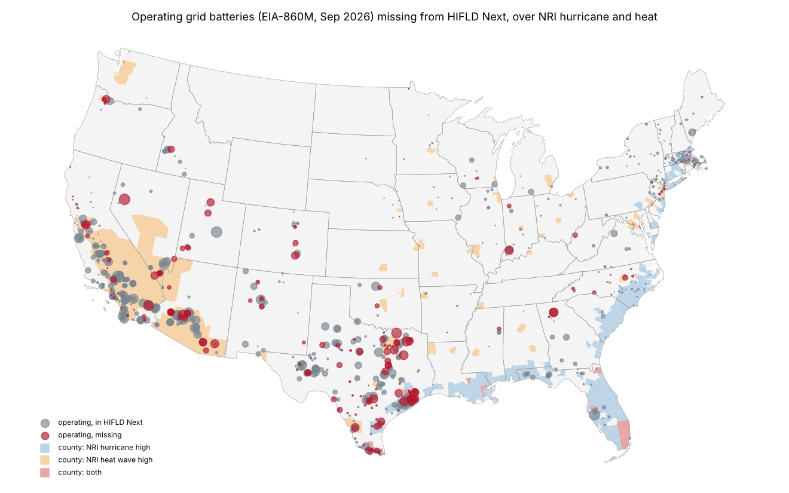

# The grid batteries no public map knows about

How much of the US grid battery fleet, operating, planned and queued, is missing from
[HIFLD Next](https://hifld.publicenvirodata.org)'s energy layers, and is the missing storage where hurricanes and
heat stress the grid most? Issue [#183](https://github.com/fulton-ring/agent-content-demos/issues/183),
[proposal card](https://app.notion.com/p/3facc69045cb81ff93ecde0295ff36e6). It builds on
[`hifld-grid-gaps/`](../hifld-grid-gaps/) (#50), which found 19% of EIA-860 2025's operable battery MW missing from
HIFLD Next; its matching is copied here, not imported, so this notebook reads on its own.

**Read [`batteries.py`](batteries.py)**, a [marimo](https://marimo.io) notebook, top to bottom. The free artifact is
[`output/batteries.csv`](output/batteries.csv) (and [`output/batteries.parquet`](output/batteries.parquet),
GeoParquet): every EIA battery generator with an `in_hifld_next` flag, match type, MW, status, year online, and NRI
and FRI hurricane and heat exposure. Columns are in [`DATA_DICTIONARY.md`](DATA_DICTIONARY.md).



## Run it

```bash
./run.sh            # needs uv; downloads ~100 MB into data/ on the first run, then writes output/
./run.sh --chips    # also redraws the hand-check images in screenshots/hand_check/
```

To read it with outputs: `uv run marimo edit batteries.py`.

## The data

All public and downloaded at run time; `output/provenance.csv` lists each URL and download time.

| Source | Used for |
|---|---|
| [EIA-860M](https://www.eia.gov/electricity/data/eia860m/), September 2026 | Operating and planned battery generators, with coordinates |
| [EIA-860](https://www.eia.gov/electricity/data/eia860/) 2025 | Reconciling with EIA-860M |
| HIFLD Next Power Plants and Generating Units, v1.0.0 | The map being tested (records dated 2023-09 and earlier) |
| [LBNL *Queued Up*](https://eta-publications.lbl.gov/publications/queued-2026-edition-characteristics), data through 2025 | Active interconnection requests with a battery. **CC BY 4.0** (Lawrence Berkeley National Laboratory and GridTracker), so usable without registration |
| [FEMA National Risk Index](https://services.arcgis.com/XG15cJAlne2vxtgt/arcgis/rest/services/National_Risk_Index_Counties/FeatureServer/0), December 2025 | County hurricane and heat-wave risk ratings |
| [`fri-datasets-map/`](../fri-datasets-map/) at `4757ebc` | Our FRI rebuild's hurricane and extreme-heat multipliers, mid-century higher warming |
| USGS NAIP Plus; Sentinel-2 L2A on Planetary Computer | Hand check imagery |

## Results (run of 2026-11-03)

**Operating and planned storage missing from HIFLD Next** (`output/batteries_by_stage.csv`, `batteries_by_match.csv`):

| | Generators | MW | MW missing | Share missing | Listed as a unit |
|---|---:|---:|---:|---:|---:|
| Operating | 1,156 | 56,121 | 14,976 | **27%** | 50% |
| Planned | 484 | 64,235 | 42,212 | **66%** | 15% |

EIA-860M agrees with the annual file: 1,002 of EIA-860 2025's 1,003 operable batteries are operating in it, and 144 of its 607 proposed ones have come online (`reconciliation_eia860_2025.csv`). Adding EIA-860M raised the missing share of operating MW from #50's 19% to 27%, because 2026's builds are in it.
By year online (`batteries_by_year_online.csv`), operating MW missing is under 1% for batteries from 2022 or earlier,
5% for 2023, 10% for 2024, 41% for 2025 and 55% for 2026. The gap is the layers' age, and it grows every month.
Of the 698 operating batteries matched as units, 274 are still listed in Generating Units as planned.

**By state** (`batteries_by_state.csv`): operating MW missing is concentrated in **Texas (7,353 MW, 38% of its
operating battery MW)**, **Arizona (2,337, 34%)** and **California (1,179, 7%)**, then Nevada and Utah. Planned MW
missing: Texas 15,511, Arizona 5,558, California 4,533.

**Queued** (`queue_battery_by_state.csv`): 3,969 active requests include a battery, **544,128 MW** of battery capacity,
led by Texas (169,752 MW), California (98,526) and Oregon (43,718). None of it is built, so none is on any map;
most queued capacity is historically withdrawn. 1,266 hybrid requests list a battery with no MW and count as zero; 914 MW has no county and is left out of the exposure table.

**Exposure, missing vs. mapped** (`exposure_mapped_vs_missing.csv`): share of MW in high-exposure counties.

| | MW | NRI hurricane high | NRI heat wave high | FRI hurricane top fifth | FRI heat top fifth |
|---|---:|---:|---:|---:|---:|
| Operating, mapped | 41,144 | 12% | 54% | 13% | 42% |
| Operating, missing | 14,976 | **19% (2,795 MW)** | **38% (5,765 MW)** | **27% (4,014 MW)** | **61% (9,145 MW)** |
| Planned, mapped | 22,022 | 22% | 38% | 19% | 51% |
| Planned, missing | 42,212 | 8% (3,516 MW) | 26% (11,056 MW) | 18% (7,682 MW) | 47% (20,016 MW) |
| Queued | 543,214 | 9% | 30% | 15% | 39% |

"High" for NRI is `Very High` or `Relatively High`; for the FRI multipliers it's the top fifth of US counties.

**Hand check** (`hand_check.csv`, images in `screenshots/hand_check/`): a seeded sample of 30 operating plants whose
batteries are all missing. **13 of 30 confirmed (43%, 95% Wilson interval 27% to 61%)**: 6 with a container yard
visible, 7 with a new pad at EIA's coordinates that wasn't on NAIP. Of the 15 plants of 20 MW or more, **11
confirmed (73%, 48% to 89%)**; 4 showed no yard within 500 m (one, Route 66 Energy Storage, is probably a coordinate
error). The other 15 are under 20 MW, and 13 of them were too small to see or unclear at 10 m.

**Run time:** 57 s for the notebook from a clean checkout, downloads included (64 s for `./run.sh` with `uv` setup); about 30 s with data cached.

## What the spike shows

**The missing share is large and growing**: 27% of operating battery MW and 66% of planned MW is nowhere on HIFLD
Next, half of the operating gap in Texas. That half of the argument holds.

**The exposure half holds only for operating storage, and depends on the measure.** Missing operating storage is
more exposed to hurricanes (19% vs 12% of MW by NRI; 27% vs 13% by our FRI layer) and to growing heat (61% vs 42% in
the FRI's top fifth), but *less* exposed to today's heat-wave risk (38% vs 54%): NRI's high heat-wave counties are
mostly in California's and Arizona's deserts, where much of the older, mapped fleet sits. For planned storage the
missing part is no more exposed than the mapped part on any measure.

## What didn't work, and what this doesn't show

- **Public NAIP is too old.** USGS's NAIP Plus and Planetary Computer end in 2022 or 2023 by state, before most
  missing plants were built; Esri's NAIP service wasn't reachable. We checked those on 10 m Sentinel-2, which can
  show a new pad but not a few-MW battery. The hand check confirms large plants, not small ones.
- **FEMA's NRI download link now redirects** to a landing page; we read FEMA's ArcGIS service instead.
- **`emp.lbl.gov` returns HTTP 403 to scripts**; the same LBNL file downloads from `eta-publications.lbl.gov`.
- The queue has county locations only, and its battery MW leaves out LBNL's imputed hybrid storage.
- EIA's 1 MW plant threshold leaves out home and most commercial batteries; we don't count them.
- A "planned" battery may never be built; `eia_status` lets a reader keep only those under construction.
- The FRI multipliers are our reconstruction, not FEMA's values.
- EIA-860M is revised monthly in place; a later run with the same month's URL may shift numbers slightly.

## What we looked at first

GeoPandas for the spatial joins and nearest-plant distances, FEMA's ArcGIS REST query API, Planetary Computer's
STAC and tile APIs, and the USGS image service's `exportImage`. We wrote no matching logic beyond joins on EIA's IDs
and nearest-neighbour distances, copied from `hifld-grid-gaps/`.
