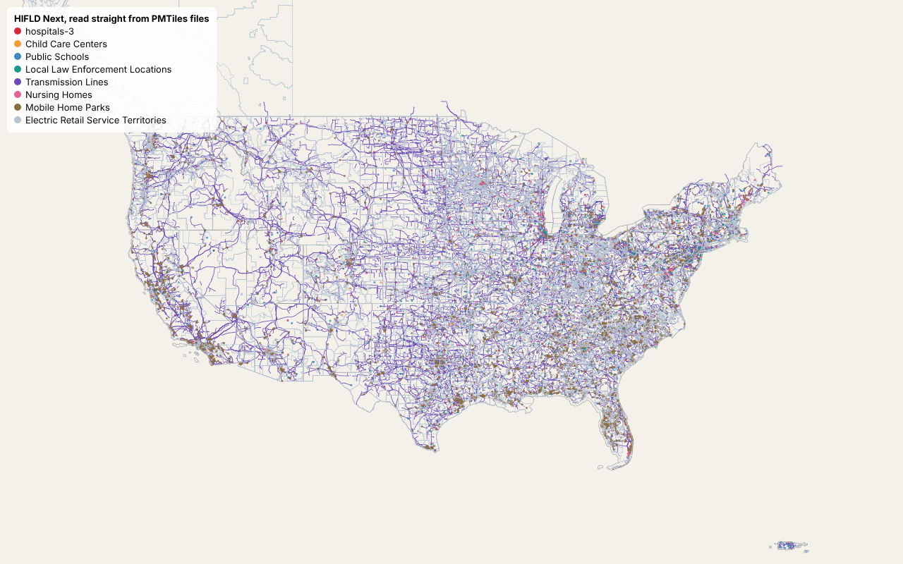

# HIFLD Next layers as single PMTiles files

Can the most-used HIFLD Next layers sit on plain object storage as one PMTiles file each, with a
public map reading them directly and no tile server? And since a PMTiles file is read-only, what
happens to people using the map when a layer changes and its file is rewritten?

**Short answer: HIFLD Next already does this.** 514 of its 525 files carry a `.pmtiles` asset,
built with tippecanoe and served from a public Google Cloud Storage bucket with range requests and
CORS, under a new URL for every version. A static MapLibre page reads them with no server of ours.
The open question was updates, and the answer depends on how the file is replaced: **publish each
version under a new URL** (as HIFLD Next does), because overwriting a file in place under a CDN
either serves the old data for the cache lifetime or, with a CDN that caches by byte range,
breaks the layer outright.



## Run it

```bash
sudo apt install tippecanoe nginx-light   # or: brew install tippecanoe nginx
./run.sh                                  # needs uv; about 12-15 minutes; downloads ~125 MB into data/ (plus ~200 MB of Chromium the first time unless CHROMIUM_PATH is set)
```

`run.sh` runs the marimo notebook `pmtiles_spike.py` as a script, so every number in `outputs/`
comes from the code a reader sees. To read it as a notebook: `uv run marimo edit pmtiles_spike.py`.
Set `CHROMIUM_PATH` to use an installed Chromium instead of downloading one, and
`PMTILES_GDAL_ALL=1` to build all eight layers with GDAL too (adds about 30 minutes).

What's in the folder:

- `pmtiles_spike.py`: the notebook, top to bottom: what HIFLD Next serves, which layers, builds,
  the map, the update test, costs.
- `map/index.html`: the whole map. MapLibre plus the `pmtiles` protocol, given a list of URLs.
- `nginx.conf`: the local "bucket" and two CDN stand-ins used for the update test.
- `outputs/`: CSVs and `results.json` from the last run, and the map screenshot.

## Data

All public, downloaded at run time: the HIFLD Next catalog API and its GeoParquet files
(`hifld.publicenvirodata.org`), HIFLD Next's published `.pmtiles` files, and the ArcGIS Online
search API for view counts. Nothing downloaded is committed.

## Results

From the clean-checkout run on 2026-11-10 (`outputs/results.json`).

**What exists.** HIFLD Next's catalog lists 330 datasets with 525 files; **514 files already have
a PMTiles asset** (the 11 without are all tables with no geometry).
They're built with tippecanoe 2.49 (`-zg --drop-densest-as-needed`) and served from Google Cloud
Storage with `Cache-Control: public, max-age=3600`, a strong ETag, range requests and CORS `*`.
One quirk: each file's tile layer is named after a temporary build file (`hospitals3chunk0fgb`),
so a map has to read the name from the archive.

**Which layers.** HIFLD Next publishes no usage counts. We ranked by ArcGIS Online views of the
old HIFLD layers and their public copies (`outputs/layer_ranking.csv`) and took the top eight.

| Layer | Features | GeoParquet MB | HIFLD Next PMTiles MB | Our PMTiles MB | tippecanoe s |
|---|---:|---:|---:|---:|---:|
| Hospitals | 8,340 | 1.1 | 2.1 | 2.1 | 1.5 |
| Child care centers | 132,217 | 11.3 | 32.2 | 32.2 | 17.2 |
| Public schools | 102,268 | 11.6 | 20.7 | 20.7 | 12.9 |
| Local law enforcement | 23,486 | 2.6 | 4.2 | 4.2 | 3.0 |
| Transmission lines | 94,619 | 44.5 | 24.4 | 24.4 | 30.7 |
| Nursing homes | 53,129 | 6.1 | 10.0 | 10.0 | 6.5 |
| Mobile home parks | 56,094 | 5.1 | 6.2 | 6.8 | 5.5 |
| Electric retail service territories | 2,931 | 41.7 | 37.5 | 37.4 | 44.8 |

Our rebuild reproduces HIFLD Next's files (138 MB against their 137 MB) in **122 s for all
eight**, so rebuilding any one changed layer takes 2 to 45 s here. GDAL's PMTiles driver, which
needs no system install, took **7x as long** on the three layers we built both ways (251 s against
35 s) and made files 1.7x the size.

**The map.** `map/index.html` reads HIFLD Next's own files straight from the bucket. The first
view of the lower 48 fetches a median **3.3 MB in 73 range requests** (2.4% of the 137 MB in the
eight files) and is idle in **7.7 s** from a cloud machine, over three cold-cache runs. Our rebuilt
files on the local bucket fetch the same 73 requests and 3.4 MB.

**Updating a layer.** We removed one hospital and changed another's bed count, rebuilt (1.5 s),
and published it two ways. Each row shows which version a new visitor sees afterwards; the
notebook also covers a visitor who already has the map open (`outputs/update_path.csv`).

| How it's published | Plain bucket | CDN, whole-object cache | CDN, range-slice cache |
|---|---|---|---|
| Overwrite at the same URL | new data; open maps switch by themselves | old data until the cache expires or is purged | **layer broken** (13 tile errors) until the cache expires |
| New URL per version | new data after reload | not tested | new data after reload |

pmtiles.js copes with an overwrite on a plain bucket: it sees the ETag change, drops its cached
directory and refetches. A CDN that caches by byte range ends up holding pieces of two files
under one URL, and the layer fails for everyone. A new URL per version, which is what HIFLD Next
does, has nothing cached that can be wrong. Separately, reloading with a warm browser cache gave
1 or 2 "Failed to fetch" errors on layers that hadn't changed, in every setup; we didn't find the
cause.

**Cost.** Assumed traffic: 10,000 sessions a month, each worth five first views (167 GB, 3.6
million range reads); 100,000 in brackets. Prices are from the providers' pages, read 2026-11-10:
[Cloud Storage](https://cloud.google.com/storage/pricing),
[network](https://cloud.google.com/vpc/network-pricing), [R2](https://developers.cloudflare.com/r2/pricing/),
[CloudFront](https://aws.amazon.com/cloudfront/pricing/), [Hugging Face](https://huggingface.co/storage).

| Setup | $/month | Why |
|---|---:|---|
| Google Cloud Storage, direct, no CDN | 21 (215) | almost all egress at $0.12/GB |
| Cloudflare R2, direct | 0 (10) | free egress; inside the free tier at 10,000 |
| GCS behind CloudFront flat-rate Pro | 17 (36) | $15 plan; GCS egress only on the 10% of misses we assumed |
| Hugging Face bucket | not priced | egress included only up to 8x storage (1.1 GB here) |

Storage is pennies at 0.14 GB; the bill is egress. A CDN cuts it by moving reads off the bucket,
and costs nothing in correctness as long as each version gets a new URL.

## What we looked at first

tippecanoe (what HIFLD Next uses, same version 2.49) and GDAL's PMTiles driver for building;
the `pmtiles` Python package for reading headers; MapLibre with Protomaps' `pmtiles` JS protocol
for the map; nginx's `proxy_cache` and `slice` modules for the CDN stand-ins. We wrote no tile
code of our own. We read pmtiles.js's `FetchSource` to understand how it handles ETags: it doesn't
send `If-Match` (to avoid CORS preflights), and on an ETag change it drops its cached header,
retries once with `cache: "reload"`, and gives up with an error if the ETag still disagrees.

## What this doesn't show

- **Traffic to HIFLD Next.** It publishes no usage counts, so "most used" means most-viewed on
  ArcGIS Online, which is demand for the old HIFLD Open layers and their copies.
- **A real bucket or CDN.** We had no bucket we could write to and used no paid service. The
  update test runs nginx on one machine as the bucket and as two kinds of CDN. It shows the
  caching mechanics; it doesn't measure a real purge or upload. The upload time is an estimate.
- **Load time from home.** First-view timings are from a cloud machine to Google Cloud Storage.
- **HIFLD Next's real bill.** The costs are estimates at an assumed traffic level from public
  price pages. HIFLD Next's files live on Google Cloud Storage; we can't see from outside whether
  it pays for a CDN in front.
- **Chrome only.** The browser tests use headless Chromium.
