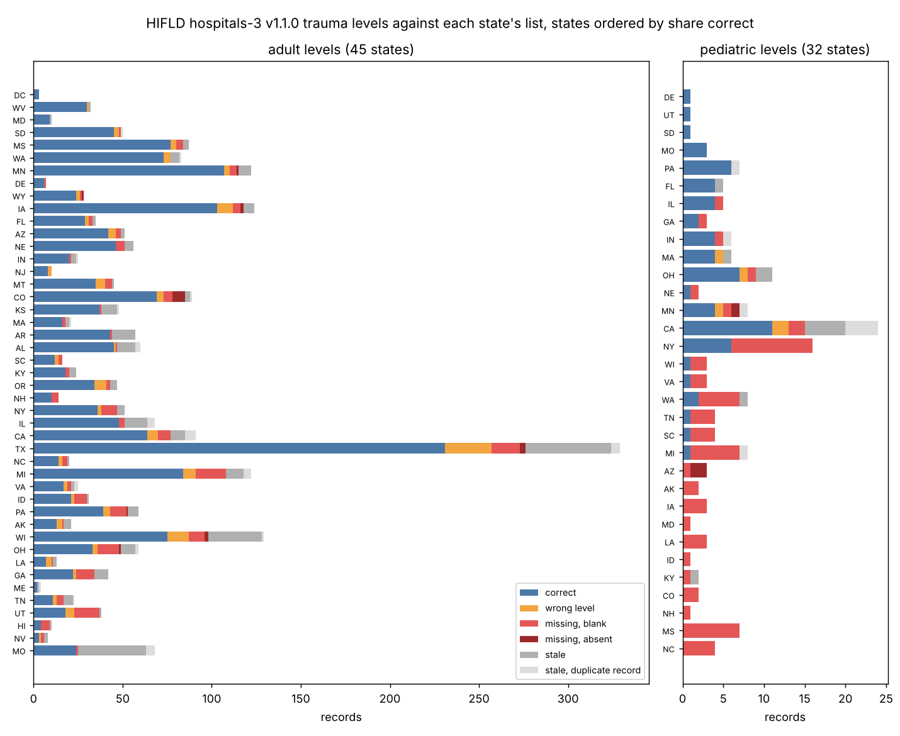

# How complete are HIFLD's trauma center levels, and can we fix them?

The HIFLD hospital layer (`hospitals-3` v1.1.0 on [HIFLD Next](https://hifld.publicenvirodata.org)) is the one national public file with a trauma level for every hospital. This spike checks its `TRAUMA` field against each state's own designation list, counts the errors by state, writes a corrected field, and reruns the trauma-access spike's distance shares on it. One marimo notebook, `audit.py`. Issue [#204](https://github.com/fulton-ring/agent-content-demos/issues/204); follows `trauma-burn-center-access/` (#148).

**Short answer.** Adult levels are mostly right and pediatric levels mostly aren't. Of 2,355 adult records we could check in 45 states, 72% match the state list. Of 158 pediatric records in 32 states, 42% do. Most pediatric errors are centers HIFLD leaves out: state lists name 54 pediatric Level I/II centers that HIFLD doesn't have at that level, including Children's Hospital Colorado, Phoenix Children's, all four of North Carolina's Level I children's hospitals and three of Louisiana's. With the corrected list, the share of children more than an hour's drive from a Level I/II pediatric center falls from **45.2% to 32.3%**. The adult share barely moves overall (**12.8% to 12.4%**), but it halves in Alaska (95% to 47%), where HIFLD types the Alaska Native Medical Center as a critical-access hospital and has Providence Alaska at Level III instead of II.

## How to run

```bash
./run.sh
```

It needs [uv](https://docs.astral.sh/uv/). The first run downloads about 240 MB into `data/` (`AUDIT_DATA_DIR` moves it) and takes under a minute; the notebook then runs in seconds. Outputs go to `outputs/` (`AUDIT_OUT_DIR`). To read the notebook with its tables, run `uv run marimo edit audit.py`.

## Where the data comes from

| What | Source |
|---|---|
| Hospitals and trauma levels | HIFLD Next `hospitals-3` v1.1.0 (issued 2026-04-06), downloaded at run time |
| State designation lists | Each state's health department or EMS office list; URL, date, terms and notes per state in `state_sources.csv`. Rows we copied are in `state_designations.csv`; the documents aren't committed |
| People and children | ACS 2018–2022 table B01001 by block group; Census 2020 population-weighted block-group centres; USDA ERS 2020 RUCA codes. All downloaded at run time |
| Drive-time conversion | The trauma-access spike's fitted straight-line-to-minutes lines (`trauma-burn-center-access/outputs/summary.json`) |

**How the state lists were read.** Nine Claude agents, one per region, each found a state's official list, recorded its terms, copied every row (all levels, adult and pediatric) and matched each row by hand to a HIFLD `source_ID`. No paid model API was used. A separate pass re-read a seeded sample of 60 rows against the sources: 59 were copied right (the one miss is an Idaho row marked provisional where the list says "pending application") and all 60 HIFLD matches were right (`extraction_check.csv`). A further pass checked every pediatric Level I/II disagreement between HIFLD and the lists (`peds_check.csv`).

**What counts as a list.** It must be the state's own official list, dated 2022 or later or still posted as current, with terms that don't forbid reuse. The American College of Surgeons' verified-center search can't be used: it has no download and its terms forbid reuse in other applications.

## Results

Every number here comes from `outputs/summary.json` and the CSVs beside it, written by the run.

**Sources.** 47 of 51 states (50 plus DC) publish an official list: 38 are reusable and 9 have unclear terms, such as an all-rights-reserved footer or a non-commercial clause. Two of those lists are too old to use (New Mexico 2013, North Dakota 2020), leaving **45 states checked for adult levels and 32 for pediatric levels**. Connecticut, Rhode Island and Vermont rely on ACS verification and publish no list, and Oklahoma doesn't publish one. The lists used are dated 2022-12-16 to 2026-11-05; 6 state no date.

**Records by bucket** (each HIFLD record with a level, or state-list row, in a checked state):

| | correct | wrong level | missing, blank in HIFLD | missing, no HIFLD record | stale | stale, duplicate record | designated but mistyped |
|---|---|---|---|---|---|---|---|
| Adult | 1,707 | 134 | 182 | 18 | 274 | 40 | 25 |
| Pediatric | 66 | 5 | 65 | 3 | 11 | 8 | 3 |

*Stale* means HIFLD gives a level the state list doesn't. Missouri alone has 43, because HIFLD gives a level to many St. Louis and Kansas City hospitals that aren't on the state's list of 28. *Duplicate* means a second HIFLD record for a designated campus also carries the level. *Mistyped* means a designated hospital whose record is closed, long-term care, psychiatric or of unknown type, or critical access at Level I/II, any of which drops it from a filtered analysis. 13 of the 25 adult cases are Kansas trauma hospitals typed long-term care. Per-state counts are in `outputs/errors_by_state.csv` and `outputs/buckets_by_state.png`.

**Level I/II only**, the centers distance analyses use:

| | in both | state list only | HIFLD only |
|---|---|---|---|
| Adult | 501 | 50 | 107 |
| Pediatric | 67 | 54 | 22 |

**Pediatric centers found.** The 32 states that designate pediatric centers list 128 at Level I/II, against 88 HIFLD records in those states; only 68 of those 88 are on the lists. Nationally, the corrected field has 139 pediatric Level I/II centers against HIFLD's 102. The other 19 states don't designate pediatric centers, so there the corrected list keeps HIFLD's records and adds children's hospitals the state designates at Level I/II.

**Distance to care** (estimated drive time, the trauma-access spike's method, rebuilt exactly):

| | centers before → after | beyond 60 min, before | after |
|---|---|---|---|
| Adult Level I/II | 612 → 571 | 12.8% | 12.4% |
| Pediatric Level I/II (children under 18) | 102 → 141 | 45.2% | 32.3% |

That is 9.5 million fewer children counted as more than an hour from a pediatric center. The largest moves are in Colorado, North Carolina, Arizona and South Carolina, where children beyond an hour fall by 67–74 points. Adult shares rise where HIFLD gave a level the state doesn't (Iowa +8.5 points, Louisiana +4.2) and fall where it missed one (Alaska −48, Montana −13). Per-state figures are in `outputs/distance_shift_by_state.csv`.



## What's in the folder

- `audit.py`: the notebook. It covers sources, the extraction check, reading HIFLD's field, the match and buckets, the corrected field, the distance rerun, and what didn't work.
- `state_sources.csv`, `state_designations.csv`: the 51 sources and the 2,410 rows copied from them.
- `extraction_check.csv`, `peds_check.csv`: the independent checks.
- `added_locations.csv`: coordinates for the one Level I/II center with no HIFLD record (Intermountain Lutheran's new campus).
- `outputs/corrected_trauma.csv`: the corrected field, one row per record with a level on either side, with `TRAUMA_corrected`, `change` and the source URL. `outputs/diff_vs_v1.1.0.csv` has only the 719 changed rows. `outputs/pairs.csv` has every comparison.

## What we looked at first

HIFLD's own `SOURCE` field, which points to the files it was built from. ACS's verified-center search, which can't be reused. Fuzzy name matching, which the trauma-access spike found unreliable for hospital names; renames and shared campuses made hand matching necessary here too.

## What it doesn't show

- Six states (CT, RI, VT, OK, NM, ND) and the pediatric records of 13 more keep HIFLD's values unchecked.
- A state list is the state's view: it can lag, and some lists are undated or a few years old. Tier mappings (Montana, Wyoming, South Dakota, Mississippi, Maryland, Tennessee, Florida) are listed in the notebook's setup cell.
- The distance figures carry the trauma-access spike's caveats: ground travel only, no traffic, a conversion calibrated on Maine and New Jersey, ±5 points nationally.
