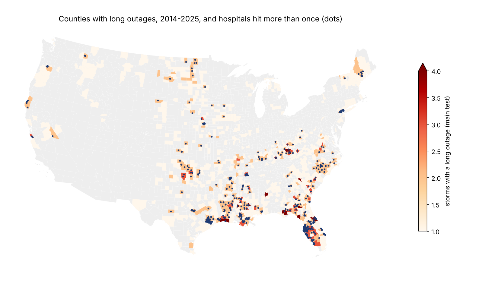

# Which US hospitals sat in the counties that stayed dark longest after major storms?

Spike for [issue #249](https://github.com/fulton-ring/agent-content-demos/issues/249). We put
every hospital in HIFLD Next's hospital layer into its county. Then we count the FEMA-declared
storms since late 2014 in which that county had at least 10% of customers out and took more than
three days to get back to 90% restored. Last, an AI agent repeats the analysis from a plain
question, and we score it.

Everything is in one marimo notebook, [`hospitals.py`](hospitals.py). It reads top to bottom:
storms, the definition of "long", the join, counts, beds and trauma level, the coverage-gap
check, the agent, and what it doesn't show.

**Read this first.** County outages measure *exposure*: how long the grid around a hospital was
down. They don't measure how long a hospital went without grid power. Utilities restore
hospitals first as priority loads, and hospitals run backup generators. Heimdall Research says
its data is "not for any decision about a single address or property". So this README and the
headline give counts and method only. Named hospitals appear only in
`outputs/hospital_ranking.csv`, for planners who want to check their own facilities.

## Short answer

**Hospitals do repeat, but the list isn't short, unless you read "10% still out after three
days" strictly.** All numbers come from `./run.sh` (`outputs/summary.json`).

| | Main test: ≥10% out at the peak, >72 h to 90% restored | Strict test: ≥10% of customers certainly still out at hour 72 |
|---|---|---|
| Open hospitals with at least one such storm | **2,330** of 7,966 (29%) | 704 |
| Hospitals with more than one | **697** | **29** |
| Hospitals with three or more | 180 | 1 |
| Hospital-storm pairs | 3,225 | 734 |
| Storms (with a hospital in a qualifying county) | 211 | 81 |
| Counties / counties with more than one | 745 / 199 | 210 / 11 |



- **The repeaters are mostly on the Gulf and in Florida.** Of the 180 hospitals with three or
  more long storms, 91 are in Florida, 39 in Louisiana and 21 in Tennessee. The top-ranked
  county, a small Louisiana parish, had six long storms between 2016 and 2024. Two of those
  six are "never restored in the window" (the February 2021 winter storm and Francine), which
  could be a stale utility feed. Check single rows like these before quoting them.
- **A few storms account for most of it.** The top five storms hold 30% of hospital-storm pairs:
  Irma (346 hospitals), Helene (171), the May 2024 Houston-area storms, DR-4781 (159, from only
  5 counties), Beryl (152) and Isaias (145). Big counties carry many hospitals, so pairs weight
  urban counties heavily. The county is the real unit.
- **Beds and trauma level barely matter.** 28% to 33% of hospitals in every bed-size group had a
  long storm, and 8% to 10% had more than one (`outputs/by_beds_and_trauma.csv`). Level I-IV
  trauma centers repeat a little less (5% to 6%) than hospitals with no trauma level listed
  (10%).
- **Why the strict test is a bound.** Heimdall gives restoration times, not an hourly series,
  so we can't read the share out at hour 72 directly. If a county had at least 20% out at the
  peak and hadn't reached 50% restored by hour 72, then at least 10% of all customers were still
  out at hour 72. That rule catches only the clear cases. The true count lies between the two
  columns.

## Is it driven by EAGLE-I coverage gaps? No, as far as we can test

- Heimdall's `coverage_gap` flag (a gap of more than 6 hours after the peak) is set on 88% of
  long county-storms and 93% of the others. EAGLE-I leaves out rows when nobody is out, so the
  flag is set almost everywhere and can't tell the two groups apart.
- EAGLE-I publishes coverage by state for 2018-2022 only. Within those years, 173 hospitals
  repeat. We drop state-years under 80% coverage, counties never restored in the window (which
  could be a stuck utility feed) and counties whose peak exceeded the customer estimate in
  another storm. 143 (83%) still repeat.
- Under 7% of long pairs fall in a state-year under 80% coverage.

## The agent

A Pydantic AI agent (Claude Haiku 5.5 on OpenRouter, typed output) got the question in plain
words, the HIFLD Next MCP server, the Zenodo record ID, and tools to load files into DuckDB and
query them. It wasn't told column names or the join. We ran three attempts.

| | Ours | Agent, 3 attempts |
|---|---|---|
| Hospitals | 2,330 | 2,283, 2,283, 2,283 |
| Pairs | 3,225 | 3,178, 3,178, 3,177 |
| Hospitals more than once | 697 | 696, 696, 696 |
| Storms | 211 | 212, 242, 241 |
| Top 10 correct (ties allowed) | | 10, 10, 10 |
| Cost / time | | $0.06-0.07, 54-57 s each; $0.19 total |

**What it got right:** it found the hospital layer through MCP, read Heimdall's data dictionary,
chose the right columns, and filtered to open hospitals and declared counties with records.

**What it got wrong:**
- **It lost Connecticut every time without saying so.** It joined on HIFLD's `COUNTYFIPS`,
  which holds Connecticut's new planning-region codes. Heimdall uses the old county codes. Our
  notebook reproduces its counts exactly with that join: 47 Connecticut hospitals drop out.
- **It counted Hurricane Eta twice,** because Eta has two rows in Heimdall's storm list.
- **Its storm count changed meaning between runs:** storms with a hospital in one run, any
  qualifying county in the other two.

Saved answers and transcripts are in `outputs/agent/`, so a reviewer can rescore without paying.

## How to run

```bash
./run.sh                                   # about 1 minute; rescores the saved agent answers
AGENT_RUN=1 OPENROUTER_API_KEY=... ./run.sh   # calls the agent again, about $0.20 for 3 attempts
```

This needs [uv](https://docs.astral.sh/uv/). The first run downloads about 30 MB into `data/`
(set `DATA_DIR` to put it elsewhere). Agent settings: `AGENT_MODEL`, `AGENT_REPEATS` (default
3) and `AGENT_BUDGET_USD` (default 3). To read the notebook with its tables, run
`uv run marimo edit hospitals.py`.

Outputs: `summary.json`, `hospital_ranking.csv` (names, for checking your own facilities),
`storms_by_hospitals.csv`, `by_beds_and_trauma.csv`, two PNGs and `agent/`.

## Where the data comes from

- **Hospitals:** HIFLD Next `hospitals-3` v1.1.0 GeoParquet (8,340 records, 7,966 open), from
  `hifld.publicenvirodata.org`.
- **Outages:** Heimdall Research, *Storm Blackout and Restoration* 1.2, Zenodo record 23010005,
  CC BY 4.0: `county_summary` and `storms`. Its restoration hours come from DOE's EAGLE-I county
  outage counts.
- **EAGLE-I coverage:** `coverage_history.csv` from the EAGLE-I figshare record (CC BY 4.0).
- **Counties:** Census 2020 cartographic boundaries. The 2024 file splits Connecticut into
  planning regions, and Heimdall doesn't.

We reused the download pattern from `nightlight-storm-restoration/`. Per the manager's note on
the issue, night light carries **no weight** here: that spike found it tracks EAGLE-I outages
weakly.

## Storms dropped, and what this doesn't show

- **Of Heimdall's 672 storms, 477 have an outage run and 463 have any county with utility
  records.** Dropped: 117 before EAGLE-I's county series starts (November 2014), 30 in a year
  with no published EAGLE-I file (2026), 41 tribal declarations with no county, 7 in
  territories EAGLE-I doesn't cover, and 13 with no county record in the window. So the period
  covered is 2014-2025, not the 14 years the card asked about.
- **Hospitals that didn't exist at older storms can't be told apart.** The layer has no opening
  date. We drop the 374 hospitals marked closed. A hospital that opened in 2020 still counts
  against a 2016 storm.
- **Restoration is timed from each county's peak, not from landfall.** Only FEMA-declared
  counties are measured.
- **The point-in-county join puts 48 hospitals in a different county from HIFLD's
  `COUNTYFIPS`.** 47 of them are the Connecticut codes. One hospital falls outside every county.
