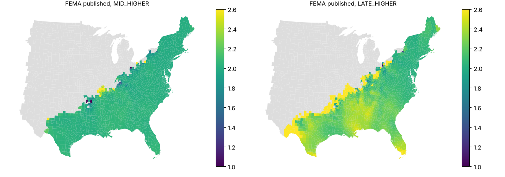
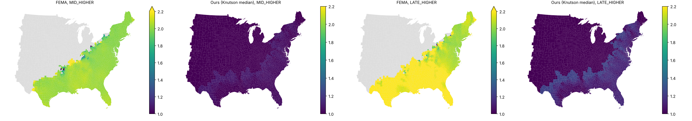
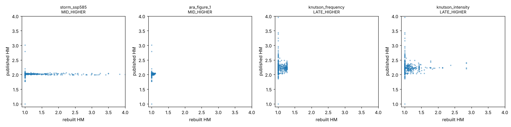

# Rebuilding FEMA's hurricane multipliers from public data

Can public track data stand in for Applied Research Associates' climate-conditioned hurricane
input (HurLoss), which FEMA shares only by email, closely enough to reproduce the hurricane
part of the Future Risk Index (FRI)? This folder is the spike for
[issue #23](https://github.com/fulton-ring/agent-content-demos/issues/23)
([proposal card](https://app.notion.com/p/3facc69045cb805aaf35c0a8fe842133)). The FRI rebuild in
#15 skipped hurricane because that input isn't public.

## Short answer

**No. Public inputs rebuild today's hurricane hazard well, but not FEMA's published hurricane
multipliers.** FEMA's published values hardly reflect hurricane climate at all, and that is the
main finding.

- **FEMA's multipliers are about 2.0 almost everywhere.** In three of the four scenarios, 94-97%
  of counties FEMA covers sit between 1.9 and 2.1, in inland Vermont as on the Florida coast.
  Medians: mid-century lower 1.995, mid-century higher 2.011, late-century lower 1.973,
  late-century higher 2.190. A constant 2.0 reproduces FEMA's held-out ratings in 95-100% of
  counties.
- **No public climate projection gives anything near 2.**
  - Knutson et al. (2020), converted per scenario by Jewson (2021): county medians of +3% to +16%
    in FEMA's intensity measure.
  - STORM's four high-resolution GCMs (SSP5-8.5, 2050): +25% median, with GCM medians from −4% to
    +55%.
  - ARA's own white paper, put through FEMA's own formula, gives 1.06-1.23 by region for 2050
    under RCP 8.5. FEMA published about 2.0 for the same regions.
- **The level only matches if FEMA's ratio carries an extra +1 (or a factor of 2).** Read that
  way, every public route lands near FEMA's values on the counties it covers: 90-100% same rating
  bin, median ratio 0.98-1.04, mean log error 0.01-0.20.
- **The pattern between counties doesn't match on any route.** Spearman rank correlation with
  FEMA's values on held-out states is −0.19 to 0.18 where a route has a value. That is no better
  than ranking counties by today's hurricane hazard (−0.22 to 0.31).
- **Today's hazard is not the problem.** Before any climate conditioning, our wind model ranks
  counties' NRI hurricane loss with Spearman 0.76 (historical tracks) and 0.92 (STORM).

So public inputs can rebuild a credible hurricane multiplier. They cannot rebuild FEMA's. FEMA's
numbers are mostly a constant, plus a county pattern we cannot trace to any hurricane climate
signal.



## Our own hurricane layer (follow-up)

The spike above is the question the issue asked. After it, we built our own county and tract
hurricane multipliers for all four FRI scenarios. They use FEMA's documented formula on
published open methods only: STORM synthetic tracks, CLIMADA wind fields, and Knutson et al.
(2020) as converted by Jewson (2021). They come with a range across Knutson's published
percentiles. **[METHOD.md](METHOD.md)** sets out the method, the case for not reusing FEMA's
values, the full results and the update policy. In short:

- **Central multipliers** in the 1,241 counties with hurricane wind: 1.03, 1.05, 1.05 and 1.13
  (mid lower, mid higher, late lower, late higher). FEMA published 1.96-2.09.
- **FEMA's value lies outside our whole Knutson range** in 98% of covered counties for three
  scenarios. Only late century under RCP 8.5 reaches it, at the top percentile.
- **National projected hurricane loss** on FEMA's own v1.19 baseline: $20.8-22.5B a year against
  FEMA's $40.5-45.5B. 16-18% of counties drop one rating bin; none drop two.
- **Census tracts (Florida pilot):** possible, and they add up to the county within 0.3%. But the
  multiplier varies by only 0.5-1.5% inside a typical county, so tract detail comes from NRI's tract
  EAL, not from the climate part.



## How to run it

```bash
./run.sh
```

`run.sh` needs [uv](https://docs.astral.sh/uv/) and about 2 GB of disk for downloads and
cached wind fields. It runs two steps. The first is `uv run hurloss-run`, the spike, which:

1. Downloads every input into `~/.cache/hurloss-public-rebuild` (set `HURLOSS_CACHE` to move it).
   Nothing downloaded goes into the repo.
2. Builds three event sets and their wind fields with [CLIMADA](https://github.com/CLIMADA-project/climada_python):
   historical tracks plus perturbed copies, STORM present climate, and STORM future climate for
   four GCMs.
3. Applies each climate-conditioning route and FEMA's formula, scores everything against FEMA's
   published values, and writes the tables and figures in `results/`.

The second is `uv run hurloss-layer`, our own layer. It builds 10,000 years of STORM wind
fields for counties and for the Florida tracts, computes the multipliers and ranges, and writes
the comparison with FEMA's values to `results/layer/`.

All of it runs on this 4-core machine. Timings for a clean run are under "Checked from a clean
checkout"; with the event sets cached it takes about two minutes. It makes no model calls and
uses no paid services, so it costs nothing.

The settings come from environment variables:

- `HURLOSS_GRID_STEP`: grid step in degrees, default 0.25.
- `HURLOSS_SYNTHETIC_COPIES`: perturbed copies per historical track, default 19.
- `HURLOSS_STORM_FILES`: 1,000-year STORM files per climate, default 5.
- `HURLOSS_LAYER_STORM_FILES`: 1,000-year STORM files behind the layer, default 10.
- `HURLOSS_TRACT_STATES`: comma-separated state FIPS codes for the tract layer, default `12`
  (Florida).
- `HURLOSS_WORKERS`: worker processes, default all cores.

To browse the results, run `uv run marimo edit notebooks/walkthrough.py`. Run the tests with
`uv run pytest`.

## Where the data comes from

| Input | Source | Notes |
|---|---|---|
| Answer key | `NRI_Future_Risk_Master_Datasheet_12052024.xlsx` from [fulton-ring/nri-future-risk](https://github.com/fulton-ring/nri-future-risk) at commit `c5cc0d6` | Same file as #15: FEMA's county `HRCN_*_HM` multipliers, ratings and the NRI v1.19 hurricane EAL they were applied to. Downloaded at run time. |
| Method | *National Risk Index: Future Risk Technical Documentation* (FEMA, Dec 2024), Sec. 2.3, Table 5 and Ch. 7 | [Archived copy at Harvard EELP](https://eelp.law.harvard.edu/wp-content/uploads/2025/03/NRI_Future_Risk_Technical_Document.pdf). |
| Historical tracks | NOAA [IBTrACS v04r01](https://www.ncei.noaa.gov/products/international-best-track-archive), North Atlantic file, `usa` provider (HURDAT2 values), 1900-2024 | 1,635 tracks, of which 1,011 come near the CONUS grid. |
| Synthetic tracks, present | STORM v4, 10,000 years from IBTrACS 1980-2018 ([doi:10.4121/12706085.v4](https://doi.org/10.4121/12706085.v4)), CC0 | We read 5,000 years of North Atlantic tracks out of the 543 MB zip with HTTP range requests (`remotezip`). |
| Synthetic tracks, future | STORM climate change, SSP5-8.5 2015-2050, four GCMs: CMCC-CM2-VHR4, CNRM-CM6-1-HR, EC-Earth3P-HR and HadGEM3-GC31-HM ([doi:10.4121/14237678.v2](https://doi.org/10.4121/14237678.v2)), CC0 | 5,000 years per GCM, read the same way. |
| Climate scaling | Knutson et al. (2020), *BAMS* [doi:10.1175/BAMS-D-18-0194.1](https://doi.org/10.1175/BAMS-D-18-0194.1), converted to any baseline and year by Jewson (2021) [doi:10.1175/JAMC-D-21-0102.1](https://doi.org/10.1175/JAMC-D-21-0102.1) | As shipped in CLIMADA (`get_knutson_scaling_factor`), with median values. |
| ARA's climate conditioning | ARA, *Incorporating Climate Change into a Hurricane Model* (2022), [white paper](https://www.ara.com/wp-content/uploads/ARA_ClimateChange_NatCatModels_WhitePaper.pdf), Figure 1 | Landfall rates by region and category for CESM RCP 8.5 in 2021 and 2050 against a reference model. Given only as a bar chart, so we read the values off by eye (about ±0.003 a year) and wrote them into `ara_white_paper.py`. |
| Baseline check | NRI v1.20 (Dec 2025) county hurricane EAL, exposure and frequency, from FEMA's [ArcGIS feature service](https://services.arcgis.com/XG15cJAlne2vxtgt/arcgis/rest/services/National_Risk_Index_Counties/FeatureServer/0) | |
| Boundaries | Census 2020 cartographic boundaries (1:500k), counties | |

**Looked at and not used:**

- **HURSAT** is storm-centred satellite imagery with no wind field, so it adds nothing to a
  county wind climatology. NESDIS announced its retirement in May 2025 after a final v07b
  update; NCEI's archive still shows v06 (1978-2015).
- **ASCE 7 wind maps** are return-period design speeds with no scenario component. They would
  only rescale today's hazard.
- **RAFT** (late century, SSP5-8.5) is 13 GB and needs a bias correction. It is split off as #24.

## How it works

- **FEMA's formula** (`fri_formula.py`), from FRI Sec. 7.2-7.3:
  - ARA supplies, at each point, the annual frequency of Category 1-5 hurricane wind.
  - Equation 11: Intensity = F1 + 2·F2 + 4·F3 + 8·F4 + 16·F5.
  - A county's frequencies are the mean over points within 1 km of it.
  - Equation 12: HM = max(1, projected intensity / historical intensity).
  - We count "frequency of Category k" as wind reaching at least Category k. Counting each
    event only in its peak band made no material difference in the prototype.
- **Wind fields** (`hazard.py`, `grid.py`):
  - CLIMADA's Holland (2008) wind profile gives peak 1-minute sustained wind at 10 m, per event,
    on a 0.25° grid. That is 8,916 points, covering 2,851 counties within a 1 km buffer.
  - A county with no grid point takes the nearest point.
  - The wind is the open-terrain value, with no surface-roughness reduction, so only rankings
    and ratios carry over, not levels.
- **Event sets** (`event_sets.py`):
  - **Historical:** IBTrACS 1900-2024 plus 19 perturbed copies of each track, using CLIMADA's
    random-walk tracks with land decay. That is 20,220 events, equal to 2,500 years.
  - **STORM:** 5,000 years each for present climate and for each GCM's future, about 15,600 to
    24,200 events near the grid per set.
- **Climate conditioning routes** (`conditioning.py`, `ara_white_paper.py`):
  - `knutson_frequency`: Jewson's recommended use. Each event's rate is rescaled by its peak
    category: Cat 4-5 events take Knutson's Cat 4-5 change, and the rest take whatever keeps the
    all-storm change. This is CLIMADA's `apply_climate_scenario_knu` arithmetic.
  - `knutson_intensity`: every wind scaled by Knutson's mean-intensity change, and every rate by
    the all-storm change.
  - North Atlantic medians against the 1900-2024 baseline:

    | Scenario | All storms | Cat 4-5 | Intensity |
    |---|---|---|---|
    | 2050, RCP 4.5 | −11.2% | +8.4% | +2.2% |
    | 2050, RCP 8.5 | −14.1% | +11.0% | +2.9% |
    | 2100, RCP 4.5 | −15.2% | +11.9% | +3.1% |
    | 2100, RCP 8.5 | −28.8% | +26.3% | +6.5% |

  - `storm_ssp585`: the equal-weight mean over the four GCMs of each county's future intensity,
    over its present-climate intensity. This covers 2050 SSP5-8.5 only, so it is scored against
    mid-century higher.
  - `ara_figure_1`: ARA's own method applied to our historical event set. Each event's rate is
    scaled by ARA's 2050 RCP 8.5 / reference landfall ratio for its region and category. Our
    stand-in for "landfall" is the grid point where the event's wind peaks. Scored against
    mid-century higher.
- **Three readings of each route:**
  - As FEMA documents it, max(1, ratio).
  - `_plus_1`, max(1, 1 + ratio), as if the "projected" rate included the historical one.
  - `_times_2`, max(1, 2 × ratio).

  The two extra readings test the factor in FEMA's values (below). They are fitted to the answer
  key's level, not derived from FEMA's documentation.
- **Scoring** (`scoring/`): copied from #15 so the hurricane rows line up with the other
  hazards.
  - Rebuilt multipliers go into FEMA's fixed NRI rating bins. The upper edge of each bin is the
    largest EAL in that rating; applied to FEMA's own values this reproduces 100% of the
    published hurricane ratings.
  - Pearson, Spearman, mean absolute log error and median rebuilt/published ratio.
  - A county the rebuild leaves blank counts as HM = 1. Counties FEMA published as 0 are left out.
  - The 12 held-out states are #15's: AZ, CT, GA, IA, ME, MN, NE, NM, OH, RI, TX and WA. Nothing
    here is fitted to the training states. The split only keeps the numbers comparable with #15.
  - Each subset is also scored as `_covered`: only counties where the route gives a value. This
    separates coverage, meaning how far inland the event set reaches, from the climate signal.

## Results

All numbers come from the clean run described under "Checked from a clean checkout" and are in
`results/`. Held-out states throughout.

### 1. What FEMA published (`answer_key_levels.csv`, `answer_key_zero_with_losses.csv`)

| Scenario | Counties with a value | Median | Middle 90% | Share within 1.9-2.1 | At the cap of 10 |
|---|---|---|---|---|---|
| Mid-century, lower | 1,579 | 1.995 | 1.96-2.02 | 97.0% | 1 |
| Mid-century, higher | 1,579 | 2.011 | 1.97-2.06 | 95.6% | 2 |
| Late century, lower | 1,579 | 1.973 | 1.91-2.03 | 94.5% | 1 |
| Late century, higher | 1,605 | 2.190 | 2.01-2.88 | 32.3% | 33 |

- **Coverage.** 1,529 CONUS counties are published as 0, which means no ARA point. 640 of them
  have hurricane losses today, $31.7M a year in total. They are mainly inland: Illinois (99),
  Missouri (81), Oklahoma (72), Iowa and Michigan (70 each). As #15 found for coastal flooding,
  FEMA's ratings treat 0 as 1.
- **No published value lies between 1 and 1.25.** The only values below 1.26 are exact 1.0s, in
  four sparse inland counties. Franklin County, AR reads 2.0, 1.0, 1.0 and 10 across the four
  scenarios.
- **The highest values sit inland, not on the coast.** The capped 10s and other large values are
  in Missouri, Arkansas, Ohio and north Texas, at the edge of ARA's coverage, where a few rare
  simulated events decide the ratio. On the coast, late-century higher peaks in south Florida
  (Collier 2.52, Broward 2.42) against north Florida (Duval 2.13).
- **The pattern between counties barely follows today's hazard**
  (`published_vs_hazard_level.csv`). Spearman of the published values against today's NRI loss
  ratio is 0.29, 0.22, 0.29 and −0.08 for the four scenarios. Against our modelled intensity it
  is 0.08-0.31.

### 2. ARA's own numbers through FEMA's formula (`ara_white_paper.csv`)

| Region | Ratio, 2050 RCP 8.5 / reference | Ratio, 2050 / 2021 | FEMA published, mid-century higher (median) |
|---|---|---|---|
| Gulf (TX-AL) | 1.132 | 1.003 | 2.035 |
| Florida | 1.216 | 1.061 | 2.032 |
| SE coast (GA-NC) | 1.226 | 1.119 | 2.019 |
| NE coast (VA-ME) | 1.055 | 0.933 | 1.993 |

ARA's white paper is CESM-only, and FEMA's input was a weighted multi-GCM CMIP5 ensemble (FRI
Sec. 7.1.1), so these numbers are not FEMA's input. But ARA's own published conditioning puts
the regional change at 6-23%, and it varies by region in a way FEMA's values don't. Under the
"1 + ratio" reading, its 2050/2021 ratios (0.93-1.12) are about the size of FEMA's departures from
2.

### 3. Rebuilt multipliers against FEMA's, held-out states (`scores.csv`)

All held-out counties FEMA covers. A blank counts as HM = 1.

| Route | Scenario | Blank | Same bin | Pearson | Spearman | Log error | Median ratio |
|---|---|---|---|---|---|---|---|
| Constant 1 (no change) | mid, lower | 0 / 424 | 70.5% | | | 0.690 | 0.500 |
| Constant 2 | mid, lower | 0 / 424 | 100.0% | | | 0.010 | 1.000 |
| Constant 2 | mid, higher | 0 / 424 | 99.8% | | | 0.017 | 0.990 |
| Constant 2 | late, lower | 0 / 424 | 99.5% | | | 0.017 | 1.007 |
| Constant 2 | late, higher | 0 / 433 | 95.2% | | | 0.174 | 0.896 |
| Knutson frequency, as documented | mid, lower | 201 | 73.1% | 0.080 | 0.312 | 0.665 | 0.506 |
| Knutson frequency, as documented | late, higher | 210 | 70.7% | −0.161 | −0.054 | 0.787 | 0.473 |
| Knutson frequency, +1 | mid, lower | 201 | 91.0% | 0.115 | 0.333 | 0.339 | 0.974 |
| Knutson frequency, +1 | late, higher | 210 | 86.8% | −0.216 | −0.081 | 0.480 | 0.730 |
| STORM SSP5-8.5, as documented | mid, higher | 75 | 78.5% | 0.032 | 0.016 | 0.571 | 0.511 |
| STORM SSP5-8.5, +1 | mid, higher | 75 | 92.9% | 0.058 | 0.135 | 0.283 | 0.987 |
| ARA Figure 1, as documented | mid, higher | 201 | 72.6% | 0.063 | 0.266 | 0.681 | 0.504 |
| ARA Figure 1, +1 | mid, higher | 201 | 91.5% | 0.070 | 0.266 | 0.336 | 0.991 |

Only counties where the route gives a value (`held_out_covered`):

| Route | Scenario | Counties | Same bin | Spearman | Log error | Median ratio | Constant 2's log error on the same counties |
|---|---|---|---|---|---|---|---|
| Knutson frequency, +1 | mid, lower | 223 | 99.1% | 0.029 | 0.027 | 1.026 | 0.004 |
| Knutson frequency, +1 | mid, higher | 223 | 98.2% | 0.142 | 0.029 | 1.025 | 0.012 |
| Knutson frequency, +1 | late, lower | 223 | 97.8% | 0.127 | 0.042 | 1.041 | 0.007 |
| Knutson frequency, +1 | late, higher | 223 | 96.0% | 0.152 | 0.056 | 0.977 | 0.105 |
| Knutson intensity, +1 | late, higher | 223 | 90.6% | 0.017 | 0.109 | 0.985 | 0.105 |
| STORM SSP5-8.5, +1 | mid, higher | 349 | 93.1% | −0.162 | 0.196 | 1.030 | 0.012 |
| ARA Figure 1, +1 | mid, higher | 223 | 99.6% | 0.183 | 0.010 | 1.005 | 0.012 |
| Knutson frequency, ×2 | late, higher | 223 | 93.3% | 0.150 | 0.105 | 1.065 | 0.105 |

What the tables show:

- **As FEMA documents the formula, every public route is worse than assuming no change.** Its
  ratios sit near 1, so after the floor almost every county gets 1 against FEMA's 2.
- **Coverage costs as much as the formula.** Our historical set puts Cat 1 wind on 948 counties
  in 2,500 years, and STORM's 5,000 present-climate years reach 1,189. FEMA covers 1,579, from
  ARA's 500,000-year simulations. About half the held-out counties are blank on the historical
  routes.
- **With the +1 reading, the level matches and the pattern doesn't.**
  - On covered counties, the Knutson and ARA routes are within 1-11% of FEMA's values (log error
    0.010-0.109). STORM is at 0.196.
  - Spearman stays at or below 0.19.
  - The constant 2 is closer than every Knutson route in the other three scenarios (0.004-0.012
    against 0.027-0.076). ARA's Figure 1 route roughly ties it (0.010 against 0.012).
  - Late-century higher is the one case where a public route beats the constant. Knutson
    frequency +1 halves the error (0.056 against 0.105) because Knutson's late-century rise
    (median +16% in our measure) matches FEMA's median 2.19. It still doesn't rank counties
    (0.15).
- **+1 fits the level better than ×2 in every scenario.** Median ratios are 0.98-1.04 for +1 and
  1.02-1.08 for ×2. That fits FEMA's "projected" intensity having included the historical one, but
  it is not proof.
- **STORM's GCM spread is large.**
  - The four GCMs' median county ratios are 0.96 (EC-Earth3P-HR), 1.14 (CNRM-CM6-1-HR), 1.21
    (HadGEM3-GC31-HM) and 1.55 (CMCC-CM2-VHR4).
  - The ensemble's middle half runs from 1.01 to 1.81, with a long tail in sparsely hit inland
    counties. FEMA's capped inland 10s show the same kind of noise.
  - Per-GCM quantiles are in `storm_gcm_ratios.csv`.



### 4. Today's hazard against NRI v1.20, before any conditioning (`baseline_*.csv`)

| Event set | Our measure against NRI | Counties | Spearman | Pearson (logs) |
|---|---|---|---|---|
| Historical + perturbed (2,500 years) | Modelled EAL against NRI EAL | 2,184 | 0.758 | 0.774 |
| Historical + perturbed | Tropical-storm rate against NRI annual frequency | 2,240 | 0.807 | 0.759 |
| STORM present (5,000 years) | Modelled EAL against NRI EAL | 1,450 | 0.917 | 0.832 |
| STORM present | Tropical-storm rate against NRI annual frequency | 1,675 | 0.921 | 0.859 |

- Modelled EAL is the expected annual damage ratio from the Emanuel (2011) US curve, times NRI's
  hurricane exposure.
- Its level runs 35-45 times NRI's, because of open-terrain winds and a generic damage curve, so
  only the ranking means anything.
- The ranking is good, so the gap to FEMA's multipliers comes from the conditioning and FEMA's
  level of 2, not from the hazard model.

## Which parts are a rebuild and which are a different method

- **A rebuild:**
  - FEMA's Equations 11 and 12 and the county aggregation.
  - The scoring.
  - Using ARA's own regional, category-level landfall ratios, as its white paper describes ARA's
    method.
- **A different method:**
  - Every hazard input. CLIMADA's Holland wind field stands in for ARA's Hazus windfield model.
  - A 0.25° grid stands in for ARA's points.
  - 2,500-5,000 synthetic years stand in for ARA's 500,000.
  - Knutson/Jewson basin-wide factors and STORM's four high-resolution GCMs stand in for ARA's
    CMIP5 RCP 4.5/8.5 runs.
  - ARA's Figure 1 numbers are one GCM (CESM), RCP 8.5, 2050, read off a chart.
- **Not public, and the biggest gap:** whatever produces FEMA's level of 2. The +1 and ×2
  readings are fits to the answer key. They are not in FEMA's documentation.

## What failed or wasn't covered

- **FEMA's values were not reproduced** by any public route as FEMA documents the formula
  (70-79% same bin, against 100% for a constant 2).
- **County ranking:** no route gets held-out Spearman above 0.19 on covered counties.
- **Inland coverage:** the historical and STORM sets reach 948 and 1,189 counties against FEMA's
  1,579. More synthetic years would help; 10× the STORM years would make the
  STORM part of the 73-minute run about 10 times longer.
- **CLIMADA needed two workarounds:**
  - Its GDAL dependency has no wheels, so `pyproject.toml` overrides it out. The parts we use
    don't need it, but `climada.entity` does, so the Emanuel damage curve is written out in
    `baseline.py`.
  - CLIMADA 6.1 breaks on NumPy 2.4, so NumPy is pinned below 2.4.
- **Two downloads were blocked from this environment:**
  - NASA's distance-to-coast raster (HTTP 403). The wind fields run with
    `ignore_distance_to_coast=True`, which only drops CLIMADA's 1,000 km inland cut-off.
  - The AMS journal site (403). The Knutson numbers come from CLIMADA's packaged tables, not the
    paper's supplement.
- **Late century:** apart from Knutson scaling, no physically simulated late-century tracks were
  used. RAFT is #24.
- **Alaska, Hawaii and the territories** were not attempted. FEMA's hurricane coverage in CONUS
  is Atlantic-only.
- **The ARA figure readings** carry an eye-reading error of about ±0.003 storms a year. That
  matters most for the small Cat 5 bars.

## Checked from a clean checkout

We cloned branch `spike/hurloss-public-rebuild` fresh, set `HURLOSS_CACHE` to an empty folder,
and ran `./run.sh` on this 4-core machine with nothing else. It finished cleanly in 4,398 s
(73 minutes). Per-step times are in `results/timings_empty_cache.csv`:

| Step | Seconds |
|---|---|
| Answer key, counties, grid | 11 |
| Historical event set (IBTrACS, 19 perturbed copies, wind fields) | 645 |
| STORM present (5,000 years: range reads, interpolation, wind fields) | 850 |
| STORM future (4 GCMs × 5,000 years) | 2,865 |
| NRI v1.20, conditioning, scoring | 4 |

- **Tables.** The committed `results/` come from a second `./run.sh` in the same clone, on the
  same cache, after a later commit that only added output tables. With the event sets cached,
  that run took about a minute. Every number in this README comes from those files.
- **Run-to-run noise.** CLIMADA's perturbed historical tracks are not exactly reproducible when
  run on a process pool, even with a fixed seed. STORM is.
  - An earlier run on the same code differed by up to 0.9 points in same-bin share, 0.016 in
    Spearman and 0.002 in log error, and only on the historical routes.
  - None of the conclusions depend on differences that small.
- **Cost:** $0. The run makes no model calls and uses no paid services.

## Files

```
run.sh                  the one command
METHOD.md               the method, the case against reusing FEMA's values, results, updates
pyproject.toml, uv.lock uv project; CLIs hurloss-run and hurloss-layer
src/hurloss_rebuild/
  run.py                the spike: inputs, event sets, routes, scoring, figures, timings
  layer_run.py          our layer: county and tract multipliers, FRI comparison, STORM check
  layer.py              FEMA's formula plus Knutson/Jewson at every published percentile
  compare_fri.py        our multipliers, projected loss and ratings against FEMA's
  tract_layer.py        tract table, spread inside counties, roll-up to the county
  fri_formula.py        FEMA's Eq. 11-12 and county aggregation (pure)
  grid.py               grid points and their counties (1 km buffer)
  hazard.py             CLIMADA wind fields, cached per event set
  event_sets.py         historical + perturbed tracks; STORM present and future
  conditioning.py       FEMA scenarios; Knutson/Jewson frequency and intensity routes
  ara_white_paper.py    ARA Figure 1 readings, their Eq. 11 ratios, and ARA's method on our events
  rebuild.py            county intensities, ratios, and the three readings
  baseline.py           today's hazard against NRI v1.20
  forensics.py          what the answer key looks like; constant baselines
  figures.py            maps and scatter
  scoring/              rating bins, held-out split and metrics, as in #15
  sources/              answer key, counties, IBTrACS, STORM (range reads), NRI v1.20,
                        tract centroids and NRI tract EAL
notebooks/walkthrough.py  marimo notebook over results/
tests/                  formula, conditioning, ARA method, layer and stacking tests
results/                spike tables and figures; results/layer/ for our layer
                        (scores_by_county.csv is not committed)
```
