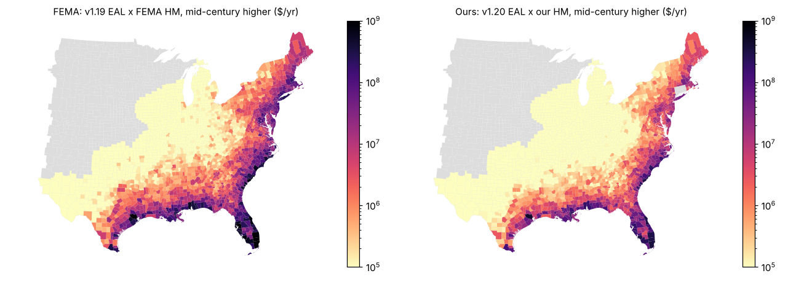

# Rebuilding FEMA's hurricane multipliers from public data

Can public storm tracks and published climate science stand in for Applied Research
Associates' climate-conditioned hurricane input (HurLoss), which FEMA shares only by email,
closely enough to rebuild the hurricane part of the Future Risk Index (FRI)? This folder is the
spike for [issue #23](https://github.com/fulton-ring/agent-content-demos/issues/23)
([proposal card](https://app.notion.com/p/3facc69045cb805aaf35c0a8fe842133)). The FRI rebuild
in #15 skipped hurricane because that input isn't public. After the spike, a founder asked for
our own hurricane layer from open methods; it is the second half of the notebook.

**Read [`notebook.py`](notebook.py) for the whole argument:** the question, the data, each step
and why, the results and what didn't work. This README is the summary.

## Short answer

**No. Public inputs rebuild today's hurricane hazard well, but not FEMA's published
multipliers, because FEMA's multipliers are about 2.0 almost everywhere and no published
climate projection comes near 2.**

- **Today's hazard rebuilds well.** Before any climate conditioning, our modelled loss ranks
  counties' NRI v1.20 hurricane loss with Spearman 0.75 (observed tracks plus perturbed copies)
  and 0.92 (STORM synthetic tracks).
- **FEMA's multipliers are about 2.0 almost everywhere.** In three of four scenarios, 94-97% of
  the counties FEMA covers sit between 1.9 and 2.1, inland Vermont as much as the Florida
  coast. A constant 2.0 matches 95-100% of held-out ratings.
- **No public projection comes near 2:**
  - Knutson et al. (2020), converted per scenario by Jewson (2021): county medians of +4% to
    +15%.
  - STORM's four high-resolution GCMs, SSP5-8.5 2050: median 1.25.
  - ARA's own white paper, through FEMA's Eq. 11: 1.06-1.23 by region.
- **Read as 1 + ratio, the level matches** (91-100% same rating bin on covered counties). The
  pattern between counties agrees only weakly, and how well depends on which states are scored.

## Our own hurricane layer

FEMA's documented Eq. 11-12 with no factor of 2, on open inputs only: two storm catalogues
(STORM, 10,000 years; observed tracks with perturbed copies, 2,500 years), CLIMADA Holland
wind fields, and Knutson's changes applied frequency-only, as Jewson recommends. The range
spans both catalogues and every published Knutson percentile.

| Scenario | FEMA median | Our central HM (1,333 covered counties) | FEMA inside our range (covered) | National projected loss, FEMA → ours (v1.19 baseline) |
|---|---|---|---|---|
| Mid-century, lower (RCP 4.5, 2050) | 1.99 | 1.04 | 2.1% | $40.6B → $20.8B |
| Mid-century, higher (RCP 8.5, 2050) | 2.00 | 1.05 | 2.3% | $41.0B → $21.0B |
| Late century, lower (RCP 4.5, 2100) | 1.96 | 1.06 | 2.9% | $40.5B → $21.1B |
| Late century, higher (RCP 8.5, 2100) | 2.09 | 1.15 | 98.6% | $45.5B → $22.4B |

- **16-18% of counties drop one rating bin**, none drop two, and the county ranking of
  projected loss matches FEMA's almost exactly (Spearman 0.996).
- **The places people check stay at the top:** Miami-Dade ranks 2nd nationally, Palm Beach
  4th, Broward 6th, Charleston 7th and Horry 11th, all still Very High.
- **STORM puts about half the observed number of hurricanes on the US coast**, measured against
  NHC's return periods. That is why the layer averages it with the observed-track catalogue.
- **Tracts:** NRI v1.20 tract EAL × county multiplier for 54,919 tracts in 29 states. A
  Florida tract-wind pilot shows the multiplier varies only 0.5-1.5% inside a county.



## How to run it

```bash
./run.sh
```

It needs [uv](https://docs.astral.sh/uv/) and about 2 GB of disk. `run.sh` runs the notebook as
a script (`uv run notebook.py`), so every table and figure in `results/` comes from the code in
the notebook. To read it with its outputs, run `uv run marimo edit notebook.py`.

- Every input is downloaded at run time into `~/.cache/hurloss-public-rebuild`, and wind fields
  are cached there too. Nothing downloaded goes into the repo.
- From an empty cache it takes about 1.5 hours on 4 cores, most of it CLIMADA wind fields.
  With the cache warm it takes a few minutes.
- Settings, all optional: `HURLOSS_CACHE` (cache folder), `HURLOSS_RESULTS` (output folder,
  default `results/`), `HURLOSS_WORKERS` (processes, default all cores).
- Tests: `uv run pytest` checks FEMA's formula, the Knutson scaling and the rating bins.
- It makes no model calls and uses no paid services, so it costs nothing.

STORM's host (4TU) rate-limits repeated range reads with HTTP 429. Downloads retry with
backoff; if it still fails, wait and rerun, since finished files are cached.

## Where the data comes from

| Input | Source |
|---|---|
| Answer key | FEMA's NRI Future Risk master datasheet (Dec 2024), from [fulton-ring/nri-future-risk](https://github.com/fulton-ring/nri-future-risk) at `c5cc0d6`, as in #15 |
| Method | FEMA, *National Risk Index: Future Risk Technical Documentation* (Dec 2024), Ch. 7 ([archived copy](https://eelp.law.harvard.edu/wp-content/uploads/2025/03/NRI_Future_Risk_Technical_Document.pdf)) |
| Observed tracks | NOAA [IBTrACS v04r01](https://www.ncei.noaa.gov/products/international-best-track-archive), North Atlantic, US agency winds, 1900-2024 |
| Synthetic tracks | STORM v4 present climate ([doi:10.4121/12706085.v4](https://doi.org/10.4121/12706085.v4)) and SSP5-8.5 2050 for four GCMs ([doi:10.4121/14237678.v2](https://doi.org/10.4121/14237678.v2)), CC0 |
| Climate scaling | Knutson et al. (2020) [doi:10.1175/BAMS-D-18-0194.1](https://doi.org/10.1175/BAMS-D-18-0194.1), per scenario via Jewson (2021) [doi:10.1175/JAMC-D-21-0102.1](https://doi.org/10.1175/JAMC-D-21-0102.1), as shipped in CLIMADA |
| ARA's conditioning | ARA, *Incorporating Climate Change into a Hurricane Model* (2022), [Figure 1](https://www.ara.com/wp-content/uploads/ARA_ClimateChange_NatCatModels_WhitePaper.pdf), read off the chart by eye |
| Today's loss | NRI v1.20 (Dec 2025) county and tract hurricane EAL, from FEMA's ArcGIS feature services |
| Places | Census 2020 county boundaries and 2020 tract population centres |
| Return periods | NHC's HURISK maps ([nhc.noaa.gov/climo](https://www.nhc.noaa.gov/climo/)), read by eye |

Looked at and not used: HURSAT (imagery with no wind field), ASCE 7 wind maps (no scenario
component) and RAFT late-century tracks (13 GB with a bias correction; split off as #24).

## What it doesn't show

- What produces FEMA's factor of two. The ARA file behind it isn't public.
- Late-century simulated tracks (RAFT, #24); Connecticut's v1.20 planning regions; Alaska,
  Hawaii and the territories; storm surge and rain.
- Run-to-run noise: CLIMADA's perturbed observed tracks aren't exactly reproducible on a process
  pool, so numbers built on them move slightly between clean runs. Everything built on STORM
  reproduces exactly.

## Files

```
notebook.py          the spike and the layer, top to bottom (marimo)
fri.py               FEMA's formula, Knutson scaling and rating bins, shared with the tests
tests/test_fri.py    tests for fri.py
run.sh               the one command
results/             spike tables and figures; results/layer/ for our layer
```
