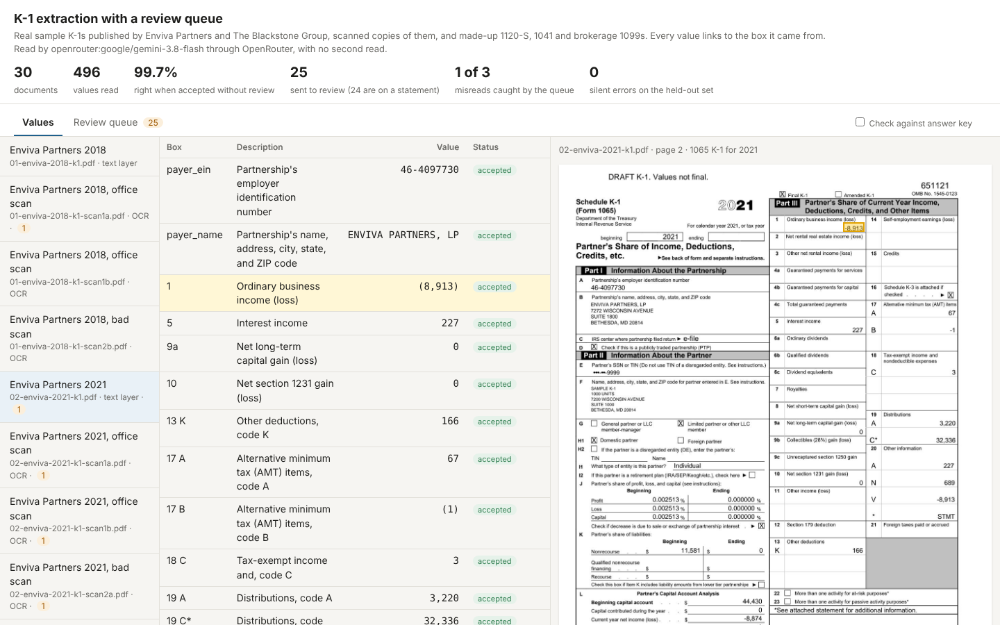

# K-1 extraction with a review queue

This demo reads Schedule K-1s and brokerage 1099s and links every extracted value to the box it came from. Anything the software isn't sure of goes to a review queue for a person to check. It answers a sales question for the CPA document extraction play: can we show a tax preparer what they'd get, with screenshots of real sample documents, without them sending us any documents?

It compares five current vision-language models, three of them open-weight, and two OCR models run on Modal's GPUs, on the same documents and answer keys, each on its own and in pairs where two models must agree. Docling reads the page layout and the supplemental statements; Pydantic AI turns each model's answer into typed values with a page, box and confidence.



## Run it

```
./run.sh               # the model comparison
./run.sh --tesseract   # also the earlier Tesseract pipelines (slow on CPU)
./run.sh --screenshots # also takes screenshots of Gemini 3.8 Flash's review screen
```

You need Python 3.10+, the `tesseract` binary (`apt install tesseract-ocr` or `brew install tesseract`; Docling uses it to read the scanned pages, so every run needs it, not only `--tesseract`), `OPENROUTER_API_KEY`, and for the OCR models `MODAL_TOKEN_ID` and `MODAL_TOKEN_SECRET` in the environment. `run.sh` checks for Tesseract and the OpenRouter key before it builds anything. Without the Modal credentials the OCR models are skipped. The script makes a virtualenv (Docling brings a CPU build of PyTorch; the virtualenv comes to about 2 GB), downloads the blank IRS forms and the real sample K-1s, generates the made-up documents, runs Docling, runs the five models in parallel, pairs Gemini with Qwen 3.8 27B, scores everything and writes:

- `output/comparison.md`: every run side by side
- `output/<model>-alone/index.html`: each model's review screen
- `output/pair-gemini-3.8-flash+qwen3.8-27b/index.html`: the review screen for Gemini checked by Qwen 3.8 27B

A run from scratch takes 36 to 81 minutes, depending mostly on the CPU: Docling's layout pass runs on CPU and took 8 to 84 seconds per document across runs, and building the virtualenv takes 2 to 14 minutes. It costs $1.20 to $1.45 in all; Gemini 3.8 Flash on its own finishes in a few minutes for about 20 cents.

**When a model fails.** Each model gets six attempts at a document, and Pydantic AI retries malformed output twice within each. A comparison model that still fails on some documents doesn't stop the run: it is scored on the documents it finished, and the ones it failed are listed in its `extracted.json` and `metrics.json` (`failed_documents`) and in the "Failed documents" column of `output/comparison.md`. A model that finishes no documents at all is left out of the comparison. The run stops with an error only when Gemini 3.8 Flash or Qwen 3.8 27B produce nothing, since the pair and the screenshots need them. The pair is scored on the documents both of its models finished. The OCR pipelines work the same way.

## The documents

**Real K-1s (Form 1065).** Publicly traded partnerships publish sample K-1 tax packages for their unitholders. Each is the issuer's real K-1 from their tax software, along with its supplemental statements, made out to a placeholder investor. We use three:

| File | Issuer | Tax year | Pages | Source |
|---|---|---|---|---|
| `01-enviva-2018-k1.pdf` | Enviva Partners, LP | 2018 | 8 | [envivabiomass.com](https://www.envivabiomass.com/wp-content/uploads/2019/09/Enviva_Sample_Tax_Package_10000_units.pdf) |
| `02-enviva-2021-k1.pdf` | Enviva Partners, LP | 2021 | 7 | [Enviva investor site](https://s28.q4cdn.com/898203682/files/doc_downloads/schedule_k-1s/2022/03/EVA-2021-Sample-K-1-1-000-Units.pdf) |
| `03-blackstone-2019-k1.pdf` | The Blackstone Group L.P. | 2019 | 11 | [Blackstone investor site](https://s23.q4cdn.com/714267708/files/doc_downloads/2020/03/SAMPLESCHEDULE_K1_2019.pdf) |

These files are not in the repo. `fetch_real.py` downloads them from the issuers' sites and checks their SHA-256 hashes, so the hand-keyed answer key (`real_answer_key.json`) is guaranteed to match. The three cover three different K-1 layouts, since the form changed in 2019 and again in 2021. Between them they include losses printed as `-27,942` and `(18)`, dashes for zero, coded boxes such as `20 AH*`, country codes (`16 A VARIOUS`), and boxes whose amount is only on an attached statement (`* STMT`).

**Scanned copies of the real K-1s.** These are born-digital PDFs, and real client documents often arrive as scans. So `fetch_real.py` also prints each K-1 page and "scans" it: it rotates, blurs and downsamples the image, adds noise and saves it as a JPEG. An office scan is mild. A bad scan imitates a fax or a phone photo.

**Made-up K-1s and 1099s.** Real 1120-S and 1041 K-1s and real brokerage 1099s aren't published anywhere we can use. `generate.py` fills the blank 2025 IRS forms with invented names and amounts, and draws a made-up broker's consolidated 1099 with DIV, INT and 1099-B summary and detail pages. Their EINs start with `00-`, a prefix the IRS doesn't assign. Every made-up document is image-only, either a clean scan, an office scan or a bad scan.

**Blank IRS forms.** `fetch_forms.py` downloads the blank Schedule K-1 forms from the IRS's prior-year archive (`irs.gov/pub/irs-prior/`): Form 1065 for 2018, 2019, 2021 and 2025, and Forms 1120-S and 1041 for 2025. It checks their SHA-256 hashes, as `fetch_real.py` does for the issuers' files. `generate.py` fills the 1120-S and 1041 forms, and the extractors line scanned K-1s up with all six for their box labels. They are not in the repo.

## How it works

1. **Docling reads every page once** (`layout.py`, on CPU). It finds the K-1 page and the supplemental statements, and turns each statement into a Box / Description / Amount table.
2. **Each model reads the form** (`extract_vlm.py --model-only`). The K-1 page (or the 1099 summary page) goes to the model as an image at 200 dpi. Each model is named by a Pydantic AI model string, such as `openrouter:google/gemini-3.8-flash`. All five here go through OpenRouter, which Pydantic AI treats as one provider among others, so a model from another provider is a different string and no code change. Pydantic AI asks for a typed result: one Pydantic model per form (1065, 1120-S, 1041 and the brokerage 1099), where every value carries what was printed, its bounding box and the model's own confidence. Thinking models run at low effort through Pydantic AI's provider-neutral `thinking` setting; reading a form doesn't need long reasoning, and at the default they spent their whole output budget thinking.
3. **A value goes to review** when the model's confidence is below 0.9, the amount is on an attached statement (`STMT`), it isn't a well-formed amount, a coded row has no code letter, or a cross-check fails (qualified dividends above ordinary dividends, 4a + 4b ≠ 4c, a 1099-B row that doesn't balance). **The whole page goes to review** when the model read nothing on it, read too few values for the amounts Docling sees printed on the page (when there are at least 8), or wasn't sure of any value it read. "Too few" depends on the form. A K-1 prints many amounts the schema doesn't ask for, such as the capital account, so a K-1 answer is near-empty only below a quarter of the printed amounts. A brokerage summary page prints only the 18 amounts the schema asks for, so there the line is three quarters: Docling sees 15 to 17 amounts on each made-up 1099 summary page, a full answer has 16 to 18 values, and GLM's sparse answers had 4 to 8. An answer that skips only the DIV or only the INT section still has 12 or 14 values and isn't caught; one that skips the 1099-B rows, or DIV and INT together, is. Otherwise every box the model left out would count as an accepted blank.
4. **Pairs** (`pair.py`). Two models' saved answers are combined with no further API calls. A value is accepted only when both models report the same box and code with the same amount and neither has its own reason to send it to review. Anything only one model reported, or that the two read differently, goes to review.
5. **Statements.** For a `STMT` amount, the model reads the statement page and lists that box's lines. The reviewer sees them as a suggestion; the value stays in the queue.
6. **OCR models on Modal** (`ocr_modal.py`, `extract_ocr.py`). olmOCR 2 and granite-docling turn a page into text rather than filling a schema, so each is followed by a text model (Gemini 3.8 Flash, which never sees the image) that fills the same typed schema from the OCR text, with the same review rules.
   - **Weights:** a small CPU container on Modal (`modal run ocr_modal.py::download`) downloads both models from Hugging Face into a Modal Volume. The GPU containers read them from there and only spend GPU time reading pages.
   - **olmOCR 2** (`allenai/olmOCR-2-7B-1025-FP8`) runs on vLLM on an L4 GPU, with olmOCR's own prompt and 1288-pixel page images, and returns Markdown with HTML tables.
   - **granite-docling** (`ibm-granite/granite-docling-258M`) is served by vLLM on an L4 GPU behind an API key made for each run. Docling's VLM pipeline runs locally and calls it, using Docling's own `GRANITEDOCLING_VLLM_API` preset with two changes. The preset asks the server to skip special tokens, but granite-docling's DocTags are special tokens, so the reply came back with no tags and Docling parsed nothing. And a dense form needs more than the preset's 4,096 output tokens.
   - The GPU cost is Modal's L4 list price ($0.000222 a second) for each page's GPU time.

`report.py` builds the review screen for each run. Clicking a value highlights its box on the page. A STMT value opens the statement page. The queue shows each flagged box cropped from the page, with the reason, and lets a person correct or confirm it. The results export to CSV. No extractor reads the answer keys; `evaluate.py` scores the output against them afterwards.

## Results

From one clean run of `./run.sh --screenshots` from a fresh clone on 2026-10-17. "Boxes" means every box on the answer key plus every value a run reported, so reading something in an empty box, or reporting a box twice, counts as an error, and the box counts differ between runs. A silent error is a wrong value that was accepted without review: the number that matters for a review queue. The held-out set is 14 documents whose scans and made-up values use a different random seed from the ones used while building the checks.

Seven earlier full runs are in [How much the results vary between runs](#how-much-the-results-vary-between-runs). In this run Gemini 3.8 Flash let 2 wrong values through from one misread on a bad scan, a different misread from the box shift in the three runs before it; see [What each model got wrong](#what-each-model-got-wrong).

The Tesseract baseline isn't in this table. The default run doesn't produce it; its numbers under [Earlier approaches](#earlier-approaches) come from earlier held-out runs with `--tesseract`.

### All 30 documents

| Pipeline | Values right | Accepted without review | Wrong but accepted | Sent to review | Cost per document | Model time per document |
|---|---|---|---|---|---|---|
| **Gemini 3.8 Flash** | **674 of 677** | **652** | **2** | **25 (24 STMT)** | **$0.0064** | **17 s** |
| Qwen3-VL 235B (open weights) | 656 of 689 | 650 | 16 | 39 | $0.0038 | 39 s |
| Qwen 3.8 27B (open weights) | 647 of 690 | 668 | 38 | 22 | $0.0062 | 53 s |
| GLM 5.3 Flash, 26 documents (failed on 4) | 586 of 605 | 564 | 2 | 41 | $0.0019 | 17 s |
| Gemma 4 31B (open weights) | 418 of 738 | 646 | 232 | 92 | $0.0018 | 77 s |
| olmOCR 2 on Modal, then Gemini 3.8 Flash on the text | 548 of 709 | 553 | 70 | 156 | $0.0073 | 12 s GPU + 8 s |
| granite-docling on Modal, then Gemini 3.8 Flash on the text | 251 of 678 | 69 | 8 | 609 | $0.0152 | 61 s GPU + 5 s |
| **Gemini 3.8 Flash + Qwen 3.8 27B, must agree** | **675 of 691** | **628** | **0** | **63** | **$0.0127** | **54 s** |

"Wrong but accepted" counts both wrong values that were accepted and values on the answer key that a run never reported, since a missed row reads as a blank box. Docling's layout pass adds 9 seconds per document on CPU to every vision-model row in this run, and up to 84 seconds on a slower machine. GLM 5.3 Flash failed every retry on 4 of the 6 made-up brokerage 1099s, so its row covers the other 26 documents and isn't comparable box for box with the rest.

On the held-out set alone, Gemini 3.8 Flash accepted 299 of 310 boxes in this run, all right, and sent 11 to review. In the three runs before it, the box shift below cost it 2 held-out boxes each time: 297 right of 299 accepted in the manager's second and fourth runs, and 295 of 297 in the run on 2026-10-16. In the three runs before those it accepted 299, all right. The pair accepted 291 held-out boxes in this run, all right. `output/comparison.md` breaks every run down by kind of document.

**Cost.** The cost is the provider's own figure for each response (OpenRouter reports it), or Pydantic AI's price table when a provider doesn't, and includes reading the supplemental statements. Every attempt is counted, including retries that failed after the model answered: Gemma 4 31B needed 2 retries in this run (output cut off at the token limit), and they are in its cost. GLM's attempts on the documents it failed were paid for but aren't in its cost, since those documents have no results; its cost per document is a little low. When a response has no known cost, its document is left out of the average and listed in `metrics.json` (`cost_unknown_documents`) and in `output/comparison.md`. That happened to one Qwen 3.8 27B response on the Blackstone office scan in the two runs on 2026-10-15, and to none in this run. For the OCR pipelines the cost adds each page's GPU time at Modal's L4 list price: about $0.0027 a document for olmOCR and $0.0124 to $0.0135 for granite-docling, whose time is each page's round trip to a server handling several pages at once, so it overstates its share. A pair costs the sum of its two models and takes as long as the slower one. This run cost about $1.27 in all, the manager's fourth run and the run on 2026-10-16 about $1.21 each, the run on 2026-10-15 about $1.25 and the manager's second run about $1.42, so expect $1.20 to $1.45.

**Time.** Run time depends mostly on the CPU, because Docling's layout pass runs there. This run took 40 minutes on 4 cores, about 6 of them building the virtualenv, with Docling at 9 seconds per document. The run on 2026-10-16 took 36 minutes, 2 of them building the virtualenv, and the run on 2026-10-15 42.5 minutes. The Spike manager's runs took 55 minutes (14 of them building the virtualenv in the first), and its fourth run took 81 minutes on a 4-core machine where Docling took 84 seconds per document. Gemini 3.8 Flash's model time was 17 to 19 seconds per document in the runs where it was measured; Docling's share was 8 to 84. Gemini on its own finishes in a few minutes for about 20 cents.

### How much the results vary between runs

The open models' answers change from run to run at temperature 0, by a lot. These are the eight full runs with the current set of models, in order: two on 2026-10-13, the Spike manager's first run on 2026-10-15, a worker's run the same day, the manager's second run later that day, a worker's run on 2026-10-16, the manager's fourth run on 2026-10-17 and this one the same day. The OCR pipelines were added for the second run. The manager's third run, on 2026-10-16, stopped when GLM failed on three documents and isn't in the table; that is what the failure handling above fixes.

| Pipeline | Wrong but accepted, by run | Sent to review, by run | Cost per document, range |
|---|---|---|---|
| Gemini 3.8 Flash | 0, 0, 0, 0, 2, 2, 2, 2 | 24, 24, 24, 24, 24, 27, 24, 25 (24 STMT each time) | $0.0064 to $0.0066 |
| Qwen3-VL 235B | 29, 6, 13, 22, 3, 6, 4, 16 | 37, 30, 40, 32, 28, 31, 29, 39 | $0.0037 to $0.0040 |
| Qwen 3.8 27B | 25, 57, 91, 32, 61, 56, 31, 38 | 24, 21, 22, 26, 18, 25, 22, 22 | $0.0034 to $0.0063 |
| GLM 5.3 Flash | 14, 4, 88\*, 4, 13, 13†, 70\*, 2† | 116, 132, 92, 59, 206, 25†, 39, 41† | $0.0009 to $0.0020 |
| Gemma 4 31B | 211, 278, 222, 239, 235, 220, 241, 232 | 105, 100, 72, 80, 90, 58, 109, 92 | $0.0015 to $0.0050 |
| olmOCR 2 + Gemini | –, 69, 84, 87, 76, 86, 70, 70 | –, 160, 140, 154, 137, 141, 151, 156 | $0.0072 to $0.0074 |
| granite-docling + Gemini | –, 26, 14, 12, 20, 2, 19, 8 | –, 573, 601, 603, 574, 601, 572, 609 | $0.0124 to $0.0219 |
| Gemini + Qwen 3.8 27B pair | 0, 0, 0, 0, 0, 0, 0, 0 | 49, 78, 113, 58, 81, 86, 55, 63 | $0.0099 to $0.0127 |

† Not every document: GLM failed every retry on 5 of the 6 brokerage 1099s in the run on 2026-10-16 (25 documents scored) and on 4 of them in this run (26 documents). In the manager's fourth run it finished all 30.

\* Near-empty answers on the brokerage 1099s. In the manager's first run GLM returned only box 1a, at confidence 0, for five of them, and every box it left out counted as an accepted blank: 85 of the 88. A check was added that sends a page to review whole when the model reads fewer than a quarter as many values as Docling sees amounts printed on it. That wasn't enough: in the manager's fourth run GLM read only 4 to 8 values on the summary pages of 1099s `17`, `18`, `26`, `27` and `28`, each of which shows 15 to 17 amounts, so it was over the quarter line, and only `16` was sent to review. Those five accounted for 66 of its 70 wrong values. The quarter line was set for K-1s, which print many amounts the schema doesn't ask for; a 1099 summary page prints only the 18 the schema asks for. The check now uses three quarters on 1099 summary pages (see [How it works](#how-it-works)), which would have sent all five to review, and those 66 would have been review items. In this run it sent GLM's `18` (4 values read, about 15 shown) and granite-docling's `18` (10 values read) to review whole.

The first three runs counted only the attempt that succeeded, so their costs leave out failed retries; the last five include them. Before these eight runs, with an earlier prompt and a slightly different model set, Gemini 3.8 Flash got 675, 676, 676 and 676 of 676 right; the one error was Enviva 2018's `-27,942` read as `-27.942` on an office scan, and it went to review because it isn't a well-formed amount.

### What each model got wrong

- **Gemini 3.8 Flash** made no errors in four of the eight runs. In the next three it made the same misread, which cost two boxes each time: on the bad scan of Enviva 2018 (`01-enviva-2018-k1-scan2b.pdf`, held out), it read the dash in box 5 as `0` and put it in box 4, at confidence 95. That is a box shift on a bad scan, accepted at high confidence, so nothing in Gemini's own answer sent it to review: box 4 became a wrong accepted 0, and box 5 went unreported and counted as an accepted blank. In this run it read that scan right, but on the bad scan of Enviva 2021 (`02-enviva-2021-k1-scan2a.pdf`) it read box 13's `K 166` as code `AH`, at confidence 95: a wrong accepted 13 AH and a missed 13 K. The pair with Qwen 3.8 27B caught every one of these; see [below](#gemini-alone-or-checked-by-an-open-model). In the run on 2026-10-16 it also read `-27,942` as `-27.942` twice and `216,999` as `216.999` once on the Enviva scans; those went to review because they aren't well-formed amounts.
- **Qwen3-VL 235B** let 16 errors through in this run: 11 on the Blackstone K-1 and its scans (on the office scan it put boxes 3, 4a to 4c, 6c, 9b and 12 wrong) and 5 on two made-up 1041s (boxes 5, 8 and 10). In other runs it let between 3 and 29 through, almost all on Blackstone.
- **Qwen 3.8 27B** let 38 errors through in this run, all on the real K-1s and their scans (34 on Blackstone), mostly coded rows of boxes 15, 16 and 17 that it skipped or filed under the wrong box: it put Blackstone's and Enviva 2018's box 16 rows under box 15, as in earlier runs.
- **GLM 5.3 Flash** can fail outright on the made-up brokerage 1099s. In this run it failed all six attempts on 4 of the 6 (`16`, `17`, `27` and `28`), each time with Pydantic AI's `Exceeded maximum output retries (2)`: its answer never fit the 1099 schema. It failed on 5 of them in the run on 2026-10-16 and on 3 in the manager's third run, which stopped there; in the manager's fourth run it failed on none. When it does answer a 1099 it often reads only part of the page: in the manager's fourth run, 4 to 8 values on five of them, which is what the near-empty check above now catches. In this run it read 4 values on `18`, and the check sent that page to review whole. Its 2 wrong values in this run were single boxes on the real K-1s. It also varies the most between runs: in the manager's second run it sent 206 values to review and still let 13 through.
- **Gemma 4 31B** shifted amounts into neighbouring boxes, misread names ("ENVIRO PARTNERS, LP") and skipped coded rows. On 1099 `28` in this run it put every DIV and INT amount one line up, so 9 boxes were wrong; it read 16 values, so the near-empty check rightly didn't apply. Between a third and 43% of what it accepted was wrong, depending on the run. It often runs out of its 8,000 output tokens before answering: twice in this run (the Blackstone K-1 and 1099 `18`), 6 times in the run on 2026-10-16 and in the manager's second run, and 8 in the run on 2026-10-15. Each is retried, and it finished every document.
- **olmOCR 2** read the characters well: on the Blackstone office scan its text has every Part III amount. But it lays a K-1's two columns of boxes out as one HTML table, pairing labels and amounts loosely, and once the form is text the box an amount belongs to is easy to lose. The text model then put amounts one box off (in one run Blackstone's 6a, 6b and 6c each got the next box's amount), filed coded rows under the wrong box (`20 V` as `13 V`), and missed rows. 70 errors went through in this run.
- **granite-docling** could not read these forms. On 26 of the 30 pages in this run Docling got nothing usable back, and those pages went to review whole; on a 27th, 1099 `18`, the text model filled only 10 values and the near-empty check sent it to review whole. Where it did return text, it read some of the page and often then repeated one token until it ran out of output; it never read a Part III amount on any of the real K-1s. A repetition penalty didn't help. Docling's own Transformers pipeline on a Modal GPU gave the same result at 257 seconds a page, so this is the model, not the serving.

**Supplemental statements.** `evaluate.py` checks every statement line a model reads against the issuer's own text layer. Gemini 3.8 Flash read all 62 lines behind the STMT boxes correctly and missed none, in this run and in every earlier one. In this run every other vision model that reached the statements also read its lines correctly: Qwen3-VL 235B and GLM all 62, Qwen 3.8 27B 53 and Gemma 15. That doesn't always hold for Gemma 4 31B: in the manager's first run it read 29 of 36 lines right and missed 10 (for example it read Blackstone's 20AG as 3,213 where the statement says 3,513), in the manager's second run 14 of 17 right with 30 missed, and in the manager's fourth run 35 of 42 right with 9 missed. The statement lines are only ever a suggestion beside a value that stays in the queue.

Two changes made the vision models comparable. In the coded boxes the code letter is now a required field: when it was optional, GLM and Qwen 3.8 27B left it out of every row. And thinking models run at low effort, without which they spent their whole output budget thinking.

### Reading the image, or reading text

The OCR models were the cheapest way to get the characters off the page, and olmOCR got nearly all of them. What they lose is the layout: a K-1 is a grid of numbered boxes, and a text model filling the schema from OCR text has to guess which amount belongs to which box. A vision model reading the image sees the grid. On these documents that difference decided the result: in this run Gemini reading the image was right on 674 of 677 values, and 671 to 676 in earlier runs; Gemini reading olmOCR's text of the same pages was right on 548 of 709.

### Gemini alone, or checked by an open model

Gemini 3.8 Flash on its own let 0 to 2 wrong values through across eight runs, but its own confidence never flagged anything: everything it sent to review was a STMT amount or a malformed one. So when it does misread a document, nothing but the cross-checks will catch it, and in the last four runs nothing did: three times it put a box 5 dash into box 4 as `0` on a bad scan, and in this run it read a box 13 code `K` as `AH` on another bad scan, each at confidence 95 and each accepted wrong. That is the case a second, independent read is for. Pairing Gemini with Qwen 3.8 27B, an open-weight model that could run on our own hardware, costs 50 to 100% more ($0.0099 to $0.0127 a document against $0.0064 to $0.0066). The pair let nothing wrong through in any of the eight runs, those misreads included, and sent between 25 and 89 more values to review than Gemini alone (49 to 113 against 24 to 27), almost all of them rows Qwen skipped or filed under the wrong box. Gemini alone is cheaper and is right on nearly every value, but it can accept a misread on a bad scan without flagging it. The pair is the safer default for client documents, and the one to show a CPA firm when the point is that wrong values don't get through.

## Earlier approaches

These numbers are from earlier runs and the default `./run.sh` doesn't reproduce them; `./run.sh --tesseract` does. The first versions of this demo, still in the repository and run with `--tesseract`, read the forms with Tesseract OCR and rules (`extract.py`), and then checked Qwen3-VL 235B against Tesseract box by box (`extract_vlm.py` without `--model-only`). On the held-out set, Tesseract and rules accepted 182 of 321 boxes with 2 silent errors and sent 43% to review. Checking Qwen3-VL against Tesseract accepted 236 with no silent errors and sent 28% to review, much of it because Tesseract couldn't read a box the model had read right. Gemini 3.8 Flash on its own beats both. Docling's own OCR wasn't usable as a check on scans: it picked up 26% of the values on the scanned K-1s.

## What it doesn't show

- **This is not our production extraction.** It is a demo built on public tools and public models. A prospect who sends real documents will see different numbers.
- **The scans are simulated.** Real scans have problems we didn't model: staples, handwriting, stamps, pages scanned at a different scale, and colour backgrounds.
- **The sample is small.** It has three real K-1s, all Form 1065 from publicly traded partnerships. There are no real 1120-S or 1041 K-1s and no real brokerage 1099s; the made-up 1099s use our own layout. Gemini's best runs were perfect on 676 values; that doesn't mean a perfect score in general, and four of eight runs weren't.
- **Model answers vary from run to run.** Across eight runs with the current models, Qwen3-VL 235B let between 3 and 29 errors through, Qwen 3.8 27B between 25 and 91 and GLM 5.3 Flash between 2 and 88 (85 and 66 of the two highest from near-empty answers that the page check now sends to review). Gemini 3.8 Flash let 0 to 2 through. Eight runs are not enough to pin down any model's error rate.
- **A model that skips one section of a 1099 can get through.** The page check compares how many values a model read with how many amounts Docling sees on the page. On a 1099 summary page it catches an answer that skips the 1099-B rows, or DIV and INT together, but not one that skips only DIV (12 values left) or only INT (14). A check per section would catch those; this demo doesn't have one. The check also can't catch values put in the wrong box, like Gemma's on 1099 `28`.
- **A failed document isn't in the review queue.** A document a model couldn't read on any retry is listed as failed and left out of its scores and review screen. In production it would go to a person whole.

## Files

- `run.sh`: the one command
- `fetch_forms.py`: downloads the blank IRS K-1 forms into `forms/`
- `fetch_real.py`: downloads the real K-1s and makes scanned copies
- `generate.py`: makes the made-up documents and `answer_key.json`
- `layout.py`: runs Docling over every sample once, writing `output/layout/`
- `extract_vlm.py`: reads every document with one model, `python extract_vlm.py openrouter:<model> --model-only`, or any other Pydantic AI model string
- `pair.py`: combines two models' runs, `python pair.py output/<a>-alone output/<b>-alone`
- `ocr_modal.py`: the Modal app: the CPU weight download, olmOCR 2 on vLLM, and the granite-docling vLLM server
- `extract_ocr.py`: OCR on Modal, then a text model fills the schema, `python extract_ocr.py olmocr|granite-docling openrouter:<model>`
- `evaluate.py`: scores a run and writes its `metrics.json`
- `report.py`: builds a run's review screen, `index.html`
- `compare.py`: writes `output/comparison.md`
- `extract.py`: the earlier Tesseract pipeline
- `screenshots.py`: saves `screenshots/` from a run's review screen (Gemini 3.8 Flash by default)
- `real_answer_key.json`: the real K-1s' Part III boxes and the partnership name and EIN, keyed by hand from the issuers' PDFs

The committed screenshots are Gemini 3.8 Flash's review screen from the clean run reported above.
