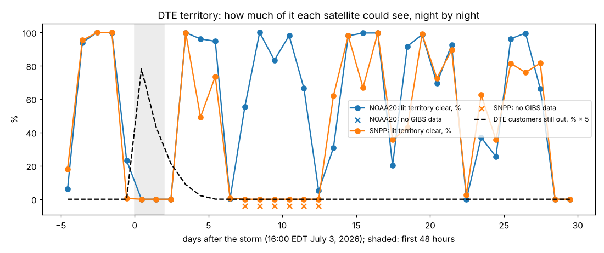

# Can satellite night light show which places are still dark in the first two days after a summer storm?

Spike for [issue #271](https://github.com/fulton-ring/agent-content-demos/issues/271), a
follow-on to [`nightlight-storm-restoration/`](../nightlight-storm-restoration/) (PR #252).
That spike found that after DTE's July 3, 2026 storm NASA's Black Marble night light had no
clear view of any of DTE's 466 census tracts for two nights. It also found that across 611
storms only 28% of county nights in the first two nights had a clear reading. This one asks
whether that blindness is cloud or one satellite's sensor. That matters now: Suomi NPP stopped
delivering data on November 2, 2026, so NOAA-20 is the satellite anyone making these maps has
to use.

One marimo notebook, [`first_two_nights.py`](first_two_nights.py), in three parts: DTE's
July 2026 storm on both satellites, the first two nights after every storm both satellites
cover, and storm-by-storm agreement with reported outages.

## Short answer

**No. In the first two nights after a storm, night light usually can't see, and that's cloud,
not the sensor. NOAA-20 is as blind as S-NPP was.** All numbers come from `./run.sh`
(`outputs/summary.json`).

| First two nights after impact, same county nights | NOAA-20 (VJ146A2) | S-NPP (VNP46A2) |
|---|---|---|
| All storms both satellites cover: 368 storms, 18,126 county nights | **27.7%** clear | 26.4% clear (27.5% where GIBS has S-NPP data) |
| Summer storms (impact May to September): 154 storms, 9,006 county nights | **34.7%** | 32.7% (34.2% where it has data) |
| DTE July 2026: tracts with a clear reading in the first 48 h | **0 of 466** | 0 of 466 |
| DTE July 2026: first clear night | **July 7, 83 h after the storm** | July 7, 83 h |

- **The two satellites agree on 89% of county nights:** both clear on 21.6%, neither on
  67.5%. Per storm, their clear shares correlate at 0.90
  ([`outputs/storms_noaa20_vs_snpp.png`](outputs/storms_noaa20_vs_snpp.png), per-storm
  table in [`outputs/storms_first_two_nights.csv`](outputs/storms_first_two_nights.csv)).
  They fly the same orbit within an hour of each other, so what blinds one blinds the other.
- **DTE, July 2026:** when NOAA-20 first saw the territory, DTE's filed curve implies 1.7% of
  its customers were still out (about 91% of affected customers were back). DTE says its own
  meters reported for only about 45% of customers at the peak. Neither the meters nor the
  satellite could see the first two nights.



- **The earlier spike's last two nights (August 1 and 2) were cloud, not missing data.**
  GIBS has a cloud-mask value for every lit pixel on both nights and none is clear. The raw
  day/night band shows cloud over the territory instead of city lights
  ([`outputs/dte_last_nights.png`](outputs/dte_last_nights.png)). Over the 30 post-storm nights,
  NOAA-20 had no clear reading on 12, all of them cloud. S-NPP had none on 17: 11 cloud, and 6
  where GIBS has no S-NPP data (July 11 to 16; table in
  [`outputs/dte_nights.csv`](outputs/dte_nights.csv)).

### Where night light can see: storm by storm, not pooled

Heimdall's night-light deficit against DOE EAGLE-I's share of customers out at the overpass,
on county nights 1 to 7 after impact with at least half the county clear
([`outputs/per_storm_spearman.csv`](outputs/per_storm_spearman.csv)):

| Storm | Clear county nights | Spearman | Deficit where under 1% out |
|---|---|---|---|
| Hurricane Beryl, Texas, July 2024 (AL022024) | 58 | **0.53** | 17% |
| Oklahoma, June 2023 (DR-4721) | 131 | **0.48** | 1% |
| DTE / SE Michigan, Aug 2023 (DR-4757) | 45 | 0.24 | 14% |
| Kentucky, May 2024 (DR-4804) | 139 | −0.20 | 50% |
| Illinois, June 2023 (DR-4728) | 74 | −0.25 | 50% |
| Pooled, all five | 447 | 0.04 | |

Night light tracked outages moderately on two storms and not at all on three. The pooled 0.04
mostly reflects differences in baseline between storms. On Kentucky and Illinois, Heimdall's
counties read about half their usual brightness for the week after, even where EAGLE-I shows
under 1% of customers out. On Oklahoma they read near normal. Pooling stacks those offsets,
so the pooled rank mostly says which storm a county night came from. Ranking within each storm
first raises it to 0.10, and the per-storm values weighted by clear county nights average 0.13.

## How we measured it

- **Night light and cloud: NASA GIBS.** Black Marble's HDF5 files on LAADS need an Earthdata
  login, which this session doesn't have, so as in the earlier spike we read GIBS's public PNG
  images and invert their color maps. For visibility we use GIBS's VIIRS night clear-sky
  confidence layer for each satellite. A pixel counts as clear at ≥95% confidence. A county or
  tract has a clear reading when at least half its pixels are clear. For storms we sample at
  60 pixels per degree (about 1.8 km), and for DTE at Black Marble's 15 arc-seconds. GIBS's
  transparent "no data" pixels are counted separately from cloud. We first checked World
  Bank's `blackmarblepy` and Google Earth Engine; both need an account.
- **Storms and counties: Heimdall Research's Storm Blackout and Restoration 1.2** (Zenodo,
  CC BY 4.0). We use its 611 storms with FEMA-declared counties and each county's impact date,
  then take nights 1 and 2 after it. We keep the county nights both satellites' GIBS cloud
  masks cover, using the date ranges from GIBS's own capabilities file: February 2018 to
  November 2, 2026, minus gaps, the largest October 1 to December 4, 2023. Alaska is left out
  because its counties cross the antimeridian. That leaves 368 storms.
- **Check against Heimdall:** Heimdall's valid-pixel share (Black Marble's own cloud, quality
  and snow flags) says 33.4% of these county nights were clear, against our 26 to 28%. Where
  Heimdall used the same satellite, our call matches Heimdall's on 88% of county nights for
  NOAA-20 and 83% for S-NPP. Our cloud mask is a bit stricter. Neither number changes the
  answer, and the satellite comparison uses the same method on both sides.
- **DTE:** the territory is the piece of HIFLD Next's DTE Electric polygon containing Detroit.
  Tracts are Census 2024, at least half inside, with 20 or more lit pixels. "Lit" means a
  usual NOAA-20 brightness of at least 5 nW/cm²/sr on clear nights in the month before the
  storm, and both satellites are scored on the same lit pixels. DTE's curve is parsed at run time from its filing in MPSC Case
  U-22156.
- **Outages: DOE EAGLE-I** (figshare, CC BY 4.0), customers out within 30 minutes of each
  county's 01:30 local solar time overpass, over EAGLE-I's modeled customers per county.

## How to run

```bash
./run.sh
```

Needs [uv](https://docs.astral.sh/uv/). No keys, no paid services, $0. The first run downloads
about 3.5 GB into `data/` (set `DATA_DIR` to put it elsewhere): EAGLE-I 2023 and 2024
(2.6 GB), Heimdall's county table (0.7 GB) and about 1,760 GIBS images (110 MB). Raw pulls
are cached there. From a fresh clone the run took 8 minutes; reruns take under a minute. To read it interactively:
`uv run marimo edit first_two_nights.py`.

## What didn't work, and what this doesn't show

- **GIBS cloud mask vs Black Marble's own flags.** Our clear rates sit 5 to 9 points below
  Heimdall's, and we can't read the HDF5 flags without a login. The satellite comparison is
  like for like, but the absolute rate depends on the mask: 28% (GIBS) or 33% (Heimdall).
- **S-NPP has holes in GIBS.** 4.2% of county nights have no S-NPP cloud mask, almost all in
  storms Heimdall measured with S-NPP. Rates "where it has data" are given beside the raw rate.
- **GIBS occasionally returns an XML error instead of an image.** The notebook retries three
  times, and would count a persistent failure as no data and say so. None persisted in our runs.
- **"Two nights" is a fixed window.** Hours from impact to the first overpass vary by county
  and storm. For DTE we give hours; for the 368 storms we count nights.
- **The per-storm Spearman rests on five storms** and on Heimdall's night light, which uses
  S-NPP or NOAA-20 depending on the storm. It isn't a NOAA-20-only rerun. A clear reading is
  not a correct one: on three of five storms, night light where it could see didn't track
  EAGLE-I.
- **EAGLE-I is the utilities' own count**, scraped from outage maps, so it is not independent.
  EAGLE-I 2026 isn't published, so there's no county answer key for DTE July 2026 (#251).
