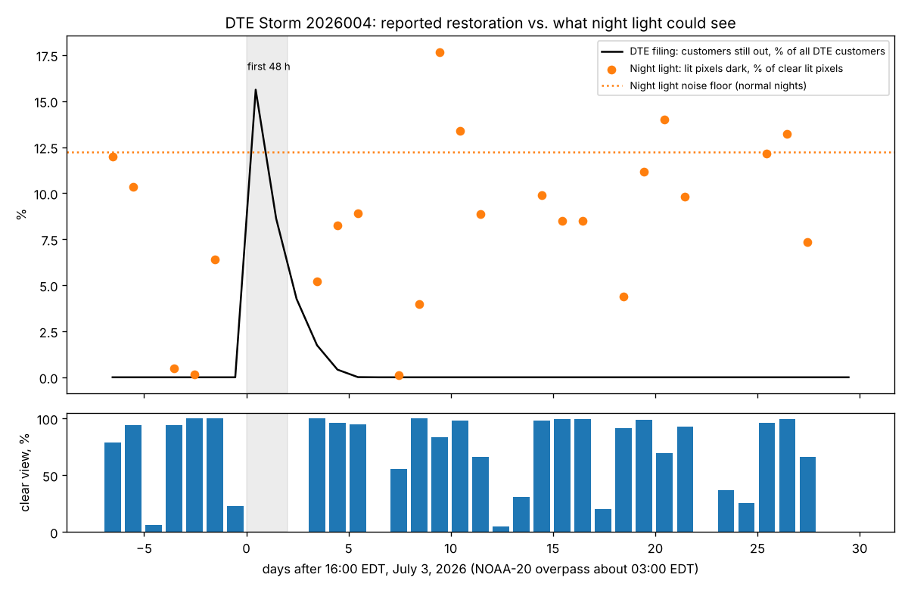
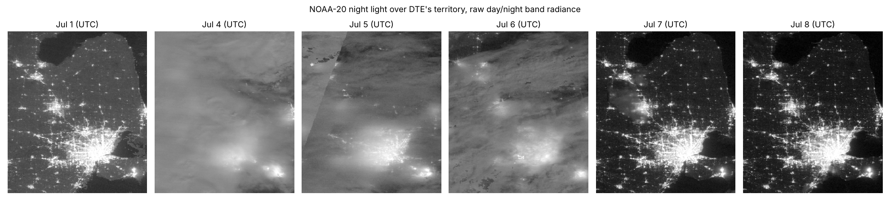

# Can satellite night light check a utility's storm restoration report?

Spike for [issue #248](https://github.com/fulton-ring/agent-content-demos/issues/248). On
July 3, 2026 a storm cut power to nearly 450,000 DTE Electric customers. DTE told the Michigan
PSC (Case U-22156) that 44% were back within 24 hours, 70% within 48, 88% within 72 and 99%
after 4.6 days, and that its smart meters reported for only about 45% of customers at the
peak. We set NASA's Black Marble night light against that curve, then tested the same method
against DOE's EAGLE-I county outage counts on storms where those counts exist.

Two marimo notebooks, each readable on its own:

- [`restoration.py`](restoration.py): DTE's July 2026 storm, territory, counties and tracts.
- [`comparison.py`](comparison.py): DTE's August 2023 storm (FEMA DR-4757) through the same
  method against EAGLE-I, five summer storms from Heimdall's Storm Blackout tables, and how
  often night light can see the first two nights at all, over 611 storms.

`nightlight.py` holds what both notebooks share: fetching and decoding night light, the
DTE territory, and the counties and tracts in it.

## Short answer

**No. Night light could not check DTE's July 2026 report. It saw nothing in the first 72 hours,
and where it did see, its night-to-night noise was larger than the outages left to find.** The
issue's own test for "it's wrong" is met: there were no clear readings in the first 48 hours.
All numbers come from `./run.sh` (see `outputs/summary_*.json`).



- **Clouds hid the hours that mattered.** VIIRS's cloud mask rates 0.0% of DTE's lit area
  clear on the nights of July 4 and 5 (UTC) and 0 of 466 tracts readable in the first 48 hours.
  The first clear night was July 7, 83 hours after the storm, when DTE says about 91% of affected
  customers were back and 1.7% of all DTE customers were still out. The raw images show the
  same thing: city lights smeared through cloud on July 4, 5 and 6.



- **On the first clear night the signal was under the noise.** 5.2% of clear lit pixels read
  "dark" (below half their usual brightness) on July 7. On normal clear nights before the storm
  the median is 5.7% and the 95th percentile 12.2%. So night light measured no excess darkness
  at territory level, against DTE's 1.7% still out.
- **Counties and tracts: "tracked DTE within 5 points" in 8 of 12 counties and 371 of 466
  tracts, but that means little.** Four counties and 95 tracts were darker than DTE's
  territory-wide share by more than 5 points. On a normal clear night before the storm, the
  same rule flags 48% of counties and 25% of tracts anyway, so these flags don't show where
  restoration lagged. DTE files no county numbers and EAGLE-I's 2026 counts are not yet public,
  so there is no county answer key for this storm.
- **Of the 30 nights after the storm, 18 had at least half the territory clear.**

## How well night light agrees with EAGLE-I in general

| Test | Clear county nights | Spearman, darkness vs. share out | Clear in first 2 nights |
|---|---|---|---|
| DTE Aug 2023 (DR-4757), our GIBS method, 12 counties | 63 of 84 | −0.05 | 6 of 24 county nights |
| DR-4757, Heimdall's night light, 9 declared counties | 45 | 0.24 | 44% |
| DR-4721, Oklahoma, June 2023 | 131 | 0.48 | 82% |
| DR-4728, Illinois, June 2023 | 74 | −0.25 | 41% |
| Beryl (AL022024), Texas, July 2024 | 58 | 0.53 | 43% |
| DR-4804, Kentucky, May 2024 | 139 | −0.20 | 15% |
| All five pooled | 447 | 0.04 | |
| All 611 storms in Heimdall 1.2 with declared counties | | | 28% of 28,278 county nights |

Heimdall's own score over 287 to 418 storms agrees: the chance that a county with 10%+ of
customers out looks darker than one with under 1% out is 0.51 to 0.57 (0.5 is a coin flip).
Night light tracked outages moderately on two storms (Beryl, the Oklahoma storms) and not
at all on the other three. On DTE's own 2023 storm, the counties EAGLE-I showed with the most out
(13% to 26%) mostly looked darker, but so did many counties with nobody out
(`outputs/dr4757_comparison.png`). Per-storm details are in `outputs/five_storms.csv`.

## What we used, and what we looked at first

- **Night light: NASA Black Marble (VJ146A2, NOAA-20), from NASA GIBS.** LAADS serves the
  HDF5 files only with an Earthdata login, which this session doesn't have. GIBS serves the
  same gap-filled, BRDF-corrected radiance as public PNG images with a published color map
  (180 bins up to 38.2 nW/cm²/sr). `nightlight.py` turns colors back into radiance and drops
  pixels the VIIRS cloud mask (also on GIBS) rates under 95% confident clear. 61 nights × 2
  layers for the DTE grid is 11.5 MB. We checked World Bank's `blackmarblepy` and Google Earth
  Engine first; both need an account.
- **DTE's territory: HIFLD Next Electric Retail Service Territories.** DTE's polygon is
  69,876 km², built from every county where DTE reports customers, including the Upper
  Peninsula. We keep the 19,817 km² piece that contains Detroit, which matches DTE's size.
- **DTE's curve: DTE's report in MPSC Case U-22156,** downloaded from the docket and parsed at
  run time (restoration shares, 450,000 affected, about 2.3 million served, 45% meter reporting).
- **Outages: DOE EAGLE-I on figshare (CC BY 4.0), 2023 and 2024 files,** 1.2 and 1.4 GB.
  Customers out within 30 minutes of each county's overpass (01:30 local solar time), divided
  by EAGLE-I's modeled customers per county. Its public record ends December 31, 2025.
- **Heimdall Research's Storm Blackout and Restoration 1.2 (Zenodo, CC BY 4.0):** county
  nightly night light from the HDF5 files with NASA's quality flags, and its validation tables.
  The July 2026 storm isn't in it: it was not FEMA-declared.
- Census 2024 cartographic boundaries for counties and tracts.

## How to run

```bash
./run.sh
```

Needs [uv](https://docs.astral.sh/uv/). No keys, no paid services. The first run downloads
about 3.5 GB into `data/` (set `DATA_DIR` to put it elsewhere), mostly the two EAGLE-I files
and Heimdall's county table; from a fresh clone the whole run took 13 minutes, and later
runs take under 30 seconds. To read the notebooks interactively: `uv run marimo edit restoration.py`.

## What didn't work, and what this doesn't show

- **The test we wanted, county by county against the utility for July 2026, isn't possible
  yet.** It needs EAGLE-I's 2026 file or DTE's county numbers. When EAGLE-I 2026 is published,
  `comparison.py`'s EAGLE-I step will run for July 2026 by adding the file to `eaglei_files`.
- **GIBS images aren't the HDF5 product.** Radiance comes in bins, 25% of DTE's lit pixels
  saturate at 38.2, and we can't read Black Marble's own quality flags. Our noise floor (5.7%
  median, 12.2% at the 95th percentile) may be partly ours. Heimdall's HDF5-based numbers don't
  agree much better, though, so we don't think the HDF5 files would change the answer.
- **Night light and customers out are different quantities.** Streetlights and stores on other
  circuits, generators, damage and empty buildings all separate them. On DR-4728 and DR-4804
  Heimdall's counties average about 47% below usual brightness for the week after while
  EAGLE-I shows 6% to 8% out. We didn't trace that gap.
- **DTE's curve at hour 0 assumes all 450,000 customers were out at once,** an upper bound for
  the first hours. The comparison doesn't depend on it, since night light had no reading then.
- The answer is for summer convective storms in the Midwest and South, where most customers
  are back within days. Weeks-long outages, like Puerto Rico after Maria, are a different
  case this spike didn't test.
