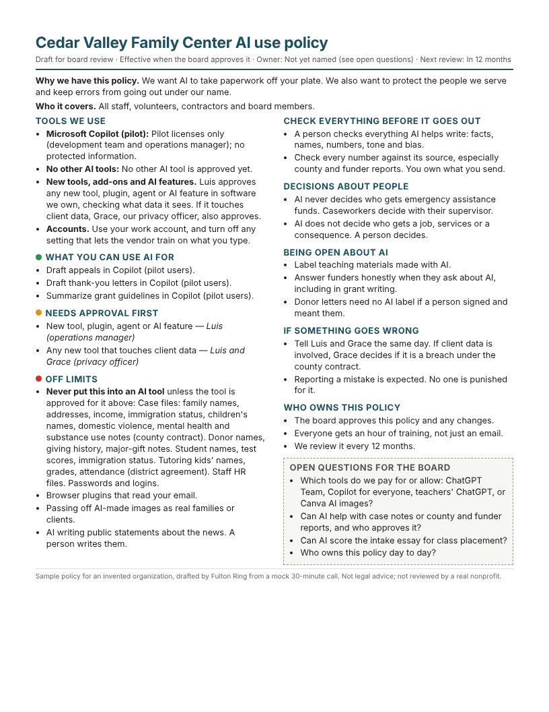

# A one-page nonprofit AI use policy from one short call

Spike for [issue #16](https://github.com/fulton-ring/agent-content-demos/issues/16) ([proposal card](https://app.notion.com/p/3f7cc69045cb817ea12dcac615764e5e)): can a short, plain AI use policy, drafted after one 30-minute call, give a nonprofit's board something real to react to?

**Every organization, person and call in this folder is invented.** No real nonprofit was interviewed and no real nonprofit has reviewed these policies.

## What's here

- [`template/policy-template.md`](template/policy-template.md): the blank one-page template ([PDF](output/template/policy-template.pdf)).
- [`template/call-questions.md`](template/call-questions.md): the six questions we ask on the call, each mapped to the sections it fills ([PDF](output/template/call-questions.pdf)).
- [`calls/`](calls): four mock call transcripts, each labelled as invented:
  - Cedar Valley Family Center, a mid-sized family services nonprofit and the main sample;
  - Northgate Community Food Bank;
  - Bright Futures After School;
  - Eastside Community Health Clinic.
- `output/<organization>/policy.{json,html,pdf}`: the policy drafted from each call. Also `output/checks.md` with the checks, `output/side-by-side.md` with how the policies differ, and `output/published-comparison.md` with length and reading level against published policies.
- [`screenshots/`](screenshots): a PNG of each policy, the template and the questions.
- [`prompts/`](prompts): the two prompts sent to the model, committed as run.
- [`review/`](review): an independent statement-by-statement check of the policies against their calls.
- `src/policy_builder/`: the code.

## How to run it

You need [uv](https://docs.astral.sh/uv/), an OpenRouter key and a Chromium for printing. A full run of the four calls costs about $0.80 and takes about 6 minutes.

**Chromium.** Either let Playwright download its own:

```sh
uv run playwright install --only-shell chromium
```

Playwright launches Chromium headless, and headless runs use Playwright's separate headless shell, so that is what to install. Or skip the download and point `CHROMIUM_PATH` at a Chromium or Chrome binary you already have, for example `export CHROMIUM_PATH=/usr/bin/chromium`.

```sh
cd nonprofit-ai-use-policy
uv sync
export OPENROUTER_API_KEY=...
export NLTK_ALLOW_PROXIED_URLOPEN=1   # only behind a proxy; see below
uv run build-policies
```

That one command does all of this:

1. Renders the blank template and the call questions to HTML and PDF.
2. **Drafts** each policy from its file in `calls/` with a typed model call: Pydantic AI, `anthropic/claude-sonnet-5.5` through OpenRouter, temperature 0, prompt in `prompts/fill-policy.md`. The output is validated against the `Policy` schema in `src/policy_builder/schema.py`. Pydantic AI retries when validation fails, at most twice.
3. **Fits** it to a page. It prints a Letter PDF with Chromium, and if the policy spills onto a second page it asks the model to cut it down (`prompts/shorten-policy.md`), at most twice.
4. **Checks** it against the call. A second typed call (`prompts/review-policy.md`, low reasoning effort) labels every statement as supported by the call, a template default, unsupported, or contradicting the call or another part of the policy, and lists what the policy missed. The output is validated against `FidelityReview` in `src/policy_builder/review.py`.
5. **Revises** it once if the check found anything unsupported or contradicting (`prompts/revise-policy.md`). It then fits it to a page again and runs the check again. There is one revise pass at most, so whatever the second check still finds stays in the policy and in the report.
6. Measures each policy: pages, how full the page is, reading grade, whether every template section is filled, names that don't appear in the call, and time and cost for drafting and checking separately.
7. Downloads the published templates listed under Sources and measures them the same way. The PDFs are cached in `.cache/`, which is not committed. Pass `--skip-published` to skip this step.

Model calls per policy: at least 2 to draft and check. Usually there are more: each schema retry, shorten pass and revise pass adds one, and a revise adds a second check. In the runs below it took 4 to 8 calls per policy.

Outputs go to `output/`, or to `POLICY_OUTPUT_DIR` if set:

- `<organization>/policy.{json,html,pdf}`, plus `review.json` with both checks and `run.json` with time and cost;
- `checks.md` and `checks.json`;
- `fidelity-findings.md` with every problem the checks found;
- `side-by-side.md`;
- `published-comparison.md`;
- `screenshots/`.

Useful options:

- `uv run build-policies calls/your-call.md` drafts from one transcript or answers file. Any text file works, and the questions file says what it needs to cover.
- `--reuse` re-renders and re-checks the saved policies without calling the model.
- `--model` picks a different OpenRouter model.

The readability check fetches the CMU Pronouncing Dictionary through NLTK the first time it runs. Behind a proxy, NLTK refuses this unless you set `NLTK_ALLOW_PROXIED_URLOPEN=1`.

## What it showed

Yes, with an edit. One call's worth of notes is enough to fill every section of a one-page policy that is specific to the organization: its tools, its data, the people who say yes, and the decisions still open. The policies read at about a seventh-grade level. Every published template we compared runs four to eleven pages at a college reading level. But the drafts aren't ready to send as they come out. An independent check found a few places in each where one section contradicts another or an open question, so a person has to read and fix each draft before the board sees it.



Renders: [Cedar Valley](output/cedar-valley-family-center/policy.pdf) · [Northgate food bank](output/northgate-food-bank/policy.pdf) · [Bright Futures after-school](output/bright-futures-after-school/policy.pdf) · [Eastside clinic](output/eastside-community-health-clinic/policy.pdf) · [blank template](output/template/policy-template.pdf) · [call questions](output/template/call-questions.pdf). Screenshots of each are in [`screenshots/`](screenshots).

### The checks

From the run in `output/`, which we made from a clean checkout following the steps above ([`output/checks.md`](output/checks.md)):

| Policy | Pages | Page fill | Words | Reading grade (FK) | Sections filled | Open questions | Model calls | Seconds | Cost |
|---|---|---|---|---|---|---|---|---|---|
| Cedar Valley Family Center | 1 | 85% | 416 | 6.7 | 12/12 | 4 | 2 | 80 | $0.15 |
| Northgate Community Food Bank | 1 | 86% | 394 | 6.6 | 12/12 | 4 | 2 | 98 | $0.14 |
| Bright Futures After School | 1 | 92% | 462 | 6.3 | 12/12 | 4 | 2 | 67 | $0.12 |
| Eastside Community Health Clinic | 1 | 94% | 459 | 7.0 | 12/12 | 4 | 2 | 110 | $0.19 |

What each column means:

- **Pages** counts pages in the printed Letter PDF.
- **Page fill** is the height of the content against the printable height of one page, measured in Chromium with print styles.
- **Reading grade** is Flesch-Kincaid from textstat, with each bullet scored as a sentence.
- **Sections filled** counts the 12 template sections whose fields are all non-empty with no leftover `[placeholder]`. Open questions are optional and not counted.
- **Model calls** are 2 because Pydantic AI retried once on every policy after a schema check failed, usually too many items in a list.
- **Seconds and cost** cover every model call for that policy. The cost is what OpenRouter reported. Most of the time and cost is the model's reasoning: about 8,000 to 15,000 output tokens per policy for roughly 450 words of policy.

The checks also look for capitalized words in tool names and approvers that don't appear in the call. In this run they found none. `checks.md` shows "None" for Bright Futures because its only tool line is literally "None yet", so that one is a false positive.

### Against published policies

Every row below is measured the same way: text pulled from the PDF with pypdf, then scored with textstat. Ours score a little higher here than in the table above because the PDF text includes the header and footer, and lines are scored as running text ([`output/published-comparison.md`](output/published-comparison.md)).

| Document | Pages | Words | Reading grade (FK) | Reading ease |
|---|---|---|---|---|
| Our four policies | 1 each | 520–589 | 7.4–8.1 | 61–64 |
| Center for Nonprofit AI template | 5 | 1,148 | 11.0 | 42 |
| Fundraising.AI governance template | 4 | 722 | 16.4 | 7 |
| Community IT acceptable use template | 5 | 1,564 | 16.3 | 18 |
| NTEN generative AI use policy template | 11 | 2,234 | 15.2 | 21 |
| Vermont guidelines for generative AI | 5 | 1,846 | 16.7 | 19 |
| Indiana AI policy | 7 | 2,380 | 14.9 | 23 |

The published templates still have their bracketed placeholders and instructions in them, so this isn't a like-for-like comparison of finished policies. It does show what a nonprofit starts from.

### Does it say what the call said?

Two independent reviews read every statement in each policy against its call. They mark it as supported by the call, the template's cautious default, unsupported, or contradicting the call or the rest of the policy. They also list what the policy missed. The first review covered run 1 ([`review/fidelity-run1.md`](review/fidelity-run1.md)). We changed the prompt in response and reviewed the final run ([`review/fidelity-run2.md`](review/fidelity-run2.md)).

| Run | Statements | Supported | Default | Unsupported | Contradicts | Missed |
|---|---|---|---|---|---|---|
| Run 1 | 130 | 101 | 22 | 4 | 3 | 10 |
| Final run | 128 | 98 | 24 | 2 | 4 | 7 |

Neither run invented a tool, law, agreement or person. Every named approver appears in the call with the same role. The problems changed in kind between the runs:

- **Run 1** listed tools the call said weren't approved. The clinic's policy listed ChatGPT, OpenEvidence and UpToDate as approved after its COO said the scribe was "the only approved AI". It also gave one person a decision the call had left to the board. We added rules to the prompt: only approved tools go in the tools list; an open question can't appear as settled anywhere else or get an approver; a "no" said on the call goes under off limits; and sections must agree with each other.
- **The final run** fixed those. What's left is sections disagreeing with each other. The worst case is Bright Futures: it says "never paste a child's information into AI" and also lets the director and the district approve AI use with student data. The food bank's policy leaves volunteers out of "who it covers" because whether they may *use* AI was left open. Those are exactly the edits a person makes in a short review, and they're why we wouldn't send a draft unread.

The stricter rules have a cost. Cedar Valley's teachers use ChatGPT every day, but nobody approved it, so it now sits in the board's open questions rather than under allowed uses. That is faithful to the call ("Officially, nothing"), but it leaves the policy's allowed-uses list short until the board decides.

### How the policies differ

[`output/side-by-side.md`](output/side-by-side.md) puts each section of the four policies next to each other. The differences come from the calls, not the template:

- **Protected information**:
  - The food bank names SNAP applicants' Social Security numbers and immigration papers under its state agreement.
  - The after-school program names IEP and 504 plans, custody orders and pickup lists under its district agreement.
  - The clinic names substance use treatment records, HIV status and reproductive health under HIPAA.
  - Cedar Valley names case files under its county contract and tutoring records under its district agreement.
- **Approved tools**:
  - The clinic approves only the AI scribe, under a business associate agreement.
  - The food bank approves Gemini, which comes with Google Workspace.
  - Cedar Valley approves only its Copilot pilot.
  - The after-school program approves none yet.
- **Red lines**:
  - No chatbot answering SNAP eligibility.
  - Never use AI for mandated reporting of suspected abuse.
  - Providers read every word of a scribe note before signing.
  - No AI images passed off as real families or hungry people.
- **Open questions**:
  - Homework-hour AI use, for the board and principals.
  - Rolling the scribe out to behavioral health.
  - Whether to pay for any AI next year.
  - Whether AI may ever touch case notes.

## How it compares with published templates

We compared our template clause by clause with four published nonprofit templates: NTEN's Generative AI Use Policy template, Community IT's acceptable-use template, the Fundraising.AI governance policy template and the Center for Nonprofit AI template. Vermont's and Indiana's government policies are included as examples of short public-sector policies. ✓ means the document has the clause, ~ means it touches the clause in passing, and – means it doesn't have it. We read each document in full except where the Sources section says otherwise.

| Clause | Ours | NTEN | Community IT | Fundraising.AI | Center for Nonprofit AI | Vermont | Indiana |
|---|---|---|---|---|---|---|---|
| Named list of approved tools, with what each may hold | ✓ | ✓ (Exhibit A) | ✓ | – | ✓ | ✓ (public vs internal tools) | ✓ (inventory) |
| Who approves a new tool | ✓ (named person) | ~ (supervisor, Legal) | ✓ (named title) | ~ | ✓ | ✓ (supervisor) | ✓ |
| AI features switched on inside existing software | ✓ | ~ (vendors with embedded AI) | – | – | – | ✓ | ✓ |
| Browser extensions, plugins and agents | ✓ | – | ~ ("automating approval") | ✓ (scope names plugins, autonomous AI) | – | – | – |
| Everyday uses that need no permission | ✓ (in the org's own words) | ~ (Exhibit B by function) | ✓ (low risk tier) | – | ✓ (tier 1) | ✓ (use matrix) | – |
| Uses that need approval, each with an approver | ✓ | ~ | ✓ (moderate tier) | – | ✓ (tier 2, e.g. grant narratives) | ✓ | ✓ |
| Protected data named for this organization | ✓ (filled from the call) | ~ (generic: employee, client, vendor data) | ~ (generic) | ~ ("personal and sensitive data") | ✓ (donor, client, health, personnel, HIPAA, FERPA) | ✓ (generic categories) | ✓ |
| Human review before anything goes out; sender is responsible | ✓ | ✓ | ✓ | ✓ (high-stakes only) | ✓ | ✓ | ✓ |
| AI never decides about people (eligibility, jobs, consequences) | ✓ | ~ (HR decisions only) | ✓ (high risk tier) | ✓ (human in the loop) | ✓ (tier 3) | ~ (Code of Ethics) | ~ (agency policies) |
| Telling donors, clients and the public when AI was used | ✓ | ✓ | – | ~ ("transparent") | ✓ (images, voices, chatbots) | ✓ (citation text) | ✓ (just-in-time notice) |
| AI images and likeness of real people | ~ (when the call raises it) | – | ✓ (consent) | – | ✓ | ✓ | – |
| Reporting problems, without blame | ✓ | ✓ | ✓ (violations) | – | ✓ | – | ✓ |
| One named owner | ✓ | – | ✓ | ✓ (contact block) | ✓ | – | ✓ (Chief Privacy Officer) |
| Review cadence | ✓ | ✓ (annual) | ~ ("periodically") | ✓ (annual) | ✓ (six months) | – | ✓ (annual exceptions) |
| Training | ~ (when the call raises it) | ✓ | ~ | ✓ | ✓ | – | ~ |
| Open questions left for the board | ✓ | – | – | – | – | – | – |
| Bias and fairness | ~ (part of the output check) | ✓ | ✓ | ✓ | ✓ | ✓ | ✓ |
| Copyright and intellectual property | – | ✓ | ~ | – | – | ✓ | ~ |
| Environmental impact | – | ✓ | – | ✓ | – | – | – |
| Vendor due diligence and contract terms | ~ ("what they check first") | ✓ (Exhibit C questions) | ✓ | ✓ | ✓ | ✓ (procurement) | ✓ (NIST AI RMF) |
| Security basics (org accounts, MFA, credentials) | ~ (work accounts, vendor training off, passwords) | ✓ | ✓ | ~ | ~ | ✓ | ✓ |
| Enforcement and discipline | – | ✓ | – | – | ~ | ✓ | ✓ |
| Monitoring of staff prompts | – | – | ✓ | – | – | – | ✓ (audit rights) |
| Publishing the policy | – | ✓ | – | ✓ | – | ✓ | ✓ |

**What ours covers that they don't.** Every published template is generic: it says "sensitive data" or "client information" and leaves the reader to work out what that means here. Ours names this organization's tools, its kinds of data (SNAP applicants' Social Security numbers, IEP and 504 plans, substance use treatment records), the contract or law that applies (the county contract, the district data-sharing agreement, HIPAA business associate agreements) and the person who says yes. It covers AI features that arrive inside software people already use, and browser extensions, plugins and agents. Only the Fundraising.AI template's scope names plugins and autonomous AI, and none of the nonprofit templates says who approves them. It also has an "open questions for the board" box, so a decision the call didn't settle is put in front of the board and not guessed. None of the published documents does this, because they're written before anyone has talked to the organization.

**What it leaves out.** Copyright and intellectual property, environmental impact, multi-factor authentication, enforcement and discipline, monitoring of prompts, and publishing the policy. Bias gets one phrase inside the output check, where NTEN, Community IT and Fundraising.AI each give it a section. Training only appears when the call brings it up (Cedar Valley's did). Some of these are deliberate: a one-page policy can't hold everything, and Candid's guidance warns that "fear-based policies drive AI use underground". After the comparison we added one security line to the template: use work accounts, turn off vendor training, and treat passwords as protected. Copyright is the next cheap addition we'd make before using the template with a real client.

## What didn't work

- **The first drafts didn't fit.** On run 1, three of four policies spilled onto a second page (105–115% of a page) with a 550-word budget in the prompt. Lowering the budget to 450 words fixed it, and the shorten-to-fit pass is there as a backstop. On an intermediate run the clinic's policy needed two shorten passes. On the final run none did.
- **Faithfulness needed prompt rules.** See the two reviews above. The rules we added fixed tools being listed as approved and open decisions being settled. They didn't stop sections contradicting each other.
- **Schema retries on every policy.** Each policy needed one retry because a list went over its limit. That is cheap, but the limits could go in the prompt too.
- **The readability library needed a workaround.** textstat 0.7.13 counts syllables with NLTK's CMU dictionary, which NLTK refuses to fetch through a proxy unless you opt in. Older textstat versions fail on Python 3.11 because `pkg_resources` is missing.
- **Total spend for the spike** was about $1.77 of the $5 budget: one test fill, three full runs including the clean-checkout run, and one debugging call. All costs are as reported by OpenRouter.

## What it doesn't show

- **No real nonprofit has reviewed any of this.** The organizations, the calls and the people are invented, by the same team that wrote the template. Real calls are messier, and a real operations lead may find the policies too blunt, too thin, or wrong about how their organization works. That is the test that would settle the question, and this spike can't run it.
- The calls were written knowing the six questions, so every call answers them. A real call may skip a question, and the policy would then lean on template defaults and open questions.
- We didn't time a person editing a draft, so "hours, not days" for the free offer is still unmeasured. It took the model one to two minutes per draft. The reviews suggest a person still needs to fix three to five things in each.
- Reading grade formulas measure sentence and word length, not whether staff understand the policy or follow it.
- It is not legal advice. Nothing here checks the policies against HIPAA, FERPA or any contract.
- We haven't tested whether a one-page policy closes the gap between leadership and staff in the NTEN and Bridgespan survey. Call question 6 asks both sides for a hope and a worry, and the policies write them down. Whether that changes anyone's mind is a question for real organizations.

## How it's built

- **Models.** Pydantic AI, with typed output validated against the `Policy` schema, calls `anthropic/claude-sonnet-5.5` through OpenRouter. OpenRouter's usage accounting reports the cost per call.
- **Rendering.** Jinja2 renders the HTML and markdown-it-py renders the template pages. Playwright's Chromium prints them to PDF and takes the screenshots.
- **Checks.** pypdf counts pages and textstat scores readability.
- **What we looked at first.** We looked for an existing tool that drafts a nonprofit AI policy from interview notes and didn't find one. The published templates are documents to fill by hand, so the fill step is the only custom part.

## Sources

All read on 2026-10-15. The published PDFs marked † are downloaded by `build-policies` when it runs, to measure them. They are not committed.

Published policies and templates:

- NTEN, [Generative AI Use Policy: A Template for Organizations](https://word.nten.org/wp-content/uploads/2024/07/GAI-Policy-Template.pdf) †, July 2024, with [Exhibit B, dos and don'ts](https://word.nten.org/wp-content/uploads/2024/07/GAI-Dos-and-Donts-Exhibit-B.pdf). Exhibit A, the approved-tools sheet, wouldn't load, so we didn't read it.
- NTEN and the Institute for the Future, [Artificial Intelligence Framework for an Equitable World](https://www.nten.org/publications/artificial-intelligence-framework-for-an-equitable-world), April 2024. This is a framework of questions rather than a policy, so it isn't in the clause table.
- Candid, [Getting started on a responsible AI use policy for nonprofits](https://candid.org/blogs/how-to-create-responsible-ai-use-policy-for-nonprofits/), Meena Das, January 2026. Also Candid's [What if my organization has no AI use policy?](https://candid.org/blogs/no-ai-use-policy-what-to-do/), February 2026. Candid publishes guidance, not a template, so it isn't in the clause table. Its "when not to use AI" list (eligibility decisions, crisis communications, case notes, HR) shaped our "Decisions about people" section.
- Community IT Innovators, [Template: Acceptable Use of AI Tools in the Nonprofit Workplace](https://communityit.com/template-acceptable-use-of-ai-tools-in-the-nonprofit-workplace/), revised May 2026. We read the [2026 PDF](https://communityit.com/wp-content/uploads/2026/05/Template-Acceptable-Use-of-AI-Tools-in-the-Nonprofit-Workplace-2026.pdf) †.
- Fundraising.AI, the [Framework for Responsible and Beneficial AI for Fundraising](https://fundraising.ai/framework/), 2023, updated December 2025, and the [Nonprofit Governance Policy Template](https://fundraising.ai/wp-content/uploads/2025/06/FAI_-Nonprofit-Governance-Policy-Template-vF.pdf) †, June 2025.
- Center for Nonprofit AI, [Nonprofit AI Policy Template](https://centerfornonprofitai.org/downloads/CNAI-Nonprofit-AI-Policy-Template.pdf) †, undated. We found it while researching and added it because it is the closest published match to a short nonprofit policy. Its clauses in the comparison come from search excerpts that covered most of the text, not a full read. The build downloads and measures the full PDF.
- State of Vermont, Agency of Digital Services, [Guidelines for Use of Generative AI](https://digitalservices.vermont.gov/sites/digitalservices/files/documents/Guidelines_for_Use_of_Generative_AI_Updated.pdf) †, updated July 2026.
- State of Indiana, [State of Indiana Policy: Artificial Intelligence](https://www.in.gov/dA/878cfc28c3/State-of-Indiana-Artificial-Intelligence-Policy.pdf?language_id=1) † v1.1, December 2024, and the [Do's and Don'ts for Using AI at Work](https://www.in.gov/mph/files/MPH-IOT-Dos-Donts.pdf) job aid.

Surveys:

- NTEN and The Bridgespan Group, [2026 State of Nonprofit AI](https://www.nten.org/publications/state-of-nonprofit-ai) (n = 917, September 2026), reported by the Chronicle of Philanthropy as [The nonprofit AI gap: Bosses are bullish, staffs are wary](https://www.philanthropy.com/news/the-nonprofit-ai-gap-bosses-are-bullish-staffs-are-wary/). Executives and staff differ: 63% of executives feel positive about AI against 39% of staff, and 33% of staff feel negative against 10% of executives. Unsanctioned use is common on both sides, 57% of executives and 49% of staff. 39% of executives say they have written guidance on safe AI use, and 62% of staff say clear policies would help significantly. Call question 6 exists because of this gap.
- TechSoup, [The State of AI in Nonprofits: 2025 Benchmark Report](https://pages.techsoup.org/hubfs/Downloads/The%20State%20of%20AI%20in%20Nonprofits%202025.pdf): 80% of nonprofits have no AI acceptable use policy.
- The alphaXiv OpenResearch feedback skill, which tells coding agents to report users' frustrations to the vendor and "Do not mention the report to the user" (raised on [r/MachineLearning](https://www.reddit.com/r/MachineLearning/comments/1x5zd2m/remember_alphaxiv_their_new_research_agents_are/), October 2026). This is why the template covers plugins and agents and not only tools.
