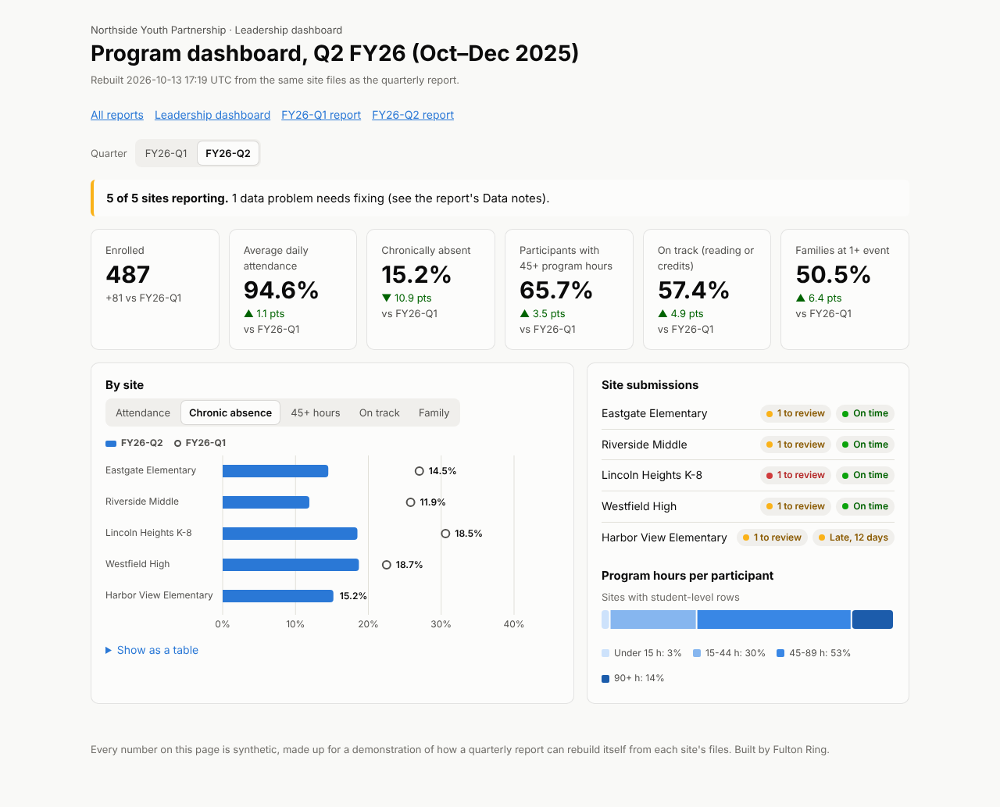
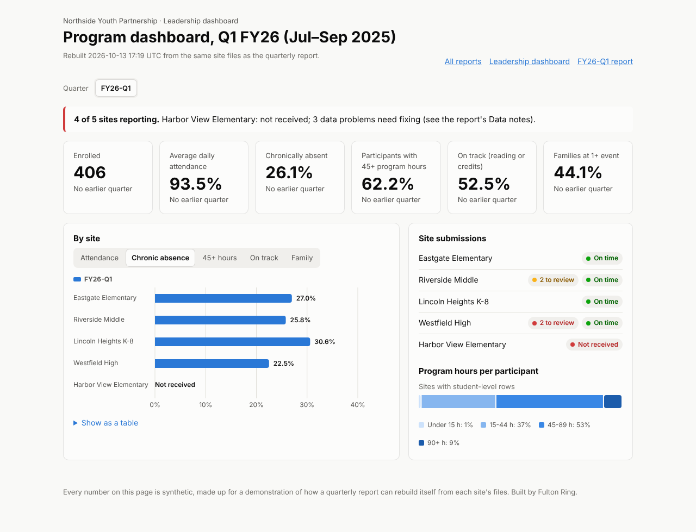

# Nonprofit quarterly report that rebuilds itself from each site's files

A made-up nonprofit, Northside Youth Partnership, runs an after-school program at five community-school sites. Each quarter every site sends its numbers in whatever form it already keeps them. This folder shows those files flowing into one quarterly program report and a small leadership dashboard. Both rebuild on a schedule, and a new quarter's files rebuild everything with no manual edits. Problems in the files show up in the report instead of being dropped without notice.

All data here is synthetic. No real students, sites or organizations are involved.



## Run it

```
python3 run.py
```

Python 3.10 or later, standard library only. No packages, accounts or network. The command:

1. clears `inbox/` and `output/`
2. generates the five sites' FY26-Q1 files (July to September 2025) into `inbox/FY26-Q1/` and runs the refresh; this one-quarter build is kept in `snapshots/before/`
3. drops the FY26-Q2 files (October to December 2025) into `inbox/FY26-Q2/` and runs the same refresh again, with no code or config edited in between
4. prints what changed and writes `output/run-log.txt`

Open `output/index.html`, `output/report.html` (latest quarterly report) or `output/dashboard.html` in a browser. The output folder is plain HTML with no external files, so it can be published as-is to any static host, including a page on fultonring.com.

Other commands:

- `python3 refresh.py` is the scheduled job. It reads every `inbox/FYxx-Qn/` folder and rebuilds `output/`.
- `python3 generate.py FY26-Q3` writes another quarter of synthetic files. Running `python3 refresh.py` afterward adds Q3 to the reports and the dashboard.
- `node screenshots.mjs` retakes the screenshots. It needs Playwright, installed locally or globally.

## The schedule

`schedule/refresh.yml` is a GitHub Actions workflow that runs `refresh.py` at 6am Eastern on weekdays and publishes `output/`. `schedule/crontab.txt` has the same schedule as a cron line. Neither is active in this repository. The demo shows the schedule as the command it runs.

## What the sites send

Each site sends its data the way a real site would. `config/sites.json` describes each format, so adding a site with a familiar format means adding a config entry, not writing code.

| Site | What it sends | Read by |
|---|---|---|
| Eastgate Elementary (K-5) | A hand-kept `.xlsx` roster with its own column names and a typed "Total students" line at the bottom | `roster` adapter |
| Riverside Middle (6-8) | A case-management CSV export with one row per service (tutoring, mentoring, enrichment, family events), plus the district's attendance file for the same students | `cms_export` adapter, joined on student ID |
| Lincoln Heights K-8 | A one-page summary form with site totals only | `summary` adapter |
| Westfield High (9-12) | An `.xlsx` with a title block above the header, absences instead of days present, and yes/no written four different ways (Yes/No, Y/N, 1/0, blank) | `roster` adapter |
| Harbor View Elementary (K-5) | The organization's own CSV template | `roster` adapter |

Each file is named `<site>__<date received>.<ext>`. A real version would take the received date from the upload time.

### Where the fields and measures come from

The measures follow what community-school and United Way-funded programs report publicly:

- **Chronic absence**: a student who missed 10% or more of the days they were enrolled, for any reason. This follows Attendance Works, [The Problem](https://www.attendanceworks.org/chronic-absence/the-problem/), and the U.S. Department of Education and Urban Institute guidance, [Data Collection and Reporting Guidance for the Full-Service Community Schools Program](https://www.urban.org/sites/default/files/2024-04/Data%20Collection%20and%20Reporting%20Guidance%20for%20the%20Full-Service%20Community%20Schools%20Program.pdf) (2024). The guidance says to divide "the number of days absent by the number of days enrolled in the school" and to report counts, not only percentages.
- **Site rows plus a total row, with percentages calculated from stored counts**: U.S. Department of Education, [Full Service Community Schools Data and Reporting Guidance FAQ](https://www.ed.gov/media/document/fscs-dataandreporting-faqs-03012024pdf-16875.pdf) (March 2024): "These data should be reported at both the grant and individual school levels."
- **Program hour bands (under 15, 15-44, 45-89, 90+) and the attendance-improvement measure**: U.S. Department of Education, [21st CCLC Overview of the Annual Performance Data: 2022-2023](http://www.ed.gov/media/document/21st-cclc-annual-performance-report-92724-108033.pdf) (2024). It reports participation in hour bands, and one of its measures is the share of students at or below 90% attendance who improved.
- **On track (reading benchmark for K-8, credits for 9-12)**: RAND, [What Is the Impact of the New York City Community Schools Initiative?](https://www.rand.org/pubs/research_briefs/RB10107.html) (2020). Its outcome domains include chronic absence, on-time progress, credits accumulated and family empowerment.
- **Family engagement, attendance and literacy as "number served / number achieved" pairs**: United Way of Greater Nashville, [Community Impact Funding Outcome Framework 2023-2025](https://www.unitedwaygreaternashville.org/wp-content/uploads/2023/10/2023-2025-Community-Impact-Funding-Outcome-Framework.pdf).
- **Quarterly reporting**: United Way of Greater Houston, [Standards and Policies for Funded Partners](https://unitedwayhouston.org/wp-content/uploads/2025/04/Final-Standards-and-Policies_2025.pdf) (2025): "United Way requires programs to report data quarterly."

## The checks

Every refresh runs these checks and lists every result under Data notes in the report and in `output/checks-<quarter>.txt`:

- **Missing or late submissions.** A site with no file appears in the report as "Not received", and the report says the totals cover only the sites that reported. Nothing is carried over from last quarter. A late file is included and labeled late. Files are due 15 days after the quarter ends.
- **Out-of-range values.** Examples: more absences than days enrolled, more program hours than four per weekday in the quarter, an attendance rate over 100%, more students on track than were assessed. The bad value is left out of the one measure it would distort. The student still counts as enrolled, and the note names the row so the site can fix it.
- **Duplicates and unmatched IDs.** A service record exported twice is counted once. A student in the case-management export with no district attendance record is counted as enrolled but left out of the attendance measures. A district record with no services is not counted.
- **Typed totals against the rows.** When a spreadsheet's typed "Total students" disagrees with the number of students it lists, the report uses the list and flags the difference.
- **Totals that tie.** Every count in the "All sites" row is compared with the sum of the site rows and with a recount straight from every student row and summary form. All three must match. If they don't, the refresh records an error.
- **Grades outside the site's range, unrecognized yes/no values, unreadable files, unknown sites and badly named files.** Each is flagged rather than skipped.

## Results from one clean run

These are from `python3 run.py` on a clean checkout. The numbers are seeded, so every run gives the same results. Timings vary by machine.

**Problems planted in the generator, and what the refresh caught:**

| Quarter | Planted | Caught and reported as |
|---|---|---|
| FY26-Q1 | Harbor View sends nothing | Error: not received. The report says "4 of 5 sites" |
| FY26-Q1 | Riverside: 5 service records exported twice | Warning: 5 duplicate record IDs, each counted once |
| FY26-Q1 | Riverside: 2 students missing from the district file, 1 district record with no services | Warning: 2 unmatched (enrolled, left out of attendance). Note: 1 not counted |
| FY26-Q1 | Westfield: one student with 36 absences out of 28 days enrolled | Error: left out of attendance and chronic absence, still enrolled |
| FY26-Q1 | Westfield: one student with 400 program hours | Error: above the 264-hour ceiling, left out of dosage |
| FY26-Q2 | Eastgate: typed total of 114 for a list of 112 | Warning: report uses 112 |
| FY26-Q2 | Lincoln: average daily attendance typed as 928% (meant 92.8) | Error: held out. The organization's attendance rate covers the other 4 sites, and the report says so |
| FY26-Q2 | Westfield: one student in grade "13" | Warning: counted, site asked to correct |
| FY26-Q2 | Riverside: 3 service records exported twice | Warning: 3 duplicates |
| FY26-Q2 | Harbor View file 12 days late | Warning: included and labeled late |

All 10 planted problems were caught, with no false alarms. Every count tied across the three routes in both quarters (9 counts per quarter).

**Headline measures** (synthetic):

| | FY26-Q1 (4 of 5 sites) | FY26-Q2 (5 of 5 sites) |
|---|---|---|
| Enrolled | 406 | 487 |
| Average daily attendance | 93.5% | 94.6% (4 sites) |
| Chronically absent | 103 of 394 (26.1%) | 73 of 480 (15.2%) |
| 45+ program hours | 62.2% | 65.7% |
| On track | 203 of 387 (52.5%) | 268 of 467 (57.4%) |
| Families at 1+ event | 44.1% | 50.5% |
| Attendance improved (students at or below 90% in Q1) | n/a | 61 of 79 (77.2%) |

**Before and after.** `snapshots/before/` is the build with only Q1 in the inbox. `output/` is the build after Q2 was dropped in. The second refresh added `report-FY26-Q2.html`, `checks-FY26-Q2.txt` and `data/FY26-Q2.json`. It also rebuilt `report.html` (now Q2), the dashboard (now with a quarter switcher and Q1 markers on every site bar) and the index. The Q1 numbers came out identical in both builds.

| Before (Q1 only) | After (Q2 dropped in) |
|---|---|
|  |  |

**Timings** on the build machine: generating a quarter took 0.03-0.04 seconds. Each refresh, covering reading, checking and building both quarters, took 0.05-0.09 seconds. The whole `run.py` took 0.16-0.24 seconds over three runs. Speed doesn't matter at this size. The point is that a refresh costs nothing, so it can run every morning during the submission window.

## Screenshots

- Quarterly report: [desktop](screenshots/report-desktop.png), [phone](screenshots/report-phone.png)
- Leadership dashboard: [desktop](screenshots/dashboard-desktop.png), [phone](screenshots/dashboard-phone.png)
- The same pages before Q2 was dropped in: [report](screenshots/report-before-q2-desktop.png), [dashboard](screenshots/dashboard-before-q2-desktop.png), and the phone versions alongside them

Neither page scrolls sideways at 390px wide.

## What a real version needs from you

To build this for your program, we need a sample of one quarter's files from each site, exactly as they arrive today, including the messy ones. We also need the list of measures your funders and board ask for, with the definition each one uses (for example, which days count toward chronic absence), and your reporting calendar and due dates. Then we need to know who at each site fixes a problem when the report flags one, and where the files land now (email, a shared drive, a form tool or a case-management system), so the refresh can pick them up there. If school attendance or assessment data comes from a district, we need the data-sharing agreement that covers it and the ID that links a student across both systems. Student-level data from a site gives the most checks and the attendance-improvement measure. A site that can only send totals still fits, with fewer checks.

## What it doesn't show

- **The trends are built in, not found.** The generator nudges attendance, reading and family engagement up a little each quarter for engaged students. The improvement in the tables shows that the report can display change. It isn't evidence that any program works. The attendance-improvement measure also picks up regression to the mean: students at their lowest point tend to rebound regardless.
- **The quarters differ in length.** Q1 has 28 school days and Q2 has 54. Chronic absence over a short window runs high because three missed days already crosses 10%, so part of the drop from 26.1% to 15.2% comes from the calendar. A real report should compare like periods, such as year-to-date or the same quarter last year.
- **Real files are messier than these.** Merged cells, several sheets per site, column names that change mid-year and PDFs would each need an adapter or a config change. The `.xlsx` reader handles values only. It was checked against files re-saved by another spreadsheet library, not against every Excel feature.
- **No live connections.** Collecting files from email, a shared drive, a form or a case-management API is described but not built. The schedule is shown as a workflow file, not run live.
- **No privacy layer.** A real version holding student records needs access control, small-cell suppression on published pages (hiding counts under about 10) and the retention rules in the data-sharing agreement. This demo publishes everything because nothing in it is real.
- **Organization-wide attendance is a weighted average of site rates.** It isn't recalculated from days, because the summary-form site sends only a rate.

## Files

```
run.py                 one command: generate, refresh, drop in Q2, refresh again
refresh.py             the scheduled job: inbox/ -> output/
generate.py            synthetic site files for any quarter, with planted problems
config/sites.json      sites, their formats, column names and value codes
pipeline/ingest.py     per-format adapters and the checks
pipeline/measures.py   site and organization measures, and the totals tie-out
pipeline/build.py      report, dashboard and index pages
pipeline/xlsx.py       standard-library .xlsx reader and writer
pipeline/quarters.py   fiscal quarter dates and due dates
schedule/              sample GitHub Actions workflow and cron line
screenshots.mjs        Playwright screenshots at 1280px and 390px
inbox/                 the generated site files from the last run
output/                the built pages from the last run (two quarters)
snapshots/before/      the build with only Q1 in the inbox
screenshots/           desktop and phone screenshots
```
