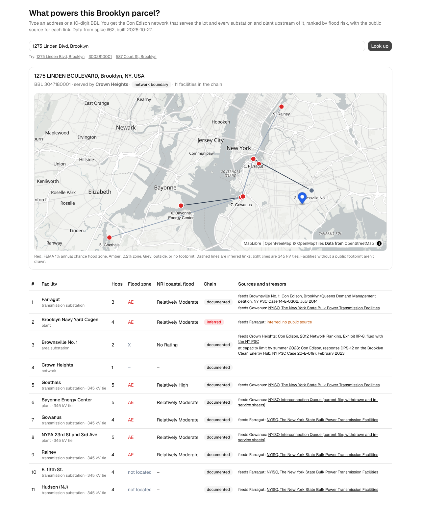

# Graph database or flat tables for the NYC supply chain risk map?

Spike [#62](../nyc-supply-chain-risk/) mapped Brooklyn's power supply chain with FEMA's method. It keeps the graph in
pandas and NetworkX inside a notebook. Issue [#65](https://github.com/fulton-ring/agent-content-demos/issues/65)
asks two things. Would a graph database do it better? And can someone who doesn't run Python use it? This spike loads
#62's graph and its 275,864 lots into four stores, checks every answer against #62's, and measures them. Then it builds
a small web app where you type an address or a BBL and see what powers the parcel.

- [`graph_store.py`](graph_store.py), a marimo notebook read top to bottom: the comparison and the recommendation.
- [`app/`](app/): the web app (Vite, React, TypeScript, Tailwind, shadcn/ui, MapLibre), with a browser check.

## How to run it

```bash
./run.sh          # needs uv; runs #62's notebook (first run ~2-6 min, downloads ~20 MB into data/), then the comparison
./run.sh app      # the same, then builds the app and serves it at http://localhost:4173 (needs Node.js 22+)
./run.sh check    # the same, then a Playwright check that the app's lists equal #62's
```

To measure Neo4j too, start a server and pass it in:

```bash
docker run -d -p 7687:7687 -e NEO4J_AUTH=neo4j/choose-a-password neo4j:2026.08-community
NEO4J_URI=bolt://localhost:7687 NEO4J_PASSWORD=choose-a-password ./run.sh
```

To read the notebook interactively: `uv run marimo edit graph_store.py`. `./run.sh check` installs Playwright's
Chromium unless `CHROMIUM_PATH` points at one.

## The data

Everything comes from #62's notebook, which this one runs as it is, with its data and output folders pointed into
this spike's `data/`. Its folder isn't changed. Its sources are public and downloaded at run time: Con Edison's
hosting-capacity map, PSC and NYISO filings, Overture/OpenStreetMap, FEMA's flood maps, the National Risk Index and
NYC's MapPLUTO (see [#62's README](../nyc-supply-chain-risk/README.md#the-data)). The app looks addresses up live
with [NYC Planning Labs GeoSearch](https://geosearch.planninglabs.nyc/docs/) and BBLs with
[PLUTO on NYC Open Data](https://data.cityofnewyork.us/resource/64uk-42ks.json). Both are free and need no key. The
basemap is [OpenFreeMap](https://openfreemap.org/).

## Results (clean-checkout run of 2026-10-21)

The graph is 34 nodes and 32 links. The 275,864 lots that have a first node each hang off it by one link. Each store
is loaded from the same three flat tables and answers three things. **load** builds the store. **one parcel** takes
a BBL and returns its upstream rows: the median of 20 runs over the 4 sample BBLs. **whole borough** gives the lots
behind every facility (#62's concentration table, FEMA Phase 2). Each answer is checked against #62's own output.

| Store | Load (s) | One parcel (ms) | Whole borough (s) | Same lists as #62 | Same concentration | Query lines | On disk (MB) |
|---|---:|---:|---:|:-:|:-:|---:|---:|
| pandas + NetworkX (#62) | 0.00 | 0.4 | 0.006 | yes | yes | 3 | – |
| DuckDB, recursive SQL | 0.21 | 12.9 | 0.014 | yes | yes | 10 | 1.6 |
| DuckDB + DuckPGQ | 0.11 | 34.7 | 0.054 | yes | yes | 12 | – |
| LadybugDB (Kùzu fork) | 0.80 | 16.3 | 0.026 | yes | yes | 4 | 24.5 |
| Neo4j Community | 30.44 | 10.4 | 0.328 | yes | yes | 4 | – |

#62's notebook took 147 s inside this run, and `./run.sh check` took 234 s in all, from a clean checkout
including downloads, the app build and the browser check. On disk: DuckDB is a database file, LadybugDB its
database folder; DuckPGQ ran in memory (see below) and Neo4j's store is on the server.

All of it ran on one machine. The flat-table stores and LadybugDB run inside Python. Neo4j ran as a local server.
The query lines are those of the upstream query alone. [`output/queries.md`](output/queries.md) has each query.

**Every store gives #62's answers**, once one trap was fixed. The 3 inferred links have no source. In SQL and Cypher,
`source <> 'nyiso-bps'` is null rather than true when the source is missing, so on the first run the inferred links
dropped out of the radial chain in DuckDB, DuckPGQ and LadybugDB. NetworkX and Neo4j got it right by luck: pandas
passed the missing source as NaN, not null.

**The app** returns the same ranked list as #62 for all 4 sample parcels given by BBL, and for Brookdale Hospital
given by its address. It refuses a Manhattan lot. That is 6 of 6 browser checks passing. The notebook checks the
app's data files against #62's lists as well, for all 5 placed parcels. The app needs no server: the notebook writes
a 73 kB graph file and a 5.4 MB lot table, and the page looks a lot up in the browser.



## Recommendation: no graph database, for this map

- **Speed doesn't decide it.** Every store answers one parcel in under 40 ms and the whole borough in under a
  second. The graph is tiny. NetworkX in memory is the fastest, because there is nothing to fetch.
- **The answers are few, so they can be computed once.** There are only 20 distinct upstream lists, one per first
  node. The app is a static page that looks them up, with no database.
- **The graph stores cost more to run and to trust.** Kùzu, the obvious embedded choice, was
  [archived in October 2025](https://github.com/kuzudb/kuzu), and its fork LadybugDB is young. DuckPGQ has no build
  for DuckDB 1.5, so this spike pins DuckDB 1.4.4. Its queries hit two bugs, and on a database file it failed in 1 of
  10 runs (below). Neo4j needs a Java server and took the longest to load. Its free cloud tier,
  [AuraDB Free](https://neo4j.com/docs/aura/quotas-and-limits/), allows 200,000 nodes, fewer than Brooklyn's lots.
- **Cypher reads best.** "Everything that feeds f" is 4 lines in LadybugDB or Neo4j, 10 in recursive SQL and 12 in
  DuckPGQ. That is the graph stores' real advantage, and it grows with the questions.

A graph store starts to pay when the graph grows: all five boroughs and several lifelines (#63, #64). Then there are
links between lifelines, such as a pumping station that needs power or a substation that needs water, and questions
nobody wrote in advance. LadybugDB would be the first to try: it is embedded, free, reads Cypher and loaded Brooklyn
in under a second. [Seer.ai](https://www.seer.ai/) (SeerAI's Geodesic platform) does what these open options don't.
It joins subscribed and proprietary data (commodities, energy infrastructure, hazards) into one queryable layer
without copying it, and keeps it current. Its data isn't public, so it can't back a reproducible demo.

## What didn't work, and what this doesn't show

- **DuckPGQ is fragile.** `path_length(p) + 1` inside `COLUMNS` is a syntax error. Joining two `GRAPH_TABLE`s in one
  query crashed DuckDB: a segmentation fault, then an internal assertion. A temporary table named like an edge table
  broke binding. On a database file, a loop of 600 graph queries hit a fatal internal error in 1 of 10 runs, after
  which DuckDB refuses the database. In memory, 10 of 10 runs passed. Those counts come from a test script run while
  building, not from `run.sh`. The notebook uses an in-memory database and records an error row if DuckPGQ fails.
- **A plausible Cypher query was wrong.** In LadybugDB, testing the radial and documented filters with `OPTIONAL
  MATCH` and `count()` gave wrong flags without any error. `EXISTS { }` subqueries give the right answer.
- **The timings are one run on one machine**, with tiny data. They show the order of magnitude, not a benchmark.
  Neo4j's load goes through the Python driver in batches of 10,000. Its bulk importer would be faster.
- **The app inherits #62's limits.** The links date from 2012, three are inferred, three facilities have no
  footprint, and only power in Brooklyn is mapped. It also shows no flood zone for the parcel itself, since that
  needs a FEMA query per lookup. BBLs not in PLUTO, such as condo billing lots, aren't found.
- **The app needs the network** for GeoSearch, PLUTO and the map tiles. The upstream lists themselves are local.

## What we looked at first

- Kùzu (archived), LadybugDB, DuckPGQ, Neo4j Community and AuraDB Free, as above. We didn't try Memgraph or Apache
  AGE: both are servers, like Neo4j.
- For the app: a marimo app would have been less code. But AGENTS.md asks for Tailwind and shadcn/ui, and a static
  page can be hosted for free. MapLibre with OpenFreeMap tiles needs no key. GeoSearch turns an address into a BBL
  without NYC's Geoclient key.
- We wrote no graph code beyond the queries. The app's own logic is a BBL lookup and a filter for the links in the
  chain.

The notebook is about 740 lines and the app about 450, a little over the 1,000-line budget together. Each store's
cell repeats the same three jobs so they can be read side by side.
