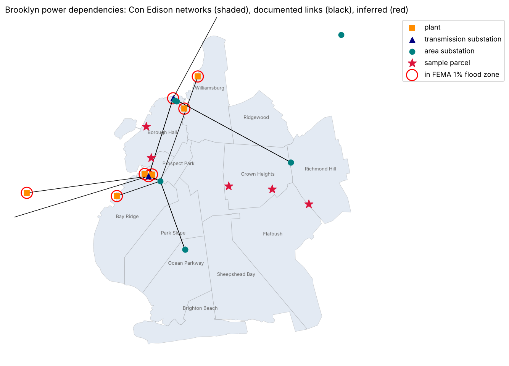
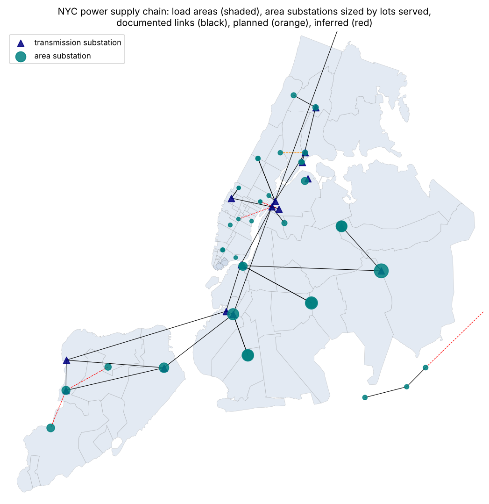

# Can we map and record supply chain risk in NYC using FEMA's methodology?

FEMA's [Supply Chain Resilience Guide](https://www.fema.gov/sites/default/files/2020-07/supply-chain-resilience-guide.pdf)
(April 2019) asks emergency managers to map a supply chain's nodes, the infrastructure they depend on, and the hazards
on each. This spike does that row by row from public data, in three marimo notebooks that read top to bottom:

- [`supply_chain_risk.py`](supply_chain_risk.py), **Brooklyn power** (issue [#62](https://github.com/fulton-ring/agent-content-demos/issues/62)):
  add a parcel and get a ranked list of the facilities upstream of it, the flood and NRI risk on each, and the
  public source for every link.
- [`lifelines.py`](lifelines.py), **Brooklyn's other lifelines** (issue [#63](https://github.com/fulton-ring/agent-content-demos/issues/63)):
  water, wastewater, gas, fuel, food and telecom in the same tables, so a parcel lists upstream risks across lifelines.
- [`citywide.py`](citywide.py), **power in all five boroughs** (issue [#64](https://github.com/fulton-ring/agent-content-demos/issues/64)):
  every tax lot traced to its network or feeder, area substation and first transmission station, with coverage
  against Con Edison's published counts. No hazards or parcel lists.

[`common.py`](common.py) holds the downloads, source check and hazard lookups the two Brooklyn notebooks share.

## How to run it

```bash
./run.sh                           # needs uv; runs all three notebooks, writes output/ (Brooklyn) and output/citywide/
./run.sh citywide.py               # one notebook
PARCELS=my_parcels.csv ./run.sh supply_chain_risk.py   # your own parcels: CSV with name and bbl, or name, lat, lon
```

To read one as a notebook: `uv run marimo edit lifelines.py`. Downloads are cached in `data/`.

- **Brooklyn power** takes 3 to 13 minutes from a clean checkout, mostly retrying FEMA's flood map server, which
  drops about half its connections. If it gives up, run it again: answers are cached as they arrive.
- **Lifelines** takes 4 to 13 more minutes and reads the power notebook's outputs, so it runs after it.
- **Citywide** took 6 minutes from a clean checkout and about 2 minutes after that.

## The data

All public, downloaded at run time, not committed. Every link that comes from a document carries the quoted passage,
and the notebooks download the document and check that the passage is in it (`source_check.csv`). Brooklyn: 38
passages verified; FEMA's guide returned HTTP 403, so its 7 quoted steps show as `unreachable`. Lifelines: 57 of 57.
Citywide: 78 of 78 verified.

| Source | What we use |
|---|---|
| [Con Edison hosting capacity map](https://www.coned.com/en/business-partners/hosting-capacity) REST layers (DOE's atlas links here) | network load areas, network-supplied areas, every overhead feeder segment tagged with its area substation |
| Con Edison network tables: 2012 ranking (PSC exhibit IIP-8); 2025 reliability report's power quality table | which area substation supplies each network, then and now |
| Con Edison filings: BQDM petition, rate-case testimony and exhibits (2013–2025), long-range transmission plans (2011, 2014, 2025) | 138 kV supply links, capacity stressors, planned network splits |
| NYISO: bulk power facility list, interconnection queue, Gold Books 2014 and 2026 | 345 and 138 kV ties, plant connections, deactivations. The 2014 edition is the last with Con Edison's line list; we found it as a copy in a Kentucky PSC case |
| PSEG Long Island 2023 transmission plan; NY DPS utility territories (data.ny.gov `awza-4vgu`) | the Rockaways, which LIPA serves, not Con Edison |
| OpenStreetMap via [Overture](https://docs.overturemaps.org/) `base/infrastructure`, release 2026-09-23.0 | substation and plant footprints |
| FEMA National Flood Hazard Layer (effective), National Risk Index (tracts) | hazards on each node (Brooklyn) |
| NYC MapPLUTO (Open Data `64uk-42ks`) | 857,347 NYC tax lots (275,864 in Brooklyn) |
| Joint Utilities of NY 2024 reliability report | Con Edison's published counts per borough |
| *Lifelines:* DEP drainage areas, NYS sewersheds (Hill and Larsen 2023), NYS gas utility territories (`i7nm-ih89`), Verizon copper retirement notices to the FCC (2016–2018) | which plant, gas utility and wire center serve each lot |
| *Lifelines:* NYC Facilities Database, HIFLD Next POL terminals (EIA), NYC GeoSearch, MapPLUTO outlines | plant, terminal, wire center and market sites |
| *Lifelines:* DEP tunnel EIS (2005), PSC Case 24-G-0248, FERC, DOE (2013), Columbia CGEP (2016), Food Flow study (2016), State Comptroller (2023), city Sandy report (2013) | the links and stressors above the first facility |

## Results: Brooklyn (run of 2026-10-19)

- **The schema.** The guide's five Phase 1 steps and two Phase 2 questions become four tables: nodes, links
  (supplier, consumer, status, source, passage), hazards per node, and sources with their checks. Phases 3 to 5
  are meetings with facility owners, so they're out of scope.
- **Facilities and links.** 21 named facilities (9 area substations, 6 transmission substations, 6 plants); 18 are
  on the map. 32 links, 29 of them documented. The 3 inferred are Farragut → Plymouth St., Farragut → Water St. and
  Brooklyn Navy Yard Cogen → Farragut. (The citywide sources later document Farragut → Plymouth St.)
- **Lots matched.** Of 275,864 lots:
  - 216,361 (78%) are in a network-supplied area;
  - 51,989 (19%) are within 500 ft of an overhead feeder;
  - 7,489 (2.7%) fall back to their load area (inferred);
  - 25 match nothing.
- **Concentration (FEMA Phase 2).** The guide expects "seven or fewer sources" to carry 70 to 80% of flows. In
  Brooklyn, 5 area substations serve 80% of lots. Greenwood (fed from Gowanus) is upstream of 60% of lots and
  Farragut of 39%. **Farragut and Gowanus are both in FEMA's 1% annual chance flood zone and inside the area Sandy
  flooded.**
- **Sample parcel.** For Brookdale University Hospital the list has 11 upstream facilities, led by Farragut (the
  only 138 kV source for its area substation, in an AE zone).
  - **Hand check** ([`hand_check.csv`](hand_check.csv)): all 11 rows, against the source, the location, FEMA's zone
    and NYC's Sandy map. **8 correct, 1 wrong, 2 not checkable.**
  - **The wrong one** is East 13th Street, which isn't on OSM, so it gets no flood rating; Sandy flooded it.



## Results: citywide (run of 2026-10-21)

- **Network → area substation: all 76 load areas paired from a public table.**
  - The 2025 table names 50 NYC area substations. Counting each one in the borough where most of the lots it
    serves are gives 26 Manhattan, 6 Bronx, 6 Brooklyn, 7 Queens, 5 Staten Island. **That matches Con Edison's
    published counts exactly.**
  - Changes since 2012, found by comparing the two tables: three new networks (Freedom, Midtown West, Morgan);
    Randalls Island merged into West Bronx; Bowling Green moved from Trade Center to Seaport No. 1.
  - Eight planned splits onto five new area substations (2026–2035) are listed with their passages but not applied.
- **Area substation → transmission: 53 links, one per area substation (including LIPA's three in the Rockaways).**
  - 32 documented, 1 planned, 20 inferred.
  - Most of the inferred are stations that share a site and a name with a 138 kV station (Corona, Jamaica,
    Hellgate).
  - Plus 28 documented 138 and 345 kV ties.
- **Lots matched: 856,988 (99.96%) of 857,347.**
  - 466,940 are in a network-supplied area.
  - 338,461 are within 500 ft of an overhead feeder. Staten Island's 33, 13 and 4 kV feeders are all in Con
    Edison's layer, tagged with its five area substations.
  - 37,783 fall back to their load area (inferred).
  - 13,804 in the Rockaways get the nearest of LIPA's three substations (inferred).
  - **359 match nothing:** 168 in Queens, 69 Staten Island, 55 Bronx, 42 Manhattan, 25 Brooklyn.
- **Documented end to end: 59.7% of lots** have both the lot-to-substation and the substation-to-transmission
  step sourced.
- **Concentration.** 15 area substations and **7 first-hop transmission stations serve 80% of the city's lots**.
  Greenwood 138 kV and Farragut alone are the first hop for 19% and 15%.
- **Coverage against published counts.** OSM places 35 of the 50 area substations, and 58 of the 130 4 kV unit
  substations the report counts outside Manhattan. Con Edison's map has 70 load areas where the report counts 64
  (the Bronx gives no count), because the map splits Fulton, Bowling Green and Richmond Hill into parts.



## Results: other lifelines in Brooklyn (`lifelines.py`, run of 2026-10-21)

Same tables and passage check (`output/lifeline_source_check.csv`): **57 passages verified, 0 not found**; 6 links
come from fields in the EIA terminal data and 3 are inferred. From `output/lifeline_coverage.csv`:

| Lifeline | Facilities (placed) | Links documented / inferred | Brooklyn lots matched to a serving facility |
|---|---:|---:|---|
| Power (from #62) | 21 (18) | 29 / 3 | 97.3% documented, 2.7% inferred |
| Wastewater | 6 (6) | 5 / 0 | **99.9% documented** (DEP drainage areas; the state's sewershed layer agrees on 99.1%) |
| Natural gas | 8 (1) | 8 / 0 | **99.9% to the utility** (National Grid NY), none to a gate or main |
| Telecom (Verizon wireline) | 17 (17) | 17 / 0 | **4.7% documented, 95.3% inferred** from the nearest documented lot |
| Water supply | 6 (0) | 6 / 0 | none: the whole borough shares one documented chain |
| Refined fuel | 11 (7) | 14 / 3 | none: documented only as far as "Brooklyn/Queens terminals" |
| Food | 3 (2) | 1 / 0 | none: Hunts Point's share is documented only citywide |

**Telecom is the surprise.** No wire-center boundary file is public, but Verizon's copper retirement notices list
14,760 Brooklyn addresses under the wire center that serves them. 88% match a tax lot, giving 13,016 seed lots,
and no lot is claimed by two wire centers. Giving each other lot the wire center of its nearest seed is right for
**96.5%** of seeds in held-out tax blocks; the nearest wire center building alone is right for 90.3%.

**Hazards.** On tax-lot footprints, 4 of Brooklyn's 5 treatment plants (Owls Head VE; Newtown Creek, 26th Ward,
Red Hook AE), all 7 Brooklyn fuel terminals, Greenpoint LNG and Hunts Point are in FEMA's 1% flood zone. No wire
center is. Coney Island's plant reads zone X, though DEP's 2013 resiliency plan rates its Sandy damage as major
(we read this in the plan; the notebook doesn't check it, as the PDF is 205 MB).

**Sample parcels** (`output/upstream_risks_all_lifelines.csv`, 190 rows). Brookdale Hospital adds to its 11 power
facilities the 26th Ward plant (AE), National Grid's three city gates and Greenpoint LNG (AE), the Rockaway Avenue
wire center, the water chain via Hillview and Tunnels 1 and 2, 7 fuel terminals (all AE or VE) and Hunts Point (AE).

**Lifelines with no public service-area link:** water supply (no shaft, pressure-zone or trunk-main areas; DEP's
own 2022 newsletter even contradicts its 2005 EIS on whether Tunnel 1 reaches Brooklyn); refined fuel (which
terminal supplies which station is commercial); food (the 2016 study says "no outlet has a single source"); gas
below the utility (which gate feeds which area); and telecom other than Verizon wireline (mobile, cable).

## What the spike shows

The method holds for power, and it scales to the city. FEMA's steps map onto four tables. The lot-to-network step
is public everywhere Con Edison serves, because it publishes its network areas and overhead feeders. Con Edison's own
2025 reliability report pairs every network with its area substation, and its counts match. The weak part is the
step above the area substation. No dataset has it. It comes from rate-case testimony and a 2014 line list that
NYISO no longer publishes, and a third of it is inferred. Even so, the citywide chain finds the same concentration
that Brooklyn did: a few 138 kV stations, two of them on Brooklyn's flooded waterfront, sit first in line for a third
of the city's lots.

The other lifelines split in two. Wastewater, gas (to the utility) and Verizon telecom can be matched to a parcel
from public data. Water supply, refined fuel and food can't: their sources name only the whole borough or city.

## What didn't work, and what this doesn't show

- **The transmission step is a third inferred** citywide (20 of 53). Con Edison's line list has been withheld since
  2015, NYISO's current one needs a login, and HIFLD's substation layer has been restricted since 2022.
- **The Rockaways are a guess at the substation level.** PSEG Long Island's feeder map needs a login.
- **5,739 Bronx lots sit on feeders tagged with Westchester stations** (Washington Street, Granite Hill). The
  report does count 19 Westchester feeders among the Bronx's, but we have no transmission link for them.
- **Footprints are incomplete.** OSM lacks a third of the area substations, so citywide hazards are left to a
  follow-up. In Brooklyn, 3 of 21 facilities have no footprint, which is how the hand check missed a real flood.
- **Flood zones are FEMA's effective 2007 maps**; the 2015 preliminary maps aren't in NFHL's effective layer. A zone
  on any part of a footprint counts.
- **Lots, not load.** Load per lot isn't public; Con Edison's network forecast file could weight a later version.
- **Distribution is a model.** The 500 ft feeder rule and the load-area fallback are guesses; underground network
  feeders aren't published.
- **No recovery times.** The guide's resilience gap needs restoration times and backup power; neither is public.
- **Upstream stops one hop out** on the meshed 345 kV grid; past that every plant is upstream of everything.
- Con Edison's map, the NYISO queue and PLUTO are unversioned, so later runs may shift slightly.
- **Lifelines: half the chain is unplaced.** Gate stations, pipelines, tunnels and reservoirs have no operator-published
  location, so they get no hazard rating.
- **Lifelines: inferences.** PIPE_IN says a terminal takes pipeline product but not from which pipeline (3 Buckeye
  links inferred). Telecom seeds are only the buildings Verizon moved to fiber in 2016–2018, and only Verizon wireline.
- A graph database or app is sub-issue
  [#65](https://github.com/fulton-ring/agent-content-demos/issues/65).

## What we looked at first

- [Seer.ai](https://www.seer.ai/), from the card: paid, and its data isn't public. #65 compares a graph store.
- A graph database: unnecessary at this size. NetworkX and pandas hold the tables.
- HIFLD substations, NYISO Gold Book Table VI-1 and PSEG Long Island's hosting capacity map: not public.
- Overpass for OSM failed in the `hifld-grid-gaps` spike; Overture's GeoParquet, read with DuckDB, works.
- GeoPandas does the joins, pypdf and openpyxl read the documents. Our own logic is joins, name rules, the
  500 ft feeder rule and the address parser for Verizon's notices.
- For lifelines: HIFLD Next (no central offices; 1 Brooklyn cell tower; no Greenpoint LNG), FCC broadband data (login
  needed, and it names providers, not offices), commercial wire-center boundaries (licensed).

The Python is about 3,450 lines (Brooklyn power 880, lifelines 1,210, citywide 1,150, shared helpers 230), over the
1,000-line budget because the folder now holds three parts. About a fifth is markdown, and most of the rest of
`lifelines.py` and `citywide.py` is link tables, one quoted passage per row, so each can be read against its source.
