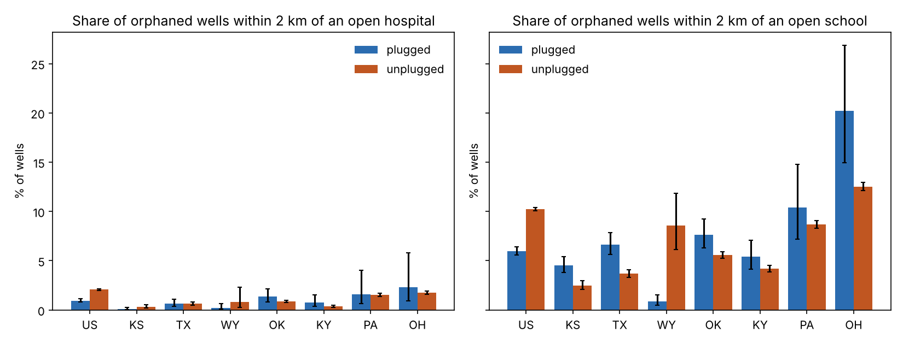

# Are federal well-plugging dollars reaching the orphaned wells closest to hospitals and schools?

Issue [#303](https://github.com/fulton-ring/agent-content-demos/issues/303). One marimo notebook,
[`proximity.py`](proximity.py), joins every orphaned well plugged with Infrastructure Act (IIJA) money to every
documented well still waiting, measures each one's distance to the nearest open hospital and public school, and
compares the two groups nationally and in the states doing the most plugging.

**Answer in one sentence:** plugged wells are about half as likely as unplugged ones to be near a hospital or
school nationally, but inside the leading states they're about as close or closer, so proximity isn't being
skipped within states; the national gap comes from where the plugging is happening (Kansas, Texas, Wyoming)
versus where the wells near people are (Ohio, Pennsylvania, California, Missouri, New York).



## Run it

```bash
./run.sh
```

Needs [uv](https://docs.astral.sh/uv/). The first run downloads about 60 MB into `data/` (`DATA_DIR`) and writes
results to `outputs/` (`OUTPUT_DIR`), including `outputs/proximity.html`, the notebook with every table. About
1.5 minutes from a clean checkout, most of it downloading; $0, no paid services or keys. To read it
interactively: `uv run marimo edit proximity.py`.

## Data (all public, downloaded at run time)

| Input | Source | Rows |
|---|---|---|
| Plugged wells | Interior Orphaned Wells Program Office feature service [`DOI_BIL_OWP_St_Program_Data`](https://services.arcgis.com/4OV0eRKiLAYkbH2J/ArcGIS/rest/services/DOI_BIL_OWP_St_Program_Data/FeatureServer/0) | 13,108 |
| Unplugged wells | USGS [Documented Orphaned Well Database 2026](https://doi.org/10.5066/P13FHBYG) feature service, CC0 | 130,121 |
| 2022 inventory (for ID matching) | USGS [2022 orphaned well dataset](https://doi.org/10.5066/P91PJETI) | 117,672 |
| Hospitals | HIFLD Next `hospitals-3` v1.1.1, status OPEN | 7,966 |
| Public schools | HIFLD Next `public-schools` v1.0.0, NCES status open/new/added/changed/reopened | 100,571 |

The issue names the data.gov record for Interior's plugged-well dataset (11,409 wells through January 31, 2026).
That record lists no download file. The feature service behind Interior's public map has 13,108 wells, the same
count as Interior's November 2026 report to Congress (through June 30, 2026), so the notebook uses it.

## Results

All numbers come from `outputs/summary.json`, `shares.csv`, `by_state_2km.csv`, `allocation.csv`,
`within_state_odds_ratio.csv`, `same_list_2022.csv` and `sensitivity.csv`, written by the run.

**Share within 2 km** (95% Wilson intervals are in `shares.csv`; 1 km results are there too):

| Area | Plugged n | Unplugged n | Hospital: plugged / unplugged | School: plugged / unplugged | Unplugged : plugged wells near a school |
|---|---|---|---|---|---|
| United States | 13,108 | 130,121 | 0.9% / 2.1% | 6.0% / 10.2% | 13,306 : 782 |
| Kansas | 2,569 | 4,566 | 0.1% / 0.3% | 4.6% / 2.5% | 114 : 117 |
| Texas | 1,923 | 8,998 | 0.6% / 0.6% | 6.7% / 3.7% | 332 : 128 |
| Wyoming | 1,300 | 374 | 0.2% / 0.8% | 0.8% / 8.6% | 32 : 11 |
| Oklahoma | 1,267 | 19,981 | 1.3% / 0.9% | 7.7% / 5.6% | 1,111 : 97 |
| Kentucky | 920 | 15,638 | 0.8% / 0.4% | 5.4% / 4.2% | 655 : 50 |
| Pennsylvania | 250 | 21,262 | 1.6% / 1.5% | 10.4% / 8.7% | 1,842 : 26 |
| Ohio | 173 | 22,759 | 2.3% / 1.8% | 20.2% / 12.5% | 2,852 : 35 |

- **Within states**, pooling the 21 states with 30+ wells on each side (Mantel-Haenszel), the odds ratio for being
  within 2 km of a school is 0.99 (0.92 to 1.08): no difference. For a hospital it is 0.54 (0.44 to 0.65), but
  that is California: its unplugged wells sit in Los Angeles-area fields. Without California it is 0.94 (0.75
  to 1.18) for hospitals and 1.27 (1.17 to 1.39) for schools.
- **Where the money goes:** Ohio and Pennsylvania hold 35.8% of the unplugged wells within 2 km of a school or
  hospital and account for 3.2% of reported plugging. Kansas, Texas and Wyoming account for 44% of plugging and
  under 4% of that near-facility backlog. Missouri has 1,863 such wells and no reported IIJA plugging.
- **Same-list check:** among wells on the 2022 inventory only, plugged wells in Texas, Pennsylvania and Ohio are
  closer to schools than the ones still listed; in Oklahoma and Wyoming they're farther (`same_list_2022.csv`).
- **Matching:** 37.7% of plugged wells match a well on the 2022 USGS inventory by API or state number. That's a
  lower bound: Kansas (the largest plugger) can't match because USGS lists its wells without API numbers, and
  Illinois, Indiana and Arkansas report state numbers that match 1% or fewer. 13.9% of plugged wells are still
  listed as unplugged in the 2026 inventory (California 99%, Texas 29%), because USGS's state files predate the
  plugging. So plugged and unplugged wells partly overlap, which makes the national comparison noisy but doesn't
  change the within-state pattern.
- **Location error:** dropping flagged locations (USGS section-center points, Interior's `Estimated` rows, and
  points shared by 3+ wells: 15% of plugged, 3% of unplugged) leaves the national and top-state 2 km shares
  within a point of the full run, except Texas, where plugged wells near schools rise from 6.7% to 10.5%
  (`sensitivity.csv`).

### What states say they prioritize

- **Pennsylvania DEP** ([scoring worksheet](https://files.dep.state.pa.us/OilGas/BOGM/BOGMPortalFiles/AbandonedOrphanWells/IIJA/Internal%20Sheet_Scoring%20System.xlsx)):
  "Well within 200 feet of occupied building or water supply well" is one 10-point line out of about 385. Up
  to 165 points go to gas or brine already reaching people (occupied structures, water supplies).
- **Texas RRC** ([2025 Oilfield Cleanup Program report, Table 7](https://rrc.state.tx.us/media/xgtpvwhf/2025-oilfield-cleanup-program-annual-report_final.pdf)):
  "Well located within city or town site limits" is 10 of 155 points; a leaking well is automatically Priority 1.
- **Ohio ODNR** must keep a scoring matrix ([ORC 1509.071](https://codes.ohio.gov/ohio-revised-code/section-1509.071))
  but doesn't publish its weights; an [ODNR presentation](https://dam.assets.ohio.gov/image/upload/procure.ohio.gov/pdf/CSP905520_DAS_OWP_Presentation.pdf)
  multiplies dwelling and public-health factors by the well's leak score.
- **Federal law** ([42 U.S.C. 15907](https://www.law.cornell.edu/uscode/text/42/15907)) lets states rank on
  "public health and safety"; it doesn't require it. None of the three names schools or hospitals.

## What it doesn't show

- **Why** a well was plugged. Leaks, groundwater risk and cost legitimately come first in every state rubric.
- **Road distance or who's inside.** Straight-line distance to the nearest open facility point.
- **Undocumented wells,** or wells plugged with state money only. Interior's table is "as reported" by IIJA
  recipients, so a state's own totals may differ.
- **Clustered uncertainty.** Intervals treat wells as independent; wells cluster in fields, so true intervals are
  wider. The within-state small-state numbers (Pennsylvania 250, Ohio 173 plugged) have wide intervals.

## Credit and what we looked at first

Meehan, Kang et al., [Environmental Issues with Orphaned Wells](https://doi.org/10.2118/227933-ms) (SPE ATCE
2025) already counted hospitals and schools within 2 km of the 2022 inventory; the new part here is plugged
versus unplugged. Nearest-neighbour search uses scikit-learn's `BallTree` (haversine), intervals and the pooled
odds ratio use statsmodels; no custom geometry code.

## Founder action

The joined layer is written to `outputs/orphan_wells_facility_distance.parquet` (GeoParquet, 143,229 wells with
status, state, match key, location flags and distance to and name of the nearest hospital and school).
Publishing it on HIFLD Next is a founder action, not part of this spike.
