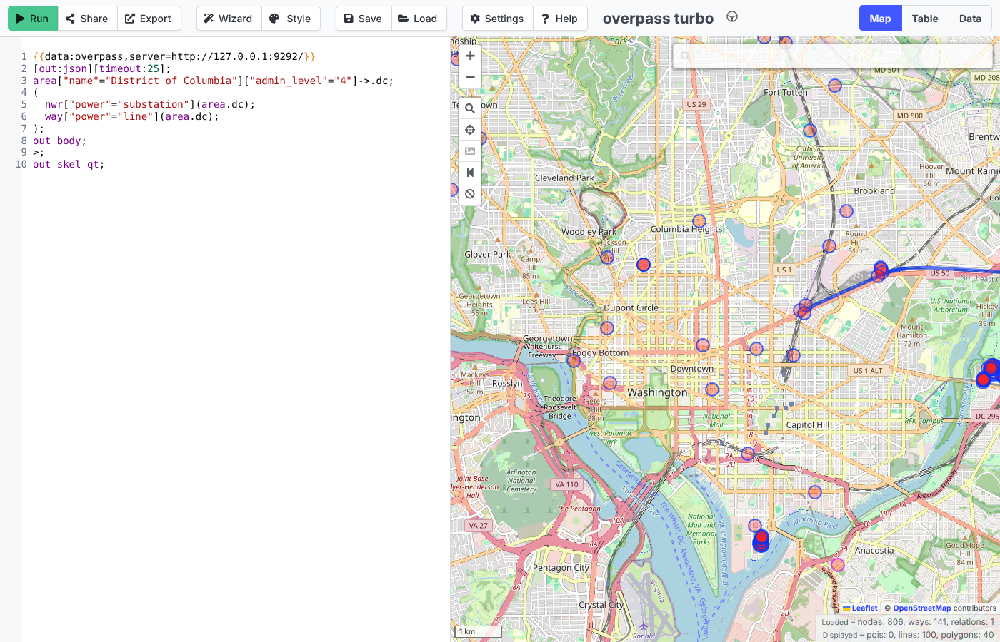

# Overpass on a modern stack

Two spikes on one question: can tools GIS teams already run replace a self-hosted
[Overpass API](https://wiki.openstreetmap.org/wiki/Overpass_API) for a region?

1. **#123, `benchmark.py`:** osm2pgsql → PostGIS behind a 200-line FastAPI service
   (`service.py`), fed a JSON stand-in for QL. It returned the same element IDs as
   Overpass on 10 of 10 queries, at a median 4.0× faster, and kept up with diffs.
2. **#125, `ql_compiler.py`:** real Overpass QL, compiled to SQL for **PostGIS and
   DuckDB**, by evaluating and patching the existing
   [Underpass-API](https://github.com/teritorio/Underpass-API) and its parser
   [overpass_parser_rust](https://github.com/teritorio/overpass_parser_rust).

**#125 verdict: adopt Underpass-API and contribute to it; don't build a new one.** As shipped, it
answered **0 of 31** answer-key queries on either backend: its backends have drifted
from its parser. With our patch (+550/−283 lines of Rust) and 136 lines of SQL adapters,
it matches Overpass's full output on **30 of 31 queries on both PostGIS and DuckDB**.
PostGIS through Underpass-API's `/interpreter` has a median latency of 48 ms against
Overpass's 431 ms, and **Overpass Turbo works against it unchanged**.

## Run it

Needs Docker and [uv](https://docs.astral.sh/uv/); `ql_compiler.py` also uses Node
and Playwright for the Overpass Turbo screenshot (it skips it without them). On a
4-core, 16 GB machine, `ql_compiler.py` took 28 minutes; at its peak we estimate about
11 GB of disk (4 GB of images, 5 GB of databases, 1.4 GB in `data/`).

```sh
./run.sh                 # both notebooks, then the parser tests
./run.sh ql_compiler     # only #125 (or: ./run.sh benchmark for only #123)
uv run marimo edit ql_compiler.py   # to read one as a notebook
```

Behind a TLS-intercepting proxy, set `DOCKER_CA_BUNDLE` to its CA file so the Rust
and Debian builds inside Docker can fetch packages. Downloads and builds go to `data/`
(git-ignored); results go to `results/` and `results/ql_compiler/`, with logs. Both
notebooks remove their containers when done.

## Data

[BBBike's Washington DC extract](https://download.bbbike.org/osm/bbbike/WashingtonDC/)
(65 MB; DC, Arlington, Alexandria and parts of Maryland), snapshot
**2026-10-24T00:00Z** in both spikes; BBBike refreshes it weekly. #123 also uses the
planet's hourly diffs. OSM data © OpenStreetMap contributors, [ODbL](https://opendatacommons.org/licenses/odbl/).

## #125: an Overpass QL → SQL compiler on PostGIS and DuckDB

The answer key is 31 queries in `answer_key.py`: #123's ten with full output, the
overpass-turbo wizard and example shapes, HIFLD-style pulls (substations, power lines,
hospitals, fire stations in DC and Arlington), and set and recursion queries. Each
runs on a local Overpass. A query **matches** when every element and every field
(tags, coordinates, node lists, members, center, bounds, geometry) is the same, with
coordinates allowed to differ by 1e-7° (Overpass rounds centres differently).

| from one clean run (`results/ql_compiler/`) | Overpass | PostGIS | DuckDB |
|---|---:|---:|---:|
| queries matching Overpass, as shipped | — | 0/31 | 0/31 |
| queries matching Overpass, patched | 31/31 | **30/31** | **30/31** |
| median of per-query p50 latency | 431 ms | **48 ms** | 502 ms |
| faster than Overpass on | — | 27/31 | 21/31 |
| build from the extract | 4–5 min (#123) | 5.5 min, 2,984 MB | 54 s, 451 MB Parquet |

- **As shipped** (`as_shipped.csv`), PostGIS failed on every tag filter: the parser
  emits jsonb operators but Underpass-API's Osmosis schema stores hstore. DuckDB failed
  on bbox SQL written for an older spatial extension, a `jsonb` type and other drift,
  and crashed on a polygon. Four queries didn't parse: `around:r,lat,lon`, `[bbox:]`
  and key regex.
- **The one difference** in the patched run: for `out count`, Overpass adds
  `"areas": "0"` when the query used an area. Our output leaves that key out.
- **Slow spots** (`patched.csv`): on PostGIS, upward recursion (`<`, `<<`, `rel(bn)`;
  1.1–3.8 s against 0.2 s) and key regex scan every relation or tag. On DuckDB,
  `way(r)` takes 6.5 s, and most queries scan whole Parquet files. DuckDB runs
  in-process; the other two are timed over HTTP.
- **Build:** Osmosis load 119 s, Underpass-API `init.sql` 94 s and our adapter 118 s.
  For DuckDB: QuackOSM 35 s (120 MB) and our tables from `ST_ReadOSM` 19 s.
- **Out of scope:** attic, `[adiff:]`, `if`, `complete` and `make` now fail with
  `unsupported Overpass QL feature: <name>`. `foreach` is an Underpass-API feature,
  and it matched Overpass.
- **Coverage** of the QL language reference (`coverage.csv`): 21 features yes,
  7 partial, 9 no.
- **Size** (`size.csv`, Rust without tests): the parser's shared grammar and logic is
  2,251 lines, the PostgreSQL dialect 158, the DuckDB dialect 182 and the server 427.
  We add 136 lines of SQL.



**What we changed** (the table in the notebook has every item). The patches are in
`underpass/`:
- **Parser:** an end-of-input anchor. Without it, anything the parser didn't know was
  silently dropped with everything after it. Also settings in any order, `[bbox:]`,
  `around` with a point and a radius in metres (it was in degrees), key regex and `,i`,
  and `._` as a statement.
- **SQL:** one query per recursion operator (all four shared one hard-coded query),
  recurse filters on real node lists and members, and output fields as Overpass prints
  them. Area filters use `EXISTS`, polygons are closed, and DuckDB dialect fixes.
- **Schema:** jsonb tags, members, and relation geometry as the collection of its
  members' geometries, on both backends. DuckDB tables come from `ST_ReadOSM`, because
  QuackOSM keeps no node lists or members.
- **Server:** SQL errors become HTTP 400 instead of a panic and a dropped connection.

**Why contribute rather than build.** The shape is right: one pest grammar, a typed
tree and a dialect trait, which is what #125 asked for. The fixes are many but each is
small. A new compiler would redo about 2,600 lines to reach the same place. The risks
are a single maintainer, and that it isn't kept working against its own backends:
there are no end-to-end tests, and 12 of the parser's 32 unit tests only pin SQL text.
Our patch changes that text, so those 12 need new expected values before going upstream
(all 32 test queries still parse). Next steps: upstream as small PRs, starting with the
end-of-input anchor and the Osmosis jsonb fix, and add this answer key as their
end-to-end test.

**A DuckDB community extension: not yet.** The compiler is Rust, and DuckDB
extensions are C++ (or Rust through the C API). The same composition already works
without one: `overpass2sql duckdb` gives SQL that can be wrapped and joined to any
table, and Underpass-API has a WASM build.

**Licences.** Underpass-API is AGPL-3.0 (its `Cargo.toml` says MIT/Apache-2.0, but the
`LICENSE` file is AGPL). The parser is MIT. `underpass/underpass_api.patch` and
`underpass/postgres_views.sql` (adapted from its `view.sql`) are AGPL-3.0;
`underpass/overpass_parser_rust.patch` is MIT. The notebook downloads both projects at
pinned commits and applies the patches; no Underpass-API code is copied in. Serving a
modified Underpass-API publicly means publishing its source, as this repo does.

## #123: osm2pgsql → PostGIS against Overpass

Same element IDs as Overpass on all ten queries, before and after diffs; faster on eight
(median 4.0×), slower on recurse-up (0.4×), per `results/queries.csv`. Import 287 s against
36 s; disk 2,020 MB against 1,263 MB; a planet hour of diffs in a median 11.5 s against
8.4 s. `benchmark.py` has the method and what didn't work.

## What we looked at first

Underpass-API and its parser (a port of the ANTLR-based
[overpass_parser-rb](https://github.com/teritorio/overpass_parser-rb)), the subject of #125;
[Postpass](https://github.com/woodpeck/postpass) (FOSSGIS: osm2pgsql → PostGIS over HTTP
with SQL, not QL); QLever + osm2rdf and Qloverleaf (QL → SPARQL, a closed proof of concept);
[OSM Express](https://github.com/bdon/OSMExpress); and DuckDB's `ST_ReadOSM`,
[QuackOSM](https://github.com/kraina-ai/quackosm) and Overture GeoParquet (rebuild-only).

## What this doesn't show

- **One region, one machine, default settings, no load test.** No per-query cost limits
  like Overpass's dispatcher.
- **#125's adapters are built once.** Osmosis can apply diffs, but our relation
  geometry and the DuckDB tables would need rebuilding, unlike #123's osm2pgsql setup.
- **The answer key is ours.** The HIFLD-style pulls are our reconstruction: the repo's
  HIFLD spikes use Overture, so there were no logged Overpass queries to copy.
  `foreach`, `convert`, `bw`/`br` and relation `out geom` are barely tested or not at all.
- **Size:** the folder's Python (about 1,970 lines across both spikes) is over the repo's
  ~1,000-line target. `ql_compiler.py` is about half markdown and the coverage table.
