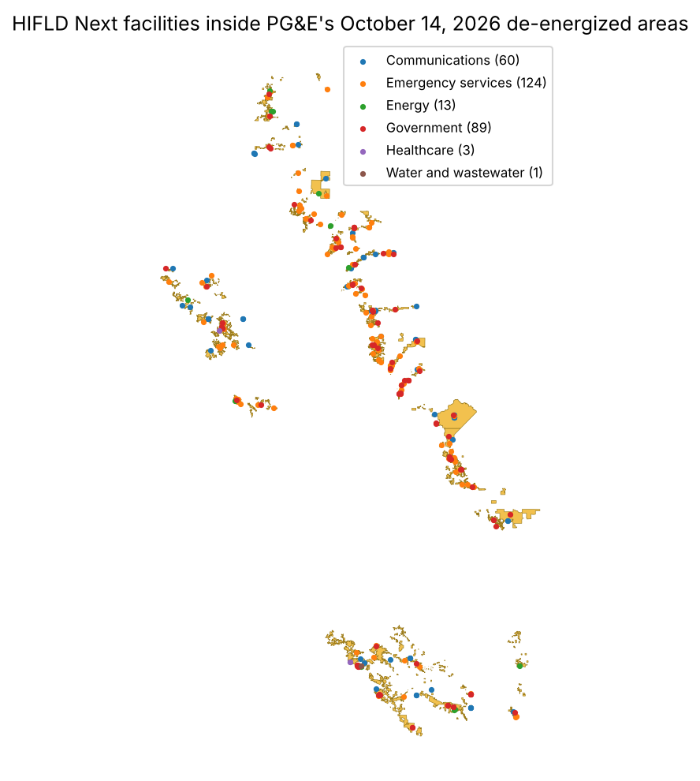

# How many of PG&E's 1,864 shut-off critical facilities can HIFLD Next find?

From October 14 to 17, 2026, PG&E cut power to 85,863 customers in a Public Safety Power Shutoff
(PSPS). It told the CPUC that 1,864 of them were critical facilities and infrastructure (CFI)
customers. This spike asks how many of those an emergency manager could find from public data:
we put HIFLD Next's facility layers inside PG&E's own polygons of de-energized areas and count
them, layer by layer. Issue [#278](https://github.com/fulton-ring/agent-content-demos/issues/278),
[proposal card](https://app.notion.com/p/418cc69045cb8143bcd0fe547c462ee1).

**Short answer: HIFLD Next finds 290 CFI-type facilities (243 distinct sites) inside the October 14
polygons, against PG&E's 1,864 CFI customers. That's 16%.** It finds the one open hospital,
and 7 of the 11 sites that got PG&E generators: 7 of the 8 school sites and none of the 3
water systems. What it misses is mainly water systems and communications sites. HIFLD Next has
no drinking-water layer at all, and its cell tower layer is a thin FCC subset. We can't put a
number on that split, because PG&E publishes the CFI total and no count by sector.

- **By sector, inside the October 14 polygons:** 124 emergency services (117 fire and EMS
  stations, 6 law enforcement, 1 local EOC), 89 government (73 public schools, 8 private schools,
  2 colleges, 6 jails and camps), 60 cellular towers, 13 power plants not run by PG&E, 3 healthcare
  (1 hospital, 2 nursing homes), 1 wastewater plant, 0 chemical sites.
- **Hospitals:** two HIFLD Next hospital records fall inside. Adventist Health St. Helena is open.
  Feather River Hospital in Paradise is marked closed, which is correct: it closed after the 2018
  Camp Fire. PG&E's Table 15 also lists "St. Helena Hospital Domestic Water Plant" among its
  generator sites. HIFLD Next finds the hospital but not its water plant.
- **The gap is similar in smaller events:** 18 of 129 CFI (14%) on July 15 and 11 of 34 (32%)
  on October 23. Nine of the 11 on October 23 are cell towers.
- **A third of the matches sit on an edge:** 102 of the 290 are within 100 m of a polygon edge,
  and another 36 are just outside one. The one school district we missed, Berkeley Unified, has its
  nearest school 88 m outside the polygon.

| Event | Customers | PG&E CFI | HIFLD Next CFI-type | Share |
|---|---:|---:|---:|---:|
| 2026-10-14 | 85,863 | 1,864 | 290 | 16% |
| 2026-07-15 | 5,186 | 129 | 18 | 14% |
| 2026-10-23 | 364 | 34 | 11 | 32% |



## Run it

```bash
./run.sh
```

Needs [uv](https://docs.astral.sh/uv/). It downloads about 165 MB (three PG&E events and 18 HIFLD
Next files) into `~/.cache/pge-psps-hifld-facilities` (or set `PSPS_CACHE`). A run from an empty
cache took under a minute; with a warm cache it takes about 20 seconds. It writes `results/`. To read
the notebook with its outputs: `uv run marimo edit notebook.py`. Cost: $0.

## Data (all public, downloaded at run time)

| Input | Where |
|---|---|
| PG&E de-energized polygons, one per "time and place" | `<date>-pge-psps-event.gdb.zip`, layer `PSPS_<date>DeEnergizedAreas`, from PG&E's [PSPS page](https://www.pge.com/en/outages-and-safety/safety/community-wildfire-safety-program/public-safety-power-shutoffs.html) |
| PG&E CFI totals (Table 1) and generator sites (Table 15) | `<date>-psps-post-event-report-tables.xlsx`, same page |
| CFI definition (CPUC's interim sector list) | Appendix F of the [October 14 report PDF](https://www.pge.com/assets/pge/docs/outages-and-safety/outage-preparedness-and-support/10-14-2026-psps-post-event-report.pdf) |
| 16 HIFLD Next facility layers, plus two school district layers | [HIFLD Next](https://hifld.publicenvirodata.org) portal API, newest version of each; list and versions in `results/hifld_versions.csv` |

The issue asked us to first check whether PG&E posts the geodatabase or only files it with the
CPUC. PG&E posts it publicly, next to the PDF and the Excel tables, for every 2026 event.

## Method

1. **Polygons.** We read the `DeEnergizedAreas` layer (23 polygons for October 14) and reproject
   it to California Albers (EPSG:3310) so distances are in metres.
2. **HIFLD Next layers, by CPUC sector.** Healthcare: hospitals, nursing homes, dialysis, VA.
   Emergency services: fire and EMS, law enforcement, local and state EOCs. Government: public and
   private schools, colleges, jails and prisons. Energy: power plants. Water: ICIS wastewater
   plants. Communications: cellular towers. Chemical: EPA RMP facilities. We keep only open or
   active records where a layer has a status field. Three groups are counted but kept out of the
   CFI total: assisted living, which the CPUC list doesn't name, and PG&E's own 16 hydro plants
   inside the footprint, which are PG&E's assets rather than customers.
3. **Count.** A facility counts if its point, or a jail's outline, touches a polygon. We also merge
   points within 100 m of each other into sites.
4. **Generator sites.** Table 15 names a district or site type, not an address. For a school
   district, we count it found if an open HIFLD Next public school with that NCES district ID is
   inside. For anything else, we look for the name.
5. **Edges.** We count facilities within 100 m and 500 m of a polygon edge, on each side.

**What we looked at first.** We used plain GeoPandas spatial joins: no new tool was needed. We took the
portal API pattern from `school-campus-dedup/` and the cached-download pattern from
`critical-facilities-flood-zones/`.

## What didn't work, and what this doesn't show

- **No CFI breakdown from PG&E.** The report, its workbook and PG&E's 2025 post-season data
  workbook give only the CFI total, so the comparison by type is against what each CPUC sector
  covers, not against PG&E's count per sector. "Misses mainly water and communications" is an
  inference: from the layers HIFLD Next lacks and from the three water systems among the generator
  sites, all of them missed.
- **Accounts against points.** PG&E counts service points (meters). A water district with a dozen
  pumps counts a dozen times on PG&E's side. Some of the gap is this unit mismatch, and public data
  can't size it.
- **Our first power plant count was wrong.** It included 16 PG&E hydro plants (Pit, Balch, Drum,
  Caribou and others). Those are PG&E's own assets, not customers, so we moved them out.
- **Loose matches on the generator test.** A district with a school inside the polygons doesn't
  prove the generator went to that school. One of the Kings Canyon matches is an online school.
- **Old or missing status fields.** Validation dates run from 2008 to 2024, depending on the layer. Fire
  stations, dialysis centres, EOCs and cell towers have no usable status field, and the fire layer
  lists some stations twice under two agencies' names. Merging those into sites drops 290 points to
  243.
- **Approximate polygons.** PG&E's polygons approximate circuit service areas. With a third of the
  matches within 100 m of an edge, a different drawing could move the count by tens.
- **One utility, three events.** We didn't test other utilities or earlier years.

## Files

`notebook.py` (the analysis), `run.sh`, and `results/`: `headline.json`, `events.csv`,
`counts_by_layer_oct14.csv`, `counts_by_sector_oct14.csv`, `facilities_inside_oct14.csv`
(every match), `hospitals_oct14.csv`, `generator_sites_oct14.csv`, `edge_sensitivity_oct14.csv`,
`hifld_versions.csv` and `map_oct14.png`.
