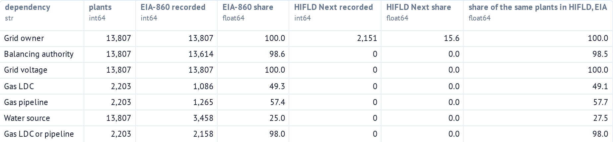

# How many US power plants have a recorded upstream dependency in public data?

Spike for [#284](https://github.com/fulton-ring/agent-content-demos/issues/284), a sub-issue of
[#210](https://github.com/fulton-ring/agent-content-demos/issues/210) ("Mapping the dependencies between
infrastructure systems").

A power plant depends on the grid it feeds, the balancing authority that dispatches it, the gas company or
pipeline that fuels it, and the water that cools it. EIA's annual generator survey (Form EIA-860) asks
every plant for these. HIFLD Next's power plant layer, which is built from EIA data, keeps almost none of
them. This spike measures both on the same operating plants, then checks whether EIA's gas pipeline names
can be joined to HIFLD Next's natural gas pipeline layer.

It publishes only national, fuel and state counts. EIA already publishes the plant-level fields; we don't
publish a new asset-level dependency table.

## Run it

```bash
./run.sh
```

Needs [uv](https://docs.astral.sh/uv/). It downloads about 30 MB into `data/` (not committed), runs the
notebook [`upstream_dependencies.py`](upstream_dependencies.py) as a script, writes `outputs/`, and exports
the notebook with its outputs to `outputs/upstream_dependencies.html`. To read it interactively:
`uv run marimo edit upstream_dependencies.py`.

## Data

| Source | What we use | Version |
|---|---|---|
| [HIFLD Next](https://hifld.publicenvirodata.org) | `power-plants-1` and `natural-gas-interstate-and-intrastate-pipelines`, GeoParquet found through the [STAC API](https://hifld.publicenvirodata.org/stac) | layer v1.0.0 |
| [EIA-860](https://www.eia.gov/electricity/data/eia860/) | Schedule 2 (plants), Schedule 3.1 (operable generators), the field directory `LayoutY2025.xlsx` and the form instructions | 2025 annual, released September 2026 |

"Operating" means at least one generator in status `OP`. A plant's fuel is the energy source of its
largest operating generator. A plant is gas-burning if any operating generator lists natural gas.

## Results

From the run on 2026-11-15 (`outputs/summary.json`, `outputs/headline.csv`). The run took 12 s after
downloads (29 s for `./run.sh` from empty, including the HTML export).

**Step 1: the fields exist.** EIA-860's field directory confirms every dependency field the reading
research listed, all on Schedule 2: balancing authority (line 5), water source (line 6), transmission or
distribution owner (line 13), up to three grid voltages (line 14), natural gas LDC (line 16a), and up to
three pipelines plus notes (line 16b). The instructions say only gas-burning plants answer 16a/16b, and
plants that use no water enter `NA`, so we measure gas over gas-burning plants and count `NA` as "no
water dependency".

**Recorded upstream dependencies, 13,807 operating plants (gas rows: 2,203 gas-burning plants):**

| Dependency | EIA-860 | HIFLD Next |
|---|---|---|
| Grid owner (transmission or distribution owner) | 100.0% | 0% (15.6% name a substation, its only grid field) |
| Balancing authority | 98.6% | 0% |
| Grid voltage | 100.0% | 0% |
| Gas LDC (gas-burning plants) | 49.3% | 0% |
| Gas pipeline (gas-burning plants) | 57.4% | 0% |
| Gas LDC or pipeline (gas-burning plants) | 98.0% | 0% |
| Water source | 25.0% | 0% |



- 98.6% of operating plants have grid owner, balancing authority and grid voltage all recorded in EIA-860.
- HIFLD Next's 43 columns hold no balancing authority, grid owner, voltage, gas supplier or water source.
  Its `SUB_1`/`SUB_2` substation names are the only upstream link, filled for 2,151 operating plants.
- Water source is low overall because solar, wind and storage plants (66% of plants) use none. It's
  recorded for 100% of hydro and nuclear, 99.5% of coal and 65.2% of gas plants (`outputs/by_fuel.csv`).
- HIFLD's substation share varies by fuel (72% of nuclear, 44% of gas, 0.9% of solar) and by state
  (19.2% in California, 0.2% in Texas). See `outputs/by_fuel.csv` and `outputs/by_state.csv`.

**Cross-sector check: EIA pipeline names against HIFLD Next's pipeline layer.** 1,134 gas plants name a
pipeline company in EIA's three pipeline fields (156 distinct names). HIFLD's layer has 252 operators,
heavily abbreviated, so both sides are normalized, then matched exactly, then on the core name (generic
words like GAS and PIPELINE removed), then fuzzily. Every fuzzy match and the 25 unmatched names with the
most plants were checked by hand ([`hand_review.csv`](hand_review.csv)).

| Outcome (best per plant) | Gas plants | Share |
|---|---|---|
| Matched by name | 783 | 69.0% |
| Same pipeline, but renamed, parent-company name or respelled | 157 | 13.8% |
| Plant entered its gas utility (LDC) in the pipeline field | 74 | 6.5% |
| Midstream, gathering or storage company not in the layer | 12 | 1.1% |
| Transmission pipeline not found in the layer | 38 | 3.4% |
| Not reviewed (long tail of 61 names) | 70 | 6.2% |

So 69% of plants that name a pipeline can be joined to the HIFLD pipeline layer automatically, and about
83% with a small hand crosswalk of renames. The renames are the main failure: PG&E (88 plants, "Pacific
Gas" in EIA, "California Gas Transmission Co" in HIFLD), DTE Gas (was Michigan Consolidated Gas, "Michcon"
in HIFLD), Enable Oklahoma Intrastate (was Enogex), Carolina Gas Transmission (was South Carolina Pipeline
Corp) and TransCanada's GTN. Two of the four fuzzy matches were wrong (Kinder Morgan Tejas and North Texas
both landed on Kinder Morgan Texas), so fuzzy matching on its own isn't safe.

**Join failures:** 1,301 of 13,807 EIA operating plants (9.4%) have no plant code in HIFLD Next. 1,845 of
HIFLD's 16,317 plants have a code not in EIA-860 2025 at all, and 811 plants HIFLD marks `OP` aren't
operating in EIA-860 2025.

## What didn't work, and what we looked at first

- Fuzzy name matching (rapidfuzz `token_sort_ratio` ≥ 90) produced wrong matches between sister pipelines,
  so it's kept but every fuzzy hit needs a hand verdict before it counts. The notebook stops if one is
  missing.
- HIFLD's STAC collections carry column names and example values but no column descriptions, so the
  HIFLD schema check is by column name and by reading the values.
- We used EIA's own field directory and instructions rather than assuming the field list. We used
  [rapidfuzz](https://github.com/rapidfuzz/RapidFuzz) for fuzzy matching rather than writing our own.

## What it doesn't show

- **Recorded isn't verified.** We count whether a field is filled in, not whether it's right.
- **A name isn't a location.** EIA names a grid owner and a pipeline company, not the substation or the
  segment where the plant connects. A matched pipeline company says which network, not where.
- **Upstream only, one hop.** No downstream dependents and no second-order links (a pipeline's own power).
- **Fuel is the largest generator's.** A hybrid plant counts under its larger unit.
- **The hand review covers 29 of 156 names** (every fuzzy match plus the top 25 unmatched by plant count).
