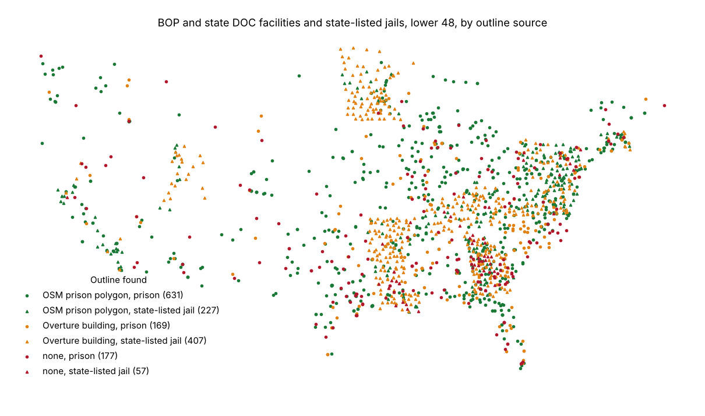

# Can we rebuild a national prison boundaries layer from public sources?

Issue [#300](https://github.com/fulton-ring/agent-content-demos/issues/300). HIFLD's *Prison Boundaries* layer
(Oak Ridge National Laboratory's polygons of every secure detention facility, federal to county) moved behind
DHS's restricted GII portal, so HIFLD Next can't republish it. This spike rebuilds as much of it as public sources
allow and measures the result against the last public copy.

**Answer: about half.** The Bureau of Prisons and 41 state corrections lists give usable locations for
1,063 federal and state facilities. We find again 51% of HIFLD's open state and federal records, and we have an
outline for 75% of our facilities (59% from OpenStreetMap). County and local jails make up 65% of the old layer
and have no public list. The open maps reach about half of them, mostly as points rather than outlines.



## How to run it

```bash
./run.sh     # needs uv. First run about 21 minutes (state sites and Overture buildings from S3), then seconds
uv run marimo edit rebuild.py   # to read it as a notebook
```

Everything is in one marimo notebook, [`rebuild.py`](rebuild.py), which reads top to bottom: the answer key,
the state survey, BOP, the state scraper, geocoding, OSM and Overture, matching, the HIFLD comparison, the
output, the hand check, and what didn't work. Downloads go to `data/`, results to `output/`. The buildings
pass needs about 12 GB of memory.

## The data (all public, downloaded at run time)

| Source | What | Licence |
|---|---|---|
| HIFLD Prison Boundaries, last public copy via [PASDA](https://mapservices.pasda.psu.edu/server/rest/services/pasda/HIFLD_FEMA/MapServer/131) | answer key only: counted and compared, never copied into our output | ORNL / DHS GMO, HIFLD Open |
| [BOP facility locator](https://www.bop.gov/locations/list.jsp) JSON | 118 federal institutions with coordinates | public domain (US government) |
| State DOC sites and state GIS portals ([`state_sources.csv`](state_sources.csv)) | 945 state facilities | state public records, terms vary |
| [Census batch geocoder](https://geocoding.geo.census.gov/geocoder/) | coordinates for addresses | public domain |
| OpenStreetMap via [QLever](https://qlever.dev) | 3,360 `amenity=prison` features in the US, 2,754 of them polygons | ODbL 1.0 |
| [Overture](https://docs.overturemaps.org/) 2026-10-21.0 places | 4,090 `jail_or_prison` places | CDLA-Permissive-2.0 |
| Overture 2026-10-21.0 buildings | footprints near each facility | ODbL 1.0 |
| Esri World Imagery | hand-check images (not committed) | Esri terms |

The PASDA copy has the same change log ("80 records added, 132 closed, 30 reopened, and 363 removed") as the
Data Rescue Project's copy archived in August 2025. Its latest source date is 2024-08-19.

**Licences per row.** `output/prison_boundaries_rebuilt.parquet` (GeoParquet, not committed) has
`attributes_licence` and `geometry_licence` on every row. The 798 rows with an OSM or Overture-building outline
are ODbL (share-alike). The other 265 are points that carry BOP, state or Census terms. Points that came from an
Overture place name match are CDLA-Permissive. Whether HIFLD Next may publish ODbL polygons is a founder call;
this spike doesn't decide it. `output/facilities.csv` (committed) holds the same facilities with no OSM-derived
geometry.

## Results (from one `./run.sh`)

**States with a usable list: 41 of 50 plus DC.** Subagents surveyed every state's corrections site by hand
(`state_sources.csv`: URL, format, coordinates or addresses, last updated). Every state except one publishes
a list with addresses or coordinates. A script can read 41 of them. Only 18 give coordinates, and only 15 are a
machine-readable file or API.
- Unusable: NY, RI, SD (bot protection); HI, DC (prose); NH (stale GIS); AK (PDF); CO (no ZIP); KS, WY (PO boxes).
- One generic scraper, configured by a few columns per state, got at least 80% of the hand count in 35 states
  (`output/scrape_yield.csv`).
- Dates are rarely stated. Several state GIS layers are years old: AZ 2020, IA 2015, KY 2018.

**Facilities found against HIFLD** (`output/hifld_counts.csv`, `output/hifld_coverage.csv`):

| | HIFLD open records | Ours | HIFLD records with one of ours within 1 km |
|---|---:|---:|---:|
| Federal | 250 | 118 (BOP) | 162 (65%) |
| State | 1,718 | 945 (857 located) | 834 (49%) |
| County + local | 3,762 | none: no public list | 166 (4%) |
| Multi / n/a | 74 | – | 2 |

HIFLD's federal count also includes ICE, US Marshals and contract sites, and its state count includes
juvenile and community-corrections sites. That is why our lists are shorter. Going the other way, 93% of our
located facilities fall within 1 km of a HIFLD record (`output/rebuilt_on_hifld.csv`).

**Locations.** The sources give coordinates for 342 facilities. The Census geocoder placed 545 of 721
addresses (76%). An Overture place name match placed 88 more, and 88 stay unlocated (`output/geocode_summary.csv`).

**Share with an outline** (`output/outline_summary.csv`): an OSM `amenity=prison` polygon within 250 m,
else an Overture building within 50 m.

| | OSM polygon | Overture building only | none | not located |
|---|---:|---:|---:|---:|
| BOP (118) | 69% | 3% | 29% | 0% |
| State DOC (945) | 58% | 18% | 15% | 9% |

**Outline agreement with HIFLD** (`output/outline_agreement.csv`), measured as intersection over union with
the HIFLD polygon each outline overlaps:
- OSM: median 0.62, and 59% of outlines are above 0.5.
- Overture buildings: median 0.23, and 16% are above 0.5. A building is not a fence line.

**Hand check on imagery** (`hand_check.csv`, `output/hand_check_summary.csv`): 40 seeded facilities, labelled
by reviewers who saw only the image and the name.

| Outline | fits | covers part | wrong |
|---|---:|---:|---:|
| OSM prison polygon (20) | 13 | 7 | 0 |
| Overture building (15) | 3 | 6 | 6 |

Only 21 of the 40 points sit on the facility itself: 11 are off it and 8 are unclear. Geocoded points often
land on the road outside, which is why matching allows 250 m.

**Local jails: no national public list with locations exists.**
- BJS's Census of Jails facility file is restricted (ICPSR data use agreement).
- The NIC National Jails Compendium (2,986 jails) isn't published.
- Some states list their jails: GIS layers in AR, MN, MD, MA, UT and VA; PDFs in PA, TN, KY and CA. Sub-issue
  [#308](https://github.com/fulton-ring/agent-content-demos/issues/308) adds these.
- What the open maps alone cover of HIFLD's 3,463 open county records: an OSM polygon on 25%, an Overture
  `jail_or_prison` place within 250 m of 45%, and either one on 53%. For HIFLD's 299 local records, either one
  covers 34%. Across the whole layer (5,804 open records), either one covers 61%.

**Run time and cost.** A run from a clean checkout took 1,238 s (about 21 minutes). The state scraping and the
Overture buildings pass take most of that. After that it runs from `data/` in seconds, and every output CSV
matched the committed copies. Cost is $0, with no paid services.

## What it doesn't show

- It doesn't show that the rebuilt layer is current. We take each source as published, and HIFLD itself is
  from 2024.
- It doesn't cover juvenile facilities run by separate agencies, ICE or US Marshals detention, private
  contract sites outside the DOC lists, or tribal jails.
- The scraper's rows aren't all secure facilities. Some are head offices, work camps or release centres, as
  each state lists them.
- 40 images is a small hand check. The HIFLD comparison is the larger check.
- We looked at the HIFLD Next catalogue and the UCLA COVID Behind Bars facility file (2,296 facilities, with
  coordinates taken from HIFLD) before building. Neither is a public replacement.
