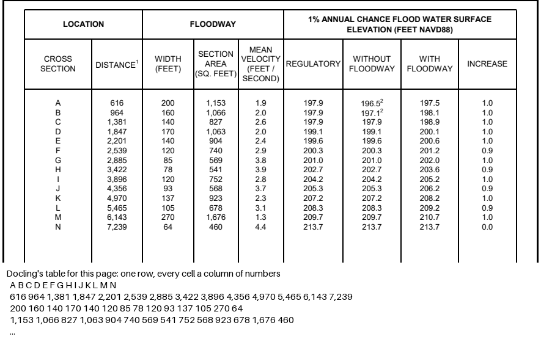

# Rebuilding Reducto's parse and extract with Docling and Gemini

Reducto sells document parsing: *Parse* turns a document into sections, tables and chunks with bounding boxes, *Split* finds the sections of a long file, and *Extract* fills a JSON schema from what Parse saw. Can an open pipeline do the same? Docling or LlamaIndex would handle layout, and a vision language model such as Gemini 3.8 Flash would read the pages. This spike measures that on two tasks with answer keys:

1. **Schema extraction**: the K-1 spike's 30 tax documents and its answer key, read by three pipelines and scored by the K-1 spike's own scoring notebook, so the numbers sit next to its README's.
2. **Section parsing**: two long FEMA Flood Insurance Studies for Henrico County, Virginia. One is a scanned typewritten report from 1980 (65 pages), the other a born-digital report from 2024 (94 pages). A hand-checked key gives their 69 numbered headings, the page each starts on, and six tables (587 cells).

**Read the two notebooks**, each top to bottom. Open one with `uv run marimo edit 1_schema_extraction.py`, or read them as plain Python:

1. [`1_schema_extraction.py`](1_schema_extraction.py): the VLM alone, Docling's text then the model, and Docling routing then the VLM.
2. [`2_section_parsing.py`](2_section_parsing.py): Docling alone, the VLM alone, and Docling then the VLM, on headings, section boundaries and tables.

## Run it

```
./run.sh
```

You need [uv](https://docs.astral.sh/uv/), the `tesseract` binary (`apt install tesseract-ocr` or `brew install tesseract`), `OPENROUTER_API_KEY`, and the K-1 spike's folder next to this one (it's in this repository). `run.sh` first runs the K-1 spike's `1_documents.py`, unchanged and in its own pinned environment, to make the 30 documents. It then runs the two notebooks as scripts, so the numbers come from the code you read. Notebook 1 runs the K-1 spike's `3_results.py`, also unchanged, to score its pipelines. Everything goes to `output/` (set `REDUCTO_OUTPUT_DIR` to write elsewhere). Model answers are saved in `output/answers/` and reused on a re-run; delete that folder to call the model again. A clean run took 34 minutes on 4 CPU cores and cost $1.31 in model calls (run 1 cost $1.33).

## Look first: what Reducto documents, and what the open tools cover

- **Reducto** ([docs](https://docs.reducto.ai/overview)). Parse returns chunks of Markdown, each with typed blocks (title, section header, table, figure, key-value) that carry a page, a bounding box and a confidence. Word- and cell-level citations are an option, but they [can't be combined](https://docs.reducto.ai/configs/parse/citations) with joining tables across pages. Split takes plain-language section descriptions and returns page ranges; it "runs Parse … then uses an LLM to classify pages". Extract takes a JSON schema and "can only return what Parse sees". The current parser, r-1, is "one full-page model" that reads "digital text, scans, handwriting". [List prices](https://docs.reducto.ai/reference/credit-usage) per 1,000 pages: Parse $10, Extract $20, Split $20. It publishes no per-page speed, but guarantees 200 to 500+ concurrent pages by tier.
- **Benchmark.** Reducto's [RD-TableBench](https://huggingface.co/datasets/reducto/rd-tablebench) is 1,000 table images with a public answer key. Its licence is CC-BY-NC-ND-4.0, which doesn't fit a commercial blog's demo, and it scores single table images, not long documents or forms, so we built our own keys. Reducto's forms benchmark, RD-FormsBench, was announced but we found no release.
- **Docling** (MIT): layout, reading order, OCR, table structure, section headers, chunking, per-element boxes, and VLM pipelines. **LlamaIndex** (MIT) is the framework and its node parsers; **LlamaParse** is a paid cloud service, so it's out under this repo's rules. **Marker** (code Apache-2.0, weights free only under $5M revenue) and **MinerU** (Apache-2.0 with extra terms) cover the same ground as Docling, with an optional LLM pass. The open **Unstructured** library partitions and chunks by title; its own README puts its table-cell accuracy at 0.43, against 0.87 for its paid API. Each open tool covers layout and tables, none covers schema extraction without a model, and we used Docling because the K-1 spike already does.

## Results

From a clean run of `./run.sh` from a fresh clone on 2026-10-26 (run 2), with run 1 earlier the same day for comparison. All model calls are Gemini 3.8 Flash on OpenRouter at temperature 0.

### Schema extraction, the K-1 spike's 30 documents

| Pipeline | Values right | Accepted without review | Wrong but accepted | Sent to review | Cost per document | Cost per page | Seconds per document (Docling + model) | Failed documents |
|---|---|---|---|---|---|---|---|---|
| *K-1 spike, Gemini 3.8 Flash (from its README, run 2026-10-18, all its review rules)* | *676 of 676* | *652* | *0* | *24* | *$0.0064* | | *8.3 + 11.8* | *0* |
| A. VLM alone, whole PDF | 668 of 676 | 652 | 7 | 24 | $0.0087 | $0.0044 | 0.0 + 15.6 | 0 |
| B. Docling Markdown, then the model (text only) | 393 of 709 | 679 | 296 | 30 | $0.0127 | $0.0064 | 19.2 + 11.2 | 0 |
| C. Docling finds the page, the VLM reads its image and Markdown | 658 of 676 | 652 | 18 | 24 | $0.0091 | $0.0046 | 19.2 + 10.6 | 0 |

"Wrong but accepted" is a wrong value accepted without review, or a box on the key a run never reported. All three pipelines use only the K-1 spike's per-value review rules (confidence, STMT, malformed amounts, unknown or repeated boxes), not its cross-checks or its whole-page check, so the difference between them is the pipeline. The italic row is the K-1 spike's own pipeline with all its rules, from its README.

Run 1 gave the same picture: A 668 of 676 right with 8 wrong but accepted, B 380 of 714 with 313, C 658 of 676 with 18. Docling took 19 to 21 seconds a document here, on a busier machine than the K-1 spike's 8.3.

- **Show the model the page.** B, which hands the model Docling's Markdown and no image, let through 296 wrong values (313 in run 1). Nearly all were on scans, where Tesseract's text is all the model gets; on the three born-digital K-1s it got 6 to 9 wrong. A and C, which show the page, got 97 to 99% of values right.
- **Gemini alone on the whole PDF is nearly as good as the K-1 spike's pipeline**, with 7 and 8 wrong values accepted against 0. Every one is on Blackstone's 11-page package and its scans, where it skipped box 7 and coded rows printed as a dash. Docling's job there is to find the page, not to read it.
- **Routing on OCR text fails silently.** C's 18 wrong values are one made-up 1099, in both runs: Docling's OCR missed the form's title on the summary page, C sent the detail page, and every box came back blank. The K-1 spike's whole-page check catches this; C here doesn't have it.

### Section parsing, two flood studies

| Document | Pipeline | Heading recall | Section recall | Level right | Extra headings | Table cells right | Cost per page | Seconds per page (Docling + model) |
|---|---|---|---|---|---|---|---|---|
| fis-henrico-1980 | Docling alone | 23 of 23 | 23 of 23 | 8 of 23 | 13 | 241 of 332 (73%) | $0.0000 | 7.0 + 0.0 |
| fis-henrico-1980 | VLM alone | 23 of 23 | 23 of 23 | 23 of 23 | 0 | 332 of 332 (100%) | $0.0018 | 0.0 + 0.9 |
| fis-henrico-1980 | Docling, then the VLM | 23 of 23 | 23 of 23 | 23 of 23 | 5 | 235 of 332 (71%) | $0.0005 | 7.0 + 0.4 |
| fis-henrico-2024 | Docling alone | 46 of 46 | 46 of 46 | 7 of 46 | 36 | 129 of 255 (51%) | $0.0000 | 7.6 + 0.0 |
| fis-henrico-2024 | VLM alone | 46 of 46 | 46 of 46 | 46 of 46 | 0 | 255 of 255 (100%) | $0.0018 | 0.0 + 0.8 |
| fis-henrico-2024 | Docling, then the VLM | 46 of 46 | 46 of 46 | 46 of 46 | 0 | 255 of 255 (100%) | $0.0009 | 7.6 + 0.4 |

| Document | Table | Docling alone | VLM alone | Docling, then the VLM |
|---|---|---|---|---|
| fis-henrico-1980 | Table 1 - Summary of Discharges | 186 of 192 | 192 of 192 | 192 of 192 |
| fis-henrico-1980 | Table 2 - Manning's "n" Values | 43 of 44 | 44 of 44 | 43 of 44 |
| fis-henrico-1980 | Flood Insurance Zone Data (Table 4 in the contents, printed TABLE 3), James River to North Run | 12 of 96 | 96 of 96 | 0 of 96 |
| fis-henrico-2024 | Table 13: Roughness Coefficients | 99 of 99 | 99 of 99 | 99 of 99 |
| fis-henrico-2024 | Table 22: Summary of Topographic Elevation Data used in Mapping | 30 of 30 | 30 of 30 | 30 of 30 |
| fis-henrico-2024 | Table 23: Floodway Data, Allens Branch | 0 of 126 | 126 of 126 | 126 of 126 |

Run 1 gave the same numbers, cell for cell. Docling took 7.0 to 7.6 seconds a page on CPU, with Tesseract on the scan.

- **Every pipeline found every numbered heading on the right page**, on both the scan and the born-digital report. The headings carry their numbers, so this was the easy part (see What it doesn't show).
- **Docling's outline is flat**: every heading at level 1, plus the cover and contents lines as headings (13 and 36 extras). Giving its Markdown to Gemini fixed every level and most extras, for $0.0005 to $0.0009 a page.
- **Tables are where Docling alone fails.** It merged the 2024 floodway table's 14 rows into one row of whole columns (0 of 126 cells), read the sideways 1980 table as fragments (12 of 96), and glued a footnote marker onto a number (`15,0002` for 15,000 with note 1). Gemini read all 587 cells right from the PDF alone.
- **Docling then the VLM inherits Docling's misses.** Docling's text never names the sideways table, so the pipeline never found its page (0 of 96). On the scanned Manning's table it took Docling's `-0.060` (a speck read as a minus sign) over the page image's 0.060.



## Failure types, and what would fix each

| Failure | Seen in | Fix |
|---|---|---|
| Text loses the form's grid and OCR misreads digits on scans | Schema B | Show the VLM the page image. Not a layout-tool or fine-tuning problem |
| Routing on OCR text picks the wrong page, and blanks are accepted | Schema C; sections, Docling then VLM, on the sideways table | Let the VLM pick the page, or add the K-1 spike's whole-page check |
| VLM skips rows when given a long package | Schema A, Blackstone | Less context, not more: send the form's page only |
| Rows merged in a table without rules | Sections, Docling alone | VLM on the page image; or fine-tune the table model (below) |
| Sideways pages unreadable | Sections, Docling alone and Docling then VLM | VLM on the page image, which reads it as printed |
| Flat heading levels, cover and contents lines as headings | Sections, Docling alone | Prompting: give Docling's Markdown to an LLM |
| OCR noise in Docling's text overrides what the VLM sees | Sections, Docling then VLM | Send the image alone, or tell the model the text is a hint only |
| Footnote marker glued to a number | Sections, Docling alone | VLM, prompted to leave out footnote markers |

## Where fine-tuning would earn its cost

Nothing we measured needed fine-tuning a frontier VLM. Every error Gemini made was fixed by changing what it was shown (one page instead of 11; the image instead of OCR text) or by a check behind it. Fine-tuning earns its cost in three places:

- **When the model has to be open weights, or run on our own hardware.** The K-1 spike's open models shifted values between boxes (Gemma 4 31B accepted 197 to 278 wrong values a run). That's the error a fine-tune on a few hundred labelled form pages fixes, and a bigger open model only partly fixes (Qwen3-VL 235B: 3 to 29).
- **When pages can't go to a VLM at all**, for cost at volume or privacy. Then Docling's table model is the reader, and its row merging on ruleless numeric tables is a training-data problem: fine-tuning its table model on a few hundred such pages is the fix.
- **At volume, on cost.** Gemini cost $0.0018 a page for section parsing and $0.0044 for schema extraction. A small fine-tuned model could cut that, but only after a pipeline like this one has produced the labels.

More pages of context made things worse here, not better.

## The case against: what Reducto does that this pipeline doesn't

- **Speed.** Docling took 7 seconds a page on 4 CPU cores, and Gemini about 1 second a page. Reducto sells 200 to 500+ concurrent pages; at scale we'd need GPUs and our own queueing and rate-limit handling.
- **Citations we can trust.** Reducto returns word- and cell-level boxes from the page. Gemini's boxes are its own claim, and we didn't check them. Docling's boxes are real, but they belong to Docling's text, not to the VLM's values.
- **Tables across many pages.** Gemini joined two-page tables right. We didn't test the 2024 study's 9-page and 32-page tables, which Reducto offers to merge.
- **Handwriting and stamps.** None of our documents have them; Reducto says r-1 reads handwriting.
- **Reliability at volume.** Two runs here, each with a run-to-run spread on the K-1 set, rate limits, and a hosted model that changes under us. Reducto adds SLAs, SOC 2, a BAA and zero data retention.
- **Cost doesn't favour Reducto.** At list price, Parse is $0.010 a page and Extract $0.020. Gemini was $0.0018 to $0.0064 a page here, before our own engineering time.

## Verdict

**Yes, for what we measured.** Gemini 3.8 Flash given the whole PDF found all 69 numbered headings on the right page and read all 587 table cells right, on a 1980 scan as well as a 2024 born-digital report, for $0.0018 a page. On the K-1 set it accepted 7 or 8 wrong values of 676 when given whole packages, and the K-1 spike's routed pipeline accepted none in its README's run (0 to 2 in each of its 11 runs). For public-records extraction an open pipeline is good enough, with two rules. The VLM reads the page image, never OCR text. And whatever routes pages to it is checked. Docling earns its place as a router and a source of real boxes, not as the reader. Section parsing was not the hard part we expected, but our documents had numbered headings; [#130](https://github.com/fulton-ring/agent-content-demos/issues/130) tests ones that don't. We found no error that needs fine-tuning a frontier VLM. Fine-tuning earns its cost only when the model must be open weights or run on our own hardware.

## What it doesn't show

- **Two runs aren't an error rate.** The K-1 spike saw Gemini's misreads come and go between runs; these two runs can't pin down any pipeline's rate.
- **Two flood studies with numbered headings are an easy outline.** Every heading carries its number. Reports with unnumbered headings, two columns, or headings set only by font size would test section parsing harder. That's [a follow-up issue](https://github.com/fulton-ring/agent-content-demos/issues/130).
- **No table here is longer than two pages.** The 2024 study's Table 23 runs 32 pages; we keyed one.
- **No handwriting**, and no tables that change columns between pages.
- **The VLM's bounding boxes weren't checked.** Docling's boxes come from the page; Gemini's are its own claim.
- **Docling ran on CPU.** On a GPU it would be several times faster.

## Files

- `1_schema_extraction.py`, `2_section_parsing.py`: the two notebooks
- `model_call.py`: one typed, cost-counted, saved model call, which both notebooks use
- `section_key.json`: the hand-checked key for the two flood studies
- `run.sh`, `pyproject.toml`, `uv.lock`: the one command and its pinned environment
- `results/`: the result tables from the clean run above, copied from `output/`
- `screenshots/`: crops of the reports' pages, with Docling's output on one
