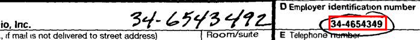

# Scanned 990-EZ extraction: error, review rate and cost per page

Can you turn scanned government records into data you can trust, and what does it cost? This spike runs the four-step method on **real paper-filed IRS Form 990-EZ returns**:

1. Draft the schema from sample pages, then freeze it.
2. Measure error on a checked sample.
3. Send a field to review when two independent readings disagree.
4. Keep a link from every value to its page and box.

It scores every field against the IRS Statistics of Income (SOI) extract, which IRS staff typed from the same paper returns, and it checks every field where that answer key is in doubt against the scan itself. It reports the three numbers nobody has published together for scanned public records: **field-level error, review rate and all-in cost per page**.



*The commonest thing that got through: both models read the typed EIN; an IRS clerk had circled it and written the corrected EIN by hand.*

## Read it

Three marimo notebooks, each top to bottom. Open one with `uv run marimo edit 1_sample.py`, or read them as plain Python:

1. [`1_sample.py`](1_sample.py): the question, the answer key, the seeded sample and the downloads.
2. [`2_extraction.py`](2_extraction.py): drafting and freezing the schema, then two vision models reading every page.
3. [`3_results.py`](3_results.py): reading amounts, checking the answer key, the review rule, the scores, cost, every wrong value that got through, and what didn't work.

## Run it

```
./run.sh
```

You need [uv](https://docs.astral.sh/uv/) and `OPENROUTER_API_KEY`. `run.sh` runs the three notebooks as scripts, in order, so the numbers come from the code you read. They hand results on through `output/` (set `EZ_OUTPUT_DIR` to write elsewhere). A run takes about 15 minutes and costs about $2.10 in model calls; the notebook stops if spending passes $10. Model answers are saved under `output/answers/` and reused on a re-run; delete that folder to call the models again. It writes `output/results.json` and the crops in `screenshots/`.

## The data

All public, fetched at run time, none committed.

- **Answer key.** The SOI 990-EZ extract for 2018 ([`18eoextractez.zip`](https://www.irs.gov/pub/irs-soi/18eoextractez.zip)), 226,533 returns. We keep only the 97,267 paper rows (`elf == "P"`); e-filed returns have image PDFs too, but they are drawn from the data, not scanned.
- **Sample.** 220 paper returns drawn with a fixed seed. Page 1 only: the EIN, the tax year and the 20 Part I amounts SOI also has, 22 fields a page.
- **Scans.** The file name comes from ProPublica's [Nonprofit Explorer API](https://projects.propublica.org/nonprofits/api), matched on EIN and tax period; the PDF comes from `apps.irs.gov/pub/epostcard/cor/`. Each file's sha256 is logged.
- **Models.** Gemini 3.8 Flash and Qwen 3.8 27B (open weights) through OpenRouter, typed with Pydantic AI, the pair that let nothing wrong through in [`k1-extraction-review-queue/`](../k1-extraction-review-queue/).
- **`adjudications.json`** (committed): the 68 fields where both models disagreed with SOI, or all three readings differed, each checked on the scan with the value there, a kind and a note.

## Results

From a clean run of `./run.sh` in a fresh clone on 2026-10-20.

**Downloads.** 187 of 220 scans downloaded (33 failures, 15%: ProPublica lists no image for that tax period). On 2 of the 187, page 1 was another schedule; both models said so, and those pages aren't scored. That leaves **4,070 fields on 185 pages**. Neither model failed to answer on any page.

| | Gemini 3.8 Flash alone | Qwen 3.8 27B alone | The pair, review on disagreement |
|---|---|---|---|
| Wrong values | 38 (0.93%) | 60 (1.47%) | 10 accepted wrong (0.25%) |
| Same, scored against SOI as published | 2.33% | 2.75% | |
| Fields sent to review | | | 77 (1.9%) |
| Pages with a field in review | | | 37 of 185 (20%) |

**Disagreement versus confidence, at the same review budget (77 fields).** Disagreement between the two models caught 28 of Gemini's 38 errors and 50 of Qwen's 60. Sending each model's 77 lowest-confidence fields instead caught **0** of Gemini's errors and 10 of Qwen's. Both models put 0.9 or 0.95 on almost everything.

**What got through: 10 wrong values in 3,993 accepted.** Eight are corrections an IRS clerk wrote by hand (six EINs, two tax years): both models read the typed value and agreed. One is a value both models put on line 17 when it belongs on line 16. One is a handwritten digit that reads as 5 but that the arithmetic says is 3. All ten crops are in `screenshots/`.

**The answer key.** SOI differs from what is on the scan on **57 of 4,070 fields (1.4%)**, more often than Gemini does. Of the 68 fields checked: 43 are SOI edits (recomputed totals, fixed signs, amounts moved between lines, lines filled in that the filer left empty), 13 are SOI typos, 9 are IRS clerk corrections that SOI keyed correctly, 1 is a misread both models share, and 2 are ambiguous. Line 21 (net assets at year end) is the worst: SOI differs from the scan on 24 of 185. Scored against SOI as published, the models look 2.5 times worse than they are.

**Cost and time per page.** Model calls cost **$0.011 a page** for both readings. Each model took about 7 to 8 seconds a page. Review is an assumption, not a measurement: at 30 seconds a reviewed field and $40 an hour, review adds $0.14 a page, so the **all-in cost is about $0.15 a page**, or about $150 per 1,000 pages. Review is 92% of it.

`3_results.py` breaks error down by field.

## What it doesn't show

- **One form, one page, one year of the extract.** Page 1 of the 990-EZ is a typed grid of numbers with an answer key. Free-text records, tables that run across pages and handwriting-heavy forms will do worse.
- **Reviewers are assumed perfect.** The error after review counts only wrong values accepted without review. How often a person gets a reviewed field right isn't measured (see the reading research on reviewers accepting wrong suggestions), and neither is review time.
- **The answer key was checked by the agent that built this, not by a person.** Each decision is in `adjudications.json` with a note, for anyone to re-check. Fields where one model matched SOI were not checked; there SOI is taken as right.
- **185 pages is a small sample.** Ten wrong values in 3,993 accepted puts the true rate between about 0.14% and 0.46% (95% Wilson interval), and the errors cluster on a few pages.
- **One run.** The open model's answers vary from run to run at temperature 0 (see the K-1 spike), so the numbers will move a little on a re-run.

## Files

- `1_sample.py`, `2_extraction.py`, `3_results.py`: the demo, as three marimo notebooks
- `adjudications.json`: every checked field, with the value on the scan, its kind and a note
- `screenshots/`: every wrong value accepted without review, cropped from the scan with the models' box outlined
- `run.sh`, `pyproject.toml`, `uv.lock`: the one command and its pinned environment

Before building this we looked at vendor tools that ship the same steps (Reducto, Extend, Azure Document Intelligence, Textract with A2I; see the reading research in #58). None publishes error on public records, and the point here is the measurement, so the pipeline is the smallest one that makes it: Pydantic AI for typed calls, OpenRouter for the models, and pypdfium2 to render pages.
