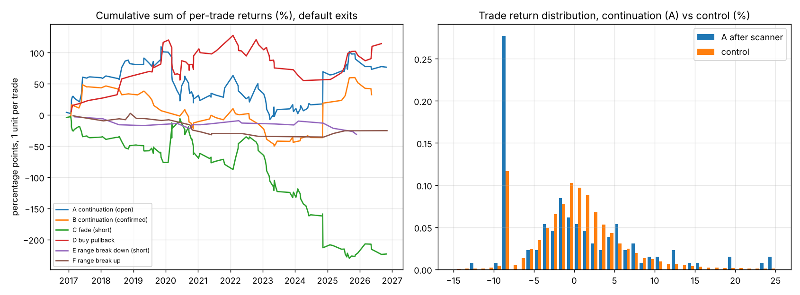

# S&P 500 volume-spike scanner: do any follow-up strategies make money?

A scanner flags S&P 500 stocks priced $1-$20 that jump on heavy volume. Six strategies then trade
the flagged stocks, and each is backtested over ten years of daily bars. The aim is to see
whether any of them, including "continuation" and "wait for support to break", has an edge.

## Run it

```bash
./run.sh        # about a minute the first time (data download), a few seconds after
```

This runs two [marimo](https://marimo.io) notebooks as scripts. Open one to read it with its
output: `uv run marimo edit 2_backtest.py`.

- `1_data.py`: downloads prices and splits for today's S&P 500 members and SPY (cached outside the repo).
- `2_backtest.py`: scanner, strategies, results, robustness checks. Writes `results/`.

## What the scanner and strategies are

Scanner (day 0, at the close): price between $1 and $20 **as traded that day**, up 5% or more,
volume at least 3x the prior 20-day average. 133 events from 2016-11 to 2026-11.

| | Strategy | Entry |
|---|---|---|
| A | Continuation | Long at day 1 open |
| B | Confirmed continuation | Long if day 1 trades above day 0's high |
| C | Fade | Short at day 1 open |
| D | Buy the pullback | Long if price gives back half of day 0's gain within 5 days |
| E | Support breaks | Days 1-3 stay in a tight box; short below the box low |
| F | Resistance breaks | Same box; long above the box high |

Exit: 8% stop or the close of the 5th trading day, whichever is first. Costs: 0.10% each way.
All parameters were fixed before looking at results. Other stops, holding periods and scanner
thresholds are reported in full, not just the best.

## Results (default exits)

| Strategy | Trades | Win rate | Mean per trade | Mean without top 3 trades | 95% interval for the mean |
|---|---|---|---|---|---|
| A continuation | 133 | 43% | +0.57% | -0.26% | -1.1% to +2.4% |
| B confirmed continuation | 68 | 40% | +0.48% | -1.21% | -1.9% to +3.2% |
| C fade (short) | 133 | 42% | -1.68% | -2.47% | -3.1% to -0.2% |
| D buy pullback | 69 | 51% | +1.66% | +0.34% | -1.1% to +4.6% |
| E support break (short) | 19 | 26% | -1.65% | -3.04% | -3.4% to +0.1% |
| F resistance break | 21 | 33% | -1.21% | -2.53% | -3.2% to +1.0% |
| Control: A's rules on random $1-$20 days | 19,983 | 50% | +0.40% | | +0.07% to +0.75% |

- Five of the six intervals include zero. Only the fade (C) is clearly negative.
- The scanner adds little to the control: A is +0.57% against +0.40% for random cheap stock-days.
- A's and D's averages come from a few big winners. The best A trade was Bloom Energy,
  +55%, in 2024, before it joined the index.
- **Membership look-ahead:** 64 of 133 events were in stocks that joined the S&P 500 later.
  Among stocks already in the index, A averaged -1.0% (69 trades) against +2.3% for the rest
  (64 trades). D went from +3.5% to +0.2%. See `results/by_membership.csv`.
- Results move a lot with the exit rule and scanner threshold (`results/sensitivity_*.csv`),
  and the first and second half of the period often disagree (`results/halves.csv`).



## Data

- Prices, volume, splits: Yahoo Finance via `yfinance` (free, unofficial, can change without notice).
- Members: [datasets/s-and-p-500-companies](https://github.com/datasets/s-and-p-500-companies) (current list, with "date added").
- Yahoo shows old prices divided by later splits. The notebook multiplies splits back in to get the price as traded, so the $1-$20 filter is right. 134 splits in the data.
- Nothing is committed except small result files. Prices are downloaded on each fresh run.

## What it doesn't show

- **Survivorship and look-ahead.** Only today's members, so removed stocks are missing and
  recent additions were often added after rising. Long-side results are probably flattered.
- **Small samples.** 19 and 21 trades for the range-break strategies.
- **Daily bars only.** A real scanner works within the day. Free intraday history is about 60
  days, so intraday entries are untested.
- **Not modelled:** short borrow fees and squeezes, position sizing, overlapping trades, taxes.
  Where a bar could hit both the stop and a profit, the stop is assumed first.
- **Reading of "price between $1 and $20".** Taken as the stock's price, not the size of the move.
- Prices are not adjusted for dividends or spin-offs, and I could not verify Yahoo's history for
  every ticker. I spot-checked a handful (AMD, GE, Pure Storage) and they looked right.
- A backtesting library such as backtesting.py or vectorbt was not evaluated. The simulator here
  is about 40 lines of plain code so the entry and stop rules can be read in the notebook.
