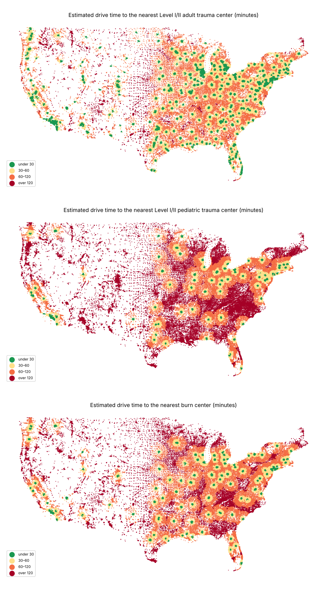

# Distance to trauma and burn centers, by community

How far is each US block group from a Level I or II trauma center and from a burn center, and does that distance fall unevenly by rurality, income, race and ethnicity, age and environmental-justice burden? One marimo notebook builds the facility lists, drives Maine and New Jersey on OpenStreetMap with the open Valhalla router, estimates drive time for the rest of the country, and writes a block-group file, maps and tables. Issue [#148](https://github.com/fulton-ring/agent-content-demos/issues/148).

**Short answer.** About 1 in 8 Americans (12.8%, 42 million) lives more than an hour's drive from a Level I/II adult trauma center. Rurality and race decide who: 72–76% of people in rural and small-town tracts are beyond the hour against 4% in metro tracts, and 52% of American Indian and Alaska Native people against 3% of Asian Americans. Income and age matter much less (16% of low-income people against 11% of everyone else; 15% of people 65+ against 12% under 65). Burn centers are much further: a third of people (33.4%, 111 million) are more than an hour from any burn center, and 45% of children are more than an hour from a Level I/II pediatric trauma center. The people with the highest EJ demographic burden are *not* the furthest. They live mostly in cities, and the middle deciles fare worst.

## How to run

```bash
./run.sh
```

It needs [uv](https://docs.astral.sh/uv/), [osmium-tool](https://osmcode.org/osmium-tool/) (`apt install osmium-tool` or `brew install osmium-tool`) and about 5 GB of disk. The first run downloads about 2.6 GB into `data/`, then builds routing tiles for both states and routes them. `ACCESS_DATA_DIR` and `ACCESS_OUT_DIR` move the data and output folders. To read the notebook with its outputs, run `uv run marimo edit access.py`.

## Where the data comes from

Everything is downloaded at run time; nothing from a source is committed.

| What | Source |
|---|---|
| Trauma centers | [HIFLD Next](https://hifld.publicenvirodata.org) `hospitals-3` v1.1.0, its `TRAUMA` field. Issued 2026-04-06, source dates to 2024-05. |
| Burn centers | [Wikipedia's list of US burn centers](https://en.wikipedia.org/wiki/List_of_burn_centers_in_the_United_States), revision 1379563112 (CC BY-SA 4.0), matched by hand to HIFLD hospitals in `burn_crosswalk.csv` |
| Where people live | Census 2020 population-weighted block-group centres |
| Population, low income, 65+, demographic index | EPA EJScreen 2024 block groups (ACS 2018–2022), the Dataverse copy `ej-datasets-hifld-next/` uses |
| Race and ethnicity, children | ACS 2018–2022 table-based summary file, B03002 and B01001 |
| Rurality | USDA ERS RUCA codes, 2020 tracts |
| Roads | OpenStreetMap US Northeast extract from openstreetmap.fr (2026-10-27 in the run reported here) |

**Why not the official lists.** The American College of Surgeons' verified trauma center search has no download, and its terms forbid using its data in other applications. The American Burn Association's directory has coordinates and a verified flag, but its [terms of use](https://ameriburn.org/terms-of-use/) forbid collecting it with automated tools and copying its data without permission. So burn centers here are *all* burn centers on Wikipedia's list (verified or not), not ABA-verified ones.

## Results

All numbers come from `outputs/summary.json` and the CSVs beside it, written by the run.

**People beyond a 60-minute drive** (estimated drive time; pediatric shares are of children under 18):

| | Level I/II adult trauma | Level I/II pediatric trauma | Burn center |
|---|---|---|---|
| Everyone | 12.8% | 45.2% | 33.4% |
| Metropolitan / micropolitan | 4.3% / 38.2% | 37.1% / 78.8% | 23.6% / 72.1% |
| Small town / rural | 75.5% / 71.7% | 96.8% / 94.9% | 93.6% / 92.9% |
| Low income / not low income | 16.0% / 11.3% | 49.8% / 43.0% | 38.1% / 31.1% |
| 65 and over / under 65 | 14.9% / 12.4% | | 37.8% / 32.5% |
| White / Black / Hispanic | 15.3% / 9.4% / 9.0% | 50.9% / 37.6% / 39.6% | 39.4% / 25.9% / 25.6% |
| American Indian and Alaska Native / Asian | 51.7% / 3.2% | 82.8% / 21.7% | 66.3% / 11.6% |
| EJ demographic index decile 1 / 5 / 10 | 6.8% / 16.3% / 10.7% | 37.8% / 51.2% / 39.4% | 28.5% / 39.1% / 26.9% |

Every group and the 30-minute shares are in `outputs/national_by_group.csv`; the largest gap per dimension is in `outputs/gaps.csv`.

**Against the published figures.** We put 87.2% of people within a 60-minute drive of a Level I/II adult center, and 80.1% within 45 minutes. Branas et al. (2005) had 84.1% within an hour by ground *or* helicopter, counting dispatch and on-scene time, and about 56% by ground alone; Choi et al. (2022) had 89.2% by ground or air in 2019. Our figure is in the same range as the recent studies and well above Branas's ground-only figure, which fits the growth in Level I/II centers from 445 in 2005 to the 612 adult records in HIFLD now. For burn centers, Klein et al. (2009) had 25.1% within an hour by ground of the 51 ABA-verified centers then. We get 66.6% for 139 burn centers of any kind, so most of the gap is the list. For pediatric centers, Melhado et al. (2025) had 51% of children within an hour by ground; we get 54.8%. `outputs/comparison_with_published.csv` has each figure and its definition.

**Straight line against road time.** In the two routed states the conversion from straight-line kilometres to minutes (11.5 min + 0.70 min/km in metro tracts, 23.3 min + 0.71 min/km in rural ones) puts 90–100% of block groups on the same side of the 60-minute line as Valhalla does. The median error is 3–7 minutes (13 for Maine pediatric trips, which are all over two hours). But it misstates the share beyond an hour by up to 6 points in either direction: Maine adult trauma 35.5% estimated against 30.3% by road, New Jersey burn 6.0% against 12.2%. Read the national shares as ±5 points. Its 30-minute shares outside metro areas are not usable: the fitted intercept for small towns is already 29 minutes. `outputs/calibration.png` plots both states.

**Facility list accuracy.** A seeded hand check against state designation lists, the ACS verified-center data and hospital announcements (`hand_check.csv`):
- Adult trauma: 26 of 30 records correct. Of the four wrong ones, one dropped to Level III in 2025 and three aren't trauma centers at all (one is a sister campus of the real center).
- Pediatric: 13 of 15 correct. One wrong record is not a trauma center; the other is a specialty hospital that shares a building with the real center.
- Burn: 19 of 20 run an inpatient burn unit, and 1 is unclear. Of the 20, the ABA lists 10 as verified and 8 as other burn centers, and doesn't list 2.
- An earlier draw of 45 records, made before the facility filter changed, found 27 of 30 adult and 13 of 15 pediatric records correct; its rows are also in `hand_check.csv`.
- Completeness: New Jersey has all 10 of its adult centers and both of Maine's are present, but New Jersey has only 1 of its 5 pediatric centers. HIFLD has 102 pediatric records against the 148 Level I/II pediatric centers Melhado et al. counted, so the pediatric figures overstate distance.

**Run time.** On 4 CPUs, a run from a clean checkout took 25 minutes: 30 seconds of downloads, 9.4 minutes cutting the OpenStreetMap extract and building routing tiles, and 14.7 minutes in Valhalla's matrix for 7,766 block groups. The national steps take seconds. A rerun reuses the downloads and tiles and takes about 15 minutes. Five Maine island block groups have no road route and are left out of the routed figures.



## What's in the folder

- `access.py`: the marimo notebook. It reads top to bottom: question, data, trauma centers, burn centers, hand check, people, straight-line distance, routing, calibration, results, comparison, map.
- `burn_crosswalk.csv`: each Wikipedia burn-center entry matched by hand to a HIFLD hospital, or the reason it's left out.
- `hand_check.csv`: the facility hand check, with the source for each verdict.
- `run.sh`: runs the notebook as a script.
- `outputs/`: summary tables, `summary.json`, the maps, `facilities.csv`, and `block_groups_me_nj.csv` (both routed states, with road and estimated times). The national `block_groups.parquet` (GeoParquet) and `block_groups.csv.gz` are rebuilt by the run; at 26 MB and 20 MB they aren't committed.

## What we looked at first

- **Routing:** Valhalla through `pyvalhalla`, which ships the tile builder and runs in-process with no server or Docker. Its default CostMatrix took about 3 minutes for one state and one kind of facility. TimeDistanceMatrix, which expands once from each hospital, is several times faster. OSRM needs a server or Docker, and Geofabrik's extracts weren't reachable from the build machine, so the OSM data comes from openstreetmap.fr.
- **Facilities:** HIFLD Next first, because it is public and already holds the trauma level. Fuzzy name matching of the burn list (rapidfuzz) was right too rarely to trust, which is why the crosswalk is by hand.
- **Demographics:** the Census API now needs a key, so race and age come from the ACS summary file tables, which don't.

## What it doesn't show

- It doesn't route the whole country. The national times are estimates calibrated on two northeastern states, which are too short where water or mountains are in the way, and they may not carry over to the West's long, fast roads.
- It covers ground travel from a block group's population centre to the hospital, with no traffic, dispatch or on-scene time and no helicopters. It says nothing about capacity, insurance or transfers between hospitals.
- Its burn centers are not the ABA-verified list, and HIFLD's trauma levels date from 2022–2024, with the errors above.
- It covers the 50 states and DC; Puerto Rico and the territories are left out.
