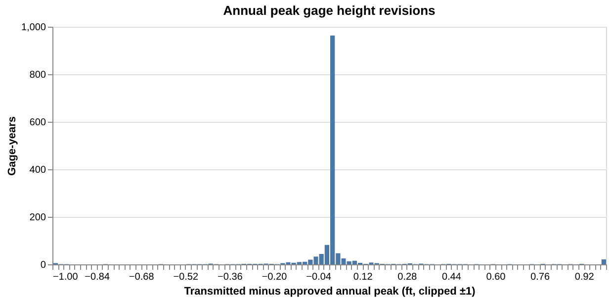

# How much do USGS river gage peaks change between real time and approval?

When a flood crest goes out from a USGS streamgage, the number is provisional; months later USGS approves the
record, sometimes with a different peak. Polymarket's river-crest markets settle on the provisional number, and
USGS does not archive provisional values, so nobody had measured the gap. This spike measures it for about 100
flood-prone gages, using the Iowa Environmental Mesonet's archive of what gages transmitted in real time.

Issue: [#263](https://github.com/fulton-ring/agent-content-demos/issues/263) (sub-issue of #207).

## Run it

```bash
./run.sh
```

Needs [uv](https://docs.astral.sh/uv/). It runs the marimo notebook `peak_revisions.py` as a script and writes
`outputs/`. To read it alongside its output: `uv run marimo edit peak_revisions.py`.

`cache/` holds the raw pulls from our run (public data, about 20 MB), so a run from a clean checkout takes about
20 seconds and reproduces our numbers. Delete `cache/` to pull everything fresh: about two hours, because the IEM
archive serves one request at a time per client. Set `USGS_API_KEY` for a higher USGS rate limit (optional).

`snapshot.py` (`uv run snapshot.py`) saves a dated copy of what USGS currently publishes for the gages behind
the live Polymarket markets (St. Louis 07010000, Baton Rouge 07374000, Great Salt Lake 10010000) into
`snapshots/<date>/`. The 2026-11-12 snapshot is committed; #264 takes the end-of-November one.

## Data

- **As transmitted:** [IEM HADS/DCP archive](https://mesonet.agron.iastate.edu/request/dcp/fe.phtml), the SHEF
  messages NOAA's HADS decoded from each gage's satellite transmissions. Gage height (`HG`) from late 2007 in
  some states and November 2010 in most; discharge (`QR`) at a few gages, mostly from 2022 on.
- **Approved:** [USGS Water Data OGC API v1](https://api.waterdata.usgs.gov/ogcapi/v1/), `daily` (to find flood
  days) and `continuous` (15-minute values with `approval_status` and qualifiers).
- **Gage list and flood stages:** IEM station tables per state and [NOAA NWPS](https://api.water.noaa.gov/nwps/v1/)
  gauge metadata (USGS id and NWS action, minor, moderate and major flood stages).

## Method, in one paragraph

For 20 states we take NWS forecast-point gages whose IEM archive starts by 2010 and pick five per state with a
fixed seed, plus White River at Indianapolis (03353000) and the two Helene gages at Asheville (03451500,
03451000). For each gage-year we pull three-day windows around the three highest approved days and compare the
highest approved 15-minute value with the highest transmitted value in the same windows. Garbage transmissions
(an 883 ft stage at a gage that peaked at 38 ft) are filtered out first and counted. Only fully approved gage-years with a
transmission within two hours of the approved crest are measured. The notebook explains each step.

## Results

From `outputs/summary.json` of our run (1,395 approved gage-years at 94 gages in 20 states, water years
2009–2026; the other 9 gages returned no usable data):

| Gage height, transmitted vs approved annual crest | |
|---|---|
| Median revision | **0.00 ft** (63% match to the hundredth) |
| 95th percentile of the size of the revision | **0.29 ft** (2.1% of the stage) |
| Within 0.05 / 0.1 / 0.5 ft | 83.7% / 89.8% / 97.0% |
| Gage-years revised by more than 0.1 ft | **10.2%** (142), about evenly up and down |
| Revised by more than 1 ft | 26 |
| NWS flood category different (action, minor, moderate, major) | **37** (2.7%); 13 of them with a revision under 0.5 ft |
| Whole-foot band edge crossed | 77 (5.5%); 39 with a revision under 0.5 ft |

What caused the 142 revisions over 0.1 ft: 104 the crest value changed, 23 the whole record shifted (a datum or
gage-height correction), 15 USGS published no value at all at the transmitted crest (deleted hours). 42 of the 142 crests fell in
December to March, the ice season. The largest, Red River at Drayton ND in March 2021, transmitted 48.44 ft
against an approved 16.45 ft peak; USGS's approved value at that hour is 15.12 ft, so the gage sent a run of
bad readings, not a crest USGS later lowered.

| Discharge (25 gages, 108 gage-years, mostly 2022 onward) | |
|---|---|
| Median revision | **1.5%** |
| 95th percentile | **29%** |
| More than 5% / 10% off | 28.7% / 16.7% |

**Named gages.** White River at Indianapolis (03353000): the 2013 and 2025 crests match within 0.02 ft; the
August 2026 crest went out at 20.51 ft and USGS shows 20.63 ft, **still provisional**. Helene, September 2024:
French Broad at Asheville (03451500) 24.67 ft transmitted vs 24.82 ft approved; Swannanoa at Biltmore
(03451000) 26.10 ft vs 27.33 ft (−1.23 ft), and its discharge 20,810 cfs vs 60,800 cfs (−66%).

**Garbage in the feed.** 58 of the measured gage-years had a transmitted reading more than 1 ft above the
crest that our filter removed (stages like 883 ft). In a full-year check of 25 sampled gage-years, 13 had
such a spike somewhere in the year, and in 10 the highest transmitted value (after filtering) fell outside our
flood windows, mostly sustained bad readings or ice-season values USGS dropped. So the crest-to-crest numbers
above are what a careful reader of the real-time feed saw; a naive maximum of the raw feed is often far off.

What it means for the article: at the flood crest, real-time gage height is almost always the approved value or
within a tenth of a foot, so markets that settle on stage chose the stable variable. The risk is a crest within
a few tenths of a band edge (about 1% of gage-years flipped a flood category on a small revision), ice-season
and failed-gage records, and anything that settles on discharge.

Sample outputs: `outputs/summary.json`, `outputs/gage_height_peaks.csv` (every gage-year),
`outputs/worst_gage_height.csv`, `outputs/discharge_peaks.csv`, `outputs/named_gages.csv`,
`outputs/revision_histogram.png`, and the rendered notebook `outputs/peak_revisions.html`.



## What we looked at first

USGS keeps no provisional history: the OGC API and the old WaterServices return only current values, and SIR
2017-5137 says provisional data "have not been archived." The Wayback Machine is blocked from our sandbox. IEM's
HADS archive is the only long record of real-time values we found. We use `httpx`, `polars` and `altair`; no
library wraps either API for this.

## What it doesn't show

- **IEM is a proxy for the USGS website.** It holds what the gage sent. USGS screens and edits values before or
  while it displays them (it does not show the garbage readings we filter), and those edits never reach HADS.
- **Windows can miss a transmitted peak elsewhere in the year.** The notebook's full-year check measures how
  often for a sample.
- **The sample** is NWS forecast points with long IEM archives, not all USGS gages.
- **Discharge** covers only the gages and years where IEM has `QR`, mostly 2022 onward.
- **Market settlement values** (minimum or maximum at a cutoff) are not the annual peak. The snapshot lets a later
  run compare the St. Louis and Baton Rouge November values with the approved record.
