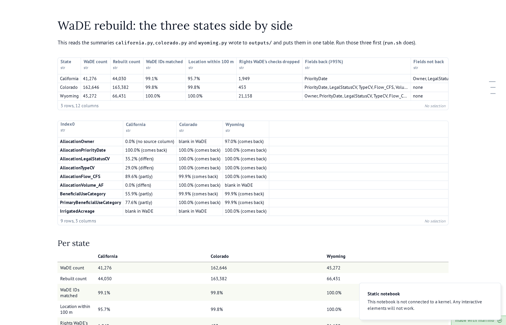

# Can WaDE's water rights be rebuilt from what it left behind?

The Western States Water Council took its Water Data Exchange (WaDE) offline in October 2026. WaDE put water rights from 18 western states into one schema. This spike rebuilds three states' water rights tables from WSWC's public mapping code, the Google Drive files WSWC left shared, and today's state sources. It then scores each rebuild against WaDE's last published table for that state.

**Short answer.** Most of it comes back, and how much depends on the state's source, not on WSWC's code. Where a state still publishes the same file (Colorado), WSWC's mapping runs unchanged and reproduces WaDE almost exactly, refreshed daily. Where the state changed systems (California), the rights come back but WSWC's code doesn't, and WaDE's status and type terms come back only through a lookup learned from WaDE's own last table. Where the source was a one-off email (Wyoming), WSWC's code reproduces WaDE exactly from the archived files, but nothing keeps it current: WaDE was serving a 2019 export.



## Results

From a clean run on 2026-11-16 (`outputs/summary.md` has the full tables):

| | California | Colorado | Wyoming |
|---|---|---|---|
| Source today | CalWATRS geospatial file, CC BY | DWR Net Amounts CSV | none public; WSWC's Drive copy |
| Mapping | new; WSWC's eWRIMS inputs are discontinued | WSWC's, unchanged | WSWC's, unchanged |
| WaDE's last count | 41,276 (published 2026-02-16) | 162,646 (2026-02-09) | 45,272 (2025-07-16) |
| Rebuilt count | 44,030 | 163,382 | 66,431 |
| WaDE right IDs matched | 99.1% (99.7% still in source) | 99.8% | 100.0% |
| Location within 100 m | 95.7% | 99.8% | 100.0% |
| Extra rights WSWC's own checks had dropped | 1,949 | 453 | 21,158 |
| Newest record | application filed 2026-09-26 | modified 2026-11-13 | priority 2019-02-15 |
| Source updated / how often | 2026-11-16, weekly | 2026-11-15, daily | export of 2019-03-02, never |
| Run time (download + rebuild) | 23 s | 63 s | 28 s |

**Fields that come back** (share of matched rights with the same value, where WaDE had one):

- **Colorado.** Priority date, legal status, type, flow, volume, beneficial use and primary use all agree at 99.9–100%. Owner was blank in WaDE too, because the CSV has none.
- **Wyoming.** Everything agrees at 99.9–100% except owner, at 97%. Acreage matches only if you take the largest parcel per right, as WaDE did, which understates multi-parcel rights.
- **California.** Priority date agrees at 100% (2,306 rights; CalWATRS adds dates for many more). Flow agrees at 90% and primary use at 78%. Status (35%) and type (29%) differ because CalWATRS renamed the eWRIMS terms. Owner can't be rebuilt: the open CalWATRS file has no owner column.

**Does the hand harmonization survive as code?** Mostly, yes. WSWC's per-state notebooks are code, and their one hand-maintained artifact, `PrimaryBenUseInput.xlsx` (523 native use names mapped to 21 WaDE categories), is in the repo. It covers 100% of Colorado's rights, 98.5% of Wyoming's and 99.1% of California's (4 CalWATRS use names are missing). What doesn't survive is a state changing its system. For California, a 35-row lookup restores 93% of WaDE's status values and a 41-row lookup restores 94% of its type values. Both lookups are learned from WaDE's last table, and the score is in-sample, so it is the best a lookup can do. 838 rebuilt California rights have a status combination WaDE never saw and need a person to map them.

**WaDE's counts were what passed its checks, not what the states published.** Of Wyoming's 21,159 rebuilt rights not in WaDE, 21,158 are in WSWC's own `waterallocations_missing.csv`. 19,682 of those were dropped for "Incomplete or bad entry for IrrigatedAcreage", so WaDE carried about two thirds of the Wyoming rights in its source files.

**Cost:** $0. Every source is free, and no model or paid service is used.

## How to run

Needs [uv](https://docs.astral.sh/uv/) and network access.

```bash
./run.sh
```

This runs `california.py`, `colorado.py`, `wyoming.py` and `summary.py` as scripts. It writes `outputs/{CA,CO,WY}_water_rights.parquet` (GeoParquet, one row per right, a point at the first point of diversion), `outputs/*_summary.json` and `outputs/summary.md`. Downloads go to `data/`, about 220 MB. Set `WADE_DATA_DIR` or `WADE_OUT_DIR` to move them.

**Refresh script.** Each live state's notebook is also its refresh script: `uv run california.py` (weekly CalWATRS) or `uv run colorado.py` (daily DWR) downloads the current file and rewrites that state's GeoParquet. Wyoming can't be refreshed.

To read a notebook with its outputs: `uv run marimo edit california.py`.

## What's here

- `california.py`, `colorado.py`, `wyoming.py`: one notebook per state. Each reads top to bottom: answer key, source, mapping (with WSWC's rules quoted where they apply), comparison, result.
- `summary.py`: the side-by-side table.
- `wade.py`: only what all three share: downloads, the WaDE answer key from Drive, the field comparison, WSWC's primary-use lookup, and the GeoParquet writer.
- `outputs/`: summaries and a screenshot from the clean run. The GeoParquet files are regenerated, not committed.

The code is about 1,480 lines. 240 of those are prose cells, and 37 are WSWC's Wyoming use-code dictionary, copied so the reader sees it.

## Where the data comes from

- **WSWC mapping repo**, [`MappingStatesDataToWaDE2.0`](https://github.com/WSWCWaterDataExchange/MappingStatesDataToWaDE2.0) (BSD 3-Clause), pinned to its last commit, 2025-12-15. The notebooks read each state's README to find its Drive folder and download `PrimaryBenUseInput.xlsx`.
- **WSWC Google Drive.** Still shared on 2026-11-16. Each state folder has `ProcessedInputData/` (what WaDE loaded, used as the answer key) and `RawInputData/`. It is downloaded with [gdown](https://github.com/wkentaro/gdown). The Drive files are newer than GitHub: California's processed files are dated February 2026.
- **California:** [CalWATRS Water Rights Geospatial Data](https://data.ca.gov/dataset/calwatrs-geospatial), CC BY, State Water Resources Control Board. The eWRIMS datasets WSWC used are marked DISCONTINUED on data.ca.gov, last updated 2026-10-01.
- **Colorado:** [DWR Water Right – Net Amounts](https://data.colorado.gov/Water/DWR-Water-Right-Net-Amounts/acsg-f33s), Colorado Division of Water Resources, Socrata.
- **Wyoming:** WWDO point-of-diversion and place-of-use files from WSWC's Drive. WSWC's README says they were emailed to WSWC and the links are gone. We found no statewide bulk download to replace them: the State Engineer's e-Permit tool downloads a map extent at a time, and the State Water Plan GIS layers date from 2001–2007.

**What we looked at first.** WaDE's public data summary page has a Tableau dashboard, but its CSV export gives the list of state datasets, not record counts. So the processed Drive files, which are what WaDE actually loaded, serve as "WaDE's last count". Colorado and Wyoming reuse WSWC's own logic, translated from row-by-row `apply` calls into column operations. California needed new code because none of WSWC's applies to CalWATRS.

## What didn't work, and what this doesn't show

- **WSWC's California notebook can't be kept current.** Its inputs are frozen eWRIMS files, and CalWATRS has a different shape (one row per feature-to-right link) and different names.
- **Owner** can't be rebuilt for California from open data. The learned California crosswalk leaves 6–7% of status and type values wrong, because CalWATRS doesn't carry the eWRIMS sub-fields WSWC split them on.
- **California volume** isn't comparable: WaDE filled it for one right. Our volume is CalWATRS face value.
- The comparison scores eight allocation fields and location. It doesn't rebuild WaDE's methods, variables, organizations or water-source tables (WSWC wrote those by hand per state), or its site-level POD-to-POU links.
- Three of 18 states. States that published ArcGIS services (Utah, Idaho, Nevada, Montana) are probably like Colorado, but we didn't test them.
- It doesn't check the states' data against reality, only the rebuild against WaDE.
