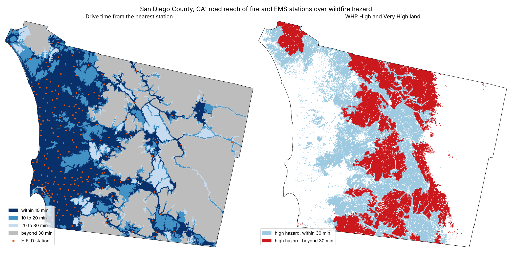

# Where fire stations can drive in 10, 20 and 30 minutes, in one wildfire-prone county

How much of a wildfire-prone county can a fire engine reach by road in 10, 20 and 30 minutes, and how many homes, people and high-hazard acres sit outside that reach? One marimo notebook picks the county by a stated rule, pulls its fire and EMS stations from HIFLD Next through the HIFLD Next MCP server, checks them against OpenStreetMap, drives out from every station with the open Valhalla router, and lays the reach bands over USFS Wildfire Hazard Potential and Census 2020 blocks. Issue [#211](https://github.com/fulton-ring/agent-content-demos/issues/211).

**Short answer.** San Diego County, tied with Broward County, FL for the highest Wildfire Risk to Communities rank for risk to homes and ahead of it on burn probability, has 221 fire and EMS stations in HIFLD Next. Within 10 minutes' drive of one of them live 98.2% of its homes and 98.1% of its people. Only 19.4% of its high-hazard land is that close. 48.4% of the high-hazard land is off every road a station reaches in 30 minutes, though most of that is within 2 km of such a road: 15.8% is more than 2 km away, and 2.4% is more than 5 km. Engines cover the homes; the high-hazard land beyond road reach has to be reached on foot, by dozer or from the air. This is the map the proposal says nobody publishes, and it took about ten minutes to build from public data.



## How to run

```bash
./run.sh
```

It needs [uv](https://docs.astral.sh/uv/), [osmium-tool](https://osmcode.org/osmium-tool/) (`apt install osmium-tool` or `brew install osmium-tool`) and about 5 GB of disk. The first run downloads about 2.3 GB into `data/` (most of it the California OpenStreetMap extract), builds routing tiles and draws an isochrone around each station. `REACH_DATA_DIR` and `REACH_OUT_DIR` move the data and output folders. To read the notebook with its outputs, run `uv run marimo edit reach.py`. No API keys or paid services.

## Where the data comes from

Everything is downloaded at run time; nothing from a source is committed.

| What | Source |
|---|---|
| County rule | USFS [Wildfire Risk to Communities](https://wildfirerisk.org/download/) county table (`wrc_download_20260415.xlsx`), `RISK_NATIONAL_RANK` (risk to homes) and `BP_NATIONAL_RANK` (burn probability) |
| Fire and EMS stations | HIFLD Next `fire-and-emergency-medical-service-ems-stations` v1.0.0 (USGS National Map structures, refreshed January 2025), queried with the [HIFLD Next MCP server](https://hifld.publicenvirodata.org/mcp)'s `query_parquet` and `get_query_page` tools |
| Second station list | OpenStreetMap `amenity=fire_station`, from the same extract we route on |
| Roads | OpenStreetMap California extract from [openstreetmap.fr](https://download.openstreetmap.fr/extracts/north-america/us-west/), 2026-11-15 in the run reported here |
| Hazard | USFS [Wildfire Hazard Potential 2023](https://doi.org/10.2737/RDS-2015-0047-4), 270 m classified raster; "high hazard" is class High or Very High |
| Homes and people | Census 2020 TIGER/Line blocks, `HOUSING20` and `POP20` |
| County outlines | Census 2020 cartographic boundaries, 1:500,000 |

## Results

All numbers come from `outputs/summary.json` and the CSVs beside it, written by the run.

**The county.** The rule walks counties by risk-to-homes rank, ties broken by burn-probability rank, and takes the first with at least 25 HIFLD stations. San Diego and Broward County, FL tie at a risk-to-homes rank of 1.000; San Diego's burn-probability rank is higher (0.999 against 0.998), and it has 221 stations. `outputs/county_choice.csv` has the top ten with their station counts.

**Stations: HIFLD Next against OpenStreetMap.** HIFLD has 221 stations in the county and OpenStreetMap 198 (after merging features mapped twice). 166 HIFLD stations have an OSM station within 300 m (median offset 14 m), and 168 within 1 km. Neither list is complete. For most of the 55 HIFLD stations without an OSM match, the nearest OSM station is a different station, so OSM is missing them; only a few are the same station plotted in another spot (Lake Morena Station 42 is 420 m off). The 34 OSM stations without a HIFLD match include federal (Navy) stations, hotshot crews, a training academy and airport crash crews. `outputs/station_differences.csv` lists both sides.

**Reach bands** (share of the county's total in each band; a block counts by its internal point, land by 270 m cell):

| Band | Homes (housing units) | People | High-hazard land | All land |
|---|---|---|---|---|
| Within 10 min | 98.2% | 98.1% | 19.4% | 32.4% |
| 10 to 20 min | 1.2% | 1.2% | 19.9% | 13.7% |
| 20 to 30 min | 0.2% | 0.4% | 12.3% | 7.7% |
| Beyond 30 min | 0.4% | 0.4% | 48.4% | 46.3% |
| Total | 1,228,505 | 3,298,634 | 5,433 km² | 11,027 km² |

Dropping the 64 stations within 25 km outside the county changes the high-hazard shares by less than half a point, so the result doesn't hinge on mutual aid across the county line.

**High-hazard land beyond 30 minutes, by distance to the nearest land within 30 minutes:**

| Distance from 30-minute reach | High-hazard land | Share of all high-hazard land |
|---|---|---|
| any | 2,627 km² | 48.4% |
| more than 0.5 km | 2,125 km² | 39.1% |
| more than 1 km | 1,516 km² | 27.9% |
| more than 2 km | 861 km² | 15.8% |
| more than 5 km | 133 km² | 2.4% |

Valhalla's isochrones are strips along the roads it reaches, often narrower than a 270 m cell. Counting any cell a 30-minute strip touches, instead of cells whose centre it covers, gives 43.2% of high-hazard land beyond 30 minutes instead of 48.4%. The distance table is the steadier way to read the result.

**Homes in high-hazard cells.** 57,063 housing units (4.6% of the county's) and 157,134 people are in blocks whose internal point falls in a High or Very High cell. Of those, 4,204 homes and 10,776 people are beyond 30 minutes. So 93% of homes in high hazard are within 30 minutes; the high-hazard land beyond reach is mostly land without homes.

**Run time.** A run from a clean checkout on 4 CPUs took 10.4 minutes (615 s in the notebook): 83 s counting stations for the ten candidate counties over MCP, 8 s pulling 285 stations over MCP, 67 s cutting the OSM extract and building tiles, 245 s for 285 isochrones (0.9 s each), and the rest downloading 2.3 GB. A rerun reuses the downloads and tiles and takes about 6 minutes. Every station got an isochrone.

## What we checked about XPRIZE

The proposal leans on the XPRIZE Wildfire results; we checked its facts against XPRIZE's own pages ([awardees](https://www.xprize.org/news/xprize-wildfire-awardees), [competition page](https://www.xprize.org/wildfire), [Alaska finals log](https://www.xprize.org/news/finals-testing-autonomous-wildfire-response)) on 2026-11-15.

- Confirmed: the purse is $11 million, made up of $7M in grand prizes, $3M in milestone awards and a $1M bonus prize. XPRIZE awarded $1.05M across five space-based detection teams (SIRIUS Wildfire Alliance first, $500,000) and $2.5M across the three autonomous response finalists: Anduril Industries $1.2M, Dryad Networks $800,000, AURA Foresight $500,000. Anduril also won the $1M Lockheed Martin detection bonus prize. That is $4.55M in all, and no grand prize is named.
- Confirmed: the Alaska test was near Nenana in June 2026. Teams had to detect and completely suppress a high-risk fire within 10 minutes of ignition across 1,000 km² (386 square miles). XPRIZE says AURA met "the critical 10-minute detection gate"; it doesn't say in so many words that every finalist detected the fire.
- Not found: the judge's quote about not getting "enough suppressant on it" is on none of these pages. Ars Technica blocked our fetch, so the quote is unverified; don't use it without the article in hand.

## What's in the folder

- `reach.py`: the marimo notebook. It reads top to bottom: question, county rule, stations from MCP, OpenStreetMap check, routing, overlay, result, maps, what didn't work.
- `run.sh`: runs the notebook as a script.
- `outputs/`: `summary.json`, the band tables, `county_choice.csv`, `stations.csv` (every station routed), `station_differences.csv` (stations on one list only), `reach_bands.geojson`, and the maps `reach_map.png` and `reach_map.html`.

## What we looked at first

- **Routing:** Valhalla through `pyvalhalla`, as `trauma-burn-center-access/` does: it bundles the tile builder and runs in-process, with no server or Docker. Its isochrone call returns all three contours for a station in about a second.
- **Hazard:** Wildfire Risk to Communities' 30 m rasters ([RDS-2020-0016-2](https://doi.org/10.2737/RDS-2020-0016-2)) come as one 11.1 GB zip for California, and the USFS image services that used to serve them have moved. WHP 2023 is the same program's hazard layer, national, in a 351 MB zip.
- **Second station list:** Overpass wasn't reachable from the build machine, so OSM stations come from the extract with `osmium tags-filter`, which is the same data.
- **The MCP server:** its `query_parquet` tool takes geometry literals through `ST_GeomFromHexWKB`, so the county outline goes into the SQL; the SQL is capped at 8 KiB and pages at 1,000 rows, so the outline is buffered and simplified first and results are paged with `get_query_page`.

## What it doesn't show

- Road reach is not response time. There is no turnout time, traffic, staffing, engine type, closest-unit dispatch, aircraft, hand crews, dozers or staging, and no travel off the road network. Valhalla's car speeds are free-flow, with no lights and sirens.
- HIFLD's fire and EMS stations are one layer; it doesn't say which stations run engines, ambulances or wildland units. CAL FIRE and US Forest Service stations are in it only where the USGS mapped them, and stations across the Mexican border aren't in it at all.
- Hazard is at 270 m and reflects fuels as of the end of 2020. Homes are 2020 Census housing units placed at each block's internal point.
- It is one county. San Diego has many stations and a dense road network in the west; a rural county would look different.
